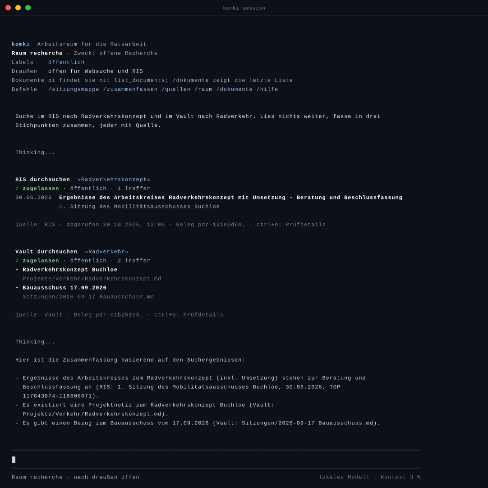

# Kommunalpolitik KI

KI-Werkzeuge für die ehrenamtliche Ratsarbeit: recherchieren mit Quellen, ohne Vertrauliches aus der Hand zu geben. Gebaut von Carsten Rösnick-Neugebauer, Stadtrat in Buchloe im Allgäu, für die eigene Ratsarbeit, offen unter MIT-Lizenz.

**Zum Lesen und Ausprobieren:** [croesnick.github.io/kommunalpolitik_ki](https://croesnick.github.io/kommunalpolitik_ki/). Den Einstieg ohne Technik bietet die Seite [Worum es geht](https://croesnick.github.io/kommunalpolitik_ki/komki/worum-es-geht/).

## Worum es geht

Ratsarbeit ist Ehrenamt. In Bayern werden Gemeinderatsmitglieder „in ehrenamtlicher Eigenschaft gewählt“ ([Art. 31 Abs. 2 Satz 1 GO](https://www.gesetze-bayern.de/Content/Document/BayGO-31)). Vor jeder Sitzung liegen Vorlagen, Anlagen und Haushaltszahlen auf dem Tisch, gelesen wird abends nach dem Beruf. Eine KI kann dabei viel abnehmen: zusammenfassen, im Ratsinformationssystem nachsehen, Förderprogramme finden.

Ein Teil der Unterlagen ist aber nichtöffentlich, und darüber gilt Verschwiegenheit, auch nach dem Mandat ([Art. 20 Abs. 2 GO](https://www.gesetze-bayern.de/Content/Document/BayGO-20); beide Normen abgerufen am 29.10.2026). Solche Unterlagen gehören nicht in einen KI-Dienst im Internet. Ein lokales Modell allein reicht dabei nicht: Sobald ein Agent private Daten kennt, fremde Inhalte liest und nach draußen senden kann (die [lethal trifecta](https://simonwillison.net/2025/Jun/16/the-lethal-trifecta/) nach Simon Willison), genügt ein präparierter Satz auf einer Webseite, und er trägt Vertrauliches hinaus.

Dieses Repo hat deshalb zwei Teile: **komki**, einen lokalen KI-Arbeitsraum, der genau diese Kombination verhindert, und einen **Werkzeugkasten** für die tägliche Ratsarbeit, der nach und nach in komki aufgeht.

## komki: der lokale KI-Arbeitsraum



*Echte Sitzung vom 25.10.2026 mit erfundenen Test-Notizen und dem echten Ratsinformationssystem.*

- **Das Sprachmodell läuft auf dem eigenen Mac.** Fragen und Notizen gehen an keinen KI-Anbieter.
- **Der Agent ist eingesperrt.** Er erreicht nur das Sprachmodell und einen Vermittler, kein Internet, keine Dateien, keine Befehle.
- **Der Vermittler entscheidet jeden Zugriff, bevor er passiert.** Jeder Inhalt trägt ein Label, das sagt, woher er stammt. Ein Raum legt fest, welche Labels zusammenkommen dürfen. Liegt Vertrauliches im Raum, bleibt der Weg nach draußen zu, auch wenn der Agent manipuliert ist.
- **Die KI berät, der Mensch entscheidet.** Eine gesperrte Anfrage geht nur mit deinem GO hinaus, und das gilt für genau diesen einen Aufruf.
- **Alles steht im Journal**, verkettet und gegen nachträgliche Änderung geprüft.

Angebunden sind heute das öffentliche Ratsinformationssystem, die Websuche (Brave), der eigene Obsidian-Vault und Dokumente, die man in eine Sitzung mitbringt.

**Stand:** Prototyp, im Alltag erprobt. komki braucht einen Mac mit Apple Silicon und rund 32 GB Arbeitsspeicher und wird aus dem Repo gebaut. Die Anleitung steht unter [In Betrieb nehmen](https://croesnick.github.io/kommunalpolitik_ki/komki/in-betrieb-nehmen/). Wie die Grenze hält, kann man [selbst ausprobieren](https://croesnick.github.io/kommunalpolitik_ki/komki/sicherheitsgrenze/). Die Sicherheitsprüfungen stehen im [Labbook](docs/research/2026-10-23-labbook-komki-connectoren.md), das Konzept in [RFC 0003](docs/rfcs/0003-vertrauliche-ki-arbeitsraeume.md).

```sh
# Werkzeuge wie in der Anleitung installiert, dann:
make komki && komki setup --demo
komki run "Was steht im RIS zum Radverkehrskonzept?"
```

## Der Werkzeugkasten für die Ratsarbeit

Vor komki entstanden die Werkzeuge für den Alltag. Orchestriert werden sie von [OpenCode](https://opencode.ai): Die KI ruft CLI-Tools und MCP-Server auf und folgt den Abläufen aus `skills/`. Im Chat genügt die Aufgabe, etwa „Bereite die nächste Sitzung vor“. Dieser Weg ist ein Übergang. Die Werkzeuge ziehen nach und nach als Connectoren hinter den komki-Vermittler, denn nur dort gelten dessen Zusagen.

- **Sitzung vorbereiten** (`sitzungsvorbereitung`): Agenda aus dem RIS, Vorlagen-PDFs, passende Artikel der Allgäuer Zeitung und eigene Notizen werden zur Sitzungsmappe im Vault.
- **Rückblick halten** (`bericht_aus_dem_stadtrat`): Sitzungen und Notizen seit dem letzten Bericht als Notiz für Fraktion, Vorstand oder Stammtisch.
- **Fördermöglichkeiten prüfen** (`foerdermittel_recherche`): Programme für ein konkretes Vorhaben mit Eigenanteilen, Fristen und Kumulierungsregeln, Schwerpunkt Bayern, jede Angabe mit Quelle.
- **Projekte strukturieren** (`ratsprojekt_proposal`, `ratsprojekt_stand`, `ratsprojekt_delta`): Material zu einem Ratsprojekt bündeln, Stand bestimmen, neue Informationen einordnen. Die KI schlägt vor, der Stadtrat nimmt an oder verwirft.
- **Antrag entwerfen** (`antrag_generieren`): fraktionsneutraler Entwurf, die eigene Vorlage kommt über den Vault-Tag `#antragsvorlage`. Finalisiert wird von Hand.
- **Im Vault suchen** (`vault_suche`): die eigenen Notizen durchsuchen, nur lesend.

Das Ratsinformationssystem der Verwaltungsgemeinschaft hat keine maschinenlesbare Schnittstelle wie OParl. `ratsinfo` synchronisiert deshalb die öffentlichen Seiten in eine lokale SQLite-Datenbank und macht Sitzungen, Drucksachen und Beschlüsse durchsuchbar.

## Grundsätze

- **Quellen statt Behauptungen.** Jede politisch relevante Aussage nennt ihre Herkunft: URL, Abrufdatum, Sitzung und TOP oder Paragraf.
- **Die KI berät, der Mensch entscheidet.** Kein Werkzeug ändert Projekte oder trifft Entscheidungen ohne ausdrückliches GO.
- **Lokal und nur lesend nach außen.** Daten liegen auf dem eigenen Rechner. Ins RIS wird nie geschrieben, abgerufen wird nur, was als Ratsmitglied oder öffentlich regulär zugänglich ist.
- **Ehrlich dokumentiert.** Was fehlt, steht unter [Grenzen](#grenzen) und in den Issues.

Vollständig stehen Prinzipien, Guardrails und Tooling-Vorgaben in [AGENTS.md](AGENTS.md).

## Bausteine

| Baustein | Zweck | Schnittstelle |
|---|---|---|
| `apps/komki_cli` | komki: richtet den Arbeitsraum ein, startet Modell, Vermittler und Connectoren in eigenen Sandboxen | CLI |
| `apps/komki_mediator` | Vermittler: entscheidet jeden Werkzeugaufruf des Agenten und führt das Journal | MCP |
| `apps/komki_policy` | Regel-Prüfkern: rechnet aus, ob eine Absicht zulässig ist, und prüft die Begründung nach | CLI |
| `apps/komki_egress` | einzige Tür ins Internet, je Connector nur zu freigegebenen Adressen | CLI |
| `apps/komki_connector*` | Connectoren für RIS, Websuche, Vault und Sitzungsdokumente, plus gemeinsamer Vertrag | Connector-Socket |
| `apps/ratsinfo` | RIS synchronisieren und volltextdurchsuchbar machen | CLI |
| `apps/ratsprojekte` | Projekt-Dashboard: Realisierungsstränge, Vorbedingungen, Quellen, Antragsreife | LiveView und MCP |
| `apps/shared` | gemeinsame Domain-Models der Elixir-Apps | Bibliothek |
| `tools/allgaeuer_zeitung_mcp` | Allgäuer Zeitung durchsuchen und Artikel lesen | MCP |
| `tools/pdf_ingest` | PDF-Text und Markierungen extrahieren, OCR für gescannte PDFs | MCP |
| `tools/nextcloud_ods_mcp` | ODS-Tabellen lesen | MCP |
| `tools/obsidian_mcp`, `tools/ratsinfo_mcp` | Vault und RIS als MCP-Server | MCP |
| `skills/` | Abläufe für den AI-Harness, siehe oben | Agent Skill |
| `docs/site/` | Doku-Site zu komki (GitHub Pages) | Website |

Die vollständige Übersicht mit Status steht in [AGENTS.md](AGENTS.md#tool-übersicht).

## Werkzeugkasten einrichten

Für komki genügt die [Anleitung auf der Doku-Site](https://croesnick.github.io/kommunalpolitik_ki/komki/in-betrieb-nehmen/). Für den Werkzeugkasten werden Elixir, `uv` für die Python-Werkzeuge und SQLite vorausgesetzt, für die Vault-Workflows der `obsidian` CLI mit laufender Obsidian-App. Alle externen Abhängigkeiten mit Installationswegen und Fallbacks stehen in [docs/prerequisites.md](docs/prerequisites.md).

```bash
# einmalig pro Clone: Secret-Scan vor jedem Commit
brew install gitleaks pre-commit
pre-commit install

# Elixir-Workspace und ratsprojekte
mix deps.get
cd apps/ratsprojekte
mix ecto.migrate
mix phx.server   # Dashboard unter http://localhost:4000, MCP-Endpoint /mcp

# ratsinfo systemweit (braucht ggf. sudo, Alternativen siehe Makefile)
make install

# Python-Werkzeuge
make deps
```

Das Repo liefert keine Beispielprojekte für ratsprojekte. Wer lokal einen Seed-Datensatz hat, spielt ihn mit `mix run priv/repo/seeds.exs` ein.

Zugangsdaten für die Allgäuer Zeitung und Nextcloud liegen in den Umgebungsvariablen `AZ_EMAIL` und `AZ_PASSWORD` beziehungsweise `NEXTCLOUD_HOST`, `NEXTCLOUD_USERNAME` und `NEXTCLOUD_PASSWORD`. `opencode.json` gibt die Server-Verkabelung vor. Für AZ-Artikel ist einmalig `uv run playwright install chromium` nötig, für gescannte PDFs OCRmyPDF mit deutschem Tesseract (`brew install ocrmypdf`).

Ohne laufenden `obsidian` CLI legen die Vault-Skills ihre Notizen unter `artifacts/vault-staging/` ab. Das Kopieren in den Vault ist dann Handarbeit.

## Grenzen

**komki**

- Nur macOS mit Apple Silicon. komki wird aus dem Checkout gebaut (`make komki`, wer Homebrew nutzt auch als lokales Paket mit `make komki-tap`). Einen veröffentlichten Release oder Tap gibt es noch nicht ([docs/release.md](docs/release.md)).
- Das RIS liefert ohne Zugangsdaten nur Titel, keine Texte der Tagesordnungspunkte ([#148](https://github.com/croesnick/kommunalpolitik_ki/issues/148)).
- Schreiben in den Vault geht nur in den Ordner `komki-test/`, eine Bestätigung vor jedem Schreiben fehlt noch ([#205](https://github.com/croesnick/kommunalpolitik_ki/issues/205)).
- Schutz vor einem manipulierten Agenten, nicht vor Schadsoftware, die schon auf dem Rechner läuft. Ein unabhängiges Audit gibt es nicht.

**Werkzeugkasten**

- Der OpenCode-Weg hat die Sicherheitsgrenze von komki nicht. Nichtöffentliche Unterlagen gehören dort nicht hinein.
- Beschlussnachverfolgung fehlt: ratsprojekte verknüpft Projekte noch nicht mit RIS-Sitzungen und trackt keine Fristen ([#32](https://github.com/croesnick/kommunalpolitik_ki/issues/32), [#33](https://github.com/croesnick/kommunalpolitik_ki/issues/33), [#34](https://github.com/croesnick/kommunalpolitik_ki/issues/34)).
- Der Projektlebenszyklus ist teils Spezifikation. Im Code erzwungen ist die Proposal-Entscheidung, die übrigen Übergänge sichern bislang die Skills ([docs/ratsprojekte-lifecycle.md](docs/ratsprojekte-lifecycle.md)). Value Proposition und Success Metrics sind noch keine harten Gates ([#37](https://github.com/croesnick/kommunalpolitik_ki/issues/37)).
- `ratsinfo_mcp` liegt im Repo, `opencode.json` bindet es nicht ein (Ratsinfo läuft über die CLI). Vault-Zugriff: Lesen über den `obsidian` CLI, Schreiben über `obsidian_mcp`, das `opencode.json` einbindet (Vault-Pfad aus `OBSIDIAN_VAULT_PATH`).
- Für Öffentlichkeitsarbeit (Presse, Newsletter) gibt es noch kein Werkzeug.

## Doku und Verweise

- [Doku-Site zu komki](https://croesnick.github.io/kommunalpolitik_ki/): Einstieg, Funktionsweise, Inbetriebnahme, Sicherheitsgrenze.
- [AGENTS.md](AGENTS.md): Prinzipien, Architektur, Guardrails, Tooling-Vorgaben.
- [docs/rfcs/](docs/rfcs/): Konzepte, allen voran [RFC 0003, vertrauliche KI-Arbeitsräume](docs/rfcs/0003-vertrauliche-ki-arbeitsraeume.md).
- [docs/workflows.md](docs/workflows.md): die elf Rats-Workflows, ihre Werkzeuge und Lücken.
- [GLOSSARY.md](GLOSSARY.md): die Fachbegriffe des Repos.
- [docs/prerequisites.md](docs/prerequisites.md): externe Abhängigkeiten mit Installation und Fallbacks.
- [Issues](https://github.com/croesnick/kommunalpolitik_ki/issues): offene Aufgaben, Ideen und Fragen.

## Lizenz

MIT, siehe [LICENSE](LICENSE).
