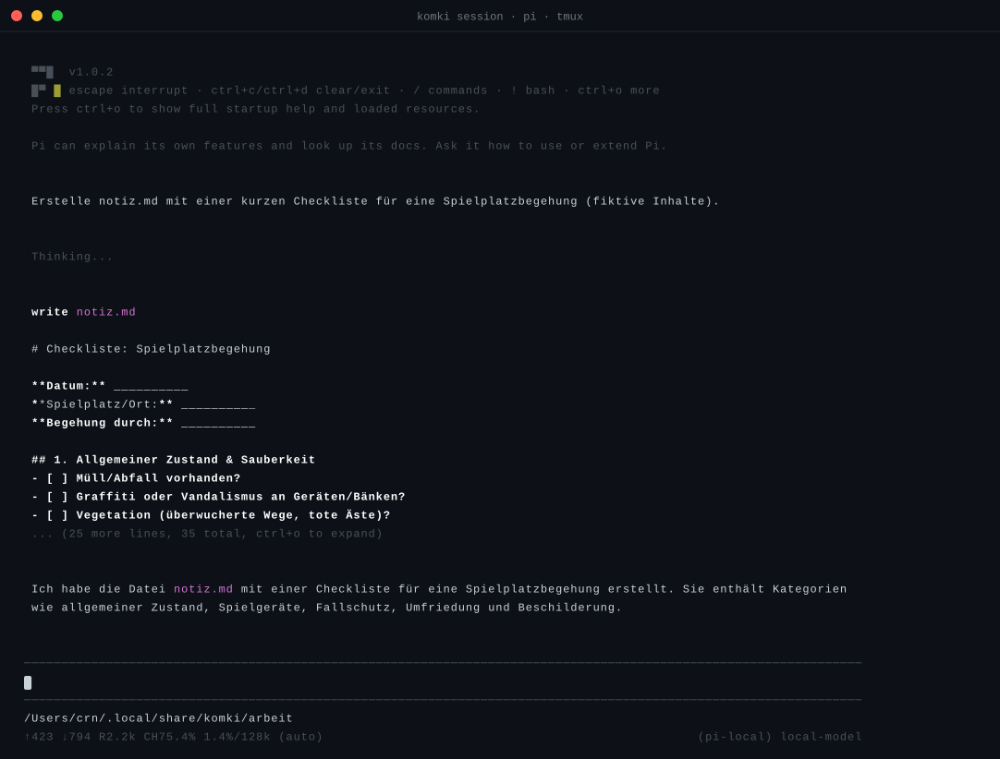

# KomKI-CLI — abgeschlossener Arbeitsraum für lokale KI-Sessions

Die KomKI-CLI (`komki`) richtet einen abgeschlossenen Arbeitsraum für
KI-Arbeit auf dem eigenen Rechner ein. Ein Sprachmodell (llama-server) und
ein Agenten-Frontend (pi) laufen vollständig lokal, eingebettet in eine
macOS-Sandbox, die erst einmal alles verweigert: Schreibzugriffe nur
innerhalb des Arbeitsraums, Netzwerk nur eine einzige Verbindung zum lokalen
Modellserver. Damit eignet sich der Raum für vertrauliche Ausarbeitungen,
denn nichts verlässt das Gerät, und vor jedem Lauf prüft ein Boot-Gate, dass
die Sandbox noch dicht ist.

Entstanden ist das Tool aus der zugehörigen Recherche (GitHub-Tickets #70
und #74). Die Sandbox-Belege der Grenz-Gates stehen im Probebericht des
#70-Beschlusses (Issue-Kommentar) und im Research-Report
`docs/research/2026-10-05-seatbelt-survey.md`.

## Die gepinnte Kombination

komki lädt nichts dynamisch nach, sondern startet immer dieselben
Komponenten mit denselben Pins:

* **Modell:** Gemma 4 26B-A4B-it (unsloth UD-Q4_K_XL-GGUF), per SHA-256
  verifiziert. Das 26B-MoE (3.8B aktiv) ist für produktive deutsche Arbeit
  gewählt: starke Deutsch-Community-Reports, sauberes Tool-Calling seit den
  Template- und Parser-Fixes von April 2026. Kontext-Standard: 128K
  (Nutzer-Präferenz große Kontexte bei 64 GB RAM).
* **Server:** `llama-server` auf Loopback, Port 49524, mit festen Flags
  (`--jinja`, `--offline`, ohne Web-UI, ohne Slots; Sampling nach der
  offiziellen Gemma-4-Empfehlung: temp 1.0, top-p 0.95, top-k 64).
* **Agent:** pi unter Node 24. Der Start umgeht den asdf-Versionsmanager:
  Dessen Shim bricht unter der Sandbox still ab, deshalb ruft komki die
  aufgelösten Pfade direkt auf (`node <pfad> <cli.js>`).
* **Sandbox:** Jedes pi startet unter einem frisch generierten
  Seatbelt-Profil (deny-default mit Whitelist). Schreibbereich ist der
  Arbeitsraum selbst. Netzwerk erlaubt das Profil nur zu zwei Zielen: zum
  lokalen Modellserver und zum Unix-Socket des Vermittlers.

Die Assets (GGUF, pi-Bundle, llama-server) liegen bereits lokal; komki
verbindet sich ausschließlich lokal (Loopback und Unix-Socket).

## Voraussetzungen und Installation

komki läuft nur unter macOS (Seatbelt-Sandbox). Drei Werkzeuge müssen
vorhanden sein, `init` entdeckt sie selbst und pinnt die aufgelösten Pfade
in die `config.json` der Instanz: ein node-Interpreter (asdf, Homebrew oder
nvm — bei asdf wird der echte Installationspfad hinter dem Shim benutzt,
weil der Shim unter der Sandbox still scheitert), das pi-Bundle als globales
npm-Paket (`npm install -g @earendil-works/pi-coding-agent`) und
`llama-server` (llama.cpp, etwa via `brew install llama.cpp`). Fehlt eins,
verweigert `init` mit klarer Meldung.

Optional: `fd` und `ripgrep` (etwa via `brew install fd ripgrep`). `init`
kopiert beide in den Bin-Fundus von pi (`pi-home/.pi/agent/bin`) — pi
findet sie offline, ohne Download-Warnung, und die Session bekommt die
Tools `find`/`grep` für die Dateisuche. Fehlen sie, verzichtet pi auf
Dateisuche und warnt beim Start.

Details und Fallbacks: [`docs/prerequisites.md`](../../docs/prerequisites.md).

```sh
mix escript.build   # erzeugt ./komki (Dev-Weg; braucht Elixir/OTP auf dem Host)
```

## Veröffentlichen über Homebrew

Nutzende installieren komki mit `brew install croesnick/komki/komki`. Die
Formel installiert das Escript mit allen Rollen, daneben die SQLite-NIF und
pi in fester Version, und zieht `erlang`, `llama.cpp`, `node` und `tmux`
als Abhängigkeiten nach. Erlang und Elixir des Repos (`.tool-versions`)
folgen deshalb Homebrews aktueller `erlang`-Version.

Ein Release in drei Schritten:

1. Version in `apps/komki_cli/mix.exs` erhöhen und mergen.
2. Tag setzen: `git tag komki-v<version> && git push origin komki-v<version>`.
   Der Workflow `komki-release` baut auf Apple Silicon das Paket
   (`make komki-paket`) und die Formel (`make komki-formel`) und hängt
   beides an das GitHub-Release.
3. `komki.rb` aus dem Release als `Formula/komki.rb` ins Tap-Repo
   `croesnick/homebrew-komki` legen.

Lokal lässt sich beides mit `make komki-formel` bauen (Ergebnis unter
`dist/`).

## Verteilen: eine Datei statt Ordner (Burrito)

Für Rechner ohne installiertes Elixir baut Burrito das Release in eine einzige
ausführbare Datei mit eingebettetem Erlang-Runtime (macOS arm64):

```sh
PATH="$HOME/.local/opt/zig-aarch64-macos-0.16.0:$PATH" \
  MIX_ENV=prod BURRITO_TARGET=macos_silicon mix release
# → burrito_out/komki_macos_silicon (eine Datei, ~10 MB)
```

Beim ersten Start entpackt die Datei ihr Payload nach
`~/Library/Application Support/.burrito/` und läuft danach ohne jede
Elixir-Installation. Eingebaute Wartungsbefehle:
`komki maintenance directory` (Entpackpfad), `maintenance meta`,
`maintenance uninstall` (Payload löschen, mit y/n-Rückfrage).

Bau-Voraussetzungen und Details: [`docs/prerequisites.md`](../../docs/prerequisites.md);
Pilot-Bericht mit allen Messungen:
[`docs/research/2026-10-11-komki-burrito-pilot.md`](../../docs/research/2026-10-11-komki-burrito-pilot.md).

Zwei Hinweise für die verteilte Datei:

- **Gatekeeper:** Die lokal gebaute Datei ist ad-hoc signiert und läuft ohne
  Nachfrage. Wer sie aus einem GitHub-Release herunterlädt, bekommt beim
  ersten Start den Gatekeeper-Dialog („Entwickler nicht verifiziert“) —
  einmalig `xattr -d com.apple.quarantine komki_macos_silicon` ausführen
  oder unter Systemeinstellungen › Datenschutz & Sicherheit freigeben.
- **Bestehende Instanzen:** Das Seatbelt-Profil hat zwei Regeln für den
  Session-Betrieb unter der Binary dazubekommen. Nach diesem Update einmalig
  `komki init --force` ausführen — der Doctor meldet Profil-Drift, bis das
  Profil neu geschrieben ist.

## Schnellstart: Arbeitsraum mit RIS, Websuche und Vault

Von null bis zur ersten Recherche, im Repo-Root:

```sh
make komki                     # baut komki (ein Programm, alle Rollen) und legt es nach ~/.local/bin
komki setup                    # lädt beim ersten Mal das Modell (17 GB), fragt vorher
komki run "Suche im RIS nach Bahnhofstraße und fasse die Treffer zusammen."
komki session                  # interaktiv in tmux
komki journal verify           # Hash-Kette des Journals prüfen
komki down                     # alles stoppen
```

`komki setup` prüft die Werkzeuge und nennt für jedes fehlende den
Installationsbefehl. Vermittler, Egress-Proxy und Connectoren sind Rollen
desselben Programms (`komki komki-mediator …`); jede läuft trotzdem als
eigener Prozess unter ihrem eigenen Sandbox-Profil. Auf einer bestehenden
Instanz frischt `setup` nach einem Update die Programmpfade und Profile auf
und lässt alle Einstellungen stehen. Es fragt nach dem Vault (Enter wählt den erfundenen
Test-Vault, `--demo` ohne Frage), legt die Instanz an, fragt den
Brave-Key verdeckt ab, falls er im Schlüsselbund fehlt, startet alles und
prüft mit dem Doctor. Ein zweiter Lauf ändert an einer bestehenden Instanz
nichts. Fehlt das Modell, nennt `setup` Größe, Quelle (feste Revision auf
Hugging Face) und Lizenz und lädt es nach Rückfrage an den Staging-Ort
(`~/.local/share/komki/models-staging/`). Ein abgebrochener Download setzt
beim nächsten Aufruf fort; verwendet wird die Datei nur mit passender
Prüfsumme. Liegt das Modell schon woanders, `--gguf-from PFAD`. Die Instanz
bekommt das Modell als APFS-Klon: kein zusätzlicher Platz, Millisekunden
statt einer 17-GB-Kopie. `run` und `session` starten fehlende Prozesse
selbst, `komki up` ist nur noch nötig, wenn man ausdrücklich vorab starten
will.

Instanz von vor den Connectoren: Der Vermittler ersetzt `registry.json`
und `room.json` beim nächsten Start selbst, wenn sie unveränderte alte
Vorlagen sind (Prüfung per SHA-256; das Journal bleibt unverändert). Hast du
eine der beiden Dateien verändert, ersetzt er nichts und erklärt beim Start,
was zu tun ist.

Hinweise zu den einzelnen Schritten:

* **Schlüssel:** `komki secret set brave` legt den Brave-Key verdeckt ab
  (nie in argv, nie im Log); `komki secret list` zeigt, ob er da ist. Beim
  ersten Start fragt macOS, ob
  `security` auf den Eintrag `brave-search-api` zugreifen darf. Wähle
  „Immer erlauben“, sonst startet der Web-Connector ohne Key und jede
  Websuche meldet `credential-missing`. „Immer erlauben“ heißt: jeder Prozess
  unter deinem Nutzer kann den Key per `security` lesen.
* **Vault:** Der Vault-Connector zeigt nur Notizen mit
  Frontmatter-Feld `komki_labels` (z. B. `komki_labels: [vault-oeffentlich@1]`);
  alles andere bleibt unsichtbar. Geschrieben wird nur nach
  `<vault>/komki-test/`. Für einen echten Vault: Notizen zuerst labeln, dann
  `init --force --vault-dir PFAD`. Leerer `--vault-dir` schaltet den
  Vault-Connector ab.
* **RIS:** Ohne Zugangsdaten nutzt der Connector die öffentlichen
  Gast-Endpunkte; die liefern nur Titel, keine Texte (#148). Zum Üben ohne
  Netz gibt es einen Mock:
  `elixir apps/komki_connector_ris/priv/mock_ris.exs --port 49640` und
  `komki init --force --ris-mock-port 49640`.
* **Raum wechseln:** Welche Daten in einer Session zusammenkommen dürfen,
  steht in `~/.local/share/komki/mediator/room.json`, Feld `workspace_bindings`. Default ist
  **recherche** (`ris-oeffentlich@1`, `vault-oeffentlich@1`,
  `web-oeffentlich@1`): Websuche und RIS erlaubt, vertrauliche Notizen
  gesperrt. Für **vertraulich** `vault-vertraulich@1` ergänzen: Dann sind
  vertrauliche Notizen lesbar und jede Web- und RIS-Suche gesperrt. Nach der
  Änderung `komki down && komki up`.
* **Nachvollziehen:** Jede Entscheidung steht im Journal
  `~/.local/share/komki/mediator/journal/pdr.jsonl`; `komki journal verify`
  prüft die Hash-Kette. Logs liegen unter `~/.local/share/komki/tmp/`.
* **Wenn etwas hakt:** `komki doctor` nennt den fehlenden Teil (Escript,
  Profil, Credential, Connector-Ping). Ein ausgefallener Connector kommt mit
  erneutem `komki up` zurück, die laufenden Prozesse bleiben dabei stehen.

## Befehle

```sh
./komki version
./komki setup                       # gefuehrte Einrichtung (Werkzeuge, Vault, Instanz, Schluessel, Start)
./komki secret set brave            # Brave-Key verdeckt in den Schluesselbund
./komki secret list                 # erwartete Schluessel und ob sie da sind
./komki journal verify              # Hash-Kette des Journals pruefen
./komki init                        # Instanz anlegen (config, Profil, pi-home, GGUF mit SHA-Gate)
./komki init --gguf-from PFAD       # GGUF-Quelle explizit angeben
./komki doctor                      # alle Checks (Werkzeuge, Profil, GGUF-SHA, Boot-Gate, Port)
./komki up                          # llama-server, Egress, Connectoren, Vermittler starten
./komki run "PROMPT"                # einmaliger pi-Lauf unter dem Profil (startet bei Bedarf alles)
./komki session                     # interaktive pi-Session in tmux
./komki session --continue          # letzte Session fortsetzen
./komki session --detach            # im Hintergrund; attach via 'tmux -L komki attach -t komki'
./komki down                        # alles stoppen (Vermittler, Connectoren, Egress, llama)
./komki status                      # Zustand (base, gguf, port, Socket, llama, Egress, Connectoren, Vermittler)
./komki label …                     # SQLite-Registry: Bindungen, Labels, Γ-Export (siehe unten)
```

Weitere Flags: `init --port N --ctx N --force` sowie für die Connectoren
`init --vault-dir PFAD --ris-base-url URL --ris-mock-port N`, `up --ctx N`,
`run --mode text|json --scratch PFAD --timeout SEKUNDEN` (PFAD nur unterhalb von `runs/` der Instanz; der Scratch ist auch das Arbeitsverzeichnis des Laufs; Laufzeit-Limit per Default 600 s, danach Exit 4). pi startet in Lauf und Session mit `--no-context-files`, damit eine vom Modell abgelegte `AGENTS.md` keinen späteren Lauf steuert, und sieht neben seinen Datei-Werkzeugen die Vermittler-Tools (`mcp__komki__*`). Exit-Codes: `0` Erfolg, `2` Nutzungs-,
Konfigurations- oder Bereitschaftsfehler (etwa: fremder Prozess auf dem llama-Port),
`3` Doctor-/Boot-Gate-Fehlschlag, `4` Laufzeitfehler.

Interaktive Sessions laufen in der tmux-Session `komki` auf einem eigenen
tmux-Server (`tmux -L komki`, ohne persönliche tmux-Config), jeweils eine
gleichzeitig. Der eigene Server sperrt den Terminal-Ausgang: pi kann weder per
OSC 52 die Zwischenablage setzen noch Sequenzen am tmux vorbeischleusen; der
Copy-Modus schreibt weiterhin in die Zwischenablage. Aus einer laufenden
tmux-Session heraus startet er verschachtelt (Prefix dann zweimal, etwa
`Ctrl+B Ctrl+B d` zum Abkoppeln). `komki run` filtert Steuersequenzen aus pis
Ausgabe, bevor sie im Terminal erscheint. Dateien aus der Session landen im Verzeichnis `arbeit`
innerhalb der Instanz, die Session-Verläufe unter `pi-home/sessions` und
lassen sich mit `session --continue` fortsetzen. pi startet mit einem
knappen deutschen System-Prompt (Deutsch als Default, durchgehende
Du-Form), Thinking-Blöcke sind eingeklappt; liegen `fd`/`ripgrep` vor,
stehen `find`/`grep` für die Dateisuche bereit. Aus der Session kopieren:
`Ctrl+B` und
dann `[` öffnet den tmux-Copy-Modus (Pfeiltasten bewegen, `Space` startet
die Auswahl, `Enter` übernimmt).

llama-server verlangt einen API-Key: `komki up` erzeugt bei jedem llama-Start
einen neuen Zufallsschlüssel in `tmp/llama.key` (nur für dich lesbar) und trägt
ihn in pis `models.json` ein. Ohne den Schlüssel antwortet llama mit 401, damit
keine Website im Browser das lokale Modell nutzen kann. `komki doctor` meldet
einen llama, der ohne Schlüssel läuft.

### Kanal zum Vermittler (Ticket #143)

pi erreicht den Vermittler (`komki-mediator`) nur über einen Unix-Socket,
nicht über einen TCP-Port:

```
<base>/run/                 Rechte 0700, angelegt von komki up
<base>/run/mediator.sock    der einzige Listener des Vermittlers, Rechte 0600
<base>/run/mediator.token   32 Byte Zufall als Hex, Rechte 0600
```

* `komki up` schreibt bei jedem Vermittler-Start ein neues Token und startet
  den Vermittler mit `--socket` und `--token-file`. Das Token steht nie in
  einer Kommandozeile. Läuft der Vermittler schon und antwortet mit dem
  aktuellen Token, bleibt beides unverändert.
* Jede Anfrage braucht `Authorization: Bearer <token>`, auch `/healthz`.
  Ohne oder mit falschem Token antwortet der Vermittler mit 401 und schreibt
  eine Logzeile (ohne Token-Wert) nach `tmp/mediator.log`. Das hält andere
  lokale Programme fern, etwa eine zweite, nicht gesandboxte Agent-Session.
* pis MCP-Client kann keinen Unix-Socket. Deshalb startet pi
  `komki-relay.js` als stdio-MCP-Server (Node, nur Standardbibliothek). Das
  Relay schickt jede JSON-RPC-Zeile als `POST /mcp` über den Socket und gibt
  die Antworten (JSON oder SSE) zeilenweise zurück. komki schreibt es vor
  jedem pi-Start neu nach `pi-home/.pi/agent/komki-relay.js`; eine vom Agenten
  veränderte Fassung überlebt damit keinen Lauf.
* `komki run` und `komki session` lesen das Token und erzeugen je pi-Start
  eine Session-ID (`ses-` plus 16 Hex-Zeichen). Beides geht über die Umgebung
  an pi (`KOMKI_MEDIATOR_TOKEN`, `KOMKI_SESSION_ID`). Die `mcp.json` enthält
  nur Verweise (`${KOMKI_MEDIATOR_TOKEN}`), kein Token. Der Vermittler
  schreibt die Session-ID als `session_id` in jeden PDR.
* Instanzen von vor #143 brauchen einmalig `komki init --force`: das
  pi-Profil ändert sich (Socket-Regel statt Vermittler-Port), und
  `--mediator-port` gibt es nicht mehr. macOS begrenzt Socket-Pfade auf
  103 Byte; `komki up` lehnt eine zu tiefe Basis ab.

### Egress, Connectoren und Vermittler-Profil (Tickets #146, #137)

Werkzeuge mit Außenwirkung (RIS, Websuche, Vault) laufen als eigene
Prozesse, jeder unter einem eigenen, generierten Seatbelt-Profil
(Vertrag: [`apps/komki_connector/CONTRACT.md`](../komki_connector/CONTRACT.md)).
Seatbelt filtert ausgehenden Verkehr nicht nach Host, und gesandboxte
Prozesse können keine weiteren Sandboxen starten. Deshalb startet `komki up`
selbst alle Prozesse, und nur der Egress-Proxy darf nach außen:

```
                 komki up (nicht gesandboxt) startet alles, Reihenfolge 1..5
 1 llama-server ─ llama-server.sb (kein Outbound)
 2 komki-egress ─ egress.sb: einziger Prozess mit Outbound *:443 (+ DNS),
       ▲          Host-Allowlist je Port im Proxy; Ports 49531 (ris), 49532 (web)
       │ CONNECT über localhost:<eigener Port>
 3 komki-connector-ris / -web / -vault ─ connector-<id>.sb:
       │          nur eigener Socket, eigener Loopback-Port, fs nach Manifest
       │ Unix-Socket <base>/run/connectors/<id>.sock (Frame-Protokoll)
 4 komki-mediator ─ mediator.sb: Raum lesen, Journal/Log schreiben,
       ▲          <base>/run/mediator.sock binden, Outbound nur Connector-Sockets
       │ Unix-Socket + Bearer-Token (#143)
 5 pi ─ komki.sb (über komki run/session)
```

* **Profile** entstehen aus `KomkiConnector.Manifest` und der `config.json`
  (`profile/connector-<id>.sb`, `egress.sb`, `mediator.sb`); `init` und jeder
  Start schreiben sie neu, `komki doctor` prüft sie byte-stabil. Gemeinsame
  Grundschicht aller Escripts: Erlang-Runtime lesen und ausführen, Escript
  lesen, Boot-Sonden. Kein Home, kein `~/.ssh`. Ermittelt per Denial-Log:
  [`docs/research/2026-10-23-connector-profile.md`](../../docs/research/2026-10-23-connector-profile.md).
* **Start:** `env -i HOME=<base>/run PATH=/usr/bin:/bin LANG=C sandbox-exec -f
  <profil> <escript> <binary> …`. Die leere Umgebung hält Variablen aus deiner
  Shell (etwa Tokens) von den Prozessen fern. `escript` ist der aufgelöste
  Erlang-Pfad (`escript_bin`), weil der asdf-Shim unter der Sandbox scheitert.
  Die Escripts findet komki wie den Vermittler: erst `PATH`, dann `<base>/bin`.
* **Credentials** (heute nur `BRAVE_API_KEY` für die Websuche) liest komki mit
  `security find-generic-password -s brave-search-api -w` und schreibt sie als
  eine JSON-Zeile in stdin des Web-Connectors, danach schließt es stdin. Sie
  stehen nie in argv, Umgebung, Log oder Status. Fehlt der Eintrag, startet der
  Connector trotzdem und meldet `credential-missing`; `komki doctor` warnt
  (geprüft wird nur die Existenz, ohne den Wert zu lesen).
* **Konfiguration** (`config.json`, Defaults): `egress_ports`
  (`{"ris": 49531, "web": 49532}`), `ris_base_url`
  (`https://risapi1.komuna.net/web/`), `ris_mock_port` (aus; gesetzt spricht der
  RIS-Connector direkt mit `http://127.0.0.1:<port>/`, ohne Proxy), `vault_dir`
  (`<base>/vault`, anfangs leer, Test-Vault siehe Schnellstart; leer gesetzt: Vault-Connector aus).
* **Bereit** ist ein Connector, wenn die reservierte Operation `ping` die
  Fassung des Manifests liefert; der Egress, wenn er „listening“ meldet.
  `komki doctor` pingt jeden laufenden Connector.
* Logs und pidfiles: `tmp/egress.log`, `tmp/connector-<id>.log`,
  `tmp/komki-egress.pid`, `tmp/connector-<id>.pid`. `<base>/run` und
  `<base>/run/connectors` haben die Rechte `0700`.
* Bestehende Instanzen: einmalig `komki init --force`, damit `escript_bin`,
  die Escript-Pfade und die neuen Profile eingetragen werden.

Unter `~/.local/share/komki` liegen die Instanzdaten, überschreibbar via
`KOMKI_HOME`.

## Die Label-Registry (Bindungen, Labels und Γ)

`komki label` führt die SQLite-Registry des RFC-0003-Sicherheitsmodells
([RFC 0003](../../docs/rfcs/0003-vertrauliche-ki-arbeitsraeume.md)):
`<base>/registry.db`, übersteuerbar per `--db`. Sie speichert Bindungen nach
R.2.2: Kennung mit Version, Empfängerkreis, Operationsbedingungen, Auflagen
und Lockerungsbefugnis. Die Lockerungsbefugnis ist strukturiert — jeder
Eintrag `authority`/`restriction`/`output` hält fest, wer welche Einschränkung
für welche Ausgabe lockern darf. Ohne Eintrag ist keine Lockerung zulässig
(R.2.2). Der Γ-Export gibt die Einträge derzeit nicht weiter und emittiert
`[]` (Ticket #109). Dazu speichert die Registry Objekt-Metadaten: Herkunft,
Inhaltsversion und Klassifikationsentscheidung, getrennt vom Inhalt. Als
SQLite-Anbindung dient exqlite (MIT-Lizenz,
[siehe Hex-Paket](https://hex.pm/packages/exqlite)), direkt ohne Ecto-Ebene.

Drei Eigenschaften tragen das Design:

- **Labels liegen außerhalb der Sandbox-Schreibhoheit** (R.2.1). Die
  Registry-DB wohnt am Basis-Root, nicht unter `pi-home` und nicht
  unter einem Lauf-Scratch. Die gesandboxte Session kann sie nicht
  schreiben; Umbenennen oder die Behauptung „anonymisiert“ ändert kein
  Label.
- **Erstklassifikation ist ein menschlicher Akt** (R.2.5). `classify`
  verlangt `--decided-by` (Beobachter-ID vom Typ „person“; die Typen stehen
  als `observer_types` im Import, Verarbeitungsdomänen dürfen nur
  vorschlagen) und `--basis` (Begründung + Quelle). Jeder
  Einordnungsschritt, Quarantäne eingeschlossen, landet als
  unveränderliche Klassifikationsentscheidung in der Historie. Ein Agent
  kann vorschlagen; setzen kann nur die nutzende Person.
- **Quarantäne ist kein leeres Label** (R.2.5). Unklassifiziertes Material
  liegt im abgesonderten Eingang, nicht als Bindungsmenge ∅. Ein
  klassifiziertes Objekt ohne Bindungen (öffentlich) ist etwas anderes und
  bleibt unterscheidbar.

```sh
./komki label import registry-seed.json        # Bindungen/Beobachter/Umgebungen füllen (Merge)
./komki label quarantine brief-4711@v1 \
           --content-ref PFAD --origin TEXT \
           --decided-by ID --basis TEXT         # Eingang in Quarantäne
./komki label classify brief-4711@v1 \
           --label ratsarbeit@1 \
           --decided-by ID --basis TEXT         # Erstklassifikation
./komki label list                              # Übersicht
./komki label show binding ratsarbeit@1        # volle Bindungsdefinition
./komki label show object brief-4711@v1        # Metadaten + Entscheidungshistorie
./komki label export --out gamma.json           # Γ-Export: komki-registry/2
```

Der Γ-Export ist der feste Regelstand für Entscheidungen. `komki-policy`
konsumiert die Datei direkt (`validate`/`decide` mit `--registry`); der
Store prüft Import und Export über den Engine-Kompiler
(`KomkiPolicy.Registry.compile/1`) — was der Store annimmt, kann die
Engine lesen. Ein synthetischer Seed liegt unter
`priv/fixtures/registry-seed.json`. Die `label`-Befehle kennen nur
Erfolg (Exit 0) und Eingabefehler (Exit 2), kein Boot-Gate. RFC 0003 ist
Draft und gibt ausdrücklich keine Freigabe für produktive Verarbeitung
geschützter Daten; alle Bezeichner des Seeds sind synthetisch.

## So sieht eine Session aus

Aufgezeichnet aus einer echten Session: Der Prompt bittet um eine kleine
Checkliste, pi schreibt `notiz.md` in den Arbeitsraum, das Modell fasst den
Inhalt zusammen. Im Footer stehen das Arbeitsverzeichnis, der Kontextverbrauch
und mit `local-model` der Hinweis, dass nichts das Gerät verlassen hat.



Nachvollziehen:

```sh
./komki session
```

Dann im Eingabefeld von pi:

```text
Erstelle notiz.md mit einer kurzen Checkliste für eine Spielplatzbegehung (fiktive Inhalte).
```

## Ehrliche Grenzen

Das Modell ist leistungsfähig, aber lokal: Antworten erscheinen ohne
Quellenbindung und ohne Gewähr — vor jeder Verwendung in Ratsarbeit gilt
es, sie zu prüfen. Ein bekannter Gemma-4-Randfall: bei langen Tool-Sessions
kann das Chat-Template Reasoning-Inhalte wiederholt einspeisen (Unsloth-
Diskussion #43); fällt das auf, existiert ein dokumentierter Template-Fix
ohne Neuquantisierung.

llama läuft ausschließlich auf Loopback, das Profil erlaubt genau eine
TCP-Verbindung zum Modellserver. Vermittlungs- oder Remote-Wege sind
bewusst nicht vorgesehen.

Im Arbeitsraum arbeiten nur synthetische oder autorisierte öffentliche Daten.
Geschützte oder vertrauliche Daten gehören nicht hinein.

Das Boot-Gate ist vor jedem Lauf Pflicht: Ist `doctor` rot, verweigern
`up`, `down`, `run` und `session` den Dienst. deny-default-Profile sind auf
macOS hierfür spröde, deshalb wird vor jedem Lauf neu geprüft statt blind
vertraut.

Eine Eigenheit auf diesem System (macOS 27.2 Beta): Unter dem Profil startet
node aus gewöhnlichen fork-Ketten nicht zuverlässig (SIGABRT beim Init; eine
branchenweit auf neueren macOS-Builds beobachtete Klasse, siehe
`docs/research/2026-10-05-seatbelt-survey.md`). Deshalb läuft in der
tmux-Pane der Session das komki-Programm als Mini-BEAM (Escript oder
Standalone-Binary), das die pi-Kette als Port-Kind startet und die
Pane-PTY durchreicht; der Headless-Lauf nutzt denselben Port-Weg ohnehin.
Unter der Standalone-Binary reicht die Burrito-Wrapper-Schicht stdout als
Pipe weiter; die Session-Kette leitet stdout deshalb zusätzlich auf das
lebende stdin-Terminal um (zwei Regeln im Profil, Analyse im Pilot-Bericht).
Damit laufen interaktive Sessions unter Escript und Binary gleich.

Der `--ctx`-Override beim `up` gilt nur für den jeweiligen Start; die
gepinnte Konfiguration bleibt unangetastet.
