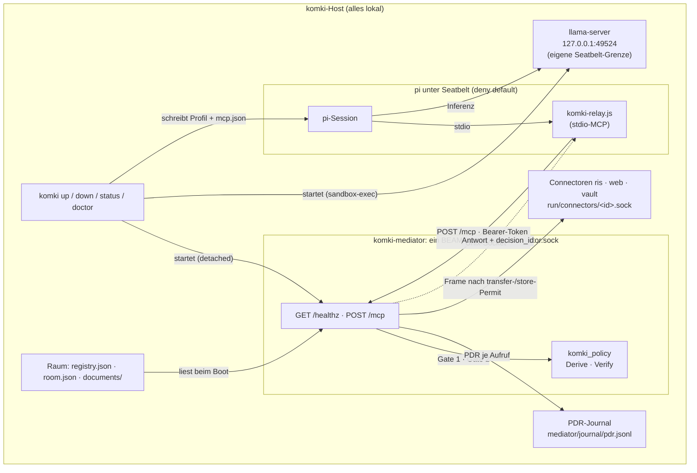
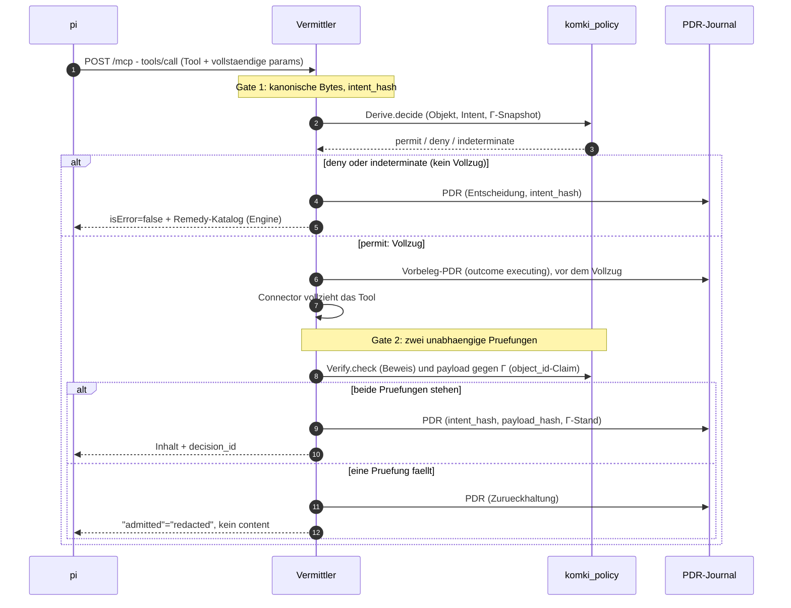
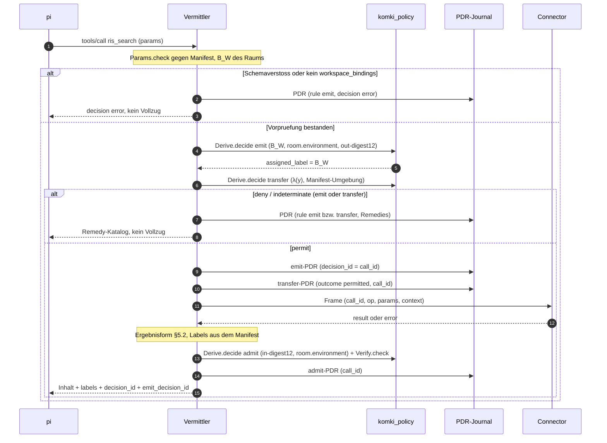

# komki_mediator

Vermittler (Ticket #102, MVP): der MCP-Layer zwischen pi (dem gesandboxten
Coding-Agent) und den Connector-Operationen. pi bekommt Tool-Zugriff
ausschliesslich durch diesen Vermittler: jeder Aufruf durchlaeuft Gate 1
(eine Policy-Entscheidung durch komki_policy VOR dem Vollzug), jede Antwort
durchlaeuft Gate 2 (unabhaengige Beweispruefung und Pruefung des
realisierten Payloads gegen den Regelstand Γ, BEVOR sie zur MCP-Antwort
wird). Fuer jeden Aufruf entsteht ein PDR-Auditdatensatz
im Journal; ein Permit schreibt zusaetzlich einen Vorbeleg, bevor
irgendetwas vollzogen wird (Audit vor Wirkung).

Fassung `komki-mediator/3` (Tickets #144, #218): neben `ping`,
`list_documents` und `admit_document` bietet der Vermittler die sechs
Connector-Tools `ris_search`, `ris_show`, `web_search`, `vault_search`,
`vault_read` und `vault_write_test` an. Jeder Connector-Aufruf laeuft als
emit → transfer → Vollzug → admit mit drei PDR
(`apps/komki_connector/CONTRACT.md` §6, Ticket #298); ein schreibender
mit `store` statt `transfer`, das ohne GO der nutzenden Person abgelehnt
wird (Ticket #205).

Gesperrte Aufrufe (`deny`, `indeterminate`, abgelehntes oder ausgebliebenes
GO) tragen neben dem Remedy-Katalog das Feld `hinweis`: ein fester Satz an
das Modell, dass Umwege nicht zum Ziel fuehren (Ticket #166,
`KomkiMediator.Hinweis`).

## Architektur im komki-Lauf

Vier Fragen, vier kurze Antworten — die Diagramme darunter zeigen dasselbe
als Bild:

* Wo laeuft er? Als eigener OS-Prozess (der Escript `komki-mediator`)
  auf dem komki-Host, erreichbar nur ueber den Unix-Socket
  `<base>/run/mediator.sock` (Rechte 0600, Ticket #143) und nur mit dem
  Bearer-Token aus `<base>/run/mediator.token`. Einen TCP-Listener gibt es
  nicht mehr. Er laeuft selbst nicht unter einer
  Seatbelt-Grenze: er ist die Durchsetzungsstelle, nicht der Gefangene.
  Sandgeboxt ist pi, die Gegenseite.
* Wer startet ihn? `komki up` (KomkiCli.Steps), in fester Reihenfolge:
  erst llama-server, dann der Vermittler. Der Start erfolgt detached
  (nohup) mit `--socket` und `--token-file`; vorher schreibt `komki up` ein
  neues Token. Das pidfile liegt unter `base/tmp/komki-mediator.pid`, das Log
  unter `base/tmp/mediator.log`; danach pollt `komki up` healthz ueber den
  Socket mit Token (max. 30 s)
  und bricht bei Timeout mit Log-Tail ab. Die Binary ist Start-Pflicht:
  fehlt sie, verweigert `komki up` (Praesenz-Pflicht sitzt beim Start, nicht
  bei init — Entdeckung: PATH, dann `<base>/bin/komki-mediator`).
  `komki down` stoppt per pidfile mit Identitaetscheck, `komki doctor`
  prueft die Binary, `komki run` und `komki session` starten ihn (und
  alles andere) selbst, wenn er unten ist.
* Wer gibt ihm Daten? Drei Quellen. Erstens der Raum unter
  `<base>/mediator/` (`registry.json` mit Gamma, `room.json`, `documents/`)
  — einmal beim Boot gelesen. Fehlen die Dateien, legt der Vermittler die
  Vorlagen an; sind sie unveraenderte Vorlagen einer frueheren Fassung
  (SHA-256), ersetzt er sie, veraenderte laesst er stehen und erklaert beim
  Start den Konflikt (Ticket #177). Zweitens pi als einziger Client, per
  `POST /mcp` (MCP StreamableHTTP). pis MCP-Client kann keinen Unix-Socket;
  pi startet deshalb `komki-relay.js` (aus komki_cli) als stdio-MCP-Server,
  das jede JSON-RPC-Zeile als `POST /mcp` ueber den Socket schickt, mit
  `Authorization: Bearer`, `X-Komki-Session` und `Mcp-Session-Id`. Die
  `mcp.json` im pi-Home (`<base>/pi-home/.pi/agent/mcp.json`) schreibt
  `komki up` aus der healthz-Antwort: Server `komki` (command = node, args =
  Relay), exposure `hidden`, genau die Fassung-Tools `direct`, Token und
  Session-ID nur als `${…}`-Verweis auf pis Umgebung. pi laeuft mit
  `--no-extensions -e builtin:mcp` und ohne eigene Werkzeuge
  (`--no-builtin-tools --tools 'mcp__komki__*'`, Ticket #104): jeder
  Datei- und Netzweg laeuft durch Gate 1 und Gate 2. Sein Seatbelt-Profil erlaubt
  Netz-Auswaerts nur zum llama-Port und zum Socket-Pfad des Vermittlers.
  Auf pi-Seite heissen die Tools `mcp__komki__<tool>`.
  Drittens die Connectoren (Dokumente, RIS, Web, Vault): je ein eigener Prozess mit
  Unix-Socket `<connectors_dir>/<id>.sock` (Default `<base>/run/connectors`,
  einstellbar mit `--connectors-dir`). Der Vermittler ruft sie nur nach
  einem transfer- bzw. store-Permit und nur ueber das Frame-Protokoll
  (`Sidecar.Client`, eine Verbindung je Aufruf).
* Wem gibt er Daten zurueck? Zwei Senken. pi erhaelt die MCP-Antwort:
  permit-Inhalt, Remedy-Katalog (bei deny) oder Zurueckhaltung
  (`"admitted" => "redacted"`, ohne content) — immer mit eingebetteter
  `decision_id`. Und das PDR-Journal
  (`<base>/mediator/journal/pdr.jsonl`) erhaelt je Aufruf einen
  Auditdatensatz, der intent_hash, payload_hash und den Γ-Stand-Hash bindet.
  komki_policy selbst ist kein Netz-Dienst: `Derive.decide` und
  `Verify.check` laufen als Bibliothek im selben BEAM wie der Vermittler.

### Lauf-Zusammenhang



### Ein Tool-Aufruf durch die Gates



### Ein Connector-Aufruf (emit → transfer → Vollzug → admit)



### GO fuer einen gesperrten Aufruf (Ticket #98)

Bietet der Remedy-Katalog einer Ablehnung in Gate 1 (emit, transfer oder
store) eine Aktionsfreigabe fuer
den exakten Call an (`aktionsfreigabe`, scope `call`) und hoert jemand zu,
legt der Vermittler `<base>/mediator/go/<call_hash>.request.json` ab und
wartet bis zu 120 s. Zuhoeren heisst: Der Herzschlag
`<base>/mediator/go/listener` ist hoechstens 5 s alt. Den erneuert der
Pane-BEAM einer Session mit angedocktem Terminal (`KomkiCli.GoWatcher`).
Ohne Zuhoerer bleibt es beim sofortigen deny. `komki go` zeigt die
Vorschau (Tool, Parameter, Blocker) und schreibt auf ein `j` eine
Aktionsfreigabe `komki-release/1` (frische Nonce, Fenster 300 s) als
`<call_hash>.answer.json`. pi kann in `mediator/go` weder lesen noch
schreiben.

Ob die Freigabe gilt, entscheidet `Derive.decide_with_release/5` gegen den
Offenlegungsstand `komki-stand/1` (`KomkiMediator.GoStand`,
`mediator/go/stand.json`). Bei permit gilt commit vor Wirkung:
`Stand.advance` verbraucht die Nonce, danach folgt das PDR mit `outcome:
released` (`payload_hash` bindet den Verbrauchs-Vorschlag), danach der
normale Vollzug. Nach einem GO fuer `transfer` oder `store` vertritt der
released-PDR den `permitted`-PDR; er steht deshalb vor dem emit-PDR. Ein Nein ergibt `go_refused`, keine Antwort `go_timeout`,
jeweils mit PDR. Die Antwort bleibt das deny samt Katalog, ergaenzt um
`"go"`. Eine ungueltige Freigabe (falscher Call, abgelaufen, Nonce
verbraucht) ist ein neues deny des Freigabe-Zweigs.

### Bewusste Grenzen

* Kein Token in der mcp.json. Das Socket-Token reist ueber pis Umgebung
  zum Relay; Connector-Zugangsdaten leben nur im Vermittler (Forschung
  ticket/102, R.4.3).
* Host nicht kompromittiert (Annahme aus #143). Das Token haelt lokale
  Clients ohne Token fern; wer als derselbe Nutzer Prozessspeicher oder die
  Token-Datei lesen kann, ist nicht Teil des Modells. Eine Peer-PID-Pruefung
  gibt es deshalb nicht.
* Kein Netz-Dienst komki_policy. Der Regel-Kern ist als Bibliothek in
  den Vermittler gebunden; pi erreicht ihn nur durch die Gates.
* Fassung-Pin auf pi-Seite. `komki up` liest die Tool-Liste aus healthz
  und schreibt nur diese als `direct`; alles, was der Vermittler kuenftig
  ueber die Fassung hinaus anbietet, bleibt hinter dem hidden-Default.
  komki_cli kennt keine Tool-Namen.
* pi ist der einzige Client. healthz ist der Vertrag zwischen komki_cli
  und dem Vermittler: status, fassung_id, tools, registry_id, gamma_hash —
  byte-stabil.

## Bau und Lauf

```bash
cd apps/komki_mediator
mix deps.get        # aktualisiert ggf. apps/workspace.lock
mix escript.build   # erzeugt ./komki-mediator

mkdir -m 700 -p ~/var/komki/run
openssl rand -hex 32 | tr -d '\n' > ~/var/komki/run/mediator.token
chmod 600 ~/var/komki/run/mediator.token
./komki-mediator --base ~/var/komki
# default --base:           KOMKI_HOME oder ~/.local/share/komki
# default --socket:         <base>/run/mediator.sock
# default --token-file:     <base>/run/mediator.token (Pflicht, sonst kein Start)
# default --connectors-dir: <base>/run/connectors
```

Nach dem Start erscheint eine einzeilige Startnotiz auf stdout; dann
blockiert der Escript. Im regelmaessigen Lauf uebernimmt `komki up` alle
diese Schritte (Start, healthz-Poll, mcp.json fuer pi) — der manuelle
Aufruf hier ist Entwicklung und Debugging vorbehalten.

## HTTP-Oberflaeche (nur Unix-Socket, CONTRACT §8)

| Route | Zweck |
|---|---|
| `GET /healthz` | Status + Fassung (`fassung_id`, `tools`, `registry_id`, `gamma_hash`) |
| `/mcp` | MCP StreamableHTTP (anubis_mcp) mit den Tools der Fassung `komki-mediator/3` (siehe unten) |

## Tools (Fassung `komki-mediator/3`)

| Tool | Ablauf | Parameter |
|---|---|---|
| `ping` | Gate (admit) gegen die Labels des Ping-Objekts | — |
| `list_documents` | Gate: je Raumdokument eine admit-Entscheidung gegen B_W, nur `permit` erscheint; ein PDR (#218) | — |
| `admit_document` | Gate (admit) gegen B_W des Raums (R.5.4, #213), Vollzug im Connector `documents` (#169) | `document_id` (max 64, `^[a-z0-9-]+$`) |
| `ris_search` | ConnectorGate, Connector `ris` | `text` (max 200), `limit` (1..20, Default 10) |
| `ris_show` | ConnectorGate, Connector `ris` | `top_id` (max 64, `^[A-Za-z0-9_-]+$`) |
| `vault_read` | ConnectorGate, Connector `vault` | `note_id` (max 200, relativer `.md`-Pfad) |
| `vault_search` | ConnectorGate, Connector `vault` | `text` (max 200) |
| `vault_write_test` | ConnectorGate, Connector `vault` (schreibend) | `title` (max 120), `body` (max 20000) |
| `web_search` | ConnectorGate, Connector `web` | `query` (max 400), `count` (1..10, Default 5) |

Schemas und Beschreibungen der Connector-Tools entstehen zur Compile-Zeit aus
`KomkiConnector.Manifest` (`KomkiMediator.Tools.Connector`); ein Test
gleicht sie mit dem Manifest ab. anubis prueft Typ, Laenge, Bereich und
Pflichtfelder schon auf Protokollebene und verwirft unbekannte Felder; das
Gate prueft alles noch einmal mit `Sidecar.Params.check/3` (Muster
nur dort).

Vor jeder Route prueft `KomkiMediator.HTTP.guard_caller/2`:

1. `Authorization: Bearer <token>`, Vergleich in konstanter Zeit
   (`Plug.Crypto.secure_compare/2`). Sonst 401 und eine Logzeile ohne
   Token-Wert, auch fuer `/healthz`.
2. `Host` ist `localhost` oder `127.0.0.1`, kein `Origin`, POST nur mit
   `application/json` (Tiefenverteidigung aus #133).
3. `X-Komki-Session` (optional, `^[a-z0-9-]{8,64}$`, sonst 400) wird zu
   `conn.assigns.komki_session`.

Fehlt die Token-Datei oder ist sie ungueltig, verweigert der Vermittler den
Start. Bedient schon ein anderer Prozess den Socket, ebenfalls.

### Session-ID im PDR (fuer alle Tools)

anubis_mcp uebernimmt `conn.assigns` je Anfrage in `frame.assigns`. Jedes
Tool holt seine Umgebung deshalb ueber `KomkiMediator.Env.for_call(frame)`
statt `Env.fetch()`; das liefert zusaetzlich `:session_id`, und das Gate
schreibt sie als `"session_id"` in den PDR (ohne Header: `null`). Neue Tools
(etwa die Connector-Tools aus #144) folgen demselben Muster:

```elixir
def execute(params, frame) do
  env = Env.for_call(frame)
  response = Gate.call(env, "tool_name", params, executor)
  {:reply, Response.json(Response.tool(), response), frame}
end
```

## Raum unter `<base>/mediator/`

```
mediator/
├── registry.json   # Gamma (Export des Label-Store, #208): Bindungen, Umgebungen, Beobachter
├── room.json       # Raum: Identitaet, Arbeitsraum, Fakten, Objekte
├── documents/      # die drei Beispieldokumente (doc-oeffentlich u. a.)
└── journal/pdr.jsonl  # PDR-Auditjournal (ein kanonisches, mehrzeiliges JSON-Dokument je Aufruf)
```

Das Journal ist trotz der Endung kein zeilenweises JSONL: Jeder Datensatz
ist byte-identisch die kanonische Form aus `KomkiPolicy.JSON.canonical`
(mehrzeilig eingerückt), die Datensätze stehen direkt hintereinander. Wer es
auswertet, liest Dokument für Dokument, etwa mit `jq -c . pdr.jsonl`.

**Manipulationsnachweis (Ticket #139).** Der Writer verkettet die Datensätze:
`seq` ist die Position, `prev_hash` der SHA-256 der Bytes des Vorgängers (der
erste hängt an einem Null-Hash). Beim Start setzt der Vermittler außerdem
`chflags uappnd` auf die Datei: Anhängen geht, Überschreiben, Kürzen und
Löschen nicht. `komki doctor` meldet ein fehlendes Flag.

```sh
komki-mediator verify-journal [--base <dir>]   # Kette prüfen, Kopf-Hash ausgeben
```

Was das leistet und was nicht:

- Erkannt: geänderte, entfernte, vertauschte oder eingeschobene Datensätze
  vor dem letzten Eintrag, nicht kanonische Bytes, ein abgebrochener letzter
  Datensatz.
- Nicht erkannt: Kürzung am Ende, ein geänderter **letzter** Datensatz und
  eine vollständig neu berechnete Kette. Das fällt nur über einen Vergleich
  des Kopf-Hashs mit einem unabhängig festgehaltenen Kontrollpunkt auf (offen
  in #139).
- `uappnd` kann der Eigentümer mit `chflags nouappnd` wieder entfernen. Wer die
  Instanz löschen will, muss das vorher tun.

Ältere Datensätze ohne Kettenfelder (vor #139) sind als Präfix zulässig und
werden als `legacy` gezählt.

Ein fehlender Raum wird beim Start provisioniert. Einen vorhandenen
ersetzt der Vermittler nur je Datei, wenn sie byte-genau eine fruehere
unveraenderte Vorlage ist (Tickets #177, #208); eigene Aenderungen bleiben
unberuehrt. `registry.json` ist seit #208 der Export des Label-Store:
`komki up` schreibt sie vor dem Start (`KomkiCli.Gamma.sync/1`), die
Vorlage dafuer ist `Templates.label_store_seed/0`.

Jedes Objekt in `room.json` traegt einen Typ (`"type"`, Ticket #134):
`admit_document` loest nur Objekte vom Typ `document` auf. Ein Objekt ohne
oder mit anderem Typ endet als `unknown_object`, ohne Entscheidung der
Engine und ohne Dateizugriff. Eine selbst veraenderte `room.json` aus der
Zeit vor #134 hat keine Typen; dort lehnt `admit_document` deshalb jedes
Objekt ab, bis die Typen nachgetragen sind.

Seit #213 entscheidet `admit_document` gegen das B_W des Raums
(`workspace_bindings`), nicht gegen die Labels des Dokuments allein
(R.5.4: das Validierungslabel ist B_W). Ein Dokument, dessen Labels nicht
in B_W liegen, endet mit `label_not_included`; jede Bindung in B_W wirkt
mit ihren Bedingungen auf jede Aufnahme des Raums. Fehlt
`workspace_bindings`, gibt es keine Raumdokumente (fail-closed). Im
Default-Raum recherche ist nur `doc-oeffentlich` zulaessig: Es traegt seit
#213 `doc-oeffentlich@2` (oeffentlicher Empfaengerkreis), das in B_W
steht. `doc-oeffentlich@1` bleibt unveraendert in Γ, weil Bindungen
unveraenderlich sind (R.2.1). Eine selbst veraenderte `room.json` braucht
die Labels ihrer Dokumente in `workspace_bindings`, sonst sperrt
`admit_document` sie; die Dateiaufnahme prueft bis #214 noch gegen
`contract.bindings`.

## Gate 1 / Gate 2 / PDR

* **Gate 1**: exakt gerenderter Aufruf (Tool samt vollstaendigen Parametern)
  → canonische Bytes → `intent_hash`; Objekt, Intent, Snapshot →
  `KomkiPolicy.Derive.decide`. Ein `deny`/`indeterminate` ist kein nackter
  Fehler, sondern der Remedy-Katalog, den die Engine in die Entscheidung
  einbettet (`KomkiPolicy.Remedies`, CONTRACT § 2.8: legal Fortsetzungen
  in fester Ordnung — der Vermittler bildet keine eigene Remedy-Abbildung,
  Single-Sourcing #115). Die Relaxationsbefugnisse der benannten Bindungen
  (Γ-L1, R.2.2) schluesselt der Vermittler aus dem rohen Registry-Term auf.
* **Vorbeleg**: nach einem `permit` schreibt der Vermittler zuerst ein PDR
  mit `outcome: executing` (beim Connector-Weg: der emit-PDR mit `outcome:
  emitted`). Erst wenn es gesynct im Journal steht, laeuft der Vollzug;
  scheitert das Schreiben, stoppt die Vermittlung.
* **Gate 2**: nur nach einem `permit` vollzieht der Connector. Danach
  laufen zwei unabhaengige Pruefungen: der Beweis durch
  `KomkiPolicy.Verify.check`, und das realisierte Payload gegen den
  Γ-Stand — das Executor-Ergebnis traegt einen `object_id`-Claim, der
  gegen `room.json` aufgeloest und mit Objekt, Version und Labels des
  Snapshots verglichen wird. Faellt eine der Pruefungen, wird der Inhalt
  zurueckgehalten (`"admitted" => "redacted"`, kein `content`).
* **Connector-Tools** (`KomkiMediator.ConnectorGate`, CONTRACT §6):
  * Vorpruefung: Parameter gegen das Manifest, `workspace_bindings` (B_W)
    muss im Raum stehen. Sonst `decision: error` mit PDR, kein Vollzug.
  * Gate 1a `emit`: der Raum erzeugt die Anfrage. Snapshot mit B_W in
    der Raumumgebung (`room.environment`), Objekt `out-<digest12>`, Fakt
    `output_content_digest = intent_hash`; die Engine ordnet λ(y) = B_W zu.
  * Gate 1b `transfer` (lesend, #298) bzw. `store` (schreibend, #205):
    nach dem emit-Permit, unter λ(y) = `assigned_label` in der
    Manifest-Umgebung (`ris-abruf@1`, `web-suche@1`, `vault-lokal@1`). Hier
    faellt der Empfaengertest. Γ hat keine `store`-Regel, also ist jedes
    Schreiben ein deny mit Aktionsfreigabe fuer den exakten Call; mit
    Zuhoerer fragt der Vermittler (GO-Anfrage mit `operation: store`
    bzw. `transfer`), sonst bleibt es beim deny.
  * Vorbeleg: bei permit liegt zuerst der emit-PDR (`outcome: emitted`),
    dann der transfer- bzw. store-PDR (`outcome: permitted`) im Journal,
    **bevor** der Connector gerufen wird. Die `decision_id` des emit-PDR
    ist die `call_id` im Frame. Jeder PDR des Aufrufs traegt sie, auch
    Ablehnungen und GO-Belege; nur die Vorpruefung kennt noch keinen
    Aufruf. Ein in Gate 1 abgelehnter Aufruf hat keinen emit-PDR.
    Bei `vault_write_test` geht `context.assigned_label` (= B_W) mit.
  * Gate 2 `admit`: Ergebnisform §5.2 (geschlossen), Labels allein aus dem
    Manifest (RIS/Web fest `import_labels`; Vault: Labels der Notiz,
    nicht leer und ⊆ `import_labels`; `write_test`: Rueckmeldung =
    `assigned_label`). Verstoss: `redacted`. Sonst Objekt `in-<digest12>`
    in `room.environment`, `Derive.decide` und `Verify.check`.
  * Connector nicht erreichbar oder Fehlercode: `admitted: false` mit PDR.
* **Raeume**: Default ist **recherche** (B_W = `ris-oeffentlich@1`,
  `vault-oeffentlich@1`, `web-oeffentlich@1`). Im Raum **vertraulich**
  (zusaetzlich `vault-vertraulich@1`) scheitert jede RIS- und Websuche bei
  der Uebergabe (`transfer`) an `recipient_not_allowed`, vertrauliche
  Notizen sind lesbar. Ein Raum ohne
  `workspace_bindings` bietet keine Connector-Operationen an.
* **PDR**: jeder Ablauf haengt einen Auditdatensatz an das Journal, der
  `intent_hash`, `payload_hash` und Γ-Stand-Hash des Aufrufs bindet
  (separater Writer-Prozess; stirbt er, stirbt die Vermittlung — die
  Auditkette dunkelt nie still ab) und bettet die `decision_id` in die
  Antwort ein. `payload_hash` ist der SHA-256 der kanonischen Antwortbasis
  (Options-Recherche §5, nicht R.4.4). Schema `komki-pdr/3`: zusaetzlich
  `rule` (`admit`/`emit`/`transfer`/`store`), `call_id` (bei
  Connector-Aufrufen die Kennung des Aufrufs, in allen seinen PDR gleich;
  kommt es zum Vollzug, ist sie die `decision_id` des emit-PDR),
  `session_id` (aus der
  Umgebung, sonst `null`) und `assigned_label` (emit-Permit).

## Komponenten

| Modul | Aufgabe |
|---|---|
| `KomkiMediator.Fassung` | festgedrehte Tool-Auflage (R.4.3) |
| `KomkiMediator.Gate` | Gate 1 + Gate 2 + PDR (ping, admit_document) |
| `KomkiMediator.ConnectorGate` | emit → transfer/store → Vollzug → admit fuer die Connector-Tools |
| `KomkiMediator.Go` | GO-Anfragen und -Antworten unter `mediator/go` (Ticket #98) |
| `KomkiMediator.GoStand` | Offenlegungsstand der GO-Noncen, commit vor Wirkung |
| `KomkiMediator.ResultShape` | Ergebnisformen der Connectoren (§5.2) |
| `KomkiMediator.PDR` | Form der PDR-Datensaetze (`komki-pdr/3`) |
| `KomkiMediator.Tools.Connector` | Tool-Baustein aus dem Manifest |
| `KomkiMediator.Gamma` | Registry-Snapshot + Stand-Hash |
| `KomkiMediator.Room` | Raum-Zustand, Objekt-/Snapshot-Bildung |
| `KomkiMediator.Journal` | getrennter PDR-Writer (R.4.4) |
| `KomkiMediator.Env` | geladene Umgebung fuer die Tools |
| `KomkiMediator.Templates` | Default-Raum (idempotent provisioniert) |
| `KomkiMediator.HTTP` | /healthz + /mcp (Plug.Router), Token-/Aufrufer-Pruefung |
| `KomkiMediator.Supervisor` | Kinderordnung, `:one_for_all` (fail-closed) |
| `KomkiMediator.CLI` | Escript-Einstieg |

## Lizenz

`anubis_mcp` ist LGPL-3.0 und wird als Runtime-Abhängigkeit eingebunden
(dynamische Nutzung, kein Linken in ein verteiltes Produkt). Lizenzangaben
des Projekts siehe Repo-Root.
