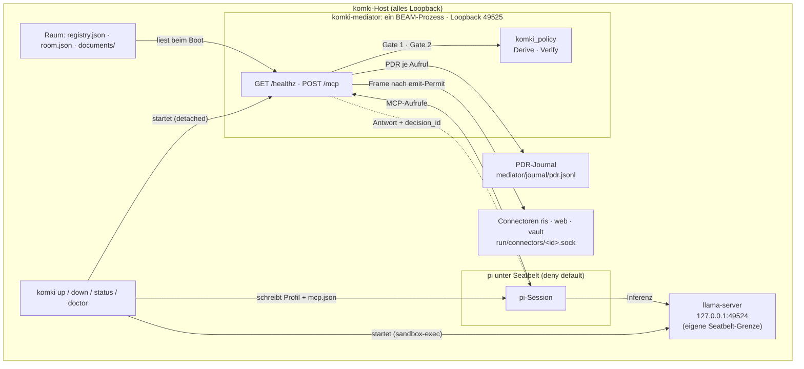
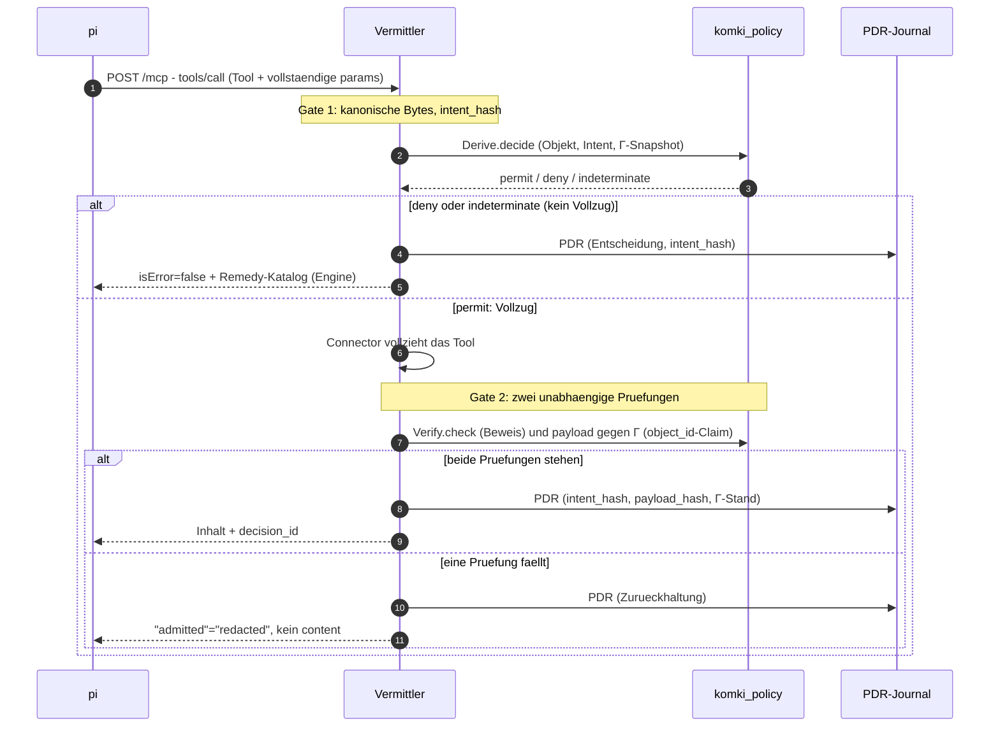
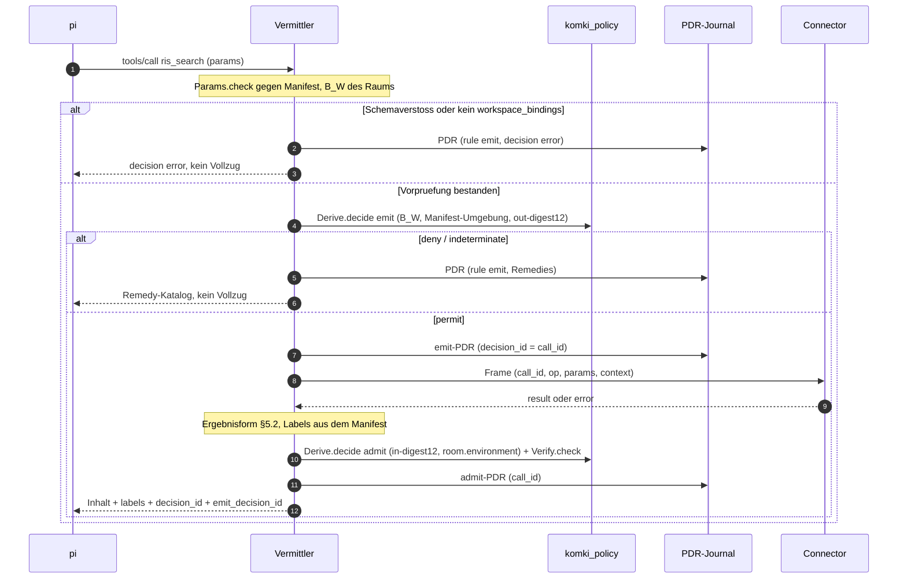

# komki_mediator

Vermittler (Ticket #102, MVP): der MCP-Layer zwischen pi (dem gesandboxten
Coding-Agent) und den Connector-Operationen. pi bekommt Tool-Zugriff
ausschliesslich durch diesen Vermittler: jeder Aufruf durchlaeuft Gate 1
(eine Policy-Entscheidung durch komki_policy VOR dem Vollzug), jede Antwort
durchlaeuft Gate 2 (unabhaengige Beweispruefung und Pruefung des
realisierten Payloads gegen den Regelstand Γ, BEVOR sie zur MCP-Antwort
wird). Fuer jeden Aufruf entsteht ein PDR-Auditdatensatz
im Journal.

Fassung `komki-mediator/2` (Ticket #144): neben `ping` und `admit_document`
bietet der Vermittler die sechs Connector-Tools `ris_search`, `ris_show`,
`web_search`, `vault_search`, `vault_read` und `vault_write_test` an. Jeder
Connector-Aufruf laeuft als emit → Vollzug → admit mit zwei PDR
(`apps/komki_connector/CONTRACT.md` §6).

## Architektur im komki-Lauf

Vier Fragen, vier kurze Antworten — die Diagramme darunter zeigen dasselbe
als Bild:

* Wo laeuft er? Als eigener OS-Prozess (der Escript `komki-mediator`)
  auf dem komki-Host, erreichbar nur ueber Loopback
  `127.0.0.1:<mediator_port>` (Default 49525, einstellbar bei
  `komki init --mediator-port`). Er laeuft selbst nicht unter einer
  Seatbelt-Grenze: er ist die Durchsetzungsstelle, nicht der Gefangene.
  Sandgeboxt ist pi, die Gegenseite.
* Wer startet ihn? `komki up` (KomkiCli.Steps), in fester Reihenfolge:
  erst llama-server, dann der Vermittler. Der Start erfolgt detached
  (nohup), das pidfile liegt unter `base/tmp/komki-mediator.pid`, das Log
  unter `base/tmp/mediator.log`; danach pollt `komki up` healthz (max. 30 s)
  und bricht bei Timeout mit Log-Tail ab. Die Binary ist Start-Pflicht:
  fehlt sie, verweigert `komki up` (Praesenz-Pflicht sitzt beim Start, nicht
  bei init — Entdeckung: PATH, dann `<base>/bin/komki-mediator`).
  `komki down` stoppt per pidfile mit Identitaetscheck, `komki doctor`
  prueft die Binary, `komki run` und `komki session` verweigern frueh,
  wenn der Vermittler unten ist.
* Wer gibt ihm Daten? Drei Quellen. Erstens der Raum unter
  `<base>/mediator/` (`registry.json` mit Gamma, `room.json`, `documents/`)
  — einmal beim Boot gelesen. Zweitens pi als einziger Client, per
  `POST /mcp` (MCP StreamableHTTP). pi findet den Vermittler ueber die
  `mcp.json` im pi-Home (`<base>/pi-home/.pi/agent/mcp.json`), die `komki up`
  aus der healthz-Antwort schreibt: Server `komki`, exposure `hidden`, genau
  die Fassung-Tools `direct`, keine Auth-Felder. pi laeuft mit
  `--no-extensions -e builtin:mcp`; sein Seatbelt-Profil erlaubt
  Netz-Auswaerts nur zu zwei Loopback-Literals: llama-Port und
  Vermittler-Port. Auf pi-Seite heissen die Tools `mcp__komki__<tool>`.
  Drittens die Connectoren (RIS, Web, Vault): je ein eigener Prozess mit
  Unix-Socket `<connectors_dir>/<id>.sock` (Default `<base>/run/connectors`,
  einstellbar mit `--connectors-dir`). Der Vermittler ruft sie nur nach
  einem emit-Permit und nur ueber das Frame-Protokoll
  (`KomkiConnector.Client`, eine Verbindung je Aufruf).
* Wem gibt er Daten zurueck? Zwei Senken. pi erhaelt die MCP-Antwort:
  permit-Inhalt, Remedy-Katalog (bei deny) oder Zurueckhaltung
  (`"admitted" => "redacted"`, ohne content) — immer mit eingebetteter
  `decision_id`. Und das PDR-Journal
  (`<base>/mediator/journal/pdr.jsonl`) erhaelt je Aufruf einen
  Auditdatensatz, der intent_hash, payload_hash und den Γ-Stand-Hash bindet.
  komki_policy selbst ist kein Netz-Dienst: `Derive.decide` und
  `Verify.check` laufen als Bibliothek im selben BEAM wie der Vermittler.

### Lauf-Zusammenhang



### Ein Tool-Aufruf durch die Gates



### Ein Connector-Aufruf (emit → Vollzug → admit)



### Bewusste Grenzen

* Kein Auth in der mcp.json. Zugangsdaten leben nur im Vermittler
  (Forschung ticket/102, R.4.3).
* Kein Netz-Dienst komki_policy. Der Regel-Kern ist als Bibliothek in
  den Vermittler gebunden; pi erreicht ihn nur durch die Gates.
* Fassung-Pin auf pi-Seite. `komki up` liest die Tool-Liste aus healthz
  und schreibt nur diese als `direct`; alles, was der Vermittler kuenftig
  ueber die Fassung hinaus anbietet, bleibt hinter dem hidden-Default.
  komki_cli kennt keine Tool-Namen.
* pi ist der einzige Client. healthz ist der Vertrag zwischen komki_cli
  und dem Vermittler: status, fassung_id, tools, registry_id, gamma_hash —
  byte-stabil.

## Bau und Lauf

```bash
cd apps/komki_mediator
mix deps.get        # aktualisiert ggf. apps/workspace.lock
mix escript.build   # erzeugt ./komki-mediator

./komki-mediator --base ~/var/komki --port 49525 --connectors-dir ~/var/komki/run/connectors
# default --base: KOMKI_HOME oder ~/.local/share/komki
# default --port: 49525
# default --connectors-dir: <base>/run/connectors
```

Nach dem Start erscheint eine einzeilige Startnotiz auf stdout; dann
blockiert der Escript. Im regelmaessigen Lauf uebernimmt `komki up` alle
diese Schritte (Start, healthz-Poll, mcp.json fuer pi) — der manuelle
Aufruf hier ist Entwicklung und Debugging vorbehalten.

## HTTP-Oberflaeche (nur loopback, 127.0.0.1)

| Route | Zweck |
|---|---|
| `GET /healthz` | Status + Fassung (`fassung_id`, `tools`, `registry_id`, `gamma_hash`) |
| `/mcp` | MCP StreamableHTTP (anubis_mcp) mit den Tools der Fassung `komki-mediator/2` (siehe unten) |

## Tools (Fassung `komki-mediator/2`)

| Tool | Ablauf | Parameter |
|---|---|---|
| `ping` | Gate (admit) | — |
| `admit_document` | Gate (admit) | `document_id` |
| `ris_search` | ConnectorGate, Connector `ris` | `text` (max 200), `limit` (1..20, Default 10) |
| `ris_show` | ConnectorGate, Connector `ris` | `top_id` (max 64, `^[A-Za-z0-9_-]+$`) |
| `vault_read` | ConnectorGate, Connector `vault` | `note_id` (max 200, relativer `.md`-Pfad) |
| `vault_search` | ConnectorGate, Connector `vault` | `text` (max 200) |
| `vault_write_test` | ConnectorGate, Connector `vault` (schreibend) | `title` (max 120), `body` (max 20000) |
| `web_search` | ConnectorGate, Connector `web` | `query` (max 400), `count` (1..10, Default 5) |

Schemas und Beschreibungen der Connector-Tools entstehen zur Compile-Zeit aus
`KomkiConnector.Manifest` (`KomkiMediator.Tools.Connector`); ein Test
gleicht sie mit dem Manifest ab. anubis prueft Typ, Laenge, Bereich und
Pflichtfelder schon auf Protokollebene und verwirft unbekannte Felder; das
Gate prueft alles noch einmal mit `KomkiConnector.Params.check/2` (Muster
nur dort).

## Raum unter `<base>/mediator/`

```
mediator/
├── registry.json   # Gamma: Verbindungsregeln, Bindungen, Befugnisse
├── room.json       # Raum: Identitaet, Arbeitsraum, Fakten, Objekte
├── documents/      # die drei Beispieldokumente (doc-oeffentlich u. a.)
└── journal/pdr.jsonl  # PDR-Auditjournal (ein kanonisches, mehrzeiliges JSON-Dokument je Aufruf)
```

Das Journal ist trotz der Endung kein zeilenweises JSONL: Jeder Datensatz
ist byte-identisch die kanonische Form aus `KomkiPolicy.JSON.canonical`
(mehrzeilig eingerückt), die Datensätze stehen direkt hintereinander. Wer es
auswertet, liest Dokument für Dokument, etwa mit `jq -c . pdr.jsonl`.

**Manipulationsnachweis (Ticket #139).** Der Writer verkettet die Datensätze:
`seq` ist die Position, `prev_hash` der SHA-256 der Bytes des Vorgängers (der
erste hängt an einem Null-Hash). Beim Start setzt der Vermittler außerdem
`chflags uappnd` auf die Datei: Anhängen geht, Überschreiben, Kürzen und
Löschen nicht. `komki doctor` meldet ein fehlendes Flag.

```sh
komki-mediator verify-journal [--base <dir>]   # Kette prüfen, Kopf-Hash ausgeben
```

Was das leistet und was nicht:

- Erkannt: geänderte, entfernte, vertauschte oder eingeschobene Datensätze
  vor dem letzten Eintrag, nicht kanonische Bytes, ein abgebrochener letzter
  Datensatz.
- Nicht erkannt: Kürzung am Ende, ein geänderter **letzter** Datensatz und
  eine vollständig neu berechnete Kette. Das fällt nur über einen Vergleich
  des Kopf-Hashs mit einem unabhängig festgehaltenen Kontrollpunkt auf (offen
  in #139).
- `uappnd` kann der Eigentümer mit `chflags nouappnd` wieder entfernen. Wer die
  Instanz löschen will, muss das vorher tun.

Ältere Datensätze ohne Kettenfelder (vor #139) sind als Präfix zulässig und
werden als `legacy` gezählt.

Ein fehlender Raum wird beim Start provisioniert; ein vorhandener wird
NIEMALS ueberschrieben (Idempotenz).

## Gate 1 / Gate 2 / PDR

* **Gate 1**: exakt gerenderter Aufruf (Tool samt vollstaendigen Parametern)
  → canonische Bytes → `intent_hash`; Objekt, Intent, Snapshot →
  `KomkiPolicy.Derive.decide`. Ein `deny`/`indeterminate` ist kein nackter
  Fehler, sondern der Remedy-Katalog, den die Engine in die Entscheidung
  einbettet (`KomkiPolicy.Remedies`, CONTRACT § 2.8: legal Fortsetzungen
  in fester Ordnung — der Vermittler bildet keine eigene Remedy-Abbildung,
  Single-Sourcing #115). Die Relaxationsbefugnisse der benannten Bindungen
  (Γ-L1, R.2.2) schluesselt der Vermittler aus dem rohen Registry-Term auf.
* **Gate 2**: nur nach einem `permit` vollzieht der Connector. Danach
  laufen zwei unabhaengige Pruefungen: der Beweis durch
  `KomkiPolicy.Verify.check`, und das realisierte Payload gegen den
  Γ-Stand — das Executor-Ergebnis traegt einen `object_id`-Claim, der
  gegen `room.json` aufgeloest und mit Objekt, Version und Labels des
  Snapshots verglichen wird. Faellt eine der Pruefungen, wird der Inhalt
  zurueckgehalten (`"admitted" => "redacted"`, kein `content`).
* **Connector-Tools** (`KomkiMediator.ConnectorGate`, CONTRACT §6):
  * Vorpruefung: Parameter gegen das Manifest, `workspace_bindings` (B_W)
    muss im Raum stehen. Sonst `decision: error` mit PDR, kein Vollzug.
  * Gate 1 `emit`: Snapshot mit B_W, Umgebung aus dem Manifest
    (`ris-abruf@1`, `web-suche@1`, `vault-lokal@1`), Objekt
    `out-<digest12>`, Fakt `output_content_digest = intent_hash`. Bei permit
    wird der emit-PDR geschrieben, **bevor** der Connector gerufen wird;
    seine `decision_id` ist die `call_id` im Frame. Bei `vault_write_test`
    geht `context.assigned_label` (= B_W) mit.
  * Gate 2 `admit`: Ergebnisform §5.2 (geschlossen), Labels allein aus dem
    Manifest (RIS/Web fest `import_labels`; Vault: Labels der Notiz,
    nicht leer und ⊆ `import_labels`; `write_test`: Rueckmeldung =
    `assigned_label`). Verstoss: `redacted`. Sonst Objekt `in-<digest12>`
    in `room.environment`, `Derive.decide` und `Verify.check`.
  * Connector nicht erreichbar oder Fehlercode: `admitted: false` mit PDR.
* **Raeume**: Default ist **recherche** (B_W = `ris-oeffentlich@1`,
  `vault-oeffentlich@1`, `web-oeffentlich@1`). Im Raum **vertraulich**
  (zusaetzlich `vault-vertraulich@1`) scheitert jede RIS- und Websuche an
  `recipient_not_allowed`, vertrauliche Notizen sind lesbar. Ein Raum ohne
  `workspace_bindings` bietet keine Connector-Operationen an.
* **PDR**: jeder Ablauf haengt einen Auditdatensatz an das Journal, der
  `intent_hash`, `payload_hash` und Γ-Stand-Hash des Aufrufs bindet
  (separater Writer-Prozess; stirbt er, stirbt die Vermittlung — die
  Auditkette dunkelt nie still ab) und bettet die `decision_id` in die
  Antwort ein. `payload_hash` ist der SHA-256 der kanonischen Antwortbasis
  (Options-Recherche §5, nicht R.4.4). Schema `komki-pdr/3`: zusaetzlich
  `rule` (`admit`/`emit`), `call_id` (bei Connector-Aufrufen die
  `decision_id` des emit-PDR, in beiden PDR gleich), `session_id` (aus der
  Umgebung, sonst `null`) und `assigned_label` (emit-Permit).

## Komponenten

| Modul | Aufgabe |
|---|---|
| `KomkiMediator.Fassung` | festgedrehte Tool-Auflage (R.4.3) |
| `KomkiMediator.Gate` | Gate 1 + Gate 2 + PDR (ping, admit_document) |
| `KomkiMediator.ConnectorGate` | emit → Vollzug → admit fuer die Connector-Tools |
| `KomkiMediator.ResultShape` | Ergebnisformen der Connectoren (§5.2) |
| `KomkiMediator.PDR` | Form der PDR-Datensaetze (`komki-pdr/3`) |
| `KomkiMediator.Tools.Connector` | Tool-Baustein aus dem Manifest |
| `KomkiMediator.Gamma` | Registry-Snapshot + Stand-Hash |
| `KomkiMediator.Room` | Raum-Zustand, Objekt-/Snapshot-Bildung |
| `KomkiMediator.Journal` | getrennter PDR-Writer (R.4.4) |
| `KomkiMediator.Env` | geladene Umgebung fuer die Tools |
| `KomkiMediator.Templates` | Default-Raum (idempotent provisioniert) |
| `KomkiMediator.HTTP` | /healthz + /mcp (Plug.Router) |
| `KomkiMediator.Supervisor` | Kinderordnung, `:one_for_all` (fail-closed) |
| `KomkiMediator.CLI` | Escript-Einstieg |

## Lizenz

`anubis_mcp` ist LGPL-3.0 und wird als Runtime-Abhängigkeit eingebunden
(dynamische Nutzung, kein Linken in ein verteiltes Produkt). Lizenzangaben
des Projekts siehe Repo-Root.
