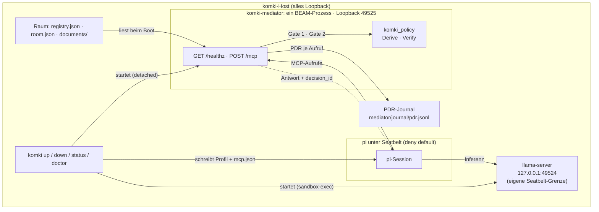

# komki_mediator

Vermittler (Ticket #102, MVP): der MCP-Layer zwischen pi (dem gesandboxten
Coding-Agent) und den Connector-Operationen. pi bekommt Tool-Zugriff
ausschliesslich durch diesen Vermittler: jeder Aufruf durchlaeuft Gate 1
(eine Policy-Entscheidung durch komki_policy VOR dem Vollzug), jede Antwort
durchlaeuft Gate 2 (unabhaengige Beweispruefung und Pruefung des
realisierten Payloads gegen den Regelstand Γ, BEVOR sie zur MCP-Antwort
wird). Fuer jeden Aufruf entsteht ein PDR-Auditdatensatz
im Journal.

## Architektur im komki-Lauf

Vier Fragen, vier kurze Antworten — die Diagramme darunter zeigen dasselbe
als Bild:

* Wo laeuft er? Als eigener OS-Prozess (der Escript `komki-mediator`)
  auf dem komki-Host, erreichbar nur ueber Loopback
  `127.0.0.1:<mediator_port>` (Default 49525, einstellbar bei
  `komki init --mediator-port`). Er laeuft selbst nicht unter einer
  Seatbelt-Grenze: er ist die Durchsetzungsstelle, nicht der Gefangene.
  Sandgeboxt ist pi, die Gegenseite.
* Wer startet ihn? `komki up` (KomkiCli.Steps), in fester Reihenfolge:
  erst llama-server, dann der Vermittler. Der Start erfolgt detached
  (nohup), das pidfile liegt unter `base/tmp/komki-mediator.pid`, das Log
  unter `base/tmp/mediator.log`; danach pollt `komki up` healthz (max. 30 s)
  und bricht bei Timeout mit Log-Tail ab. Die Binary ist Start-Pflicht:
  fehlt sie, verweigert `komki up` (Praesenz-Pflicht sitzt beim Start, nicht
  bei init — Entdeckung: PATH, dann `<base>/bin/komki-mediator`).
  `komki down` stoppt per pidfile mit Identitaetscheck, `komki doctor`
  prueft die Binary, `komki run` und `komki session` verweigern frueh,
  wenn der Vermittler unten ist.
* Wer gibt ihm Daten? Zwei Quellen. Erstens der Raum unter
  `<base>/mediator/` (`registry.json` mit Gamma, `room.json`, `documents/`)
  — einmal beim Boot gelesen. Zweitens pi als einziger Client, per
  `POST /mcp` (MCP StreamableHTTP). pi findet den Vermittler ueber die
  `mcp.json` im pi-Home (`<base>/pi-home/.pi/agent/mcp.json`), die `komki up`
  aus der healthz-Antwort schreibt: Server `komki`, exposure `hidden`, genau
  die Fassung-Tools `direct`, keine Auth-Felder. pi laeuft mit
  `--no-extensions -e builtin:mcp`; sein Seatbelt-Profil erlaubt
  Netz-Auswaerts nur zu zwei Loopback-Literals: llama-Port und
  Vermittler-Port. Auf pi-Seite heissen die Tools `mcp__komki__<tool>`.
* Wem gibt er Daten zurueck? Zwei Senken. pi erhaelt die MCP-Antwort:
  permit-Inhalt, Remedy-Plan (bei deny) oder Zurueckhaltung
  (`"admitted" => "redacted"`, ohne content) — immer mit eingebetteter
  `decision_id`. Und das PDR-Journal
  (`<base>/mediator/journal/pdr.jsonl`) erhaelt je Aufruf einen
  Auditdatensatz, der intent_hash, payload_hash und den Γ-Stand-Hash bindet.
  komki_policy selbst ist kein Netz-Dienst: `Derive.decide` und
  `Verify.check` laufen als Bibliothek im selben BEAM wie der Vermittler.

### Lauf-Zusammenhang



### Ein Tool-Aufruf durch die Gates


### Bewusste Grenzen

* Kein Auth in der mcp.json. Zugangsdaten leben nur im Vermittler
  (Forschung ticket/102, R.4.3).
* Kein Netz-Dienst komki_policy. Der Regel-Kern ist als Bibliothek in
  den Vermittler gebunden; pi erreicht ihn nur durch die Gates.
* Fassung-Pin auf pi-Seite. `komki up` liest die Tool-Liste aus healthz
  und schreibt nur diese als `direct`; alles, was der Vermittler kuenftig
  ueber die Fassung hinaus anbietet, bleibt hinter dem hidden-Default.
  komki_cli kennt keine Tool-Namen.
* pi ist der einzige Client. healthz ist der Vertrag zwischen komki_cli
  und dem Vermittler: status, fassung_id, tools, registry_id, gamma_hash —
  byte-stabil.

## Bau und Lauf

```bash
cd apps/komki_mediator
mix deps.get        # aktualisiert ggf. apps/workspace.lock
mix escript.build   # erzeugt ./komki-mediator

./komki-mediator --base ~/var/komki --port 49525
# default --base: KOMKI_HOME oder ~/.local/share/komki
# default --port: 49525
```

Nach dem Start erscheint eine einzeilige Startnotiz auf stdout; dann
blockiert der Escript. Im regelmaessigen Lauf uebernimmt `komki up` alle
diese Schritte (Start, healthz-Poll, mcp.json fuer pi) — der manuelle
Aufruf hier ist Entwicklung und Debugging vorbehalten.

## HTTP-Oberflaeche (nur loopback, 127.0.0.1)

| Route | Zweck |
|---|---|
| `GET /healthz` | Status + Fassung (`fassung_id`, `tools`, `registry_id`, `gamma_hash`) |
| `/mcp` | MCP StreamableHTTP (anubis_mcp) mit den Tools `ping` und `admit_document` |

## Raum unter `<base>/mediator/`

```
mediator/
├── registry.json   # Gamma: Verbindungsregeln, Bindungen, Befugnisse
├── room.json       # Raum: Identitaet, Arbeitsraum, Fakten, Objekte
├── documents/      # die drei Beispieldokumente (doc-oeffentlich u. a.)
└── journal/pdr.jsonl  # PDR-Auditjournal (eine kanonische JSON-Zeile je Aufruf)
```

Ein fehlender Raum wird beim Start provisioniert; ein vorhandener wird
NIEMALS ueberschrieben (Idempotenz).

## Gate 1 / Gate 2 / PDR

* **Gate 1**: exakt gerenderter Aufruf (Tool samt vollstaendigen Parametern)
  → canonische Bytes → `intent_hash`; Objekt, Intent, Snapshot →
  `KomkiPolicy.Derive.decide`. Ein `deny`/`indeterminate` ist kein nackter
  Fehler, sondern ein Remedy-Plan (behebbare Schritte,
  Relaxationsbefugnisse inklusive).
* **Gate 2**: nur nach einem `permit` vollzieht der Connector. Danach
  laufen zwei unabhaengige Pruefungen: der Beweis durch
  `KomkiPolicy.Verify.check`, und das realisierte Payload gegen den
  Γ-Stand — das Executor-Ergebnis traegt einen `object_id`-Claim, der
  gegen `room.json` aufgeloest und mit Objekt, Version und Labels des
  Snapshots verglichen wird. Faellt eine der Pruefungen, wird der Inhalt
  zurueckgehalten (`"admitted" => "redacted"`, kein `content`).
* **PDR**: jeder Ablauf haengt einen Auditdatensatz an das Journal, der
  `intent_hash`, `payload_hash` und Γ-Stand-Hash des Aufrufs bindet
  (separater Writer-Prozess; stirbt er, stirbt die Vermittlung — die
  Auditkette dunkelt nie still ab) und bettet die `decision_id` in die
  Antwort ein. `payload_hash` ist der SHA-256 der kanonischen Antwortbasis
  (Options-Recherche §5, nicht R.4.4).

## Komponenten

| Modul | Aufgabe |
|---|---|
| `KomkiMediator.Fassung` | festgedrehte Tool-Auflage (R.4.3) |
| `KomkiMediator.Gate` | Gate 1 + Gate 2 + PDR |
| `KomkiMediator.Gamma` | Registry-Snapshot + Stand-Hash |
| `KomkiMediator.Room` | Raum-Zustand, Objekt-/Snapshot-Bildung |
| `KomkiMediator.Remedy` | Abhilfeplaene aus Blockern/Evidenzen |
| `KomkiMediator.Journal` | getrennter PDR-Writer (R.4.4) |
| `KomkiMediator.Env` | geladene Umgebung fuer die Tools |
| `KomkiMediator.Templates` | Default-Raum (idempotent provisioniert) |
| `KomkiMediator.HTTP` | /healthz + /mcp (Plug.Router) |
| `KomkiMediator.Supervisor` | Kinderordnung, `:one_for_all` (fail-closed) |
| `KomkiMediator.CLI` | Escript-Einstieg |

## Lizenz

`anubis_mcp` ist LGPL-3.0 und wird als Runtime-Abhängigkeit eingebunden
(dynamische Nutzung, kein Linken in ein verteiltes Produkt). Lizenzangaben
des Projekts siehe Repo-Root.
