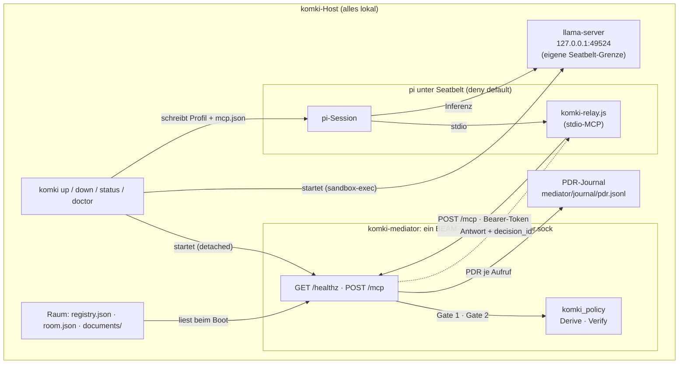
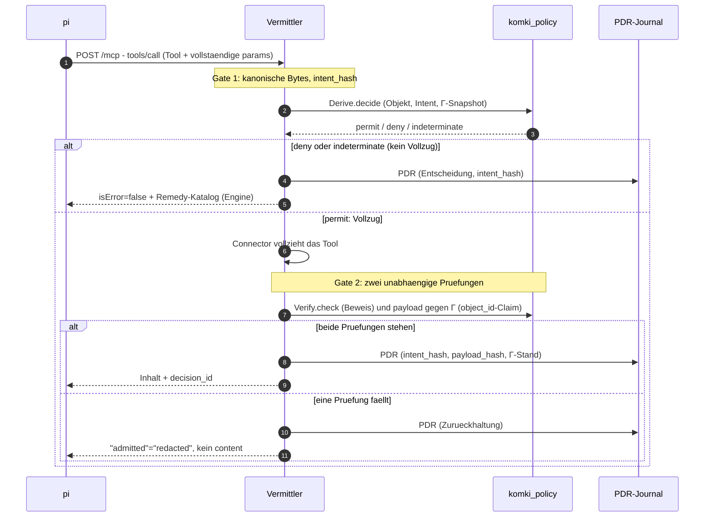

# komki_mediator

Vermittler (Ticket #102, MVP): der MCP-Layer zwischen pi (dem gesandboxten
Coding-Agent) und den Connector-Operationen. pi bekommt Tool-Zugriff
ausschliesslich durch diesen Vermittler: jeder Aufruf durchlaeuft Gate 1
(eine Policy-Entscheidung durch komki_policy VOR dem Vollzug), jede Antwort
durchlaeuft Gate 2 (unabhaengige Beweispruefung und Pruefung des
realisierten Payloads gegen den Regelstand Γ, BEVOR sie zur MCP-Antwort
wird). Fuer jeden Aufruf entsteht ein PDR-Auditdatensatz
im Journal.

## Architektur im komki-Lauf

Vier Fragen, vier kurze Antworten — die Diagramme darunter zeigen dasselbe
als Bild:

* Wo laeuft er? Als eigener OS-Prozess (der Escript `komki-mediator`)
  auf dem komki-Host, erreichbar nur ueber den Unix-Socket
  `<base>/run/mediator.sock` (Rechte 0600, Ticket #143) und nur mit dem
  Bearer-Token aus `<base>/run/mediator.token`. Einen TCP-Listener gibt es
  nicht mehr. Er laeuft selbst nicht unter einer
  Seatbelt-Grenze: er ist die Durchsetzungsstelle, nicht der Gefangene.
  Sandgeboxt ist pi, die Gegenseite.
* Wer startet ihn? `komki up` (KomkiCli.Steps), in fester Reihenfolge:
  erst llama-server, dann der Vermittler. Der Start erfolgt detached
  (nohup) mit `--socket` und `--token-file`; vorher schreibt `komki up` ein
  neues Token. Das pidfile liegt unter `base/tmp/komki-mediator.pid`, das Log
  unter `base/tmp/mediator.log`; danach pollt `komki up` healthz ueber den
  Socket mit Token (max. 30 s)
  und bricht bei Timeout mit Log-Tail ab. Die Binary ist Start-Pflicht:
  fehlt sie, verweigert `komki up` (Praesenz-Pflicht sitzt beim Start, nicht
  bei init — Entdeckung: PATH, dann `<base>/bin/komki-mediator`).
  `komki down` stoppt per pidfile mit Identitaetscheck, `komki doctor`
  prueft die Binary, `komki run` und `komki session` verweigern frueh,
  wenn der Vermittler unten ist.
* Wer gibt ihm Daten? Zwei Quellen. Erstens der Raum unter
  `<base>/mediator/` (`registry.json` mit Gamma, `room.json`, `documents/`)
  — einmal beim Boot gelesen. Zweitens pi als einziger Client, per
  `POST /mcp` (MCP StreamableHTTP). pis MCP-Client kann keinen Unix-Socket;
  pi startet deshalb `komki-relay.js` (aus komki_cli) als stdio-MCP-Server,
  das jede JSON-RPC-Zeile als `POST /mcp` ueber den Socket schickt, mit
  `Authorization: Bearer`, `X-Komki-Session` und `Mcp-Session-Id`. Die
  `mcp.json` im pi-Home (`<base>/pi-home/.pi/agent/mcp.json`) schreibt
  `komki up` aus der healthz-Antwort: Server `komki` (command = node, args =
  Relay), exposure `hidden`, genau die Fassung-Tools `direct`, Token und
  Session-ID nur als `${…}`-Verweis auf pis Umgebung. pi laeuft mit
  `--no-extensions -e builtin:mcp`; sein Seatbelt-Profil erlaubt
  Netz-Auswaerts nur zum llama-Port und zum Socket-Pfad des Vermittlers.
  Auf pi-Seite heissen die Tools `mcp__komki__<tool>`.
* Wem gibt er Daten zurueck? Zwei Senken. pi erhaelt die MCP-Antwort:
  permit-Inhalt, Remedy-Katalog (bei deny) oder Zurueckhaltung
  (`"admitted" => "redacted"`, ohne content) — immer mit eingebetteter
  `decision_id`. Und das PDR-Journal
  (`<base>/mediator/journal/pdr.jsonl`) erhaelt je Aufruf einen
  Auditdatensatz, der intent_hash, payload_hash und den Γ-Stand-Hash bindet.
  komki_policy selbst ist kein Netz-Dienst: `Derive.decide` und
  `Verify.check` laufen als Bibliothek im selben BEAM wie der Vermittler.

### Lauf-Zusammenhang



### Ein Tool-Aufruf durch die Gates



### Bewusste Grenzen

* Kein Token in der mcp.json. Das Kanal-Token reist ueber pis Umgebung
  zum Relay; Connector-Zugangsdaten leben nur im Vermittler (Forschung
  ticket/102, R.4.3).
* Host nicht kompromittiert (Annahme aus #143). Das Token haelt lokale
  Clients ohne Token fern; wer als derselbe Nutzer Prozessspeicher oder die
  Token-Datei lesen kann, ist nicht Teil des Modells. Eine Peer-PID-Pruefung
  gibt es deshalb nicht.
* Kein Netz-Dienst komki_policy. Der Regel-Kern ist als Bibliothek in
  den Vermittler gebunden; pi erreicht ihn nur durch die Gates.
* Fassung-Pin auf pi-Seite. `komki up` liest die Tool-Liste aus healthz
  und schreibt nur diese als `direct`; alles, was der Vermittler kuenftig
  ueber die Fassung hinaus anbietet, bleibt hinter dem hidden-Default.
  komki_cli kennt keine Tool-Namen.
* pi ist der einzige Client. healthz ist der Vertrag zwischen komki_cli
  und dem Vermittler: status, fassung_id, tools, registry_id, gamma_hash —
  byte-stabil.

## Bau und Lauf

```bash
cd apps/komki_mediator
mix deps.get        # aktualisiert ggf. apps/workspace.lock
mix escript.build   # erzeugt ./komki-mediator

mkdir -m 700 -p ~/var/komki/run
openssl rand -hex 32 | tr -d '\n' > ~/var/komki/run/mediator.token
chmod 600 ~/var/komki/run/mediator.token
./komki-mediator --base ~/var/komki
# default --base:       KOMKI_HOME oder ~/.local/share/komki
# default --socket:     <base>/run/mediator.sock
# default --token-file: <base>/run/mediator.token (Pflicht, sonst kein Start)
```

Nach dem Start erscheint eine einzeilige Startnotiz auf stdout; dann
blockiert der Escript. Im regelmaessigen Lauf uebernimmt `komki up` alle
diese Schritte (Start, healthz-Poll, mcp.json fuer pi) — der manuelle
Aufruf hier ist Entwicklung und Debugging vorbehalten.

## HTTP-Oberflaeche (nur Unix-Socket, CONTRACT §8)

| Route | Zweck |
|---|---|
| `GET /healthz` | Status + Fassung (`fassung_id`, `tools`, `registry_id`, `gamma_hash`) |
| `/mcp` | MCP StreamableHTTP (anubis_mcp) mit den Tools `ping` und `admit_document` |

Vor jeder Route prueft `KomkiMediator.HTTP.guard_caller/2`:

1. `Authorization: Bearer <token>`, Vergleich in konstanter Zeit
   (`Plug.Crypto.secure_compare/2`). Sonst 401 und eine Logzeile ohne
   Token-Wert, auch fuer `/healthz`.
2. `Host` ist `localhost` oder `127.0.0.1`, kein `Origin`, POST nur mit
   `application/json` (Tiefenverteidigung aus #133).
3. `X-Komki-Session` (optional, `^[a-z0-9-]{8,64}$`, sonst 400) wird zu
   `conn.assigns.komki_session`.

Fehlt die Token-Datei oder ist sie ungueltig, verweigert der Vermittler den
Start. Bedient schon ein anderer Prozess den Socket, ebenfalls.

### Session-ID im PDR (fuer alle Tools)

anubis_mcp uebernimmt `conn.assigns` je Anfrage in `frame.assigns`. Jedes
Tool holt seine Umgebung deshalb ueber `KomkiMediator.Env.for_call(frame)`
statt `Env.fetch()`; das liefert zusaetzlich `:session_id`, und das Gate
schreibt sie als `"session_id"` in den PDR (ohne Header: `null`). Neue Tools
(etwa die Connector-Tools aus #144) folgen demselben Muster:

```elixir
def execute(params, frame) do
  env = Env.for_call(frame)
  response = Gate.call(env, "tool_name", params, executor)
  {:reply, Response.json(Response.tool(), response), frame}
end
```

## Raum unter `<base>/mediator/`

```
mediator/
├── registry.json   # Gamma: Verbindungsregeln, Bindungen, Befugnisse
├── room.json       # Raum: Identitaet, Arbeitsraum, Fakten, Objekte
├── documents/      # die drei Beispieldokumente (doc-oeffentlich u. a.)
└── journal/pdr.jsonl  # PDR-Auditjournal (ein kanonisches, mehrzeiliges JSON-Dokument je Aufruf)
```

Das Journal ist trotz der Endung kein zeilenweises JSONL: Jeder Datensatz
ist byte-identisch die kanonische Form aus `KomkiPolicy.JSON.canonical`
(mehrzeilig eingerückt), die Datensätze stehen direkt hintereinander. Wer es
auswertet, liest Dokument für Dokument, etwa mit `jq -c . pdr.jsonl`.

**Manipulationsnachweis (Ticket #139).** Der Writer verkettet die Datensätze:
`seq` ist die Position, `prev_hash` der SHA-256 der Bytes des Vorgängers (der
erste hängt an einem Null-Hash). Beim Start setzt der Vermittler außerdem
`chflags uappnd` auf die Datei: Anhängen geht, Überschreiben, Kürzen und
Löschen nicht. `komki doctor` meldet ein fehlendes Flag.

```sh
komki-mediator verify-journal [--base <dir>]   # Kette prüfen, Kopf-Hash ausgeben
```

Was das leistet und was nicht:

- Erkannt: geänderte, entfernte, vertauschte oder eingeschobene Datensätze
  vor dem letzten Eintrag, nicht kanonische Bytes, ein abgebrochener letzter
  Datensatz.
- Nicht erkannt: Kürzung am Ende, ein geänderter **letzter** Datensatz und
  eine vollständig neu berechnete Kette. Das fällt nur über einen Vergleich
  des Kopf-Hashs mit einem unabhängig festgehaltenen Kontrollpunkt auf (offen
  in #139).
- `uappnd` kann der Eigentümer mit `chflags nouappnd` wieder entfernen. Wer die
  Instanz löschen will, muss das vorher tun.

Ältere Datensätze ohne Kettenfelder (vor #139) sind als Präfix zulässig und
werden als `legacy` gezählt.

Ein fehlender Raum wird beim Start provisioniert; ein vorhandener wird
NIEMALS ueberschrieben (Idempotenz).

## Gate 1 / Gate 2 / PDR

* **Gate 1**: exakt gerenderter Aufruf (Tool samt vollstaendigen Parametern)
  → canonische Bytes → `intent_hash`; Objekt, Intent, Snapshot →
  `KomkiPolicy.Derive.decide`. Ein `deny`/`indeterminate` ist kein nackter
  Fehler, sondern der Remedy-Katalog, den die Engine in die Entscheidung
  einbettet (`KomkiPolicy.Remedies`, CONTRACT § 2.8: legal Fortsetzungen
  in fester Ordnung — der Vermittler bildet keine eigene Remedy-Abbildung,
  Single-Sourcing #115). Die Relaxationsbefugnisse der benannten Bindungen
  (Γ-L1, R.2.2) schluesselt der Vermittler aus dem rohen Registry-Term auf.
* **Gate 2**: nur nach einem `permit` vollzieht der Connector. Danach
  laufen zwei unabhaengige Pruefungen: der Beweis durch
  `KomkiPolicy.Verify.check`, und das realisierte Payload gegen den
  Γ-Stand — das Executor-Ergebnis traegt einen `object_id`-Claim, der
  gegen `room.json` aufgeloest und mit Objekt, Version und Labels des
  Snapshots verglichen wird. Faellt eine der Pruefungen, wird der Inhalt
  zurueckgehalten (`"admitted" => "redacted"`, kein `content`).
* **PDR**: jeder Ablauf haengt einen Auditdatensatz an das Journal, der
  `intent_hash`, `payload_hash` und Γ-Stand-Hash des Aufrufs bindet
  (separater Writer-Prozess; stirbt er, stirbt die Vermittlung — die
  Auditkette dunkelt nie still ab) und bettet die `decision_id` in die
  Antwort ein. `payload_hash` ist der SHA-256 der kanonischen Antwortbasis
  (Options-Recherche §5, nicht R.4.4).

## Komponenten

| Modul | Aufgabe |
|---|---|
| `KomkiMediator.Fassung` | festgedrehte Tool-Auflage (R.4.3) |
| `KomkiMediator.Gate` | Gate 1 + Gate 2 + PDR |
| `KomkiMediator.Gamma` | Registry-Snapshot + Stand-Hash |
| `KomkiMediator.Room` | Raum-Zustand, Objekt-/Snapshot-Bildung |
| `KomkiMediator.Journal` | getrennter PDR-Writer (R.4.4) |
| `KomkiMediator.Env` | geladene Umgebung fuer die Tools |
| `KomkiMediator.Templates` | Default-Raum (idempotent provisioniert) |
| `KomkiMediator.HTTP` | /healthz + /mcp (Plug.Router), Token-/Aufrufer-Pruefung |
| `KomkiMediator.Supervisor` | Kinderordnung, `:one_for_all` (fail-closed) |
| `KomkiMediator.CLI` | Escript-Einstieg |

## Lizenz

`anubis_mcp` ist LGPL-3.0 und wird als Runtime-Abhängigkeit eingebunden
(dynamische Nutzung, kein Linken in ein verteiltes Produkt). Lizenzangaben
des Projekts siehe Repo-Root.
