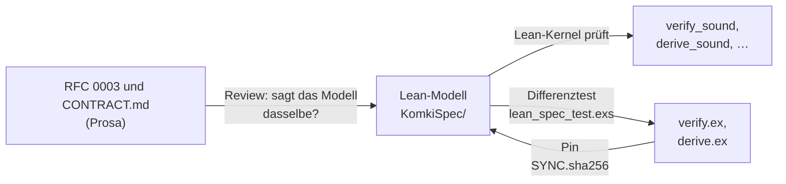

# Lean-Spezifikation von komki_policy

Formales Modell von `derive` (normaler Zweig) und `verify` in Lean 4, mit
Beweis ihrer Korrektheit für die Regelzweige `admit`, `emit`, `store` und
`transfer` (Ticket #625). `lib/komki_policy/derive.ex` und `verify.ex`
werden per Differenztest gegen das bewiesene Lean-Modell gehalten, ein Pin
meldet jede Änderung an den gespiegelten Modulen. Die Spezifikation läuft nicht in komki mit, sie ist ein Prüforakel
in Repo und CI.

## Was bewiesen ist

| Satz | Aussage | Bezug |
|---|---|---|
| `verify_sound` | Akzeptiert `verify` einen Baum, ist seine Regel aus Registry und Snapshot ableitbar (`Derivable`), gleich was der Baum behauptet | RFC 0003 A.7, CONTRACT.md § 4.3, § 4.5, § 4.7, § 4.8, § 5 |
| `verify_sound_rfc`, `derivable_permitted` | Daraus folgt die Regel: λ(x) ⊆ B_W ∧ Erlaubt_Γ(Aufnahme(x, W), B_W); Erlaubt_Γ(Erzeugen(y, W), B_W); B_W ⊆ λ(y) ∧ Erlaubt_Γ(Speicherung oder Übergabe, λ(y)) | R.5.4, CONTRACT.md § 4.5, R.5.6 |
| `verify_emit_assigns` | Ein gültiger `emit`-Baum ordnet λ(y) := B_W zu: `assigned_label` ist als Menge B_W | R.5.5 |
| `handover_within_admitted` | Wird x in einen Raum aufgenommen, erreicht ein geprüftes `store` oder `transfer` aus demselben Raum nur Beobachter in R_Γ(λ(x)) | A.3 an der Engine |
| `derive_sound`, `derive_complete` | `derive` erlaubt genau dann, wenn die Regel ableitbar ist (`Derivable`, dieselbe Aussage, in der `verify_sound` endet) | CONTRACT.md § 4.3–§ 4.5, § 4.7, § 4.8 |
| `derive_verifies` | `verify` akzeptiert jeden Baum, den `derive` baut | CONTRACT.md § 2.5, § 5 |
| `derive_permit_stable`, `derive_deny_stable` | Mehr Fakten machen aus einem `permit` oder `deny` nichts anderes; nur ein `indeterminate` löst sich auf | R.5.2, B.4, CONTRACT.md § 4.4 |
| `eval_mono` | Mehr Fakten kippen kein bekanntes Urteil des dreiwertigen Auswerters | R.5.2, CONTRACT.md § 3 |
| `recipients_antitone`, `permitted_antitone` | Mehr Bindungen, nie mehr Empfänger; Erlaubt vererbt sich auf Teilmengen | A.2 |
| `no_forbidden_recipient` | Ohne Lockerung erreicht nichts, was von x abhängt, einen Beobachter außerhalb von R_Γ(λ(x)) | Kern von A.3: nur die Labels, ohne Schrittmodell |

Kein `sorry`: `lake build` behandelt jede Warnung als Fehler.
`./check-axioms.sh` zeigt die Axiome je Hauptsatz und lässt nur Leans
Standardaxiome durch (`propext`, `Quot.sound`, `Classical.choice`); ein
eigenes `axiom` oder ein `sorry` macht es rot.

Die drei geschmiedeten Beweise aus dem Audit (#477, #479, #480) waren
Gegenbeispiele genau zu `verify_sound`, für den damaligen Elixir-Prüfer. Der
Differenztest findet sie gegen den Stand vor ihrer Behebung (Commit
`ed7c4574^`) wieder, alle drei Klassen. Ebenso die Ausgabebäume auf einem
Quarantäneobjekt oder ohne Digest (#628): `verify` bestätigte sie, obwohl
`derive` für diesen Snapshot gar nicht entscheidet.

`handover_within_admitted` setzt voraus, dass beide Snapshots dasselbe B_W
nennen. B_W ist unveränderlich (RFC 4.1); das durchzusetzen ist Sache des
Vermittlers, nicht der Engine.

Die Sätze setzen voraus, was `Registry.compile/1` und `Context` durchsetzen
(`Registry.WellFormed`, `Snapshot.WellFormed`: Leser ⊆ 𝒪, sortierte und
eindeutige Labels, geschlossene Klassifikation, boolesche Basisfakten). Die
Brücke prüft beides an jedem Fall des Differenztests
(`Registry.wellFormed_sound`, `Snapshot.wellFormed_sound`).

## Vertrauenskette



Bewiesen ist das Modell. Ob es den Vertrag richtig wiedergibt, ist eine
Review-Frage. Ob der Elixir-Code dem Modell folgt, prüft der Differenztest,
nicht ein Beweis.

## Ausführen

Einmalig elan installieren (siehe [docs/prerequisites.md](../../../docs/prerequisites.md#lean-4-und-elan)),
dann im Verzeichnis `apps/komki_policy/lean`:

```bash
lake build          # Beweise prüfen, komki-spec bauen
./check-axioms.sh   # Axiome der Hauptsätze, nur Standardaxiome
```

Den Differenztest startet man in `apps/komki_policy`:

```bash
mix test --only lean_spec
```

Für `verify` vergleicht er drei Quellen. Erstens die Fixtures unter `priv/fixtures` samt
den geschmiedeten Beweisen aus dem Audit (#477, #479, #480) und den
Ausgabebäumen außerhalb ihres Wertebereichs (#628). Zweitens 8 000 zufällige
Welten, je eine Regel: Registry, zwei Snapshots und Bäume aus fremden,
reparierten und um Regeln ergänzten Welten. Drittens Varianten dieser Bäume:
mit Gleitkomma- statt Ganzzahl-Literalen (#626), mutiert, außerhalb des
Wertebereichs, unter der jeweils anderen Übergaberegel, je Behauptungsfeld
vertauscht oder ersetzt, und der stärkste Fälscher: ein Baum, der jede
Behauptung aus der Zielwelt spiegelt, einen falschen Fakt als `false`.
Verglichen wird, wo Elixir ein Urteil fällt oder die Snapshot-Voraussetzung
einer Ausgaberegel verwirft; jeder andere Eingabefehler fällt heraus.
Für `derive` vergleicht er die Entscheidung über denselben Welten und den
Fixtures: Urteil, Prüflabel, Blocker samt `condition` und
`recipients_outside`, fehlende Belege, den ganzen Beweisbaum,
`assigned_label`, `content_digest`, dazu `unsupported` und die Eingabefehler
aus #628. Nicht verglichen werden die Echos der Eingabe und die Remedies.

`KOMKI_SPEC_SEED` und `KOMKI_SPEC_RUNS` erweitern die Suche. Eine Abweichung
schreibt ihre Fälle als JSONL-Datei; `komki-spec verify-batch <datei>`
beziehungsweise `komki-spec derive-batch <datei>` spielt sie nach.

## Synchron halten

`SYNC.sha256` pinnt die Elixir-Module, die das Modell Schritt für Schritt
spiegelt. Ändert sich eines, schlägt `lean_sync_test.exs` im normalen
`mix test` fehl, auch ohne Lean-Installation.

| Elixir | Lean |
|---|---|
| `derive.ex` | `KomkiSpec/Derive.lean` (normaler Zweig, Beweisbaum) |
| `verify.ex` | `KomkiSpec/Verify.lean` |
| `evaluator.ex` | `KomkiSpec/Evaluator.lean` |
| `calculus.ex` | `allowedRecipients` in `KomkiSpec/Verify.lean` |
| `registry.ex` | Sortierung in `KomkiSpec/Bridge.lean`, `Registry.WellFormed`, `Expr.ofJVal` |
| `context.ex` | `KomkiSpec/Model.lean`, `Snapshot.WellFormed` in `DeriveSound.lean`, `Snapshot.wellFormed` in `Domain.lean` (Wertebereich nach der Eingabeprüfung) |

Dann das Lean-Modell gegen die Änderung prüfen und anpassen, `lake build`
und den Differenztest laufen lassen und den Pin erneuern:

```bash
shasum -a 256 lib/komki_policy/{calculus,context,derive,evaluator,registry,verify}.ex > lean/SYNC.sha256
```

Die Tabellen aus `derive.ex` (Prämissen je Regel, Regelzweige,
Ausgabe- und Übergaberegeln) prüft der Differenztest direkt gegen
`komki-spec constants`, dazu das Prüflabel je Regel aus
`Derive.checked_label/3`.

## Grenzen

- **Ohne Freigaben.** Die Freigabe-Zweige (§ 4.6, § 4.9), der
  Remedy-Katalog (§ 2.8) und `advance` (§ 2.7) sind nicht modelliert; sie
  folgen in #629.
- **Ohne Zielarbeitsraum.** R.5.6 verlangt bei der Übergabe an einen
  Zielarbeitsraum zusätzlich dessen Aufnahmeregel. CONTRACT.md § 4.8
  klammert das aus (#270), das Modell auch.
- **Bei `verify` nur das Urteil.** Befundcodes von `verify` und ihre
  Reihenfolge modelliert die Spezifikation nicht; bei `derive` dagegen
  Blocker und fehlende Belege samt Reihenfolge.
- **Nur der geprüfte Wertebereich.** Das Modell setzt voraus, was
  `Registry.compile/1` und `Context` durchsetzen (siehe oben). Von der
  Eingabeprüfung sind nur die Snapshot-Voraussetzung der Ausgaberegeln
  (#628) und, für `derive`, `unknown_environment` modelliert und
  abgeglichen; Fälle mit einem anderen Eingabefehler lässt der
  Differenztest weg. Wo Elixir außerhalb des
  Bereichs abstürzen würde, etwa bei einem Ausdruck außerhalb von B.4,
  verweigert das Modell (`missing_operation_rule`).
- **Kohärenz von Intent und Snapshot liegt außerhalb.** Dass Objekt,
  Version und Raum des Intents zum Snapshot passen, prüft
  `Context.ensure_coherence/2` vor `verify`; das Modell nimmt es an.
- **Die Brücke ist unbewiesen.** `KomkiSpec/Bridge.lean` liest JSON ins
  Modell ein. Gleitkommazahlen hält sie von Ganzzahlen getrennt, so wie
  `verify.ex` behauptete Ausdrücke strikt vergleicht (#626).

## Lizenzen

Lean 4: Apache-2.0. elan: Apache-2.0 und MIT (`LICENSE-APACHE`,
`LICENSE-MIT`). Beide über die GitHub-API am 23.11.2026 geprüft. Keine
weiteren Abhängigkeiten, kein Mathlib.
