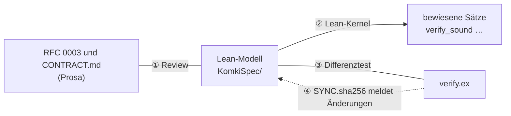

# Formales Modell von `verify` in Lean

Wir definieren hier ein formales Modell von `verify` in Lean 4. `verify` ist
der Prüfer in `komki_policy`, der die Beweisbäume zu `permit`-Entscheidungen
nachrechnet (CONTRACT.md § 5 nennt ihn Ableitungsprüfer). Bisher umfasst das
Modell den Regelzweig `admit`; die Zweige `emit`, `store` und `transfer`
folgen im selben Ticket (#625).

Für das Modell beweisen wir: Nimmt es einen Beweisbaum an, dann folgt die
behauptete Entscheidung tatsächlich aus Registry und Snapshot. Ein
manipulierter Beweisbaum kann also kein `permit` durchsetzen, das die Regeln
nicht hergeben. Der Beweis gilt für das Modell, nicht für den Elixir-Code. Ob
`verify.ex` genauso urteilt, prüfen wir mit einem Differenztest, der beiden
Prüfern dieselben Fälle vorlegt.

Das Modell gehört nicht zur Anwendung. Wir verwenden es nur in der
Entwicklung und in der CI; komki selbst läuft weiterhin vollständig in
Elixir.

## Wozu

`komki_policy` trennt zwei Aufgaben:

- `derive` entscheidet, ob eine Operation erlaubt ist, und liefert zu jedem
  `permit` einen Beweisbaum: die Prämissen, auf die sich die Entscheidung
  stützt.
- `verify` prüft so einen Baum unabhängig von `derive`. Es rechnet jede
  Prämisse aus Registry, Snapshot und Intent nach und übernimmt keine Angabe
  ungeprüft aus dem Baum (CONTRACT.md § 5).

Die Registry enthält den geltenden Regelstand Γ, der Snapshot die Fakten der
konkreten Situation, der Intent die beantragte Operation.

Nimmt `verify` einen manipulierten Baum an, kommt eine Entscheidung durch,
die die Regeln nicht decken. Ein Audit hat drei solche Lücken aufgedeckt
(#477, #479, #480). Tests mit Beispielbäumen decken nur die Fälle ab, an die
jemand gedacht hat. Ein Beweis gilt für jeden Baum, solange die
Voraussetzungen des Modells erfüllt sind.

## Was Lean ist

Lean ist eine funktionale Programmiersprache und zugleich ein
Beweisassistent. Wir schreiben darin Funktionen und Sätze über diese
Funktionen, etwa „liefert `verify` `valid`, dann ist `admit` ableitbar“. Lean
akzeptiert einen Satz erst mit einem vollständigen Beweis. Aus dem Beweis,
den wir schreiben, erzeugt Lean einen formalen Beweisterm, und den prüft der
Lean-Kernel. Vertrauen müssen wir nur diesem kleinen, bewusst einfach
gehaltenen Programmteil, nicht dem Beweistext und nicht den Werkzeugen, die
ihn in einen Beweisterm übersetzen.

Zwei Wege gibt es, diese Prüfung zu umgehen. Das Schlüsselwort `sorry` steht
anstelle eines Beweises, ähnlich einem TODO: Lean nimmt den Satz dann ohne
Beweis hin und warnt nur. Mit `axiom` lässt sich eine beliebige Aussage als
wahr annehmen. Beides fängt die CI ab (siehe [CI](#ci)).

## Was modelliert ist

`KomkiSpec/Verify.lean` bildet `Verify.check/4` aus
`lib/komki_policy/verify.ex` Schritt für Schritt nach, für Bäume des
Regelzweigs `admit`. Dieser Zweig entscheidet über die
[Aufnahme](../../../GLOSSARY.md#aufnahme): ob ein Objekt Teil eines
Arbeitsraums werden darf. Für Bäume der Zweige `emit`, `store` und
`transfer` antwortet das Modell vorerst mit `out_of_scope`.

Die Dateien und was sie enthalten:

| Datei | Inhalt |
|---|---|
| `KomkiSpec/JVal.lean` | JSON-Werte, wie `verify.ex` sie vergleicht |
| `KomkiSpec/Model.lean` | Registry, Snapshot, Intent und Beweisbaum nach der Eingabeprüfung |
| `KomkiSpec/Evaluator.lean` | der dreiwertige Auswerter für Bedingungen (CONTRACT.md § 3) |
| `KomkiSpec/Calculus.lean` | Empfängerkreise und „Erlaubt“ aus RFC 0003 R.5.1 und R.5.2 |
| `KomkiSpec/Verify.lean` | `verify` für `admit` |
| `KomkiSpec/Soundness.lean` | der Beweis, dass `verify` nur ableitbare Entscheidungen annimmt |
| `KomkiSpec/Bridge.lean` | liest die JSON-Eingaben ins Modell ein (unbewiesen) |
| `Main.lean` | das Programm `komki-spec`, das der Differenztest aufruft |
| `Axioms.lean`, `check-axioms.sh` | Axiom-Prüfung der Hauptsätze |
| `SYNC.sha256` | Prüfsummen der nachgebildeten Elixir-Module |

Sätze und Kommentare verwenden die Schreibweise aus RFC 0003:

| Zeichen | Bedeutung |
|---|---|
| Γ | der geltende Regelstand: Bindungen, Beobachter und Umgebungen, wie die Registry sie enthält |
| λ(x) | das Label des Objekts x, also die Bindungen, unter denen x steht |
| B_W | die Bindungen des Arbeitsraums W; ein Objekt darf nur hinein, wenn sein Label darin liegt |
| R_Γ(L) | der Empfängerkreis des Labels L: wer Daten erhalten darf, die unter allen Bindungen in L stehen, also die Schnittmenge der zulässigen Leser dieser Bindungen |
| 𝒪 | alle Beobachter, die die Registry kennt; zugleich der Empfängerkreis des leeren Labels |
| ρ_Γ(c) | die Beobachter einer Verarbeitung c, also wer sie mitbekommen kann; bei `admit` die Beobachter der Umgebung des Raums |
| Erlaubt_Γ(c, L) | die Verarbeitung c ist unter allen Bindungen in L erlaubt: Grundvoraussetzungen erfüllt, ρ_Γ(c) ⊆ R_Γ(L) und die Bedingung jeder Bindung erfüllt (R.5.2) |

## Was bewiesen ist

### `verify_sound`

Liefert `verify` für einen Baum `valid`, dann ist `admit` allein aus Registry
und Snapshot ableitbar, im Sinne von CONTRACT.md § 4.3. Was der Baum
behauptet, spielt dafür keine Rolle. Voraussetzung ist eine Registry, wie
`Registry.compile/1` sie liefert, im Modell `Registry.WellFormed` (siehe
[Grenzen](#grenzen)).

Genau diese Eigenschaft haben die drei manipulierten Bäume aus dem Audit im
damaligen Elixir-Prüfer verletzt.

### `verify_sound_rfc`

Aus `verify_sound` folgt die Aufnahmeregel aus RFC 0003 R.5.4: Das Label des
Objekts liegt in den Bindungen des Raums (λ(x) ⊆ B_W), und die Aufnahme ist
unter allen Raumbindungen erlaubt. Damit verbinden wir den Vertrag
(CONTRACT.md § 4.3) mit der Formel des RFC; den Zwischenschritt leistet
`admitDerivable_permitted`.

### `eval_mono`

Der Auswerter für Bedingungen kennt drei Ergebnisse: wahr, falsch und
unbekannt. Unbekannt heißt, dass ein benötigter Fakt im Snapshot fehlt.
Kommen Fakten hinzu, kann aus „unbekannt“ noch wahr oder falsch werden; ein
bekanntes Ergebnis bleibt, wie es ist (R.5.2, CONTRACT.md § 3).

Für ein `permit` heißt das: Eine Bedingung, die schon mit unvollständigen
Fakten wahr ist, bleibt wahr, welche Fakten auch noch hinzukommen.

### `recipients_antitone`, `permitted_antitone`

Kommen zu einem Label Bindungen hinzu, wird der Empfängerkreis nie größer.
Beispiel: Bindung A erlaubt Alice und Bob als Empfänger, Bindung B nur Alice.
Daten unter beiden Bindungen darf nur Alice erhalten (RFC 0003 A.2).

Daraus folgt `permitted_antitone`: Ist eine Verarbeitung unter einem Label
erlaubt, dann auch unter jeder Teilmenge davon. Weniger Bindungen bedeuten
weniger Einschränkungen; sie können eine Verarbeitung, die unter mehr
Einschränkungen erlaubt war, nicht unzulässig machen.

### `no_forbidden_recipient`

Gehört ein Beobachter nicht zum Empfängerkreis von λ(x), erreicht ihn ohne
Lockerung nichts, was aus x hervorgeht (Kern von A.3). Die
Verarbeitungsschritte modellieren wir dabei nur über ihre Wirkung auf Labels:
Aufnahme mit anschließender Ausgabe (λ(x) ⊆ B_W ⊆ λ(y)) sowie Speichern und
Übergabe, die keine Bindung entfernen. Eine Lockerung kommt im Modell bewusst
nicht vor.

Der Satz zeigt also, dass die Regeln des RFC keinen verbotenen Empfänger
zulassen, nicht aber, dass komkis Operationen diese Regeln einhalten. Einen
Teil davon deckt `verify_sound_rfc` ab: `verify` nimmt nur Bäume an, die die
Aufnahmeregel erfüllen.

## Wie Modell und Elixir-Code zusammenhängen

Bewiesen ist das Modell, nicht der Elixir-Code. Damit die Beweise für komki
etwas bedeuten, müssen mehrere Verbindungen halten, und jede kann für sich
versagen. Ein korrekt bewiesenes Modell kann den Vertrag falsch wiedergeben.
Ein vertragstreues Modell kann anders urteilen als `verify.ex`. Und eine
einmal geprüfte Übereinstimmung geht verloren, wenn sich der Elixir-Code
später ändert. Deshalb sichern wir jede Verbindung eigens ab:



1. Ob das Modell RFC 0003 und CONTRACT.md richtig wiedergibt, lässt sich nicht
   beweisen. Das prüfen Menschen im Review.
2. Der Lean-Kernel prüft die Beweise. Die CI stellt sicher, dass keiner offen
   ist und keiner auf eigenen Axiomen beruht.
3. Der [Differenztest](#differenztest) legt Modell und `verify.ex` dieselben
   Fälle vor. Er prüft viele Eingaben, aber nicht alle.
4. Die Prüfsummen in `SYNC.sha256` halten das Modell nicht synchron. Sie
   melden nur, dass sich ein nachgebildetes Elixir-Modul geändert hat und wir
   das Modell prüfen müssen (siehe
   [Wenn sich der Elixir-Code ändert](#wenn-sich-der-elixir-code-ändert)).

### Differenztest

Ein Differenztest (differential testing) legt zwei unabhängig geschriebenen
Implementierungen dieselben Eingaben vor und vergleicht ihre Ergebnisse. Bei
uns urteilen `Verify.check/4` und der Lean-Prüfer `komki-spec` über dieselben
Fälle aus Registry, Snapshot, Intent und Beweisbaum. Weicht auch nur ein
Urteil ab, scheitert der Test.

Die Fälle stammen aus zwei Quellen:

- den Beispieldaten unter `priv/fixtures` und den drei manipulierten Bäumen
  aus dem Audit (#477, #479, #480);
- 8 000 zufällig erzeugten Szenarien aus je einer Registry und zwei
  Snapshots. Zu jedem Szenario erzeugt `derive` Beweisbäume, auch nach
  Anpassungen an Snapshot und Registry, damit genug `permit`-Bäume entstehen.
  Jeden Baum prüfen wir in bis zu vier Fassungen: gegen den Snapshot, für den
  er erzeugt wurde, gegen den zweiten Snapshot desselben Szenarios, zufällig
  verändert und mit Gleitkomma- statt Ganzzahl-Literalen (`3.0` statt `3`,
  #626).

Verglichen werden nur Fälle, in denen Elixir ein Urteil fällt. Lehnt Elixir
die Eingabe als fehlerhaft ab, lassen wir den Fall weg, weil das Modell
geprüfte Eingaben voraussetzt. Mit dem festen Seed bleiben rund 12 000
verglichene Fälle. Der Test verlangt darunter mindestens 600 `valid` und
7 000 `invalid`, damit er nicht nur Ablehnungen vergleicht.

Dass der Test Fehler findet, haben wir an älteren Ständen nachgewiesen. Gegen
den Elixir-Prüfer vor den Audit-Fixes (Commit `ed7c4574^`) findet er Angriffe
aller drei Klassen wieder, auch unter den erzeugten Bäumen. Gegen den Stand
vor #626 fand er eine bis dahin unbekannte Abweichung: `verify.ex` hatte im
Baum `3.0` akzeptiert, wo die Registry `3` enthält.

## Ausführen

Einmalig elan installieren, die Versionsverwaltung von Lean (siehe
[docs/prerequisites.md](../../../docs/prerequisites.md#lean-4-und-elan)).
Dann im Verzeichnis `apps/komki_policy/lean`:

```bash
lake build          # Modell bauen, Beweise prüfen, komki-spec bauen
./check-axioms.sh   # zeigt, auf welchen Axiomen die Hauptsätze beruhen
```

Den Differenztest startet man in `apps/komki_policy`:

```bash
mix test --only lean_spec
```

Der reguläre `mix test` führt ihn nicht aus. `KOMKI_SPEC_SEED` und
`KOMKI_SPEC_RUNS` ändern Seed und Zahl der Szenarien. Bei einer Abweichung
schreibt der Test die Fälle als JSONL-Datei ins Temp-Verzeichnis und nennt
den Pfad. `komki-spec verify-batch <datei>` spielt sie nach; das Programm
liegt nach `lake build` unter `.lake/build/bin/`.

## CI

Der Workflow `Lean` (`.github/workflows/lean.yml`) läuft bei Änderungen unter
`apps/komki_policy/`:

1. `lake build` prüft alle Beweise. Jede Warnung gilt als Fehler, also auch
   die Warnung zu einem `sorry`, einem offen gelassenen Beweis.
2. `./check-axioms.sh` zeigt für jeden Hauptsatz aus
   [Was bewiesen ist](#was-bewiesen-ist), auf welchen Axiomen er beruht.
   Zugelassen sind nur Leans drei Standardaxiome, auf denen auch die
   Standardbibliothek aufbaut: `propext`, `Quot.sound` und
   `Classical.choice`. Ein `sorry` erscheint dort als `sorryAx`, ein eigenes
   `axiom` unter seinem Namen. Beides macht den Schritt rot, ebenso ein
   Hauptsatz, der in der Ausgabe fehlt.
3. `mix test --only lean_spec` führt den Differenztest aus.

Die Prüfsummen in `SYNC.sha256` prüft der reguläre `mix test` im Workflow
`CI`, dafür braucht es kein Lean.

## Wenn sich der Elixir-Code ändert

Das Modell bildet fünf Elixir-Module nach. `SYNC.sha256` hält ihre
Prüfsummen von dem Stand fest, gegen den wir das Modell zuletzt geprüft
haben. Ändert sich eines der Module, scheitert `lean_sync_test.exs` im
regulären `mix test`.

| Elixir-Modul | Gegenstück im Lean-Modell |
|---|---|
| `verify.ex` | `KomkiSpec/Verify.lean` |
| `evaluator.ex` | `KomkiSpec/Evaluator.lean` |
| `calculus.ex` | `allowedRecipients` in `KomkiSpec/Verify.lean` |
| `registry.ex` | Sortierung in `KomkiSpec/Bridge.lean`, `Registry.WellFormed`, `Expr.ofJVal` |
| `context.ex` | `KomkiSpec/Model.lean` (Wertebereich nach der Eingabeprüfung) |

Ändern wir eines dieser Module, prüfen wir das Lean-Modell gegen die Änderung
und passen es bei Bedarf an. Danach lassen wir `lake build` und den
Differenztest laufen und erneuern in `apps/komki_policy` die Prüfsummen:

```bash
shasum -a 256 lib/komki_policy/{calculus,context,evaluator,registry,verify}.ex > lean/SYNC.sha256
```

Die Prüfsummen zeigen nur, dass sich etwas geändert hat. Ob das Modell danach
noch stimmt, entscheiden die Prüfung durch Menschen und der Differenztest.

`derive.ex` steht nicht in der Liste. Seine festen Tabellen (Prämissen von
`admit`, Regelzweige) gleicht der Differenztest direkt mit
`komki-spec constants` ab, dazu das Prüflabel von `admit` (B_W) aus
`Derive.checked_label/3`.

## Grenzen

- **Nur `admit`.** Für Bäume der Zweige `emit`, `store` und `transfer`
  antwortet das Modell mit `out_of_scope`. Ticket #625 umfasst alle vier
  Zweige; die übrigen drei folgen dort.
- **Nur das Urteil.** Bewiesen ist, wann `verify` `valid` sagt. Welche
  Befundcodes `verify.ex` meldet und in welcher Reihenfolge, bildet das
  Modell nicht ab.
- **Nur geprüfte Eingaben.** Das Modell setzt voraus, was
  `Registry.compile/1` und `Context` durchsetzen: sortierte, eindeutige
  Mengen, Fakten vom richtigen Typ, Leser ⊆ 𝒪. Für die Registry steht das
  als Voraussetzung `Registry.WellFormed` in `verify_sound`. Die
  Eingabeprüfung selbst ist nicht modelliert; der Differenztest lässt Fälle
  mit Eingabefehler weg.
- **Nicht jede Abhängigkeit hat eine Prüfsumme.** `verify.ex` nutzt auch
  `validations.ex`, um den Beweisbaum vorab zu prüfen. Dieses Modul steht in
  diesem Stand nicht in `SYNC.sha256`.
- **Intent und Snapshot gehören zusammen.** Dass Objekt, Version und Raum des
  Intents zum Snapshot passen, prüft `Context.ensure_coherence/2` vor
  `verify`. Das Modell nimmt es an.
- **Das Einlesen ist unbewiesen.** `KomkiSpec/Bridge.lean` liest JSON ins
  Modell ein und gehört nicht zu den Beweisen. Gleitkommazahlen hält es von
  Ganzzahlen getrennt, so wie `verify.ex` behauptete Ausdrücke strikt
  vergleicht (#626).
- **Treue zum Vertrag.** Ob das Modell RFC 0003 und CONTRACT.md richtig
  wiedergibt, ist eine Frage für das Review, kein Beweis.

## Lizenzen

Lean 4: Apache-2.0. elan: Apache-2.0 und MIT (`LICENSE-APACHE`,
`LICENSE-MIT`). Beide über die GitHub-API am 23.11.2026 geprüft. Keine
weiteren Abhängigkeiten, kein Mathlib.
