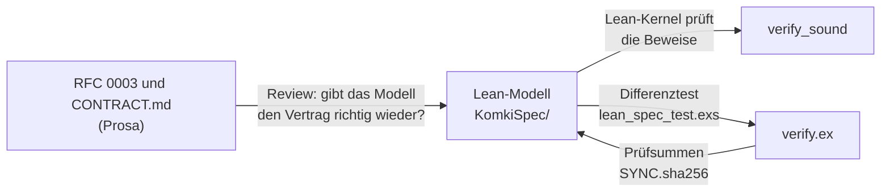

# Lean-Modell des Ableitungsprüfers

Dieses Verzeichnis enthält ein formales Modell von `verify`, dem
Ableitungsprüfer aus `komki_policy`, geschrieben in Lean 4. Damit beweisen
wir, dass `verify` keinen gefälschten Beweisbaum durchlässt. Ein Differenztest
vergleicht außerdem, ob der Elixir-Prüfer genauso urteilt wie das Modell.
Abgedeckt ist bisher der Regelzweig `admit` (Ticket #625).

Das Modell ist nicht Teil von komki. Es prüft im Repo und in der CI, nicht
zur Laufzeit.

## Wozu

`derive` entscheidet, ob eine Operation erlaubt ist, und liefert zu jedem
`permit` einen Beweisbaum: die Prämissen, auf die sich die Entscheidung
stützt. `verify` prüft so einen Baum unabhängig von `derive`: Es rechnet
jede Prämisse aus Registry, Snapshot und Intent nach und übernimmt nichts
ungeprüft aus dem Baum (CONTRACT.md § 5). Die Registry enthält den
Regelstand Γ, der Snapshot die Fakten der Situation, der Intent die
beantragte Operation.

Nimmt `verify` einen Baum an, dessen `permit` nicht aus diesen Eingaben folgt,
kommt eine Entscheidung durch, die die Regeln nicht hergeben. Solche Bäume hat
das Audit dreimal gefunden (#477, #479, #480). Tests mit Beispielbäumen
decken nur die Fälle ab, an die jemand beim Schreiben gedacht hat; ein Beweis
gilt für jeden möglichen Baum.

## Was Lean ist

Lean ist eine funktionale Programmiersprache und zugleich ein
Beweisassistent. Man schreibt darin Funktionen und dazu Sätze über diese
Funktionen, etwa „liefert `verify` `valid`, dann ist `admit` ableitbar“.
Einen Satz akzeptiert Lean erst mit einem vollständigen Beweis, und den prüft
der Lean-Kernel. Vertrauen muss man nur diesem kleinen Programmteil, nicht
dem Beweistext.

Zwei Schlupflöcher gibt es. Das Schlüsselwort `sorry` steht anstelle eines
Beweises, ähnlich einem TODO: Lean nimmt den Satz dann ohne Beweis hin und
warnt nur. Mit `axiom` lässt sich eine beliebige Aussage als wahr annehmen.
Beides fängt die CI ab (siehe [CI](#ci)).

## Was modelliert ist

`KomkiSpec/Verify.lean` bildet `Verify.check/4` aus
`lib/komki_policy/verify.ex` Schritt für Schritt nach, für Bäume des
Regelzweigs `admit`. Dieser Zweig entscheidet über die
[Aufnahme](../../../GLOSSARY.md#aufnahme): ob ein Objekt Teil eines
Arbeitsraums werden darf. Für Bäume der Zweige `emit`, `store` und
`transfer` antwortet das Modell vorerst mit `out_of_scope`.

Die Dateien und was sie enthalten:

| Datei | Inhalt |
|---|---|
| `KomkiSpec/JVal.lean` | JSON-Werte, wie `verify.ex` sie vergleicht |
| `KomkiSpec/Model.lean` | Registry, Snapshot, Intent und Beweisbaum nach der Eingabeprüfung |
| `KomkiSpec/Evaluator.lean` | der dreiwertige Auswerter für Bedingungen (CONTRACT.md § 3) |
| `KomkiSpec/Calculus.lean` | Empfängerkreise und „Erlaubt“ aus RFC 0003 R.5.1 und R.5.2 |
| `KomkiSpec/Verify.lean` | `verify` für `admit` |
| `KomkiSpec/Soundness.lean` | der Beweis, dass `verify` nur ableitbare Entscheidungen annimmt |
| `KomkiSpec/Bridge.lean` | liest die JSON-Eingaben ins Modell ein (unbewiesen) |
| `Main.lean` | das Programm `komki-spec`, das der Differenztest aufruft |
| `Axioms.lean`, `check-axioms.sh` | Axiom-Prüfung der Hauptsätze |
| `SYNC.sha256` | Prüfsummen der nachgebildeten Elixir-Module |

Sätze und Kommentare verwenden die Schreibweise aus RFC 0003:

| Zeichen | Bedeutung |
|---|---|
| Γ | Regelstand, der Inhalt der Registry |
| λ(x) | Label des Objekts x, die Menge seiner Bindungen |
| B_W | Bindungen des Arbeitsraums W |
| R_Γ(L) | Empfängerkreis des Labels L: wer Daten mit diesen Bindungen erhalten darf, also die Schnittmenge der Leser aller Bindungen in L |
| 𝒪 | alle Beobachter der Registry, zugleich der Empfängerkreis des leeren Labels |
| ρ_Γ(c) | Beobachter der Situation c, hier die der Umgebung des Raums |
| Erlaubt_Γ(c, L) | die Verarbeitung c ist unter allen Bindungen in L erlaubt (R.5.2) |

## Was bewiesen ist

### `verify_sound`

Liefert `verify` für einen Baum `valid`, dann ist `admit` allein aus Registry
und Snapshot ableitbar, im Sinne von CONTRACT.md § 4.3. Was der Baum
behauptet, spielt dafür keine Rolle. Die drei gefälschten Bäume aus dem Audit
waren Gegenbeispiele genau zu dieser Aussage, damals für den Elixir-Prüfer.
Der Satz setzt eine Registry voraus, wie `Registry.compile/1` sie liefert
(`Registry.WellFormed`, siehe [Grenzen](#grenzen)).

### `verify_sound_rfc`

Aus `verify_sound` folgt die Aufnahmeregel aus RFC 0003 R.5.4: Das Label des
Objekts liegt in den Bindungen des Raums (λ(x) ⊆ B_W), und die Aufnahme ist
unter allen Raumbindungen erlaubt. Den Schritt von CONTRACT.md § 4.3 zur
Formel des RFC leistet `admitDerivable_permitted`.

### `eval_mono`

Der Auswerter kennt drei Ergebnisse: wahr, falsch und unbekannt, wenn ein Fakt
fehlt. Kommen Fakten hinzu, kann aus „unbekannt“ noch wahr oder falsch werden,
ein bekanntes Ergebnis ändert sich aber nicht mehr. Kein `permit` beruht also
auf einem Fakt, der fehlte (R.5.2, CONTRACT.md § 3).

### `recipients_antitone`, `permitted_antitone`

Kommen zu einem Label Bindungen hinzu, wird der Empfängerkreis nie größer.
Beispiel: Bindung A erlaubt Alice und Bob als Empfänger, Bindung B nur Alice.
Daten mit beiden Bindungen darf nur Alice erhalten. Daraus folgt: Ist eine
Verarbeitung unter einem Label erlaubt, dann auch unter jeder Teilmenge davon
(RFC 0003 A.2).

### `no_forbidden_recipient`

Gehört ein Beobachter nicht zum Empfängerkreis von λ(x), erreicht ihn ohne
Lockerung nichts, was aus x hervorgeht (Kern von A.3). Die
Verarbeitungsschritte sind dabei nur über ihre Wirkung auf Labels modelliert:
Aufnahme mit anschließender Ausgabe (λ(x) ⊆ B_W ⊆ λ(y)) sowie Speichern und
Übergabe, die keine Bindung entfernen. Eine Lockerung kommt im Modell bewusst
nicht vor. Der Satz zeigt, dass die Regeln des RFC keinen verbotenen Empfänger
zulassen. Ob komkis Operationen sich an diese Regeln halten, sagt er nicht.

## Wie Modell und Elixir-Code zusammenhängen

Bewiesen ist das Modell, nicht der Elixir-Code. Was die Beweise für komki
bedeuten, hängt an drei Verbindungen:



- Ob das Modell RFC 0003 und CONTRACT.md richtig wiedergibt, lässt sich nicht
  beweisen. Das klärt das Review.
- Ob `verify.ex` genauso urteilt wie das Modell, prüft der
  [Differenztest](#differenztest), mit vielen Eingaben, aber nicht mit allen.
- Die Prüfsummen in `SYNC.sha256` machen jede Änderung an den nachgebildeten
  Elixir-Modulen sichtbar, damit das Modell nicht unbemerkt veraltet
  (siehe [Wenn sich der Elixir-Code ändert](#wenn-sich-der-elixir-code-ändert)).

### Differenztest

Ein Differenztest (differential testing) gibt zwei Implementierungen
dieselben Eingaben und vergleicht ihre Ergebnisse. Hier urteilen
`Verify.check/4` und der Lean-Prüfer `komki-spec` über dieselben Fälle aus
Registry, Snapshot, Intent und Beweisbaum. Weichen die Urteile auch nur
einmal ab, scheitert der Test. Die Fälle kommen aus zwei Quellen:

- die Beispieldaten unter `priv/fixtures` und die drei gefälschten Bäume aus
  dem Audit (#477, #479, #480);
- 8 000 zufällig erzeugte Welten, jede eine Kombination aus Registry und zwei
  Snapshots. Zu jeder Welt erzeugt `derive` Beweisbäume, auch nach
  Anpassungen an Snapshot und Registry, damit genug `permit`-Bäume
  entstehen. Jeder Baum wird gegen den eigenen und den fremden Snapshot
  geprüft, dazu in einer mutierten Fassung und mit Gleitkomma- statt
  Ganzzahl-Literalen (#626).

Verglichen wird nur, wo Elixir ein Urteil fällt. Lehnt Elixir die Eingabe als
fehlerhaft ab, fällt der Fall heraus, weil das Modell geprüfte Eingaben
voraussetzt. Mit dem festen Seed bleiben rund 12 000 verglichene Fälle. Der
Test verlangt darunter mindestens 600 `valid` und 7 000 `invalid`, damit er
nicht nur Ablehnungen vergleicht.

Dass der Test Fehler findet, ist nachgewiesen: Gegen den Elixir-Prüfer vor
den Audit-Fixes (Commit `ed7c4574^`) findet er Angriffe aller drei Klassen
wieder, auch unter den erzeugten Bäumen. Gegen den Stand vor #626 fand er
eine echte Abweichung: `verify.ex` hatte im Baum `3.0` akzeptiert, wo die
Registry `3` enthält.

## Ausführen

Einmalig elan installieren, die Versionsverwaltung von Lean (siehe
[docs/prerequisites.md](../../../docs/prerequisites.md#lean-4-und-elan)).
Dann im Verzeichnis `apps/komki_policy/lean`:

```bash
lake build          # Modell bauen, Beweise prüfen, komki-spec bauen
./check-axioms.sh   # Axiome der Hauptsätze ausgeben, nur Standardaxiome zulassen
```

Den Differenztest startet man in `apps/komki_policy`:

```bash
mix test --only lean_spec
```

Der normale `mix test` lässt ihn aus. `KOMKI_SPEC_SEED` und `KOMKI_SPEC_RUNS`
ändern Seed und Zahl der Welten. Bei einer Abweichung schreibt der Test die
Fälle als JSONL-Datei ins Temp-Verzeichnis und nennt den Pfad.
`komki-spec verify-batch <datei>` spielt sie nach; das Programm liegt nach
`lake build` unter `.lake/build/bin/`.

## CI

Der Workflow `Lean` (`.github/workflows/lean.yml`) läuft bei Änderungen unter
`apps/komki_policy/`:

1. `lake build` prüft alle Beweise. Jede Warnung gilt als Fehler, also auch
   die Warnung zu einem `sorry`, einem offen gelassenen Beweis.
2. `./check-axioms.sh` zeigt für jeden Hauptsatz aus
   [Was bewiesen ist](#was-bewiesen-ist), auf welchen Axiomen er beruht.
   Zugelassen sind nur Leans drei Standardaxiome, auf denen auch die
   Standardbibliothek aufbaut: `propext`, `Quot.sound` und
   `Classical.choice`. Ein `sorry` erscheint dort als `sorryAx`, ein eigenes
   `axiom` unter seinem Namen. Beides macht den Schritt rot, ebenso ein
   Hauptsatz, der in der Ausgabe fehlt.
3. `mix test --only lean_spec` führt den Differenztest aus.

Die Prüfsummen in `SYNC.sha256` prüft der normale `mix test` im Workflow `CI`,
dafür braucht es kein Lean.

## Wenn sich der Elixir-Code ändert

Das Modell bildet fünf Elixir-Module nach. `SYNC.sha256` hält ihre
Prüfsummen von dem Stand fest, gegen den das Modell zuletzt geprüft wurde.
Ändert sich eines der Module, scheitert `lean_sync_test.exs` im normalen
`mix test`.

| Elixir-Modul | Gegenstück im Lean-Modell |
|---|---|
| `verify.ex` | `KomkiSpec/Verify.lean` |
| `evaluator.ex` | `KomkiSpec/Evaluator.lean` |
| `calculus.ex` | `allowedRecipients` in `KomkiSpec/Verify.lean` |
| `registry.ex` | Sortierung in `KomkiSpec/Bridge.lean`, `Registry.WellFormed`, `Expr.ofJVal` |
| `context.ex` | `KomkiSpec/Model.lean` (Wertebereich nach der Eingabeprüfung) |

Wer eines dieser Module ändert, prüft das Lean-Modell gegen die Änderung und
passt es bei Bedarf an. Danach `lake build` und den Differenztest laufen
lassen und in `apps/komki_policy` die Prüfsummen erneuern:

```bash
shasum -a 256 lib/komki_policy/{calculus,context,evaluator,registry,verify}.ex > lean/SYNC.sha256
```

`derive.ex` steht nicht in der Liste. Seine festen Tabellen (Prämissen von
`admit`, Regelzweige) gleicht der Differenztest direkt mit
`komki-spec constants` ab, dazu das Prüflabel von `admit` (B_W) aus
`Derive.checked_label/3`.

## Grenzen

- **Nur `admit`.** Für Bäume der Zweige `emit`, `store` und `transfer`
  antwortet das Modell mit `out_of_scope`; diese Zweige folgen in #625.
- **Nur das Urteil.** Bewiesen ist, wann `verify` `valid` sagt. Welche
  Befundcodes `verify.ex` meldet und in welcher Reihenfolge, bildet das
  Modell nicht ab.
- **Nur geprüfte Eingaben.** Das Modell setzt voraus, was
  `Registry.compile/1` und `Context` durchsetzen: sortierte, eindeutige
  Mengen, Fakten vom richtigen Typ, Leser ⊆ 𝒪. Für die Registry steht das
  als Voraussetzung `Registry.WellFormed` in `verify_sound`. Die
  Eingabeprüfung selbst ist nicht modelliert; der Differenztest lässt Fälle
  mit Eingabefehler weg.
- **Intent und Snapshot gehören zusammen.** Dass Objekt, Version und Raum des
  Intents zum Snapshot passen, prüft `Context.ensure_coherence/2` vor
  `verify`. Das Modell nimmt es an.
- **Das Einlesen ist unbewiesen.** `KomkiSpec/Bridge.lean` liest JSON ins
  Modell ein und gehört nicht zu den Beweisen. Gleitkommazahlen hält es von
  Ganzzahlen getrennt, so wie `verify.ex` behauptete Ausdrücke strikt
  vergleicht (#626).
- **Treue zum Vertrag.** Ob das Modell RFC 0003 und CONTRACT.md richtig
  wiedergibt, ist eine Frage für das Review, kein Beweis.

## Lizenzen

Lean 4: Apache-2.0. elan: Apache-2.0 und MIT (`LICENSE-APACHE`,
`LICENSE-MIT`). Beide über die GitHub-API am 23.11.2026 geprüft. Keine
weiteren Abhängigkeiten, kein Mathlib.
