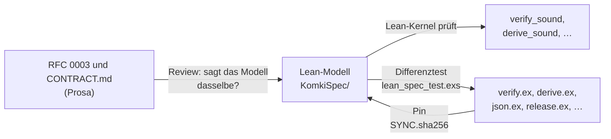

# Lean-Spezifikation von komki_policy

Formales Modell der Policy-Engine in Lean 4: `derive` mit normalem Zweig
und Freigabe-Zweigen, `verify`, der Remedy-Katalog, der Auswerter und der
Standübergang `advance`, mit Beweisen ihrer Korrektheit für die
Regelzweige `admit`, `emit`, `store` und `transfer` (Tickets #625, #629).
Dazu, ausführbar und nur per Differenztest gehalten, die JSON-Schicht
samt Call-Hash.
Der Elixir-Code wird per Differenztest gegen das bewiesene Lean-Modell
gehalten, ein Pin meldet jede Änderung an den gespiegelten Modulen. Die
Spezifikation läuft nicht in komki mit, sie ist ein Prüforakel in Repo und
CI.

## Was bewiesen ist

| Satz | Aussage | Bezug |
|---|---|---|
| `verify_sound` | Akzeptiert `verify` einen Baum, ist seine Regel aus Registry und Snapshot ableitbar (`Derivable`), gleich was der Baum behauptet | RFC 0003 A.7, CONTRACT.md § 4.3, § 4.5, § 4.7, § 4.8, § 5 |
| `verify_sound_rfc`, `derivable_permitted` | Daraus folgt die Regel: λ(x) ⊆ B_W ∧ Erlaubt_Γ(Aufnahme(x, W), B_W); Erlaubt_Γ(Erzeugen(y, W), B_W); B_W ⊆ λ(y) ∧ Erlaubt_Γ(Speicherung oder Übergabe, λ(y)) | R.5.4, CONTRACT.md § 4.5, R.5.6 |
| `verify_emit_assigns` | Ein gültiger `emit`-Baum ordnet λ(y) := B_W zu: `assigned_label` ist als Menge B_W | R.5.5 |
| `handover_within_admitted` | Wird x in einen Raum aufgenommen, erreicht ein geprüftes `store` oder `transfer` aus demselben Raum nur Beobachter in R_Γ(λ(x)) | A.3 an der Engine |
| `derive_sound`, `derive_complete` | `derive` erlaubt genau dann, wenn die Regel ableitbar ist (`Derivable`, dieselbe Aussage, in der `verify_sound` endet) | CONTRACT.md § 4.3–§ 4.5, § 4.7, § 4.8 |
| `derive_verifies` | `verify` akzeptiert jeden Baum, den `derive` baut | CONTRACT.md § 2.5, § 5 |
| `verifyReport_verdict` | Der Bericht von `verify` (Befunde in der Reihenfolge der Prüfschritte, oder der Eingabefehler einer Ausgaberegel; die Eingabeprüfung des Beweisbaums läuft davor) ist leer genau dann, wenn das Urteil `valid` ist; damit gelten die Sätze über `verify` auch für ihn | CONTRACT.md § 5 |
| `proofError_decodes` | Jeder Beweisbaum, den die Eingabeprüfung von `verify` annimmt (`proofError`, wie `validate_proof/1`), liegt im Modell, jede Prämisse mit einer der vier Arten | CONTRACT.md § 2.5, § 5 |
| `snapshotError_validated` | Jeder Snapshot, den `Context.validate_snapshot/2` annimmt (`snapshotError`), liegt im Modell und im Wertebereich der Sätze (`Snapshot.validated`) | CONTRACT.md § 2.2 |
| `derive_permit_stable`, `derive_deny_stable` | Mehr Fakten machen aus einem `permit` oder `deny` nichts anderes; nur ein `indeterminate` löst sich auf | R.5.2, B.4, CONTRACT.md § 4.4 |
| `aktion_permit` | Eine Aktionsfreigabe überbrückt weder einen ungültigen Vertrag noch eine entfernte Bindung, bei `store` weder den Empfängertest (#417) noch eine unbelegte Beobachterliste (#432); Fenster, Nonce, Geltungsbereich, Call-Hash und Autorität stimmen | CONTRACT.md § 4.6, R.6 |
| `offenlegung_permit` | Eine Offenlegungsfreigabe erlaubt nur `store`, mit gültigem Vertrag, erhaltener Bindung, belegter Beobachterliste, der geschlossenen Ausgabeart und dem Ziellabel, der Befugnis für jede gelockerte Bindung (BerechtigtZurLockerung) und einem Ziellabel, dessen Leser den Speicher abdecken | CONTRACT.md § 4.9, R.5.7 |
| `release_single_use` | Ist der Verbrauch committet, erlaubt dieselbe Freigabe nie wieder, an keinem späteren Stand | CONTRACT.md § 2.7, B.8 |
| `advance_cas` | Von zwei Vorschlägen für denselben Stand committet höchstens einer | CONTRACT.md § 2.7 |
| `catalog_aktion_effective`, `catalog_offenlegung_effective` | Bietet der Katalog einer Ablehnung des normalen Zweigs ein GO für den exakten Call an, erlaubt der Freigabe-Zweig eine Freigabe genau nach diesem Angebot | CONTRACT.md § 2.8, #631 |
| `release_catalog_*_effective`, `release_remedies_*_effective` | Ebenso nach einer Ablehnung im Freigabe-Zweig: Das erneute GO, das der Katalog anbietet, wirkt an jedem Stand mit dort frischer Nonce, passendem Fenster und einem Beobachter als Autorität, der jede nötige Befugnis hat | CONTRACT.md § 2.8, § 4.6, § 4.9 |
| `release_catalog_offenlegung_grantable` | Und jemand kann es annehmen: Bietet der Katalog nach einer abgelehnten Offenlegungsfreigabe ein GO an, gibt es einen Beobachter, dessen Freigabe erlaubt wird | CONTRACT.md § 2.8 |
| `catalog_gos` | Die GO-Angebote des ganzen Katalogs (`catalog`) sind Eintrag für Eintrag die, über die die Wirksamkeitssätze sprechen (`catalogGos`), für jeden Befund, den `derive` meldet | CONTRACT.md § 2.8 |
| `remedies_aktion_effective`, `remedies_offenlegung_effective` | Daraus: Jedes GO, das ein Eintrag des ganzen Katalogs einer Ablehnung des normalen Zweigs anbietet, wirkt | CONTRACT.md § 2.8 |
| `catalog_ascending` | In jedem Eintrag des Katalogs stehen die Fortsetzungen in der normativen Ordnung: kein GO vor einer Fortsetzung, die nichts verletzt | CONTRACT.md § 2.8 |
| `derive_fakt_deny`, `derive_fakt_indeterminate` | `fakt_nachreichen` fragt nach genau dem Feld, das sein Befund nennt, nie nach keinem | CONTRACT.md § 2.8 |
| `derive_blockers_named`, `derive_evidence_named` | Was ein Befund nennt, ist das, was § 2.8 meint: bei `missing_fact` einen Fakt, der im Snapshot fehlt; bei `recipients_unproven` die Beobachterliste, die nicht `true` ist; bei `basis_right_false` einen Basisfakt der Regel, der `false` ist, bei `audit_path_not_ready` genau `audit_path_ready`; bei `binding_condition_false` ein Feld der falschen Bedingung, und keines nur, wenn die Bedingung unabhängig von den Fakten `false` ist | CONTRACT.md § 2.8, § 4.3, § 4.4 |
| `derive_transformations_listed` | `registrierte_transformation` listet bei `label_not_included` genau die registrierten Transformationen mit `input_labels ⊆ λ(x)` und `output_labels ⊆ B_W`, in der Reihenfolge der Registry | CONTRACT.md § 2.1, § 2.8 |
| `remedies_transformation` | `registrierte_transformation` bietet nur registrierte Transformationen mit `input_labels ⊆ λ(x)` und `output_labels` im Prüflabel an; ein Objekt mit diesen Labels besteht die Label-Inklusion | CONTRACT.md § 2.1, § 2.8 |
| `catalog_neuerRaum`, `neuer_raum_necessary`, `neuer_raum_recipients_necessary` | `neuer_raum` trägt `required_bindings` = λ(x) bei `admit`, sonst `[]`, und `required_recipients` = ρ_Γ(c). Beides ist notwendig: Jeder Raum, in dem `derive` x aufnimmt, hat alle `required_bindings`; jeder Raum in derselben Umgebung, in dem `derive` erlaubt, lässt alle `required_recipients` unter seinem Prüflabel zu | CONTRACT.md § 2.8, B.7 |
| `derive_deny_remedied`, `derive_indeterminate_remedied`, `release_remedied` | Jeder Blocker und jeder fehlende Beleg von `derive`, auch im Freigabe-Zweig, bekommt mindestens eine Fortsetzung, kein nacktes `deny` | CONTRACT.md § 2.8, APPA Theorem 5 |
| `eval_mono` | Mehr Fakten kippen kein bekanntes Urteil des dreiwertigen Auswerters | R.5.2, CONTRACT.md § 3 |
| `recipients_antitone`, `permitted_antitone` | Mehr Bindungen, nie mehr Empfänger; Erlaubt vererbt sich auf Teilmengen | A.2 |
| `no_forbidden_recipient` | Ohne Lockerung erreicht nichts, was von x abhängt, einen Beobachter außerhalb von R_Γ(λ(x)) | Kern von A.3: nur die Labels, ohne Schrittmodell |
| `Registry.compiledOk_sound`, `Snapshot.validated_sound` | Was die Eingabeprüfung im Modell zusichert (`Registry.compiledOk`, `Snapshot.validated`), erfüllt die Voraussetzungen der übrigen Sätze | CONTRACT.md § 2.1, § 2.2, § 3 |

Kein `sorry`: `lake build` behandelt jede Warnung als Fehler.
`./check-axioms.sh` zeigt die Axiome je Hauptsatz und lässt nur Leans
Standardaxiome durch (`propext`, `Quot.sound`, `Classical.choice`); ein
eigenes `axiom` oder ein `sorry` macht es rot.

Die drei geschmiedeten Beweise aus dem Audit (#477, #479, #480) waren
Gegenbeispiele genau zu `verify_sound`, für den damaligen Elixir-Prüfer. Der
Differenztest findet sie gegen den Stand vor ihrer Behebung (Commit
`ed7c4574^`) wieder, alle drei Klassen. Ebenso die Ausgabebäume auf einem
Quarantäneobjekt oder ohne Digest (#628): `verify` bestätigte sie, obwohl
`derive` für diesen Snapshot gar nicht entscheidet.

`handover_within_admitted` setzt voraus, dass beide Snapshots dasselbe B_W
nennen. B_W ist unveränderlich (RFC 4.1); das durchzusetzen ist Sache des
Vermittlers, nicht der Engine.

Die Sätze setzen voraus, was `Registry.compile/1` und `Context` durchsetzen
(`Registry.WellFormed`, `Registry.AuthoritiesKnown`, `Snapshot.WellFormed`:
Leser und Befugnis-Autoritäten ⊆ 𝒪, sortierte und eindeutige Labels,
geschlossene Klassifikation, boolesche Basisfakten; dazu 𝒪 ≠ ∅ für
`release_catalog_offenlegung_grantable`, `validate_observers/1`). Die Brücke prüft alles
an jedem Fall des Differenztests (`Registry.wellFormed_sound`,
`Registry.wellFormed_authorities`, `Snapshot.wellFormed_sound`). Dass
`Registry.compile/1` und `Context` das wirklich durchsetzen, prüft ein
eigener Differenztest mit verdorbenen Eingaben (siehe unten).

## Vertrauenskette



Bewiesen ist das Modell. Ob es den Vertrag richtig wiedergibt, ist eine
Review-Frage. Ob der Elixir-Code dem Modell folgt, prüft der Differenztest,
nicht ein Beweis.

## Ausführen

Einmalig elan installieren (siehe [docs/prerequisites.md](../../../docs/prerequisites.md#lean-4-und-elan)),
dann im Verzeichnis `apps/komki_policy/lean`:

```bash
lake build          # Beweise prüfen, komki-spec bauen
./check-axioms.sh   # Axiome der Hauptsätze, nur Standardaxiome
```

Den Differenztest startet man in `apps/komki_policy`:

```bash
mix test --only lean_spec
```

Für `verify` vergleicht er drei Quellen. Erstens die Fixtures unter `priv/fixtures` samt
den geschmiedeten Beweisen aus dem Audit (#477, #479, #480) und den
Ausgabebäumen außerhalb ihres Wertebereichs (#628). Zweitens 8 000 zufällige
Welten, je eine Regel: Registry, zwei Snapshots und Bäume aus fremden,
reparierten und um Regeln ergänzten Welten. Drittens Varianten dieser Bäume:
mit Gleitkomma- statt Ganzzahl-Literalen (#626), mutiert, außerhalb des
Wertebereichs, unter der jeweils anderen Übergaberegel, je Behauptungsfeld
vertauscht oder ersetzt, und der stärkste Fälscher: ein Baum, der jede
Behauptung aus der Zielwelt spiegelt, einen falschen Fakt als `false`.
Verglichen wird der ganze Bericht: das Urteil und die Befunde in ihrer
Reihenfolge samt Bindung und Fakt, oder Code und Pfad jedes
Eingabefehlers nach einer kompilierten Registry: Intent, Snapshot und
ihre Kohärenz, die Snapshot-Voraussetzung einer Ausgaberegel und die
Eingabeprüfung des Beweisbaums (dazu Mutationen an seiner Form: Schema, fremde Felder,
falsche Typen, fehlende Schlüssel). Jeder Befundcode aus `verify.ex` und
jeder Code dieser Eingabefehler muss dabei vorkommen.
Für `derive` vergleicht er die Entscheidung über denselben Welten und den
Fixtures: Urteil, Prüflabel, Blocker samt `condition` und
`recipients_outside`, fehlende Belege, den ganzen Beweisbaum,
`assigned_label`, `content_digest`, dazu `unsupported` und jeden
Eingabefehler mit Code und Pfad, je Welt auch mit einem verdorbenen Feld
in Snapshot oder Intent und `start` mit verdorbenem Snapshot (#644), und
den ganzen Remedy-Katalog: je Befund alle Fortsetzungen in
ihrer Ordnung samt Payload (Fakt, Transformation, `required_bindings`,
`required_recipients`, Call-Hash). Nicht verglichen werden nur die Echos
der Eingabe.

Für die Freigabe-Zweige vergleicht er dasselbe samt geplantem Verbrauch
(`release`), über den Fixtures mit Freigabe und je Welt drei Varianten
(gültig, falscher Call-Hash, fremder Geltungsbereich, Fenster davor oder
danach, verbrauchte Nonce, unbekannte Autorität, Offenlegungsfreigaben mit
passender oder falscher Ausgabeart und Ziellabel). Für `advance` vergleicht
er den nächsten Stand oder den Ablehnungsgrund, auch für die Wiederholung
nach einem Commit. Die Schemaprüfungen von Freigabe, Stand und Vorschlag
(`KomkiSpec/ReleaseInput.lean`) vergleicht er an je einem Fixture mit
Aktions- und Offenlegungsfreigabe: jede Verderbung aus seinem Katalog
allein, jedes geordnete Paar, Freigabe mit Stand, Intent mit Freigabe und
Stand mit Vorschlag, jeweils Code und Pfad des ersten Fehlers.

Den Auswerter vergleicht er auch direkt: die Grenzfälle aus
`priv/fixtures/expressions/evaluate_expectations.json` und 8 000
generierte Ausdrücke über generierten Fakten, Urteil gegen Urteil.

Die Eingabeprüfung vergleicht er mit verdorbenen Eingaben: Je Welt wird
die Registry an einer Stelle beschädigt (fremder Leser, fremde Autorität,
fremder Umgebungsbeobachter, leere oder doppelte Leser, unbekanntes Ein-
oder Ausgabelabel einer Transformation, leere Eingabelabels, ein in
`fact_fields` umdeklarierter Basisfakt, ein Ausdruck mit unbekanntem Feld, falschem
Literaltyp, Gleitkommazahl, negativer Schranke, falschem Operator für den
Feldtyp oder falscher Form) und der Snapshot ebenso (unsortierte oder
doppelte Bindungen und Labels, unbekannte Bindung oder Umgebung, Fakt mit
falschem Typ, auch ein Basisfakt als String, `string_set` mit einem
Nicht-String, undeklarierter Fakt, fremde Klassifikation), jeweils oder
beides unverdorben. Was `Registry.compile/1` und
`Context.validate_snapshot/2` annehmen, muss `Registry.compiledOk`
beziehungsweise `Snapshot.validated` erfüllen: die Voraussetzungen der
Sätze und typrichtige Ausdrücke und Fakten nach § 3, mit denen die
Zweige des Auswerters für falsch typisierte Werte unerreichbar sind.
Dazu verdirbt er je Code und Pfad von `validate_intent/1`,
`validate_snapshot/2` und `ensure_coherence/2` ein Feld von Intent oder
Snapshot (auch ein fehlendes Feld oder den ganzen Datensatz), an einer Welt auch jedes geordnete Paar zweier solcher Felder,
damit die Reihenfolge der Prüfungen zählt, und vergleicht den ersten
Fehler mit `contextError` aus
`KomkiSpec/ContextInput.lean`; `snapshotError_validated` beweist, dass
jeder Snapshot, den es annimmt, im Wertebereich liegt.

Die JSON-Schicht vergleicht er Byte für Byte: die Fixtures, Randfälle der
Grammatik und von UTF-8, Verschachtelung um die Tiefengrenze des Encoders
(#473), 8 000 generierte Dokumente mit wechselndem Leerraum und wechselnden
Escapes, vier von fünf um ein Byte verändert oder abgeschnitten, dazu
die Überlaufgrenze der Gleitkommazahlen und je Klasse von UTF-8-Leitbytes
eine gültige und eine kaputte Folge. Verglichen werden der
Fehlercode von `JSON.parse/1` oder die kanonische Form samt SHA-256.
Gleitkommazahlen werden geparst, aber als Marker verglichen, weil
`Float.to_string/1` nicht modelliert ist. Den Call-Hash rechnet die Brücke
selbst (`callHashOf`); jede Entscheidung und jeder Katalog, die ihn
nennen, vergleicht ihn so mit `Release.call_hash/4`.

Die CLI vergleicht er auf Dateibytes: `komki-policy decide` (auch mit
`--release`/`--stand`), `verify` und `advance` laufen über `CLI.run/1` auf
Dateien aus den Welten der übrigen Tests, jede vierte mit einem
veränderten Byte in einer Datei, jede achte ab einer wechselnden Datei mit
einem eigenen Parserfehler je Datei, dazu `decide` mit unbekannter Umgebung, mit und ohne
Freigabe, für die eigene Operation und für `start`, und ohne Freigabe `start`
mit einem Snapshot ohne `object`, den nur die vorgezogene
`unsupported`-Prüfung von `decide_validated?/4` beantwortet (#644). Das Modell liest
dieselben Bytes mit dem strengen Parser in der Reihenfolge der CLI und
entscheidet; verglichen werden Exit-Code (§ 7), Fehlercode des Parsers und
die Felder der Ausgabe, die das Modell kennt: die Entscheidung ohne die
Echos der Eingabe, der Prüfbericht von `verify`, `result` bei `unsupported`
und `refused`, der neue Stand. `validate`, `plan`, Bedienfehler, Lesefehler
und Exit 4 deckt nur
`cli_test.exs` ab.

Ein weiterer Test prüft in Elixir, was `catalog_*_effective` und
`release_catalog_*_effective` für das Modell beweisen: Jedes angebotene GO
für den exakten Call, nach einer Ablehnung im normalen wie im
Freigabe-Zweig, wird zu einer Freigabe mit frischer Nonce, und der
Freigabe-Zweig muss erlauben.

`KOMKI_SPEC_SEED` und `KOMKI_SPEC_RUNS` erweitern die Suche. Eine Abweichung
schreibt ihre Fälle als JSONL-Datei; `komki-spec verify-batch`,
`derive-batch`, `release-batch`, `advance-batch`, `eval-batch`,
`domain-batch`, `json-batch` beziehungsweise `cli-batch` spielt sie nach.

## Synchron halten

`SYNC.sha256` pinnt die Elixir-Module, die das Modell Schritt für Schritt
spiegelt. Ändert sich eines, schlägt `lean_sync_test.exs` im normalen
`mix test` fehl, auch ohne Lean-Installation.

| Elixir | Lean |
|---|---|
| `derive.ex` | `KomkiSpec/Derive.lean` (normaler Zweig, Beweisbaum), `KomkiSpec/Release.lean` (Freigabe-Zweige), `callHashOf` in `KomkiSpec/CallHash.lean` (`output_call_hash/2`) |
| `remedies.ex` | `catalogGos` in `KomkiSpec/Release.lean` (GO-Angebote), `catalog` in `KomkiSpec/Remedies.lean` |
| `stand.ex` | `advance` in `KomkiSpec/Release.lean`, `standError` und `proposalError` in `KomkiSpec/ReleaseInput.lean` |
| `verify.ex` | `KomkiSpec/Verify.lean` (Urteil), `KomkiSpec/VerifyReasons.lean` (Befunde), `KomkiSpec/ProofInput.lean` (Eingabeprüfung des Beweisbaums) |
| `validations.ex` | `firstUnknown` in `KomkiSpec/ProofInput.lean` (`closed_fields/3`: erstes unbekanntes Feld in Sortierreihenfolge), `kebabJ`, `objectRefJ` und `strIn knownOperations` in `KomkiSpec/ContextInput.lean` (`require_kebab/2`, `require_object_ref/2`, `require_operation/2`) |
| `cli.ex` | `cliFiles` und `cliCase` in `KomkiSpec/Bridge.lean` (Lesereihenfolge der Dateien, Exit-Codes) |
| `evaluator.ex` | `KomkiSpec/Evaluator.lean` |
| `calculus.ex` | `allowedRecipients` in `KomkiSpec/Verify.lean`, `lockerungsbeduerftig` und `lockerungsbefugte` in `KomkiSpec/Release.lean` |
| `registry.ex` | `kebab` in `KomkiSpec/ContextInput.lean` (`kebab_id?/1`), Sortierung in `KomkiSpec/Bridge.lean`, `Registry.WellFormed`, `Expr.ofJVal`, `Registry.compiledOk` und `Expr.typed` in `KomkiSpec/Input.lean` |
| `json.ex` | `KomkiSpec/Json.lean` (Parser, kanonischer Encoder) |
| `release.ex` | `callHashOf` in `KomkiSpec/CallHash.lean`, SHA-256 in `KomkiSpec/Sha256.lean`, `releaseError` in `KomkiSpec/ReleaseInput.lean` |
| `context.ex` | `KomkiSpec/ContextInput.lean` (Eingabeprüfung von Intent und Snapshot, Kohärenz), `KomkiSpec/Model.lean`, `Snapshot.WellFormed` in `DeriveSound.lean`, `Snapshot.wellFormed` in `Domain.lean`, `Snapshot.validated` in `Input.lean` (Wertebereich nach der Eingabeprüfung) |

Dann das Lean-Modell gegen die Änderung prüfen und anpassen, `lake build`
und den Differenztest laufen lassen und den Pin erneuern:

```bash
shasum -a 256 lib/komki_policy/{calculus,cli,context,derive,evaluator,json,registry,release,remedies,stand,validations,verify}.ex > lean/SYNC.sha256
```

Die Tabellen aus `derive.ex` (Prämissen je Regel, Regelzweige,
Ausgabe- und Übergaberegeln) prüft der Differenztest direkt gegen
`komki-spec constants`, dazu das Prüflabel je Regel aus
`Derive.checked_label/3`.

## Grenzen

- **Vom Remedy-Katalog sind Wirksamkeit, Ordnung, Vollständigkeit und
  die Payload-Zusagen aus § 2.8 bewiesen**: das Feld von
  `fakt_nachreichen`, die Liste der Transformationen, notwendige Bindungen
  und Empfänger von `neuer_raum`. Dass die Registry ihre Transformationen
  nach Kennung sortiert hält, besorgt die unbewiesene Brücke wie
  `Remedies.matching_transformations/2`. Die Wirksamkeitssätze sprechen über
  `catalogGos` (`Release.lean`), Ordnung und Vollständigkeit über `catalog`
  (`Remedies.lean`); `catalog_gos` zeigt, dass beide dieselben GOs
  anbieten.
- **Lockerung nach dem Vertrag.** `BerechtigtZurLockerung` folgt CONTRACT.md
  § 4.9 Schritt 6: Befugnis nur für Bindungen, deren Leser den Speicher
  nicht abdecken. RFC 0003 R.5.7 verlangt sie für jede entfernte Bindung
  (∀ b ∈ L∖L′). Die Abweichung liegt im Vertrag, nicht im Code; zu
  entscheiden in #638.
- **Call-Hash als Parameter der Sätze.** Das Modell nimmt den Hash des
  entschiedenen Calls als Parameter; die Sätze gelten für jeden Wert, also
  auch für `callHashOf`, den die Brücke rechnet (SHA-256 über die
  kanonische Form, § 2.6). Dass verschiedene Calls verschiedene Hashes
  haben, setzt die Kollisionsresistenz von SHA-256 voraus; beweisen lässt
  sie sich nicht. Die vier beschreibenden Felder einer Freigabe
  (`operation`, `object`, `workspace`, `content_digest`) prüft auch
  Elixir nur auf ihre Form; an den Call bindet allein `call_hash` (#655).
- **JSON-Schicht ausführbar, nicht bewiesen.** `Json.lean` und
  `Sha256.lean` sind ausführbare Spezifikationen, die der Differenztest am
  Elixir-Code hält; Sätze über sie gibt es nicht. Gleitkommazahlen druckt
  der Encoder nicht.
- **Ohne Zielarbeitsraum.** R.5.6 verlangt bei der Übergabe an einen
  Zielarbeitsraum zusätzlich dessen Aufnahmeregel. CONTRACT.md § 4.8
  klammert das aus (#270), das Modell auch.
- **Bei `verify` ist nur die Leere des Berichts bewiesen**
  (`verifyReport_verdict`). Codes, Reihenfolge, Bindung und Fakt der
  Befunde sowie Code und Pfad der Eingabefehler hält der Differenztest.
- **Nur der geprüfte Wertebereich.** Das Modell setzt voraus, was
  `Registry.compile/1` und `Context` durchsetzen (siehe oben). Dass sie es
  durchsetzen, prüft der Differenztest für die Verderbungen seines
  Katalogs, je eine für jede Prüfung, auf der die Sätze ruhen, und nur in
  dieser Richtung: Lehnt Elixir mehr ab, als das Modell verlangt (Schema,
  Kennungsformat, geschlossene Felder, Quellenangabe der Fakten, Sortierung
  von Lesern und Transformationslabels, Vokabular der Befugnisse,
  Operationsnamen, `identity`, `registry_ref`), hält das für `Context`
  der Vergleich mit `contextError`, für `Registry.compile/1` niemand,
  ebenso dessen Fehlercodes. Für `verify` ist jeder Eingabefehler nach
  einer kompilierten Registry modelliert (Intent, Snapshot, Kohärenz,
  Snapshot-Voraussetzung der Ausgaberegeln (#628), Beweisbaum), ebenso
  für `derive` (Intent, `unsupported`, Snapshot, Kohärenz, #628, im
  Freigabe-Zweig dazu die Schemata von Freigabe und Stand) und für
  `advance` (Stand und Vorschlag). Wo Elixir außerhalb des
  Bereichs abstürzen würde, etwa bei einem Ausdruck außerhalb von B.4,
  verweigert das Modell (`missing_operation_rule`).
- **Die Brücke ist unbewiesen.** `KomkiSpec/Bridge.lean` liest die Fälle
  mit Leans eigenem JSON-Parser ins Modell ein; nur `cli-batch` und
  `json-batch` lesen die Dateibytes mit `Json.lean`. Gleitkommazahlen hält
  sie von Ganzzahlen getrennt, so wie `verify.ex` behauptete Ausdrücke
  strikt vergleicht (#626).

## Lizenzen

Lean 4: Apache-2.0. elan: Apache-2.0 und MIT (`LICENSE-APACHE`,
`LICENSE-MIT`). Beide über die GitHub-API am 23.11.2026 geprüft. Keine
weiteren Abhängigkeiten, kein Mathlib.
