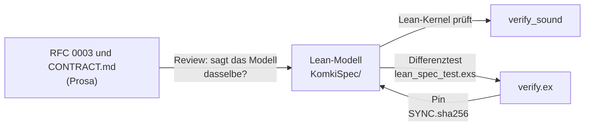

# Lean-Spezifikation von komki_policy

Formales Modell des Ableitungsprüfers `verify` in Lean 4, mit Beweis seiner
Korrektheit für den Regelzweig `admit` (Ticket #625). Der Elixir-Prüfer
(`lib/komki_policy/verify.ex`) wird per Differenztest gegen das bewiesene
Lean-Modell gehalten, ein Pin meldet jede Änderung an den gespiegelten
Modulen. Die Spezifikation läuft nicht in komki mit, sie ist ein Prüforakel
in Repo und CI.

## Was bewiesen ist

| Satz | Aussage | Bezug |
|---|---|---|
| `verify_sound` | Akzeptiert `verify` einen Baum, ist `admit` aus Registry und Snapshot ableitbar, gleich was der Baum behauptet | RFC 0003 A.7, CONTRACT.md § 4.3, § 5 |
| `verify_sound_rfc` | Daraus folgt die Aufnahmeregel: λ(x) ⊆ B_W ∧ Erlaubt_Γ(Aufnahme(x, W), B_W) | R.5.4 |
| `eval_mono` | Mehr Fakten kippen kein bekanntes Urteil des dreiwertigen Auswerters | R.5.2, CONTRACT.md § 3 |
| `recipients_antitone`, `permitted_antitone` | Mehr Bindungen, nie mehr Empfänger; Erlaubt vererbt sich auf Teilmengen | A.2 |
| `no_forbidden_recipient` | Ohne Lockerung erreicht nichts, was von x abhängt, einen Beobachter außerhalb von R_Γ(λ(x)) | Kern von A.3: nur die Labels, ohne Schrittmodell |

Kein `sorry`: `lake build` behandelt jede Warnung als Fehler.
`./check-axioms.sh` zeigt die Axiome je Hauptsatz und lässt nur Leans
Standardaxiome durch (`propext`, `Quot.sound`, `Classical.choice`); ein
eigenes `axiom` oder ein `sorry` macht es rot.

Die drei geschmiedeten Beweise aus dem Audit (#477, #479, #480) waren
Gegenbeispiele genau zu `verify_sound`, für den damaligen Elixir-Prüfer. Der
Differenztest findet sie gegen den Stand vor ihrer Behebung (Commit
`ed7c4574^`) wieder, alle drei Klassen.

## Vertrauenskette



Bewiesen ist das Modell. Ob es den Vertrag richtig wiedergibt, ist eine
Review-Frage. Ob der Elixir-Code dem Modell folgt, prüft der Differenztest,
nicht ein Beweis.

## Ausführen

Einmalig elan installieren (siehe [docs/prerequisites.md](../../../docs/prerequisites.md#lean-4-und-elan)),
dann im Verzeichnis `apps/komki_policy/lean`:

```bash
lake build          # Beweise prüfen, komki-spec bauen
./check-axioms.sh   # Axiome der Hauptsätze, nur Standardaxiome
```

Den Differenztest startet man in `apps/komki_policy`:

```bash
mix test --only lean_spec
```

Er vergleicht drei Quellen: die Fixtures unter `priv/fixtures` samt den
geschmiedeten Beweisen aus dem Audit (#477, #479, #480), 8 000 zufällige
Welten (Registry, zwei Snapshots, Bäume aus fremden, reparierten und um
Regeln ergänzten Welten) und Varianten dieser Bäume: mit Gleitkomma- statt
Ganzzahl-Literalen (#626) und mit Mutationen. Verglichen wird
nur, wo Elixir ein Urteil fällt; ein Eingabefehler fällt heraus.
`KOMKI_SPEC_SEED` und `KOMKI_SPEC_RUNS` erweitern die Suche. Eine Abweichung
schreibt ihre Fälle als JSONL-Datei; `komki-spec verify-batch <datei>`
spielt sie nach.

## Synchron halten

`SYNC.sha256` pinnt die Elixir-Module, die das Modell Schritt für Schritt
spiegelt. Ändert sich eines, schlägt `lean_sync_test.exs` im normalen
`mix test` fehl, auch ohne Lean-Installation.

| Elixir | Lean |
|---|---|
| `verify.ex` | `KomkiSpec/Verify.lean` |
| `evaluator.ex` | `KomkiSpec/Evaluator.lean` |
| `calculus.ex` | `allowedRecipients` in `KomkiSpec/Verify.lean` |
| `registry.ex` | Sortierung in `KomkiSpec/Bridge.lean`, `Registry.WellFormed`, `Expr.ofJVal` |
| `context.ex` | `KomkiSpec/Model.lean` (Wertebereich nach der Eingabeprüfung) |

Dann das Lean-Modell gegen die Änderung prüfen und anpassen, `lake build`
und den Differenztest laufen lassen und den Pin erneuern:

```bash
shasum -a 256 lib/komki_policy/{calculus,context,evaluator,registry,verify}.ex > lean/SYNC.sha256
```

Die Tabellen aus `derive.ex` (Prämissen von `admit`, Regelzweige) prüft
der Differenztest direkt gegen `komki-spec constants`, dazu das Prüflabel
von `admit` (B_W) aus `Derive.checked_label/3`.

## Grenzen

- **Nur `admit`.** Bäume für `emit`, `store` und `transfer` sind
  `out_of_scope`; ihre Zweige folgen in #625.
- **Nur das Urteil.** Befundcodes und ihre Reihenfolge modelliert die
  Spezifikation nicht.
- **Nur der geprüfte Wertebereich.** Das Modell setzt voraus, was
  `Registry.compile/1` und `Context` durchsetzen: sortierte, eindeutige
  Mengen, typgerechte Fakten, Leser ⊆ 𝒪 (`Registry.WellFormed`, Hypothese
  von `verify_sound`). Die Eingabeprüfung selbst ist nicht modelliert; der
  Differenztest lässt Fälle mit Eingabefehler weg.
- **Kohärenz von Intent und Snapshot liegt außerhalb.** Dass Objekt,
  Version und Raum des Intents zum Snapshot passen, prüft
  `Context.ensure_coherence/2` vor `verify`; das Modell nimmt es an.
- **Die Brücke ist unbewiesen.** `KomkiSpec/Bridge.lean` liest JSON ins
  Modell ein. Gleitkommazahlen hält sie von Ganzzahlen getrennt, so wie
  `verify.ex` behauptete Ausdrücke strikt vergleicht (#626).

## Lizenzen

Lean 4: Apache-2.0. elan: Apache-2.0 und MIT (`LICENSE-APACHE`,
`LICENSE-MIT`). Beide über die GitHub-API am 23.11.2026 geprüft. Keine
weiteren Abhängigkeiten, kein Mathlib.
