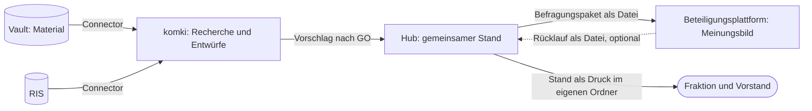

# ratsprojekte wird der lokale Hub für den Weg von der Idee zum Antrag

Der Weg zu einem Antrag hat mehrere Beteiligte: Eine Idee entsteht, die Fraktion redet darüber, Vorstand und Basis werden gefragt, Fakten kommen dazu, ein Antrag geht in den Rat, der Beschluss muss nachverfolgt werden. Bisher hält das kein Werkzeug zusammen. ratsprojekte ist für eine Person gedacht, Menschen können dort nichts eingeben, und sein Modell kennt weder Kreise noch Anträge. Der tatsächliche Stand liegt in einem ODS-Sheet (#54) und in Köpfen. Wir bauen ratsprojekte deshalb um: Es wird der Hub, der den gemeinsamen Stand führt. Im ersten Wurf läuft er lokal, eine Person führt ihn, und alle anderen bekommen eine bewusst ausgegebene Fassung. Die Frage „Wo stehen wir eigentlich?“ soll niemand mehr einzeln beantworten müssen.

Geprüft ist das an einem [Storyboard mit durchklickbarem Modell](../../apps/ratsprojekte/storyboard/hub-desktop.html). Es zeigt, dass sich die Abläufe bedienen lassen, nicht, dass sie im Alltag gepflegt werden. Das zeigt erst die eigene Nutzung mit dem echten Bestand, die zunächst der Entwickler selbst übernimmt. Ob jemand ohne Technikkenntnisse zurechtkommt, ist damit nicht belegt und bleibt zu prüfen, bevor eine andere Person den Hub führt.

## Entscheidung

**Vier Werkzeuge, je eine Art von Wahrheit.**

Der Vault bleibt Quelle für Material, der Hub wird Quelle für den Stand. Der Hub schreibt nie in den Vault und nie ins RIS. Eine Idee darf im Hub entstehen, ohne dass es dazu eine Vault-Notiz gibt.

**Die Oberfläche ist für Menschen ohne Technikkenntnisse gemacht, den Betrieb übernimmt vorerst die Entwicklung.** Die Oberfläche spricht Alltagssprache und kommt ohne Terminal aus. Start und Sicherung liegen vorerst bei einer technisch versierten Person. Eine installierbare Fassung kommt erst, wenn jemand anderes den Hub wirklich nutzen will.

**Personas, Kreise und Entscheidungsrechte sind getrennt.** Eine Persona ist ein Mensch mit einem Ziel, ein Kreis ist, wer eine bestimmte Fassung zu sehen bekommt, und ein Entscheidungsrecht gehört einem Gremium. Der Hub hält fest, wer entschieden hat, und erzwingt nichts.

| Kreis | Wer | Fassung |
|---|---|---|
| Redaktion | die Person, die den Hub führt | Arbeitsansicht: alles, auch private Einträge und Querverweise |
| Engerer Kreis | Fraktion und Vorstand | Stand: was neu ist, wer dran ist, Entscheidungen, Meinungsbilder, Fakten, Anträge |
| Basis | wer den Aufruf-Link einer Befragung hat | Befragungstexte: eigens geschriebener Titel, Situation, Vorschlag, Hintergrund |
| Öffentlichkeit | alle | eingereichter Antrag und Beschluss |

Externe wie Elternbeirat, Vereine oder andere Fraktionen bekommen nichts aus dem Hub. Was sie sagen, wird als Meinungsbild eingetragen, vertrauliche Gespräche als privater Eintrag. Rechte je Eintrag gibt es nicht, nur diese festen Fassungen. Bevor ein Stand hinausgeht, sieht die Redaktion genau das Dokument.

Die Entscheidungsrechte sind mit Fraktion und Vorstand abgestimmt. komki entscheidet keine davon.

| Entscheidung | Wer entscheidet | Wer beteiligt ist |
|---|---|---|
| Eine Idee aufnehmen | Fraktion oder Vorstand | Die Basis schlägt vor, die Redaktion trägt ein. |
| Die Basis befragen | Vorstand, auch darüber, wer den Aufruf-Link bekommt | Die Fraktion wird vorher gehört, kann die Befragung aber nicht verhindern. Die Redaktion bereitet vor. |
| Weiter ausarbeiten | Fraktion | Der Vorstand wird gehört. Das Meinungsbild der Basis bindet nicht und kennt keine Mindestzahl, Fraktion und Vorstand ordnen es selbst ein. |
| Antrag einreichen | Fraktion allein, freies Mandat | Vorstand und Basis werden informiert. Die Redaktion reicht ein und trägt nach. |
| Stand weitergeben | Redaktion, bei jeder Ausgabe | |
| Vorschlag aus komki übernehmen | Redaktion | komki schlägt vor. |

**Der Stand geht als Druck in einen eigenen Ordner.** Der Hub hat für den Stand eine Druckansicht für A4 und erzeugt selbst kein PDF, das macht der Druckdialog des Browsers. „Stand ausgeben“ speichert genau das Dokument mit Uhrzeit, es bleibt abrufbar und ändert sich nicht mehr. Ab diesem Zeitpunkt zählt „Neu seit“. Die Redaktion druckt es als PDF und legt es von Hand in einen eigenen Nextcloud-Ordner, den Fraktion und Vorstand mit persönlichen Konten öffnen. In den Chat geht nur ein Hinweis ohne Inhalt, etwa „Neuer Stand vom 08.11. liegt im Ordner“. Auf Seite 1 stehen der Überblick und „Wer ist dran“, darauf folgt „Neu seit“ mit nur der Substanz: neue Ideen, Einträge und Entscheidungen samt Phasenwechsel und Antragsstand. Danach kommen das frische Meinungsbild und alle aktiven Projekte zum Nachschlagen. Fristen stehen neutral im Stand, auf abgelaufene weist nur die Vorschau hin. Eine falsche Aussage wird mit einem Eintrag „Korrektur“ richtiggestellt, der unter „Neu seit“ erscheint. Bei einer heiklen löscht die Redaktion die Datei, spricht die Lesenden an, und der nächste Stand nennt nur die Rücknahme. Als Vorbereitung für einen Bericht an Vorstand oder Fraktion zeigt die Stand-Ansicht einen Rückblick ab einem frei gewählten Tag, in derselben Fassung und ohne Speichern. Den Bericht schreibt die Redaktion selbst.

**Das Modell ist klein.**

- **Ratsprojekt** mit Phase (Idee, Meinungsbildung, Ausarbeitung, Im Rat, Umsetzung), nächstem Schritt und Ablage (Ruht, Verworfen, Abgeschlossen). Phasen sind frei wechselbar, weil der echte Ablauf Schleifen hat. Ein Grund im Verlauf ersetzt die Sperre im Code.
- **Verlauf** nur anhängend. Jeder Eintrag sagt, wer ihn lesen darf. Was die Redaktion im Hub tut, schreibt sich von selbst mit, von Hand kommt nur dazu, was anderswo passiert ist. Aus komki erscheinen nur eingegangene, übernommene und abgelehnte Vorschläge, denn jede weitere Zeile wäre eine Speicherung mit eigenem GO.
- **Meinungsbild** je Kreis: Datum, ein Satz, optional eine Verteilung. Der Hub bildet keinen Gesamtwert und keine Rangliste.
- **Befragung** bündelt mehrere Projekte für eine Frage an einen Kreis, mit Frist. Sie ist der Übergabepunkt zur Beteiligungsplattform. Sie läuft erst, wenn die Redaktion das Hochladen bestätigt hat, denn der Hub sieht es nicht. Danach bleibt sie als Ergebnisseite stehen, in der Reihenfolge der Ideen und ohne Sortierung nach Zustimmung.
- **Fakt:** eine Aussage mit Beleg, Datum und Prüfstatus. Was die KI findet, gilt als nicht verifiziert, bis ein Mensch die Fundstelle nachgeschlagen hat. URL und Abrufdatum setzt der Vermittler aus dem Journal ein, nicht der Agent.
- **Variante:** eine Alternative zum selben Ziel, mit Vorbedingungen und dem Status offen, gewählt oder verworfen samt Grund. Das ist der bisherige Realisierungsstrang.
- **Antrag** als eigenes Objekt, mehrere je Projekt, mit Beschlussvorschlag, Adressat, Status, Ergebnis und Querverweis auf die Ablage. Der Text selbst liegt nicht im Hub.
- **Querverweise** auf Vault, Ablage und komki-Raum, beim Raum nur dessen Kennung.

Die Antragsreife bleibt als Checkliste, die nichts sperrt. Priorität, Konten und die Mindestlängen im Changeset entfallen. Phasen lassen sich nicht aus den Anträgen ableiten, weil ein Projekt mehrere haben kann.

**Der neue Eintrag ist die Kernhandlung.** Ein Dialog fragt „Was ist passiert?“. Pflicht ist nur der Text. Die Wahl, wer ihn lesen darf, steht immer sichtbar da. Phase und nächster Schritt sind einklappbar. Am Antrag gibt es das entsprechend für Status und Ergebnis. Getrennte Dialoge wären nach einer Sitzung mit sechs Projekten achtzehn Schritte. Der Lohn dafür ist der fertige Stand vor der nächsten Sitzung.

**Menschen schreiben direkt, die KI schlägt vor.** Das Ergebnis eines komki-Raums ist genau ein Ereignis mit Teilen: ein GO in komki („darf das den Raum verlassen?“), eine Entscheidung im Hub („passt das zum heutigen Stand?“), bei der sich Teile abwählen lassen. Das hält „ein GO deckt genau ein Ereignis“ (#352) ein. Das Abwählen im Hub schützt nichts, weil der Inhalt den Raum mit dem GO schon verlassen hat. Es beantwortet nur, ob ein Teil zum Stand passt. Abgewählte Teile werden gelöscht, der Verlauf hält nur fest, dass einer nicht übernommen wurde. Das Annehmen aus dem Chat (`decide_proposal`) entfällt, eine KI führt im Hub keine Entscheidung aus.

**Der Connector kommt früh, beginnend mit Fakten aus öffentlicher Recherche.** Quellenrecherche ist der Hauptnutzen der Verbindung zu komki. Der erste Schritt ist schreibend: Fakten mit Quelle, Fundstelle und Abrufdatum vorschlagen. Aus öffentlicher Recherche ist das nach den Regeln unkritisch. Das Lesen aus dem Hub folgt getrennt. Beides wird zuerst im Kalkül modelliert und dann am echten Vermittler durchgetestet, mit Szenen als Tests, allen Gegenproben und einem echten Lauf als Abnahme.

**Der Bestand des Hubs trägt genau ein Label, `ratsprojekte@1` (K2 aus dem Referenzszenario).** Der Hub trennt seine Einträge nicht, und alles darin kann in einen Stand gelangen. Sein Bestand ist deshalb nach R.4.4 konservativ gemeinsam gebunden, und der Empfängerkreis sind genau seine Beobachter: die nutzende Person, der Agent, Fraktion und Vorstand, die Betreiber der Nextcloud, über die der Stand geht, und die Sicherung, also Time Machine. Dass sie nur Chiffretext sieht, ändert daran nichts. komki darf also nur liefern, was für diesen Kreis zulässig ist. Schreiben ist eine Speicherung und braucht immer ein GO, aber ein GO ersetzt den Empfängertest nicht. Sonst hinge ein Verstoß gegen Art. 20 Abs. 2 GO nur an einem müden Klick am Abend: Ein Fenster warnt zwar, prüft aber nicht, ob die Person das überhaupt darf. Deshalb erscheint in diesem Fall gar keins. Der Schreibweg verlangt einen Token, den nur der Connector kennt. Die Antwort auf einen Vorschlag ist immer dieselbe Quittung ohne Daten aus dem Hub, damit sich keine Projekte ausprobieren lassen. Der Hub meldet nur Erfolg oder Misserfolg, die Quittung an den Raum formuliert der Connector — so trägt sie keine Kennung und keine Fortnummer aus dem Bestand. Die Projektangabe ist nur ein Hinweis, den die Redaktion im Hub zuordnet.

Gelesen wird nur der maschinenlesbare Stand, eine Datei aus einer Liste erlaubter Felder. Der Hub sieht dabei keine Anfrage. Die Datei trägt `ratsprojekte@1`, also kann sie nur ein Raum mit dieser Bindung aufnehmen: Der Rechercheraum sucht frei und kennt den Stand nicht, ein Projektraum kennt ihn und sucht nur per GO. Private Einträge, Querverweise und offene Vorschläge bleiben für komki unsichtbar, auch als Anzahl. Unsichtbar bleibt auch fremder Text aus Befragungen, also Argumente und noch nicht zugeordnete Vorschläge, weil sich darüber Anweisungen einschleusen lassen. Menschen lesen sie wörtlich, komki sieht die Zählungen und das, was ein Mensch im Hub selbst geschrieben oder gelesen und gespeichert hat. Damit gespeichert wird, was die Person gesehen hat, entfernt der Hub beim Speichern unsichtbare Steuerzeichen aus allen Freitextfeldern.

Aus vertraulichen Räumen gelangt nur Essenz in den Hub. Das Kalkül sagt, was zulässig ist, und die nutzende Person liest gegen, was der Agent produziert hat, und entscheidet, welche Teile dorthin dürfen. Im ersten Wurf geschieht das von Hand: Sie lässt den Agenten eine kurze Fassung schreiben, liest sie gegen und trägt sie über die normalen Formulare ein. Das braucht weder ein neues Werkzeug noch ein Herkunftsfeld, und komki hält diese Weitergabe nicht im Journal fest. Der Weg über komki, eine Lockerung im Einzelfall, wird erst bei echtem Bedarf gebaut (#423). Nichtöffentliches steht nie im Hub, auch nicht bei Handeingaben, dort hilft nur die Vorschau. Die Regeln und Gegenproben stehen als Szenen 11 bis 14 im [Referenzszenario](../szenarien/radweg-bahnhofstrasse.md).

**Lokal, ohne Konten, mit Zugangslink und verschlüsselter Datenbank.** Der Hub läuft als Release aus dem Checkout, mit echten Daten nie im Dev-Modus: Dort hängt Tidewave am Endpunkt, und jeder lokale Prozess könnte Code in der App ausführen. Ein LaunchAgent startet ihn bei der Anmeldung, aber gesperrt, also ohne Schlüssel und ohne offene Datenbank. Erst `ratsprojekte open` fragt per Touch ID nach dem Schlüssel und öffnet den Browser mit einem einmaligen Link, aus dem der Hub ein Session-Cookie setzt. Ohne dieses Cookie zeigt die Oberfläche nur „Bitte über ratsprojekte öffnen“. Nach 30 Minuten ohne Handlung in der Oberfläche sperrt sich der Hub wieder. Aufrufe des Connectors zählen dabei nicht, sonst könnte ein Agent den Hub beliebig lange offen halten. Die Oberfläche liegt auf `127.0.0.1:4100` und nimmt nur Anfragen mit Host `localhost` oder `127.0.0.1` an. Der Connector spricht über einen eigenen Unix-Socket mit Rechten 0600, der nur die Connector-Operationen annimmt. Den Token erzeugt komki und legt ihn versiegelt im Schlüsselbund ab, der Hub kennt nur seinen Hash. Ist der Hub gesperrt, bekommt der Connector „Hub gesperrt“, gepuffert wird nichts.

Die Datenbank ist eine eigene SQLite-Datei unter `~/Library/Application Support/ratsprojekte/` statt der mit ratsinfo geteilten, verschlüsselt mit SQLCipher. Ihren Schlüssel versiegelt `sealed_envelope` mit einem eigenen Schlüssel in der Secure Enclave, dafür ruft der Hub `komki-tresor` als Programm auf. Eine Notkopie zeigt der Hub einmal beim Einrichten als Wiederherstellungscode, sie gehört in den Passwortmanager. Gesichert wird mit Time Machine auf einer verschlüsselten Platte. Vor jeder Schemaänderung legt der Hub zusätzlich eine Kopie neben die Datenbank, behalten wird nur die letzte. Die Logs enthalten keine Inhalte, also nur Stufe `:warning`, keine Pfade und keine Parameter. Fällt der Rechner aus, wird aus Time Machine wiederhergestellt. `ratsprojekte recover` versiegelt den Schlüssel mit dem Wiederherstellungscode neu, und komki erzeugt einen neuen Token. Bis dahin hat die Fraktion den letzten ausgegebenen Stand.

Gegen Prozesse im eigenen Benutzerkonto schützt das nur begrenzt: Was dort läuft, solange der Hub entsperrt ist, kommt an den Schlüssel im Speicher. Verschlüsselung, Zugangslink und Sperre schützen Kopien der Datei, den liegen gelassenen Browser-Tab und gegen beiläufiges Mitlesen über `127.0.0.1`. Wird der Hub später gehostet, wird aus dem Stand eine Leseansicht hinter einem Login, und das Modell bleibt.

**Kopplung an Beteiligungsplattformen nur über Dateien.** Hin geht ein Befragungspaket, zurück ein Rücklauf, beides je eine JSON-Datei nach [`docs/schnittstellen/befragung.md`](../schnittstellen/befragung.md). Die Datei trägt die nutzende Person von Hand, der Hub baut keine Verbindung auf. Zugeordnet wird über eine Kennung, die der Hub je Befragung vergibt und die Plattform nur zurückgibt, nicht über den Titel. Der Hub funktioniert ohne Beteiligungsplattform: Ein Handzeichen am Stammtisch ist ebenfalls ein Meinungsbild. Der Hub enthält keinen Parteibezug und keinen Namen eines konkreten Werkzeugs. Lebenszyklen werden nicht gespiegelt, die Frage einer Befragung sagt, worum es geht.

## Verworfene Optionen

- **Stufen je Tätigkeit** (kleiner Kreis, Vorstand, Basis, Recherche): Ein Projekt ist oft in mehreren zugleich, und Recherche läuft vor und nach einer Befragung.
- **Den Stand im Vault führen** (Frontmatter und Ansichten): Lokal mit einer Person wäre das die billigste Lösung. Befragungen, Ausgaben, Vorschläge mit Teilen und das spätere Hosting müssten aber an einem Ort entstehen, der dafür nicht gemacht ist.
- **Nextcloud Deck oder das ODS-Sheet:** Beides ist für einen Probelauf gut genug, trägt aber weder Meinungsbilder noch Anträge noch die Vorschläge aus komki.
- **Gleich hosten, mit Login:** Das wäre Betrieb und Datenschutz, bevor bewiesen ist, dass der Ablauf trägt.
- **Labels je Eintrag:** R.4.4 sieht das für eine Projektverwaltung vor. Für eine einzelne Person ist es zu schwer, und ohne weitere Lesende im Hub schützt es wenig.
- **Schreiben als `transfer`:** Das wäre die wörtliche Lesart von „Empfänger“. Öffentliche Bindungen tragen aber `transfer: true`, ein Vorschlag käme ohne GO durch, und es bräuchte einen neuen Schalter.
- **Zweites GO fürs Erzeugen im Raum (`emit`):** Das zweite Fenster war kein Schutz. Bei `emit` überbrückte ein GO auch unzulässige Empfänger, die unüberbrückbare Schranke steht beim Speichern (#417), und der RFC fordert am Erzeugen keine Aktionsfreigabe. Es verdoppelte nur den Einordnungsaufwand und stellte eine Frage, die keine Szene einem GO zuweist. Belegt durch den Durchstich (#409).
- **Vorschlagsliste als eigener Empfänger nur für die Redaktion:** Dann käme auch `ratsarbeit@1` dorthin, und ein einziger Klick im Hub wäre eine Lockerung ohne Befugnisprüfung außerhalb des Vermittlers.
- **GO für unzulässige Empfänger behalten:** Die Engine bietet das heute an. Sie kann noch nicht unterscheiden, wer was lockern darf (#109), also bleibt der Weg bis dahin zu. Die Essenz aus Fraktionsräumen kommt vorerst von Hand in den Hub.
- **`fraktion-intern@2` mit Vorstand:** Der Vorstand dürfte dann alles Fraktionsinterne lesen, nicht nur das Ausgewählte, und die Nextcloud-Betreiber als Weg des Stands und die Sicherung müssten ebenfalls hinein.
- **Essenz schon im ersten Wurf über komki:** Das bräuchte das Format der Lockerungsbefugnisse, die Offenlegungsfreigabe in der Engine und ein Fenster mit Teileauswahl. Dagegen steht nur das Eintragen von Hand, und das lässt sich zunächst im eigenen Gebrauch prüfen.
- **Essenz über komki in private Einträge:** Der Vorstand sähe sie zwar nicht, aber der Bestand ist als Ganzes gebunden, und ein privater Eintrag lässt sich mit einem Klick auf sichtbar umstellen. Die Schutzzusage hinge an einem Häkchen.
- **Fremden Text neu schreiben müssen:** Das lässt sich nicht erzwingen, abtippen geht immer. Es genügt, dass die Redaktion ihn liest und bewusst speichert.
- **Empfängerkreis der öffentlichen Bindungen weiter aufzählen:** Jeder neue Beobachter hieße neue Fassungen oder einen beiseitegelegten Label-Store. Stattdessen `alle`, in engen Grenzen (#418).
- **PDF im Hub erzeugen:** Das bräuchte Headless Chrome oder ein Zusatzprogramm, nur für einen Export. Der Druckdialog des Browsers reicht.
- **Kurztext mit Inhalt für den Chat:** Der Messenger und sein Betreiber würden Beobachter des ganzen Bestands, schon bei einer einzigen Probe.
- **Stand per Mail oder als öffentlicher Link:** Bei Mail lesen die Anbieter aller Empfänger mit und lassen sich nicht vollständig aufzählen, beim Link weiß niemand, wer liest. Eine unvollständige Beobachterliste lehnt das Kalkül ab.
- **Den Stand im Hub kürzen oder eine zweite Kurzfassung:** Seite 1 reicht für die Sitzung, der Rest dient zum Nachschlagen. Ruhende Ideen mit „Noch nicht gehört“ braucht der Vorstand.
- **Bericht an die Basis aus dem Hub über komki:** Mitglieder und Öffentlichkeit liegen nicht im Empfängerkreis von `ratsprojekte@1`. Das bräuchte eine Lockerung wie die Essenz über komki und wird erst gebaut, wenn das Schreiben von Hand stört.
- **Antragstext im Hub:** Er wäre ein schlechter Doppelgänger des gemeinsamen Dokuments und von komki.
- **Den Hub im Dev-Modus betreiben:** Tidewave würde jedem lokalen Prozess die Ausführung von Code in der App erlauben, dazu kämen Code-Reloading und ausführliche Logs.
- **Datenbank im Klartext, nur die Sicherung verschlüsselt:** FileVault schützt nur den ausgeschalteten Rechner. Jede Kopie der Datei, auch eine Time Machine ohne Verschlüsselung, enthielte den ganzen Bestand im Klartext.
- **Oberfläche ohne Zugangslink:** Jeder Prozess im Benutzerkonto könnte den Bestand mit einem einzigen `curl` lesen, auch wenn die Datei verschlüsselt ist.
- **Connector über eine Route am Browser-Port:** Oberfläche und Connector-Weg lägen am selben Port, und die Sandbox des Connectors müsste TCP freigeben statt eines einzelnen Pfads.
- **Entsperren schon beim Anmelden:** Dann fragt ein Hintergrunddienst nach Touch ID, ohne dass klar ist, wer fragt.
- **Den Token im Hub erzeugen:** Der Klartext läge dann auch beim Hub. So liegt er nur im Schlüsselbund hinter Touch ID.
- **Zweite Sicherung außer Haus in der Nextcloud:** Sie fehlt bei Brand oder Einbruch. Der letzte ausgegebene Stand liegt aber ohnehin dort, und es bräuchte zuerst einen eingerichteten Client. Kommt, sobald der Hub wirklich trägt.
- **Time Machine ausschließen und eigens sichern:** Eine zweite Sicherung wäre mehr Betrieb, und mit SQLCipher sieht Time Machine nur Chiffretext.
- **Ordner mit Markdown hin, CSV zurück:** Einen Ordner kann man im Browser kaum hochladen oder verschicken, und die CSV trägt weder Kennungen noch Argumente.
- **Projekt-Slug als Kennung:** Er gäbe den internen Arbeitstitel an die Plattform weiter, und ein Projekt kann mehrmals befragt werden.
- **Argumente nur für die Redaktion:** Das war zu kompliziert für zu wenig Schutz. Die Teilnehmenden erfahren stattdessen vorher, dass ihr Text wörtlich weitergeht. Die Grenze liegt bei den Maschinen, nicht zwischen den Menschen.

## Folgen

- **Änderung an RFC 0003:** R.4.4 nennt die Projektverwaltung als künftigen labelführenden Speicher. Der Hub nutzt dessen zweiten Fall, den gemeinsam gebundenen Bestand. Das gehört als Anwendungsfall in die Revision (#85).
- **Änderung an der Engine:** Bei `store` ersetzt kein GO mehr den Empfängertest (#417). Das blockiert den Durchstich.
- **Änderung an Γ:** Dazu kommen die Beobachter `fraktion` und `vorstand`, die Umgebungen `ratsprojekte-bestand@1` (mit `nextcloud-betreiber` als Weg des Stands) und eine fürs Lesen, der Beobachter `sicherung` (Time Machine), die Bindung `ratsprojekte@1` und `alle` im Label-Store (#418). Fraktionsräume können bis zur Lockerung (#109, #354, #410) nicht in den Hub liefern. `fraktion-intern@1` bleibt unverändert, ihre Befugnis bekommt eine eigene Ausgabeart. Γ ändert sich nur nach GO. Für den Schreibweg ist es erteilt (2026-11-10, Durchstich #409): `ratsprojekte@1` trägt `admit` und `emit`, bekommt aber keine `transfer`-Regel — das Erzeugen im Raum ist keine GO-Frage, jede Übergabe und jede Speicherung bleibt GO-pflichtig. Das Lesen über den Connector wird getrennt entschieden (#419).
- **Kanonische Dokumente, vor jedem Code:** `docs/ratsprojekte-lifecycle.md` (Phasen, freie Übergänge), `docs/workflows.md` (neuer Workflow von der Idee zum Antrag, WF 2 und WF 5 neu fassen), `GLOSSARY.md` (Phase, Kreis, Redaktion, Engerer Kreis, Befragung, Fakt, Variante; Stand und ausgegebener Stand stehen schon dort), AGENTS.md §7 (kein GO im Chat für den Hub) und §10 (Vault für Material, Hub für den Stand).
- **AI-Schnittstelle (AGENTS §5):** Der Hub bietet von Anfang an die Fassung Stand als Datei für Maschinen, ohne fremden Text aus Befragungen. Der Dev-MCP-Endpoint entfällt, schreibend geht es nur über den Connector.
- **Tickets:** #54 entfällt, weil der Stand das Sheet ablösen soll. #277 rückt nach vorn und baut auf dem Ereignis mit Teilen und auf der Fassung Stand auf, das Lesen folgt in #419. #33 und #34 bleiben und bekommen mit Antrag und Frist einen Ort. Die Skills `ratsprojekt_*` und `antrag_generieren` folgen der Entscheidung zu den pi-Vorlagen (#375).
- **Beteiligungsplattform:** Damit es ohne Terminal geht, braucht sie Hoch- und Herunterladen im Browser und einen Export im neuen Format. Vor einem Argument muss sie sagen, dass der Text wörtlich weitergeht. Gebaut wird das außerhalb dieses Repos, gegen [`docs/schnittstellen/befragung.md`](../schnittstellen/befragung.md). Bis der neue Export da ist, trägt die Redaktion Meinungsbilder von Hand ein.
- **Bestand:** Phoenix-Grundgerüst, CSP, Sobelow, Slugs und der Vorschlagsweg bleiben, das Grundgerüst wird auf den von der Community angenommenen aktuellen Stand von `mix phx.new` gehoben (Phoenix 1.8.16, LiveView 1.2.13, Stand Oktober 2026; neue Pakete nur mit GO). Schema und Oberfläche werden neu gebaut, die Seeds zeigen nur erfundene Gartenstadt-Projekte. Es gibt keinen Import und keine geregelte Übernahme: Der Hub startet leer, eingetragen wird bei Bedarf von Hand oder später über komki. Die alten Tabellen liegen als CSV-Archiv außerhalb des Repos und werden einmal von Hand aus der mit ratsinfo geteilten Datenbank gelöscht, sobald der Hub mit eigener Datei läuft.
- **Sheet der Fraktion:** Es wird am Tag des ersten ausgegebenen Stands eingefroren, ohne Zeit, in der beide gepflegt werden. Vorher müssen Time Machine auf einer verschlüsselten Platte laufen, die Wiederherstellung einmal echt durchgespielt sein (sichern, Datei und versiegelten Schlüssel löschen, mit dem Wiederherstellungscode zurückholen), die Fraktion Bescheid wissen und der Ordner für den Stand stehen. Danach liegt es nur lesbar in der Nextcloud, mit einem Hinweis auf den Ordner, und ist keine Quelle mehr. Eine Tabelle als Export aus dem Hub wird erst gebaut, wenn sie fehlt.
- **Preis von „lokal“:** Es gibt keine Vertretung, und der Stand altert im Urlaub. Ohne laufende Time Machine ist der Hub schlechter als das Sheet, und ohne den Wiederherstellungscode im Passwortmanager ist die Sicherung nach einem Ausfall des Rechners wertlos. Ein ausgegebener Stand lässt sich nicht zurückholen, eine Korrektur wirkt nur nach vorn.
- **Betrieb:** SQLCipher kommt als Systembibliothek dazu (BSD-Lizenz). exqlite wird im Workspace dagegen gebaut, das gilt dann auch für ratsinfo, und ohne Schlüssel verhält sich SQLCipher wie SQLite. Die BEAM läuft mit `+sbwt none` (auch für dirty CPU und IO), damit sie im Leerlauf wirklich schläft. Das Bau-Ticket misst am echten Release: im Leerlauf unter 150 MB und im Mittel unter 0,5 % CPU, sonst wird der Hub von Hand gestartet. Es provoziert außerdem einen Absturz und prüft, dass das Log keine Inhalte enthält. Die 30 Minuten bis zur Sperre stehen in der Konfiguration. Ob der Hub sauber auf einem Unix-Socket lauscht, prüft der Durchstich (#409).
