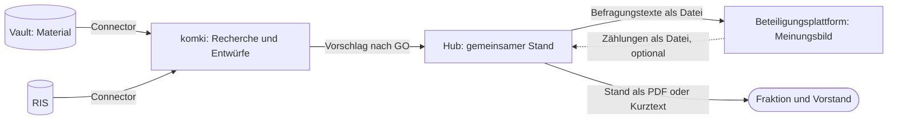

# ratsprojekte wird der lokale Hub für den Weg von der Idee zum Antrag

Der Weg zu einem Antrag hat mehrere Beteiligte: Eine Idee entsteht, die Fraktion redet darüber, Vorstand und Basis werden gefragt, Fakten kommen dazu, ein Antrag geht in den Rat, der Beschluss muss nachverfolgt werden. Bisher hält das kein Werkzeug zusammen. ratsprojekte ist für eine Person gedacht, Menschen können dort nichts eingeben, und sein Modell kennt weder Kreise noch Anträge. Der tatsächliche Stand liegt in einem ODS-Sheet (#54) und in Köpfen. Wir bauen ratsprojekte deshalb um: Es wird der Hub, der den gemeinsamen Stand führt. Im ersten Wurf läuft er lokal, eine Person führt ihn, und alle anderen bekommen eine bewusst ausgegebene Fassung. Die Frage „Wo stehen wir eigentlich?“ soll niemand mehr einzeln beantworten müssen.

Geprüft ist das an einem [Storyboard mit durchklickbarem Modell](../../apps/ratsprojekte/storyboard/hub-desktop.html). Es zeigt, dass sich die Abläufe bedienen lassen, nicht, dass sie im Alltag gepflegt werden. Das zeigen erst ein Test mit einem nicht-technischen Ratsmitglied und der echte Bestand.

## Entscheidung

**Vier Werkzeuge, je eine Art von Wahrheit.**

Der Vault bleibt Quelle für Material, der Hub wird Quelle für den Stand. Der Hub schreibt nie in den Vault und nie ins RIS. Eine Idee darf im Hub entstehen, ohne dass es dazu eine Vault-Notiz gibt.

**Die Oberfläche ist für Menschen ohne Technikkenntnisse gemacht, den Betrieb übernimmt vorerst die Entwicklung.** Die Oberfläche spricht Alltagssprache und kommt ohne Terminal aus. Start, Sicherung und der Austausch mit der Beteiligungsplattform liegen vorerst bei einer technisch versierten Person. Eine installierbare Fassung kommt erst, wenn jemand anderes den Hub wirklich nutzen will.

**Personas, Kreise und Entscheidungsrechte sind getrennt.** Eine Persona ist ein Mensch mit einem Ziel, ein Kreis ist, wer eine bestimmte Fassung zu sehen bekommt, und ein Entscheidungsrecht gehört einem Gremium. Der Hub hält fest, wer entschieden hat, und erzwingt nichts.

| Kreis | Wer | Fassung |
|---|---|---|
| Redaktion | die Person, die den Hub führt | Arbeitsansicht: alles, auch private Einträge und Querverweise |
| Engerer Kreis | Fraktion und Vorstand | Stand: was neu ist, wer dran ist, Entscheidungen, Meinungsbilder, Fakten, Anträge |
| Basis | wer den Aufruf-Link einer Befragung hat | Befragungstexte: eigens geschriebener Titel, Situation, Vorschlag, Hintergrund |
| Öffentlichkeit | alle | eingereichter Antrag und Beschluss |

Externe wie Elternbeirat, Vereine oder andere Fraktionen bekommen nichts aus dem Hub. Was sie sagen, wird als Meinungsbild eingetragen, vertrauliche Gespräche als privater Eintrag. Rechte je Eintrag gibt es nicht, nur diese festen Ausgaben. Vor jeder Ausgabe sieht die Redaktion genau das Dokument, das hinausgeht.

**Das Modell ist klein.**

- **Ratsprojekt** mit Phase (Idee, Meinungsbildung, Ausarbeitung, Im Rat, Umsetzung), nächstem Schritt und Ablage (Ruht, Verworfen, Abgeschlossen). Phasen sind frei wechselbar, weil der echte Ablauf Schleifen hat. Ein Grund im Verlauf ersetzt die Sperre im Code.
- **Verlauf** nur anhängend. Jeder Eintrag sagt, wer ihn lesen darf.
- **Meinungsbild** je Kreis: Datum, ein Satz, optional eine Verteilung. Der Hub bildet keinen Gesamtwert und keine Rangliste.
- **Befragung** bündelt mehrere Projekte für eine Frage an einen Kreis, mit Frist. Sie ist der Übergabepunkt zur Beteiligungsplattform und bleibt danach als Ergebnisseite stehen, in der Reihenfolge der Ideen und ohne Sortierung nach Zustimmung.
- **Fakt:** eine Aussage mit Beleg, Datum und Prüfstatus. Was die KI findet, gilt als nicht verifiziert, bis ein Mensch die Fundstelle nachgeschlagen hat.
- **Variante:** eine Alternative zum selben Ziel, mit Vorbedingungen und dem Status offen, gewählt oder verworfen samt Grund. Das ist der bisherige Realisierungsstrang.
- **Antrag** als eigenes Objekt, mehrere je Projekt, mit Beschlussvorschlag, Adressat, Status, Ergebnis und Querverweis auf die Ablage. Der Text selbst liegt nicht im Hub.
- **Querverweise** auf Vault, Ablage und komki-Raum, beim Raum nur dessen Kennung.

Die Antragsreife bleibt als Checkliste, die nichts sperrt. Priorität, Konten und die Mindestlängen im Changeset entfallen. Phasen lassen sich nicht aus den Anträgen ableiten, weil ein Projekt mehrere haben kann.

**Der neue Eintrag ist die Kernhandlung.** Ein Dialog fragt „Was ist passiert?“. Pflicht ist nur der Text. Die Wahl, wer ihn lesen darf, steht immer sichtbar da. Phase und nächster Schritt sind einklappbar. Am Antrag gibt es das entsprechend für Status und Ergebnis. Getrennte Dialoge wären nach einer Sitzung mit sechs Projekten achtzehn Schritte. Der Lohn dafür ist der fertige Stand vor der nächsten Sitzung.

**Menschen schreiben direkt, die KI schlägt vor.** Das Ergebnis eines komki-Raums ist genau ein Ereignis mit Teilen: ein GO in komki („darf das den Raum verlassen?“), eine Entscheidung im Hub („passt das zum heutigen Stand?“), bei der sich Teile abwählen lassen. Das hält „ein GO deckt genau ein Ereignis“ (#352) ein. Das Annehmen aus dem Chat (`decide_proposal`) entfällt, eine KI führt im Hub keine Entscheidung aus.

**Der Connector kommt früh, beginnend mit Fakten aus öffentlicher Recherche.** Quellenrecherche ist der Hauptnutzen der Verbindung zu komki. Der erste Schritt ist schreibend: Fakten mit Quelle, Fundstelle und Abrufdatum vorschlagen. Aus öffentlicher Recherche ist das nach den Regeln unkritisch. Das Lesen aus dem Hub folgt getrennt. Beides wird zuerst im Kalkül modelliert und dann am echten Vermittler durchgetestet, mit Szenen als Tests, allen Gegenproben und einem echten Lauf als Abnahme.

**Der Hub führt keine Labels und gilt für komki als Empfänger (K2 aus dem Referenzszenario).** Weil alles aus dem Hub in einen Stand gelangen kann, ist der Empfängerkreis der ganze engere Kreis. komki darf also nur liefern, was für Fraktion und Vorstand zulässig ist. Gelesen wird über den Connector nur die Fassung Stand, private Einträge bleiben für komki unsichtbar. Aus vertraulichen Räumen gelangt nur Essenz in den Hub: Das Kalkül sagt, was zulässig ist, und die nutzende Person liest gegen, was der Agent produziert hat, und entscheidet, welche Teile dorthin dürfen. Nichtöffentliches steht nie im Hub, auch nicht bei Handeingaben, dort hilft nur die Vorschau.

**Lokal, ohne Login, mit eigener Datenbank.** Der Hub läuft auf `127.0.0.1` und nutzt eine eigene SQLite-Datei statt der mit ratsinfo geteilten. Wird er später gehostet, wird aus dem Stand eine Leseansicht hinter einem Login, und das Modell bleibt.

**Kopplung an Beteiligungsplattformen nur über Dateien.** Hin geht ein Ordner mit Markdown-Dateien, zurück eine CSV mit Zählungen je Thema. Der Hub funktioniert ohne Beteiligungsplattform: Ein Handzeichen am Stammtisch ist ebenfalls ein Meinungsbild. Der Hub enthält keinen Parteibezug und keinen Namen eines konkreten Werkzeugs. Lebenszyklen werden nicht gespiegelt, die Frage einer Befragung sagt, worum es geht.

## Verworfene Optionen

- **Stufen je Tätigkeit** (kleiner Kreis, Vorstand, Basis, Recherche): Ein Projekt ist oft in mehreren zugleich, und Recherche läuft vor und nach einer Befragung.
- **Den Stand im Vault führen** (Frontmatter und Ansichten): Lokal mit einer Person wäre das die billigste Lösung. Befragungen, Ausgaben, Vorschläge mit Teilen und das spätere Hosting müssten aber an einem Ort entstehen, der dafür nicht gemacht ist.
- **Nextcloud Deck oder das ODS-Sheet:** Beides ist für einen Probelauf gut genug, trägt aber weder Meinungsbilder noch Anträge noch die Vorschläge aus komki.
- **Gleich hosten, mit Login:** Das wäre Betrieb und Datenschutz, bevor bewiesen ist, dass der Ablauf trägt.
- **Labels je Eintrag:** R.4.4 sieht das für eine Projektverwaltung vor. Für eine einzelne Person ist es zu schwer, und ohne weitere Lesende im Hub schützt es wenig.
- **Antragstext im Hub:** Er wäre ein schlechter Doppelgänger des gemeinsamen Dokuments und von komki.

## Folgen

- **Änderung an RFC 0003:** R.4.4 nennt die Projektverwaltung als künftigen labelführenden Speicher. Diese Entscheidung weicht davon ab, das gehört in die Revision (#85).
- **Änderung an Γ:** Im Referenzszenario enthält `fraktion-intern@1` den Vorstand nicht, Fraktionsräume können also nicht in den Hub liefern. Fakten aus öffentlicher Recherche sind davon nicht betroffen. Ob für die Essenz aus Fraktionsräumen die Bindung eine neue Fassung mit Vorstand braucht oder der engere Kreis eine eigene, klärt das Kalkül. Γ ändert sich nur nach GO.
- **Kanonische Dokumente, vor jedem Code:** `docs/ratsprojekte-lifecycle.md` (Phasen, freie Übergänge), `docs/workflows.md` (neuer Workflow von der Idee zum Antrag, WF 2 und WF 5 neu fassen), `GLOSSARY.md` (Phase, Kreis, Redaktion, Engerer Kreis, Stand, Befragung, Fakt, Variante), AGENTS.md §7 (kein GO im Chat für den Hub) und §10 (Vault für Material, Hub für den Stand).
- **AI-Schnittstelle (AGENTS §5):** Der Hub bietet von Anfang an die Fassung Stand als Datei für Maschinen. Der Dev-MCP-Endpoint entfällt, schreibend geht es nur über den Connector.
- **Tickets:** #54 entfällt, weil der Stand das Sheet ablösen soll. #277 rückt nach vorn und baut auf dem Ereignis mit Teilen und auf der Fassung Stand auf. #33 und #34 bleiben und bekommen mit Antrag und Frist einen Ort. Die Skills `ratsprojekt_*` und `antrag_generieren` folgen der Entscheidung zu den pi-Vorlagen (#375).
- **Beteiligungsplattform:** Damit es ohne Terminal geht, braucht sie Hoch- und Herunterladen im Browser, für die Argumente einen erweiterten Export. Gebaut wird das außerhalb dieses Repos, gegen eine gemeinsame Beschreibung der Schnittstelle in diesem Repo.
- **Bestand:** Phoenix-Grundgerüst, CSP, Sobelow, Slugs und der Vorschlagsweg bleiben. Schema und Oberfläche werden neu gebaut. Es gibt keinen Import, der Bestand wird von Hand übernommen.
- **Preis von „lokal“:** Es gibt keine Vertretung, und der Stand altert im Urlaub. Die Datenbank muss in die normale Sicherung, sonst ist der Hub schlechter als das Sheet. Eine ausgegebene Fassung lässt sich nicht zurückholen.
