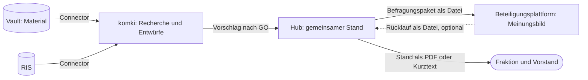

# ratsprojekte wird der lokale Hub für den Weg von der Idee zum Antrag

Der Weg zu einem Antrag hat mehrere Beteiligte: Eine Idee entsteht, die Fraktion redet darüber, Vorstand und Basis werden gefragt, Fakten kommen dazu, ein Antrag geht in den Rat, der Beschluss muss nachverfolgt werden. Bisher hält das kein Werkzeug zusammen. ratsprojekte ist für eine Person gedacht, Menschen können dort nichts eingeben, und sein Modell kennt weder Kreise noch Anträge. Der tatsächliche Stand liegt in einem ODS-Sheet (#54) und in Köpfen. Wir bauen ratsprojekte deshalb um: Es wird der Hub, der den gemeinsamen Stand führt. Im ersten Wurf läuft er lokal, eine Person führt ihn, und alle anderen bekommen eine bewusst ausgegebene Fassung. Die Frage „Wo stehen wir eigentlich?“ soll niemand mehr einzeln beantworten müssen.

Geprüft ist das an einem [Storyboard mit durchklickbarem Modell](../../apps/ratsprojekte/storyboard/hub-desktop.html). Es zeigt, dass sich die Abläufe bedienen lassen, nicht, dass sie im Alltag gepflegt werden. Das zeigen erst ein Test mit einem nicht-technischen Ratsmitglied und der echte Bestand.

## Entscheidung

**Vier Werkzeuge, je eine Art von Wahrheit.**

Der Vault bleibt Quelle für Material, der Hub wird Quelle für den Stand. Der Hub schreibt nie in den Vault und nie ins RIS. Eine Idee darf im Hub entstehen, ohne dass es dazu eine Vault-Notiz gibt.

**Die Oberfläche ist für Menschen ohne Technikkenntnisse gemacht, den Betrieb übernimmt vorerst die Entwicklung.** Die Oberfläche spricht Alltagssprache und kommt ohne Terminal aus. Start und Sicherung liegen vorerst bei einer technisch versierten Person. Eine installierbare Fassung kommt erst, wenn jemand anderes den Hub wirklich nutzen will.

**Personas, Kreise und Entscheidungsrechte sind getrennt.** Eine Persona ist ein Mensch mit einem Ziel, ein Kreis ist, wer eine bestimmte Fassung zu sehen bekommt, und ein Entscheidungsrecht gehört einem Gremium. Der Hub hält fest, wer entschieden hat, und erzwingt nichts.

| Kreis | Wer | Fassung |
|---|---|---|
| Redaktion | die Person, die den Hub führt | Arbeitsansicht: alles, auch private Einträge und Querverweise |
| Engerer Kreis | Fraktion und Vorstand | Stand: was neu ist, wer dran ist, Entscheidungen, Meinungsbilder, Fakten, Anträge |
| Basis | wer den Aufruf-Link einer Befragung hat | Befragungstexte: eigens geschriebener Titel, Situation, Vorschlag, Hintergrund |
| Öffentlichkeit | alle | eingereichter Antrag und Beschluss |

Externe wie Elternbeirat, Vereine oder andere Fraktionen bekommen nichts aus dem Hub. Was sie sagen, wird als Meinungsbild eingetragen, vertrauliche Gespräche als privater Eintrag. Rechte je Eintrag gibt es nicht, nur diese festen Ausgaben. Vor jeder Ausgabe sieht die Redaktion genau das Dokument, das hinausgeht.

**Das Modell ist klein.**

- **Ratsprojekt** mit Phase (Idee, Meinungsbildung, Ausarbeitung, Im Rat, Umsetzung), nächstem Schritt und Ablage (Ruht, Verworfen, Abgeschlossen). Phasen sind frei wechselbar, weil der echte Ablauf Schleifen hat. Ein Grund im Verlauf ersetzt die Sperre im Code.
- **Verlauf** nur anhängend. Jeder Eintrag sagt, wer ihn lesen darf.
- **Meinungsbild** je Kreis: Datum, ein Satz, optional eine Verteilung. Der Hub bildet keinen Gesamtwert und keine Rangliste.
- **Befragung** bündelt mehrere Projekte für eine Frage an einen Kreis, mit Frist. Sie ist der Übergabepunkt zur Beteiligungsplattform und bleibt danach als Ergebnisseite stehen, in der Reihenfolge der Ideen und ohne Sortierung nach Zustimmung.
- **Fakt:** eine Aussage mit Beleg, Datum und Prüfstatus. Was die KI findet, gilt als nicht verifiziert, bis ein Mensch die Fundstelle nachgeschlagen hat. URL und Abrufdatum setzt der Vermittler aus dem Journal ein, nicht der Agent.
- **Variante:** eine Alternative zum selben Ziel, mit Vorbedingungen und dem Status offen, gewählt oder verworfen samt Grund. Das ist der bisherige Realisierungsstrang.
- **Antrag** als eigenes Objekt, mehrere je Projekt, mit Beschlussvorschlag, Adressat, Status, Ergebnis und Querverweis auf die Ablage. Der Text selbst liegt nicht im Hub.
- **Querverweise** auf Vault, Ablage und komki-Raum, beim Raum nur dessen Kennung.

Die Antragsreife bleibt als Checkliste, die nichts sperrt. Priorität, Konten und die Mindestlängen im Changeset entfallen. Phasen lassen sich nicht aus den Anträgen ableiten, weil ein Projekt mehrere haben kann.

**Der neue Eintrag ist die Kernhandlung.** Ein Dialog fragt „Was ist passiert?“. Pflicht ist nur der Text. Die Wahl, wer ihn lesen darf, steht immer sichtbar da. Phase und nächster Schritt sind einklappbar. Am Antrag gibt es das entsprechend für Status und Ergebnis. Getrennte Dialoge wären nach einer Sitzung mit sechs Projekten achtzehn Schritte. Der Lohn dafür ist der fertige Stand vor der nächsten Sitzung.

**Menschen schreiben direkt, die KI schlägt vor.** Das Ergebnis eines komki-Raums ist genau ein Ereignis mit Teilen: ein GO in komki („darf das den Raum verlassen?“), eine Entscheidung im Hub („passt das zum heutigen Stand?“), bei der sich Teile abwählen lassen. Das hält „ein GO deckt genau ein Ereignis“ (#352) ein. Das Abwählen im Hub schützt nichts, weil der Inhalt den Raum mit dem GO schon verlassen hat. Es beantwortet nur, ob ein Teil zum Stand passt. Abgewählte Teile werden gelöscht, der Verlauf hält nur fest, dass einer nicht übernommen wurde. Das Annehmen aus dem Chat (`decide_proposal`) entfällt, eine KI führt im Hub keine Entscheidung aus.

**Der Connector kommt früh, beginnend mit Fakten aus öffentlicher Recherche.** Quellenrecherche ist der Hauptnutzen der Verbindung zu komki. Der erste Schritt ist schreibend: Fakten mit Quelle, Fundstelle und Abrufdatum vorschlagen. Aus öffentlicher Recherche ist das nach den Regeln unkritisch. Das Lesen aus dem Hub folgt getrennt. Beides wird zuerst im Kalkül modelliert und dann am echten Vermittler durchgetestet, mit Szenen als Tests, allen Gegenproben und einem echten Lauf als Abnahme.

**Der Bestand des Hubs trägt genau ein Label, `ratsprojekte@1` (K2 aus dem Referenzszenario).** Der Hub trennt seine Einträge nicht, und alles darin kann in einen Stand gelangen. Sein Bestand ist deshalb nach R.4.4 konservativ gemeinsam gebunden, und der Empfängerkreis sind genau seine Beobachter: die nutzende Person, der Agent, Fraktion und Vorstand, dazu Ausgabeweg und Sicherung, sobald sie feststehen. komki darf also nur liefern, was für diesen Kreis zulässig ist. Schreiben ist eine Speicherung und braucht immer ein GO, aber ein GO ersetzt den Empfängertest nicht. Sonst hinge ein Verstoß gegen Art. 20 Abs. 2 GO nur an einem müden Klick am Abend: Ein Fenster warnt zwar, prüft aber nicht, ob die Person das überhaupt darf. Deshalb erscheint in diesem Fall gar keins. Der Schreibweg verlangt einen Token, den nur der Connector kennt. Die Antwort auf einen Vorschlag ist immer dieselbe Quittung ohne Daten aus dem Hub, damit sich keine Projekte ausprobieren lassen. Die Projektangabe ist nur ein Hinweis, den die Redaktion im Hub zuordnet.

Gelesen wird nur der maschinenlesbare Stand, eine Datei aus einer Liste erlaubter Felder. Der Hub sieht dabei keine Anfrage. Die Datei trägt `ratsprojekte@1`, also kann sie nur ein Raum mit dieser Bindung aufnehmen: Der Rechercheraum sucht frei und kennt den Stand nicht, ein Projektraum kennt ihn und sucht nur per GO. Private Einträge, Querverweise und offene Vorschläge bleiben für komki unsichtbar, auch als Anzahl. Unsichtbar bleibt auch fremder Text aus Befragungen, also Argumente und noch nicht zugeordnete Vorschläge, weil sich darüber Anweisungen einschleusen lassen. Menschen lesen sie wörtlich, komki sieht die Zählungen und das, was ein Mensch im Hub selbst geschrieben oder gelesen und gespeichert hat. Aus vertraulichen Räumen gelangt nur Essenz in den Hub, als Lockerung im Einzelfall: Das Kalkül sagt, was zulässig ist, und die nutzende Person liest gegen, was der Agent produziert hat, und entscheidet, welche Teile dorthin dürfen. Nichtöffentliches steht nie im Hub, auch nicht bei Handeingaben, dort hilft nur die Vorschau. Die Regeln und Gegenproben stehen als Szenen 11 bis 14 im [Referenzszenario](../szenarien/radweg-bahnhofstrasse.md).

**Lokal, ohne Login, mit eigener Datenbank.** Der Hub läuft auf `127.0.0.1` und nutzt eine eigene SQLite-Datei statt der mit ratsinfo geteilten. Wird er später gehostet, wird aus dem Stand eine Leseansicht hinter einem Login, und das Modell bleibt.

**Kopplung an Beteiligungsplattformen nur über Dateien.** Hin geht ein Befragungspaket, zurück ein Rücklauf, beides je eine JSON-Datei nach [`docs/schnittstellen/befragung.md`](../schnittstellen/befragung.md). Die Datei trägt die nutzende Person von Hand, der Hub baut keine Verbindung auf. Zugeordnet wird über eine Kennung, die der Hub je Befragung vergibt und die Plattform nur zurückgibt, nicht über den Titel. Der Hub funktioniert ohne Beteiligungsplattform: Ein Handzeichen am Stammtisch ist ebenfalls ein Meinungsbild. Der Hub enthält keinen Parteibezug und keinen Namen eines konkreten Werkzeugs. Lebenszyklen werden nicht gespiegelt, die Frage einer Befragung sagt, worum es geht.

## Verworfene Optionen

- **Stufen je Tätigkeit** (kleiner Kreis, Vorstand, Basis, Recherche): Ein Projekt ist oft in mehreren zugleich, und Recherche läuft vor und nach einer Befragung.
- **Den Stand im Vault führen** (Frontmatter und Ansichten): Lokal mit einer Person wäre das die billigste Lösung. Befragungen, Ausgaben, Vorschläge mit Teilen und das spätere Hosting müssten aber an einem Ort entstehen, der dafür nicht gemacht ist.
- **Nextcloud Deck oder das ODS-Sheet:** Beides ist für einen Probelauf gut genug, trägt aber weder Meinungsbilder noch Anträge noch die Vorschläge aus komki.
- **Gleich hosten, mit Login:** Das wäre Betrieb und Datenschutz, bevor bewiesen ist, dass der Ablauf trägt.
- **Labels je Eintrag:** R.4.4 sieht das für eine Projektverwaltung vor. Für eine einzelne Person ist es zu schwer, und ohne weitere Lesende im Hub schützt es wenig.
- **Schreiben als `transfer`:** Das wäre die wörtliche Lesart von „Empfänger“. Öffentliche Bindungen tragen aber `transfer: true`, ein Vorschlag käme ohne GO durch, und es bräuchte einen neuen Schalter.
- **Vorschlagsliste als eigener Empfänger nur für die Redaktion:** Dann käme auch `ratsarbeit@1` dorthin, und ein einziger Klick im Hub wäre eine Lockerung ohne Befugnisprüfung außerhalb des Vermittlers.
- **GO für unzulässige Empfänger behalten:** Die Engine bietet das heute an. Sie kann noch nicht unterscheiden, wer was lockern darf (#109), also bleibt der Weg bis dahin zu. Die Essenz aus Fraktionsräumen kommt vorerst von Hand in den Hub.
- **`fraktion-intern@2` mit Vorstand:** Der Vorstand dürfte dann alles Fraktionsinterne lesen, nicht nur das Ausgewählte, und Ausgabeweg und Sicherung müssten ebenfalls hinein.
- **Fremden Text neu schreiben müssen:** Das lässt sich nicht erzwingen, abtippen geht immer. Es genügt, dass die Redaktion ihn liest und bewusst speichert.
- **Empfängerkreis der öffentlichen Bindungen weiter aufzählen:** Jeder neue Beobachter hieße neue Fassungen oder einen beiseitegelegten Label-Store. Stattdessen `alle`, in engen Grenzen (#418).
- **Antragstext im Hub:** Er wäre ein schlechter Doppelgänger des gemeinsamen Dokuments und von komki.
- **Ordner mit Markdown hin, CSV zurück:** Einen Ordner kann man im Browser kaum hochladen oder verschicken, und die CSV trägt weder Kennungen noch Argumente.
- **Projekt-Slug als Kennung:** Er gäbe den internen Arbeitstitel an die Plattform weiter, und ein Projekt kann mehrmals befragt werden.
- **Argumente nur für die Redaktion:** Das war zu kompliziert für zu wenig Schutz. Die Teilnehmenden erfahren stattdessen vorher, dass ihr Text wörtlich weitergeht. Die Grenze liegt bei den Maschinen, nicht zwischen den Menschen.

## Folgen

- **Änderung an RFC 0003:** R.4.4 nennt die Projektverwaltung als künftigen labelführenden Speicher. Der Hub nutzt dessen zweiten Fall, den gemeinsam gebundenen Bestand. Das gehört als Anwendungsfall in die Revision (#85).
- **Änderung an der Engine:** Bei `store` ersetzt kein GO mehr den Empfängertest (#417). Das blockiert den Durchstich.
- **Änderung an Γ:** Dazu kommen die Beobachter `fraktion` und `vorstand`, die Umgebungen `ratsprojekte-bestand@1` und eine fürs Lesen, die Bindung `ratsprojekte@1` und `alle` im Label-Store (#418). Fraktionsräume können bis zur Lockerung (#109, #354, #410) nicht in den Hub liefern. `fraktion-intern@1` bleibt unverändert, ihre Befugnis bekommt eine eigene Ausgabeart. Γ ändert sich nur nach GO.
- **Kanonische Dokumente, vor jedem Code:** `docs/ratsprojekte-lifecycle.md` (Phasen, freie Übergänge), `docs/workflows.md` (neuer Workflow von der Idee zum Antrag, WF 2 und WF 5 neu fassen), `GLOSSARY.md` (Phase, Kreis, Redaktion, Engerer Kreis, Stand, Befragung, Fakt, Variante), AGENTS.md §7 (kein GO im Chat für den Hub) und §10 (Vault für Material, Hub für den Stand).
- **AI-Schnittstelle (AGENTS §5):** Der Hub bietet von Anfang an die Fassung Stand als Datei für Maschinen, ohne fremden Text aus Befragungen. Der Dev-MCP-Endpoint entfällt, schreibend geht es nur über den Connector.
- **Tickets:** #54 entfällt, weil der Stand das Sheet ablösen soll. #277 rückt nach vorn und baut auf dem Ereignis mit Teilen und auf der Fassung Stand auf, das Lesen folgt in #419. #33 und #34 bleiben und bekommen mit Antrag und Frist einen Ort. Die Skills `ratsprojekt_*` und `antrag_generieren` folgen der Entscheidung zu den pi-Vorlagen (#375).
- **Beteiligungsplattform:** Damit es ohne Terminal geht, braucht sie Hoch- und Herunterladen im Browser und einen Export im neuen Format. Vor einem Argument muss sie sagen, dass der Text wörtlich weitergeht. Gebaut wird das außerhalb dieses Repos, gegen [`docs/schnittstellen/befragung.md`](../schnittstellen/befragung.md). Bis der neue Export da ist, trägt die Redaktion Meinungsbilder von Hand ein.
- **Bestand:** Phoenix-Grundgerüst, CSP, Sobelow, Slugs und der Vorschlagsweg bleiben. Schema und Oberfläche werden neu gebaut. Es gibt keinen Import, der Bestand wird von Hand übernommen.
- **Preis von „lokal“:** Es gibt keine Vertretung, und der Stand altert im Urlaub. Die Datenbank muss in die normale Sicherung, sonst ist der Hub schlechter als das Sheet. Eine ausgegebene Fassung lässt sich nicht zurückholen.
