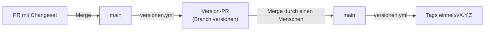

# Changesets: Versionen und Changelogs

Stand: 2026-11-14. Fünf Einheiten haben eine eigene Version und ein eigenes Changelog. Jede spürbare Änderung bringt ein **Changeset** mit: eine kleine Markdown-Datei unter `.changeset/`, die sagt, welche Einheit sich wie ändert und was Nutzende davon merken. Ein **Version-PR** sammelt die offenen Changesets. Sein Merge setzt die Tags. Warum es so gebaut ist: [ADR 0005](../adr/0005-versionierung-mit-changesets-und-knope.md). Wie ein Release abläuft: [release.md](../release.md).

## Einheiten

| Einheit | Version in | Changelog | Sprache und Leser |
|---|---|---|---|
| `komki` | `apps/komki_cli/mix.exs` | `apps/komki_cli/CHANGELOG.md` | Deutsch, für Nutzende |
| `ratsprojekte` | `apps/ratsprojekte/mix.exs` | `apps/ratsprojekte/CHANGELOG.md` | Deutsch, für Nutzende |
| `sidecar` | `apps/sidecar/mix.exs` | `apps/sidecar/CHANGELOG.md` | Englisch, für Entwickler |
| `seatbelt` | `apps/seatbelt/mix.exs` | `apps/seatbelt/CHANGELOG.md` | Englisch, für Entwickler |
| `sealed_envelope` | `apps/sealed_envelope/mix.exs` | `apps/sealed_envelope/CHANGELOG.md` | Englisch, für Entwickler |

Die Liste der Einheiten steht nur in `knope.toml`. Zu einer Einheit gehören auch die Apps, die sie per Pfad-Abhängigkeit mitbringt, bis zur nächsten Einheit. `komki` ist so eine Version für das ganze Programm: Vermittler, Policy, Connectoren und Egress zählen mit. Abhängigkeiten mit `only:` (etwa `komki_mock`) zählen nicht, sie werden nicht ausgeliefert. Alle übrigen Apps und die Python-Tools unter `tools/` bleiben ohne Version und Changelog.

## Wann ein Changeset nötig ist

Ein Changeset braucht jede Änderung, die Nutzende einer Einheit merken: Verhalten, Befehle, Optionen, Ausgaben, Einrichtung, bei den Bibliotheken die öffentliche API. Refactoring, Tests, CI und reine Doku brauchen keins. Leere Changesets gibt es nicht.

Der Workflow `changesets` prüft das an jedem PR: Ändert der PR `lib/` oder `priv/` einer Einheit oder einer App, die sie mitbringt, und nennt kein Changeset des PRs diese Einheit, ist der Check rot. Eine Änderung in `apps/komki_mediator/lib/` braucht also ein Changeset für `komki`. Ist die Änderung trotzdem nicht spürbar, bekommt der PR das Label `ohne-changeset`, und der Prüfbericht nennt den Grund. Lokal prüft dasselbe:

```bash
elixir scripts/changesets.exs check origin/main
```

## Format

Eine Datei `.changeset/<kurzer-name>.md`, von Hand geschrieben. knope muss dafür nicht installiert sein.

```markdown
---
komki: major
sidecar: patch
---

# komki setup fragt vor dem Überschreiben eines Programm-Pins nach

Wer `komki setup` nach einem Update startet, sieht jetzt, welches Programm
sich geändert hat, und bestätigt den neuen Pin einzeln.
```

- Zwischen den Zeilen `---` steht je Einheit eine Zeile `einheit: major|minor|patch`. Eine Datei darf mehrere Einheiten nennen. Gilt der Text nicht für alle, schreib lieber zwei Dateien, denn jede Einheit hat ihre eigene Sprache.
- Die erste Zeile nach dem Frontmatter ist der Eintrag im Changelog. Der Text darunter ist optional und erscheint als Absatz unter dem Eintrag.
- Geschrieben wird aus Sicht der Leser der Einheit (Tabelle oben), nicht als Commit-Nachricht: was sie jetzt anders sehen oder tun.

### Stufen in der 0.x-Phase

knope liest 0.x-Versionen als `0.<major>.<minor>`. Von 0.1.0 aus:

| Stufe | ergibt | wofür |
|---|---|---|
| `major` | 0.2.0 | Brüche und große Neuerungen |
| `minor` | 0.1.1 | kleinere Neuerungen |
| `patch` | 0.1.1 | Fehlerbehebungen |

Ab 1.0 gilt gewöhnliches SemVer. Die bauende Session schlägt die Stufe vor, wer den PR mergt, entscheidet.

## Wer schreibt

Die Session, die baut, interaktiv oder im [Dev-Loop](dev-loop.md). Die prüfende Session bewertet das Changeset als Prüfpunkt ([pruefpunkte.md](pruefpunkte.md#einheiten-mit-version)). Im Dev-Loop schreibt die Umsetzung statt des Labels eine Datei `.dev-loop/ohne-changeset` mit dem Grund. Das Label setzt dann das Skript.

## Vom Changeset zum Tag



1. Bei jedem Push auf `main` mit offenen Changesets baut der Workflow `versionen` den Version-PR neu: `knope prepare-release` erhöht die Versionen in den `mix.exs`, schreibt die Changelogs und löscht die verbrauchten Changesets.
2. **Kaskade:** Erhöht der Version-PR eine Bibliothek, bekommen die Einheiten, die sie per Pfad-Abhängigkeit einbinden, einen Patch mit dem Eintrag „Enthält seatbelt 0.1.1“. Das gilt nur, wenn sie nicht schon eine eigene Erhöhung haben. Heute: `sealed_envelope` → `komki` und `ratsprojekte`, `sidecar` und `seatbelt` → `komki`. Die Abhängigkeiten liest `scripts/changesets.exs cascade` aus den `mix.exs` aller Apps einer Einheit, auch über Vermittler und Connectoren hinweg.
3. Den Version-PR mergt nur ein Mensch. Der Merge ist das GO für die Tags. Der Dev-Loop fasst ihn nie an.
4. Nach dem Merge setzt `knope release` die Tags `<einheit>/v<version>`, etwa `komki/v0.2.0`, und der Workflow pusht sie. Er vergleicht dafür die Versionen mit den vorhandenen Tags; fällt ein Lauf weg, holt der nächste Push auf `main` fehlende Tags nach. Einheiten ohne jeden Tag lässt er aus, die Baseline-Tags setzt ein Mensch. GitHub-Releases entstehen dabei nicht. Veröffentlicht wird erst nach dem Publish-GO ([release.md](../release.md)).

Die Pflicht-Checks laufen am Version-PR, weil der Workflow die CI auf dem Branch `versionen` selbst startet. Pushes mit dem `GITHUB_TOKEN` starten sonst keine Workflows.
