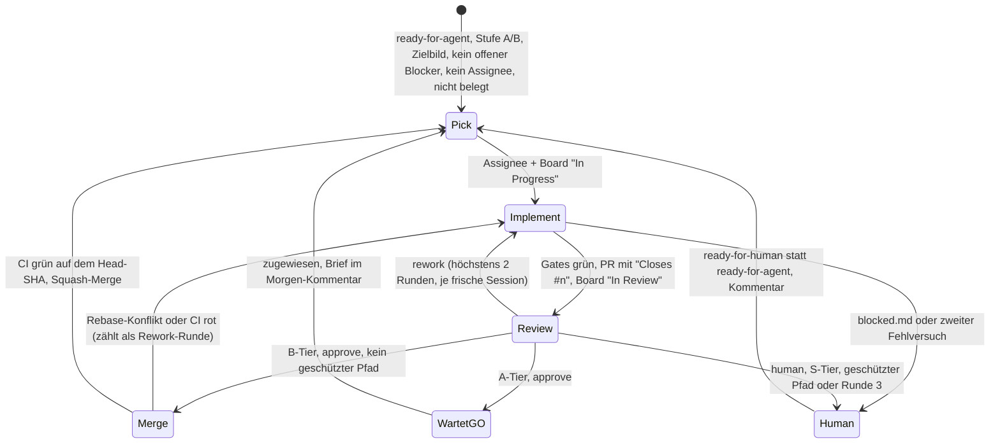

# Dev-Loop: Tickets unbeaufsichtigt abarbeiten

Stand: 2026-11-08, Ticket #389. Der Dev-Loop arbeitet freie Tickets ab, auch wenn niemand am Rechner sitzt. Für jedes Ticket setzt eine Agent-Session um, eine zweite prüft. Danach entscheidet das Skript nach festen Regeln: mergen, auf ein GO warten oder an die nutzende Person übergeben. Eine dritte Session, die Product-Owner-Rolle (PO), verfeinert unterdessen Tickets und macht nur Vorschläge. Die Regeln für die Agenten stehen nicht hier, sondern im [Lane-Protokoll](lane-protocol.md) und in den [AI-Stufen](ai-tiers.md). Der Loop setzt sie durch.

## Ablauf



- **Auswahl:** Ein Ticket braucht ein Zielbild im Text oder in einem Kommentar (`ai-tiers.md`). Ein Zielbild-Entwurf der PO zählt nicht, denn er hat noch kein GO. Zuerst kommen Tickets mit dem Label `next`, dann B vor A, dann die kleinste Nummer. Als *belegt* gelten Tickets, die zu einem offenen PR gehören, deren Nummer im Branch eines PR oder eines lokalen Worktrees steht (`lane-152-…`, `brave-mock-340`) oder die auf dem Board „In Progress“ stehen. So bleiben von Hand geöffnete Lanes unberührt.
- **Review:** Vor dem Review führt das Skript die Gates auf dem PR-Head selbst aus, außerhalb der Sandbox. Sind sie rot, zählt das ohne Review als Rework-Runde. Sind sie grün, bekommt das Review das Ergebnis als Beleg und prüft Abnahme und Diff. Was die Sandbox nicht messen lässt (etwa `lsof`, lokale Ports), führt nicht zu `human`. Das Review nennt den Punkt dann in seiner Zusammenfassung.
- **Geschwächte Tests:** Vor der Entscheidung prüft das Skript den Diff heuristisch: mehr entfernte als ergänzte Assertions in einer Testdatei, ergänzte Skip-Marker, gelöschte Testdateien. Ein Treffer geht an die nutzende Person — auch bei zustimmendem Review. Fehlalarme sind die sichere Richtung; wer eine schwächere Assertion derselben Art einschmuggelt, fällt nicht an die Heuristik, sondern an das Review.
- **Merge:** B-Tier wird automatisch gemergt. A-Tier wartet zugewiesen auf „In Review“, die nutzende Person mergt von Hand. S-Tier wird nie automatisch gemergt.
- **Geschützte Pfade:** Neben den Pfaden aus `ai-tiers.md` schützt der Loop seine eigenen Regeln: `scripts/dev_loop*`, `.github/`, `docs/agents/` und `AGENTS.md`. Ein Diff, der einen dieser Pfade berührt, geht immer an die nutzende Person.
- **Fehler:** Scheitert eine Umsetzung (rote Gates, kein Commit, Zeitlimit, Absturz), versucht der Loop es einmal in einer frischen Session neu. Scheitert auch das, übergibt er das Ticket an die nutzende Person, ebenso bei einer Eskalation des Agenten (`.dev-loop/blocked.md`).
- **Notbremse:** Vor jeder Ticket-Wahl prüft der Loop die CI von `main`. Ist sie rot, beendet er den Lauf mit einer macOS-Notification — gebaut oder gemergt wird nicht auf kaputter Basis. Drei Tickets in Serie, die an die nutzende Person übergeben wurden, beenden den Lauf ebenfalls. Der Loop macht kein Revert: Übergabe ist seine Aufgabe, Rückgängigmachen die der nutzenden Person. Ein CI-Leseversuch, der scheitert, beendet den Lauf nicht (Branch Protection bewacht jeden Merge ohnehin).
- **PO:** Die PO läuft zu Beginn jedes Laufs und noch einmal, wenn keine Tickets mehr zur Auswahl stehen. Je Lauf nimmt sie höchstens 5 Tickets, die `needs-triage` sind oder A/B ohne Zielbild. Sie schreibt einen Zielbild-Entwurf oder Rückfragen als Kommentar. Stufen, `ready-for-agent` und Abhängigkeiten schlägt sie nur im Morgen-Kommentar vor. `ai:s-tier`, `ready-for-human` und `wayfinder:*` fasst sie nicht an.
- **Morgen-Kommentar:** Am Ende jedes Laufs kommentiert der Loop auf #389, was gemergt wurde, was auf ein GO wartet, was an die nutzende Person übergeben wurde und was die PO vorschlägt. Dazu eine Statistik: Reviews, Freigaben in der ersten Runde und Rework-Runden, je Stufe Läufe, Zeit, Tokens und Turns. Die Rohdaten liegen als `metrics.jsonl` im Lauf-Verzeichnis.

## Rollen und Modelle

| Rolle | Erst | Fallback bei erschöpftem Konto |
|---|---|---|
| Umsetzung | `claude` mit Sonnet 5.5 | `tt` mit Default-Modell |
| Review | `claude` mit Opus 5.5 | `tt` mit Default-Modell, Effort `max` |
| PO | `claude` mit Opus 5.5 | `tt` mit Default-Modell, Effort `max` |

Jede Stufe läuft als frische Session ohne Oberfläche (`claude -p`). Die Prompts liegen unter `scripts/dev_loop/prompts/`. Sind beide Konten erschöpft, beendet sich der Lauf sauber und meldet sich per macOS-Notification.

## Sicherheitsgrenze

- **Nur das Skript schreibt nach GitHub.** Agenten bekommen kein Token. Sie arbeiten im Worktree und übergeben ihre Ergebnisse als Dateien unter `.dev-loop/` (gitignored): `pr.md`, `brief.md`, `blocked.md`, `review.json`, `po.json`.
- **PAT:** Fine-grained, nur für dieses Repo. Er liegt im Schlüsselbund unter `dev-loop-gh-pat`. Das Skript reicht ihn als `GH_TOKEN` nur an die eigenen `gh`-Aufrufe und an `git push` über HTTPS weiter.
- **Kommentar-Filter:** Das Repo ist öffentlich, und jede Kommentar-Zeile würde in einem unbeaufsichtigten Prompt landen — oder ein Zielbild bestätigen. Nur Kommentare des Repository-Owners erreichen Auswahl, Prompts und Marker-Zählung. Der Loop und die PO schreiben unter demselben Login und tragen zusätzlich ihre Marker. Der Ticket-Körper bleibt unberührt: Die nutzende Person hat ihn gelesen und gelabelt, bevor der Loop ihn aufnimmt.
- **Agenten:**
  - `--permission-mode auto --permission-prompts none`
  - Bash-Sandbox von Claude Code und Deny-Regeln aus `scripts/dev_loop/agent_settings.json` (`gh`, `git push`, `security`, `ssh`, `curl`, Lesen von `~/.ssh`, `~/.config/gh`, Schlüsselbund)
  - Schreiben darf die Sandbox nur im Worktree, in den Hex- und Mix-Caches und in `/tmp`. `/tmp` braucht die Test-Suite von komki_cli für kurze Socket-Pfade (103-Byte-Grenze). Dort liegt nichts Geheimes, andere Prozesse des Kontos können es aber lesen.
  - keine MCP-Server (`--strict-mcp-config`)
  - kein `GH_TOKEN` in der Umgebung
- **Prüfen:** `elixir scripts/dev_loop.exs --check-sandbox` lässt eine Session harmlose Befehle ausführen, die durchgehen müssen, und dann an Zugangsdaten scheitern. Die Befehle der Probe beweisen nur den Zugriff (Login-Name, Byte-Zahlen) und geben selbst bei einem Fehlschlag kein Geheimnis an das Modell. Zuletzt lief die Probe am 2026-11-07 auf `claude`, mit dem PAT im Schlüsselbund: alle vier Versuche abgelehnt, die Positivkontrollen (`git status`, `mix --version`, Schreiben in `/tmp`) liefen.
- **Grenze der Grenze:** Der Loop läuft im Konto `crn`. Sandbox und Deny-Regeln sind Policy von Claude Code, keine Trennung durch das Betriebssystem. Ein eigenes macOS-Konto wäre die härtere Variante, die bewusst nicht gewählt wurde (Grilling zu #389, Q3).
- **Branch Protection** auf `main` mit Pflicht-Checks: Eine rote CI blockiert den Merge auch dann, wenn das Skript einen Fehler hat.

## Bedienung

```bash
elixir scripts/dev_loop.exs --dry-run                   # Plan: Auswahl, Belegung, PO-Kandidaten; keine Agenten, keine Writes
elixir scripts/dev_loop.exs --check-sandbox --account tt # Sandbox-Probe auf einem bestimmten Konto
elixir scripts/dev_loop.exs --only 392 --no-po          # ein Ticket, unter Aufsicht
elixir scripts/dev_loop.exs --until 07:00               # über Nacht, höchstens 5 Tickets (--max-tickets)
touch ~/.dev-loop/STOP                                   # Not-Aus: greift vor der nächsten Stufe; Datei danach löschen
touch ~/.dev-loop/TAKEOVER                               # laufende Stufe von Hand übernehmen (siehe unten)
```

- **Wach bleiben:** Solange das Skript läuft, hält es den Mac per `caffeinate` wach. Ein Lock in `~/.dev-loop/lock` verhindert einen zweiten Lauf.
- **Zeitfenster:** `--until` startet nach der angegebenen Uhrzeit kein neues Ticket mehr. Eine laufende Stufe darf bis zu 4 Stunden dauern. Liefert eine Session 30 Minuten lang keine Ausgabe mehr, gilt sie als hängengeblieben und wird vorher beendet (Idle-Timeout); lange laufende Werkzeuge stören nicht, sie streamen ihre Ausgabe.
- **Cockpit in Herdr:** Gemeint ist die Desktop-App Herdr auf herdr-core (`hc`), nicht das ältere Terminal-Programm `herdr`. Startet man das Skript in einem Herdr-Terminal, öffnet es für jede Stufe einen eigenen Tab im selben Space, etwa „loop-368-review-claude“. Der Tab zeigt die Session live: den Text des Agenten, jeden Tool-Aufruf mit Ergebnis, die Ablehnungen und am Ende Turns und Dauer. Am Ende der Stufe beendet das Skript den Tab wieder. Bricht ein Lauf ab (Ctrl-C, Absturz), bleibt der Tab mit dem letzten Stand stehen. Der nächste Lauf beendet ihn beim Start, erkennbar am hc-Label `dev-loop=viewer`.
  - Den ganzen Kontakt mit Herdr bündelt `scripts/dev_loop/herdr.exs`: `hc run` mit dem Label `herdr.space=<Space>` für den Tab, `herdr-app` für den Space und den Tab-Namen. Fällt Herdr aus, protokolliert der Loop das und arbeitet ohne Tab weiter.
  - **Unter „Agents“:** Der Viewer meldet den Zustand der Stufe so an herdr-core, wie Claude Code sich selbst meldet (OSC 7501, `app=claude-code`). Während die Stufe läuft, steht dort `working`, und die Statuszeile zeigt den aktuellen Tool-Aufruf, etwa „Bash mix test“. Am Ende meldet der Viewer `done` oder `error`. Herdr führt den Tab deshalb als Agenten. Tippen lässt sich in diesen Tab nicht, denn der eigentliche Agent läuft ohne Oberfläche; dafür gibt es die Übernahme.
  - **Prüfen:** `elixir scripts/dev_loop/test/herdr_live_test.exs` in einem Herdr-Terminal öffnet für ein paar Sekunden echte Tabs. Der Test prüft: Name, Live-Darstellung, Schließen auch nach einem Absturz der Stufe, das Aufräumen nach einem abgebrochenen Lauf und den Betrieb ohne Herdr. In der CI wird er übersprungen.
  - Die Agenten bleiben Kindprozesse des Skripts ohne Oberfläche (`claude -p`). Die Pane liest nur das Log mit (`tail -F … | jq -f scripts/dev_loop/viewer.jq`).
- **Übernahme:** `touch ~/.dev-loop/TAKEOVER` übergibt die gerade laufende Stufe an die nutzende Person. Das Skript prüft die Datei jede Sekunde, beendet die Session ohne Oberfläche und setzt dieselbe Session interaktiv fort (`claude --resume <id>`). Der Agent behält dabei seinen ganzen Kontext. Konto, Modell, Worktree und Regeln (`agent_settings.json`, Auto-Modus) bleiben gleich. Die Session-ID vergibt das Skript beim Start jeder Stufe selbst (`--session-id`), sie steht im `run.log`.
  - In Herdr erscheint die Session als eigener Tab „<stufe>-hand“, und das Skript wechselt dorthin. Es ist ein echtes Claude Code, Herdr erkennt es also selbst als Agenten. Der Tab gehört ab da der nutzenden Person: Er trägt das hc-Label `dev-loop=takeover`, kein Lauf räumt ihn auf, und er schließt sich erst, wenn man Claude Code beendet.
  - Für den Loop gilt das Ticket als an den Menschen übergeben: Kommentar mit Session-ID und dem Befehl zum Weitermachen, Label `ready-for-human`. Der Worktree bleibt stehen. Danach nimmt der Loop das nächste Ticket. Außerhalb von Herdr öffnet das Skript keinen Tab. Weiter geht es dann mit dem Befehl aus dem Kommentar, etwa `cd <worktree> && tt --resume <id>`.
  - Eine Übernahme gilt für eine Stufe: Die Stufe, die die Datei sieht, löscht sie. Eine liegengebliebene Datei löscht jeder Lauf beim Start. Übernimmt man den PO, ersetzt der nächste PO-Lauf dessen Worktree `loop-po`.
  - **Geprüft** am 2026-11-07 mit `--check-sandbox --account tt`: Übernahme nach dem zweiten Tool-Aufruf. Der Tab lief auf `tt`, Herdr führte ihn als Agenten (`claude-code`, `idle`, nach einer Frage `working` und dann `done`). Auf die Frage nach dem bisherigen Stand nannte die Session genau die zwei Aufrufe aus dem Log und den unterbrochenen dritten. Automatisch prüfen `scripts/dev_loop/test/takeover_test.exs` (Abbruch, gleiche Session-ID, Resume-Befehl ohne Token, mit einem nachgebauten `claude`) und der Herdr-Live-Test (Tab, Label, übersteht das Aufräumen).
  - Außerhalb von Herdr öffnet das Skript keinen Tab. Den Verlauf zeigt dann:
    ```bash
    tail -f "$(ls -td ~/.dev-loop/logs/*/ | head -1)"run.log
    ```
  - Die Logs jeder Stufe liegen als `*.jsonl` (stream-json von Claude Code) im selben Lauf-Verzeichnis. Eine abgeschlossene Stufe lässt sich nachlesen mit `jq -rR -f scripts/dev_loop/viewer.jq <stufe>.jsonl`.
- **Neustart:** Der ganze Zustand liegt auf GitHub. Dazu gehören der Board-Status und die Review-Marker `<!-- dev-loop:review verdict=… sha=… -->` in den PR-Kommentaren. Nach einem Absturz macht ein neuer Lauf zuerst offene Loop-PRs ohne Freigabe des aktuellen Heads weiter, dann Loop-Worktrees ohne PR (`.claude/worktrees/loop-<n>`).

## Einrichtung (einmalig)

1. **PAT anlegen:** github.com → Settings → Developer settings → Fine-grained tokens → Generate.
   - Name `dev-loop`, Ablauf 90 Tage
   - Repository access: *Only select* → `kommunalpolitik_ki`
   - Repository permissions:

     | Permission | Zugriff | Wofür |
     |---|---|---|
     | Contents | Read and write | Branch pushen, Squash-Merge, Branch nach dem Merge löschen |
     | Pull requests | Read and write | PR anlegen, Review-Kommentare, mergen |
     | Issues | Read and write | Tickets und Blocker lesen, kommentieren, zuweisen, `ready-for-human` setzen |
     | Actions | Read-only | CI-Läufe zum Head-SHA abfragen |
     | Metadata | Read-only | Pflicht, setzt GitHub automatisch |

   - Alles andere bleibt auf „No access“. **Workflows** fehlt mit Absicht: Ohne diese Permission lehnt GitHub jeden Push ab, der eine Datei unter `.github/workflows/` ändert. Ein Agent kann so keinen geänderten Workflow in die CI bringen.
   - **Board:** Ein fine-grained PAT erreicht keine Projects, die einem Nutzerkonto gehören. GitHub führt das als bekannte Lücke (Docs „Managing your personal access tokens“, abgerufen am 2026-11-07). Das Skript protokolliert dann eine Warnung und arbeitet weiter. Als belegt gilt ein Ticket trotzdem, weil der Loop es sich zuweist. `Done` setzt der Board-Workflow beim Schließen.
2. **PAT in den Schlüsselbund**, ohne Shell-History. `security` fragt den Wert interaktiv ab:
   ```bash
   security add-generic-password -a "$USER" -s dev-loop-gh-pat -w
   ```
3. **Board:** Das Feld Status hat die Option **„In Review“** zwischen „In Progress“ und „Done“, angelegt am 2026-11-07. Wer die Optionen über die API ändert, muss die IDs der bestehenden Optionen mitgeben. Sonst verlieren alle Items ihren Status.
4. **Branch Protection** für `main`, eingerichtet am 2026-11-07:
   - Pflicht-Checks „Elixir quality gates“ und „komki-anzeige (Node-Tests)“. Beide laufen bei jedem PR.
   - Die Regel gilt auch für Admins (`enforce_admins`). Der Loop handelt mit dem PAT als `croesnick`, also als Admin, und ohne diese Einstellung könnte er die Checks umgehen. Folge: Auch von Hand geht nichts mehr direkt auf `main`, alles läuft über einen PR.
   - Force-Push und Löschen von `main` sind gesperrt.
5. **Probe:** `elixir scripts/dev_loop.exs --check-sandbox`, danach einmal `--only <n>` unter Aufsicht.

## Bekannte Grenzen (v1)

- Seriell, eine Lane. Parallele Lanes sind bewusst offen.
- **A-Tier ohne echten Lauf:** Die Abnahme von A-Tier braucht einen echten Lauf. Ohne Aufsicht trägt das erst die Mock-Welt (#347). Bis dahin endet A-Tier bei „In Review“.
- **`DoctorBootTest`** startet auf einem Mac mit Staging-Modell einen echten llama-server, bis #392 ihn per Tag aus dem Standardlauf nimmt. Der Staging-Pfad hängt fest an `~/.local/share/komki`, `KOMKI_HOME` umgeht ihn nicht.
- **Erschöpftes Konto:** Die Erkennung beruht auf den dokumentierten Meldungen („You've hit your … limit“, „spend limit reached“; `code.claude.com/docs/en/errors`, abgerufen am 2026-11-07). Am 2026-11-07 um 19:57 griff sie an einem echten Limit: `claude` meldete „You've hit your session limit · resets 8pm (Europe/Berlin)“ (HTTP 429), und dieselbe Stufe lief auf `tt` weiter.
- **Sandbox-Probe auf `tt`:** Lief am 2026-11-07 mit `--check-sandbox --account tt`. Drei Versuche lehnten die Regeln von Claude Code ab. Das Lesen von `~/.config/gh` und `~/.ssh` scheiterte an der Sandbox des Betriebssystems („Operation not permitted“). Die Positivkontrollen liefen.
- **Board-Status:** Mit dem fine-grained PAT setzt der Loop weder „In Progress“ noch „In Review“ (siehe Einrichtung). Er prüft das einmal zu Beginn jedes Laufs und lässt das Board danach in Ruhe. Lanes, die nur auf dem Board auf „In Progress“ stehen, ohne Worktree und ohne PR, erkennt er deshalb nicht als belegt.
- **Rebase über Workflow-Änderungen:** Hat `main` seit dem Branch eine Datei unter `.github/workflows/` geändert, kann GitHub den Push nach dem Rebase ablehnen, weil der PAT keine Workflows-Permission hat. Der Lauf meldet das als Skriptfehler im Morgen-Kommentar.
- **Geschwächte Tests, Heuristikgrenze:** Die Prüfung sieht Netto-Assertions, ergänzte Skips und gelöschte Testdateien. Eine Assertion in eine schwächere derselben Form umzuschreiben (etwa `assert x == 1` zu `assert is_integer(x)`) fällt nicht darauf, sondern an das Review.
