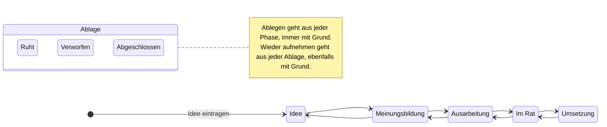
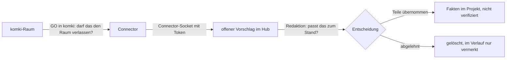
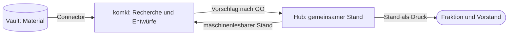

# Projektlebenszyklus — ratsprojekte

> **Kanonisches Lifecycle-Dokument.** Dieses Dokument ist der verbindliche
> Bezug für alle Skills, Connectoren und AI-Workflows, die mit Ratsprojekten
> im Hub arbeiten. Bei Änderungen am Lebenszyklus (neue Phase, neue Ablage,
> neue Regel für einen Wechsel) wird zuerst dieses Dokument aktualisiert,
> danach Code und Skills.

Quelle jeder Aussage hier ist [ADR 0004](adr/0004-ratsprojekte-als-lokaler-hub.md).
Der Hub ist der lokale Ort für den gemeinsamen Stand auf dem Weg von der Idee
zum Antrag. Die Redaktion führt ihn, Fraktion und Vorstand bekommen den
[ausgegebenen Stand](../GLOSSARY.md#ausgegebener-stand).

## Phasen und Ablagen

Ein Ratsprojekt steht immer in genau einer **Phase**. Daneben kann es in einer
**Ablage** liegen. Dann ist es nicht mehr aktiv, behält aber seine Phase.

Das Diagramm zeigt die üblichen Schritte. **Jeder Wechsel zwischen zwei Phasen
ist erlaubt**, auch über mehrere Phasen hinweg und zurück, weil der echte
Ablauf Schleifen hat: Der Rat vertagt, die Fraktion will die Basis noch einmal
hören, ein Antrag wird zurückgezogen und neu ausgearbeitet. Statt einer Sperre
im Code steht der Grund im Verlauf.

| Phase | Code (`Project.phase`) | Was in dieser Phase geschieht |
|---|---|---|
| Idee | `idea` | Eine Idee ist eingetragen. Sie darf im Hub entstehen, ohne dass es eine Vault-Notiz gibt. |
| Meinungsbildung | `opinion_forming` | Fraktion, Vorstand, Basis oder Externe äußern sich, als Meinungsbild oder über eine Befragung. |
| Ausarbeitung | `drafting` | Fakten, Varianten und Vorbedingungen werden geklärt, ein Antrag wird vorbereitet. Hier zeigt der Hub die Checkliste „Antragsreife“. |
| Im Rat | `at_council` | Mindestens ein Antrag ist eingereicht oder wird beraten. |
| Umsetzung | `implementation` | Der Beschluss ist gefasst, die Verwaltung setzt um, die Redaktion verfolgt nach. |

| Ablage | Code (`Project.disposition`) | Bedeutung |
|---|---|---|
| Ruht | `resting` | Für jetzt zurückgestellt, kann jederzeit wieder aufgenommen werden. |
| Verworfen | `rejected` | Wird nicht weiterverfolgt. |
| Abgeschlossen | `completed` | Erledigt, etwa nach der Umsetzung oder weil der Zweck anders erreicht ist. |

Ein Projekt ohne Ablage ist **aktiv**. Ablegen setzt `disposition` und
`disposed_on` und entfernt den nächsten Schritt, Wiederaufnehmen leert
`disposition` und `disposed_on`. Die Phase bleibt dabei unverändert.

Phasen lassen sich nicht aus den Anträgen ableiten, weil ein Projekt mehrere
Anträge haben kann. Wer die Phase wechselt, entscheidet selbst.

## Wie ein Wechsel passiert

Die Kernhandlung des Hubs ist der neue Eintrag „Was ist passiert?“. Pflicht ist
nur der Text, und genau dieser Text ist der Grund für alles, was der Eintrag
mitnimmt:

| Handlung | Weg im Hub | Was im Verlauf steht |
|---|---|---|
| Phase wechseln | Eintrag „Was ist passiert?“ mit aufgeklappter Phase | Entscheidung „Alt → Neu: Text“, immer im Stand |
| Nächsten Schritt setzen | im selben Eintrag oder eigenes Formular | Zeile über den neuen Schritt |
| Status oder Ergebnis eines Antrags | Eintrag am Antrag | Zeile über den Antragsstand |
| Ablegen, Wiederaufnehmen | Formular mit Pflichtfeld Grund | Entscheidung mit Grund |
| Variante wählen oder verwerfen | Formular mit Grund | Zeile über die Variante |

Was die Redaktion im Hub tut, schreibt der Hub selbst in den Verlauf. Von Hand
kommt nur dazu, was anderswo passiert ist. Der Verlauf wird nur ergänzt, nie
geändert. Nur die Sichtbarkeit eines Eintrags (für den Stand oder „Nur ich“)
lässt sich umstellen.

## Wer entscheidet

Der Hub hält fest, wer entschieden hat, und erzwingt nichts. Die
Entscheidungsrechte sind mit Fraktion und Vorstand abgestimmt:

| Entscheidung | Wer entscheidet | Wer beteiligt ist |
|---|---|---|
| Eine Idee aufnehmen | Fraktion oder Vorstand | Die Basis schlägt vor, die Redaktion trägt ein. |
| Die Basis befragen | Vorstand, auch darüber, wer den Aufruf-Link bekommt | Die Fraktion wird vorher gehört, kann die Befragung aber nicht verhindern. Die Redaktion bereitet vor. |
| Weiter ausarbeiten | Fraktion | Der Vorstand wird gehört. Das Meinungsbild der Basis bindet nicht und kennt keine Mindestzahl. |
| Antrag einreichen | Fraktion allein, freies Mandat | Vorstand und Basis werden informiert. Die Redaktion reicht ein und trägt nach. |
| Stand weitergeben | Redaktion, bei jeder Ausgabe | |
| Vorschlag aus komki übernehmen | Redaktion | komki schlägt vor. |

komki entscheidet keine davon.

## Antragsreife

Die Antragsreife ist eine **Checkliste, die nichts sperrt**. Der Hub zeigt sie
in der Ausarbeitung:

- Was ändert sich, für wen? (Nutzen)
- Woran messen wir den Erfolg?
- Ein Antrag ist begonnen, sein Beschlussvorschlag ist konkret.
- Der Adressat steht fest.
- Es gibt Fakten mit Beleg, und alle sind verifiziert.
- Eine Variante ist gewählt, und ihre Vorbedingungen sind erfüllt. Ohne
  Varianten ist das bei einfachen Anträgen in Ordnung.
- Eine Festlegung der Fraktion ist eingetragen (nur ein Hinweis).

Ein offener Punkt hält niemanden auf. Die Fraktion entscheidet, ob ein Antrag
eingereicht wird.

## Vorschläge aus komki

Menschen schreiben direkt in den Hub, die KI schlägt nur vor. Ein Vorschlag aus
einem komki-Raum ist genau ein Ereignis mit Teilen:

- Das GO in komki deckt genau dieses eine Ereignis. Im Hub entscheidet die
  Redaktion im Browser, ob die Teile zum heutigen Stand passen. Abgewählte
  Teile werden gelöscht, der Verlauf hält nur fest, dass einer nicht übernommen
  wurde.
- Eine KI führt im Hub keine Entscheidung aus. Ein Annehmen aus dem Chat gibt
  es nicht.
- Übernommene Fakten gelten als nicht verifiziert, bis ein Mensch die
  Fundstelle nachgeschlagen hat.
- Die Projektangabe im Vorschlag ist nur ein Hinweis. Die Redaktion ordnet zu.
- Aus komki erscheinen im Verlauf nur eingegangene, übernommene und abgelehnte
  Vorschläge.

Den Schreibweg beschreibt [`schnittstellen/connector-socket.md`](schnittstellen/connector-socket.md),
das Lesen [`schnittstellen/stand.md`](schnittstellen/stand.md).

## Vault und Hub

Der Vault bleibt die Quelle für **Material**: Notizen, Recherchen, Mails,
Gesprächsnotizen. Der Hub ist die Quelle für den **Stand**: welche Projekte es
gibt, in welcher Phase, wer dran ist, was entschieden ist.

- Der Hub schreibt nie in den Vault und nie ins RIS.
- Eine Idee darf im Hub entstehen, ohne dass es eine Vault-Notiz gibt.
- Der Slug verbindet beide: `/projekte/{slug}` im Hub, `#ratsprojekt/{slug}`
  als Vault-Tag. Ein Querverweis im Projekt zeigt auf die Vault-Notiz.

## Pflicht für Skills und AI-Workflows

Jeder Skill, Connector und jede AI-Session, die Ratsprojekte liest oder etwas
vorschlägt:

1. **kennt diesen Lebenszyklus**, indem sie auf dieses Dokument verweist;
2. **schlägt nur vor, entscheidet nichts**: Phasenwechsel, Ablagen, Varianten
   und Anträge ändert ein Mensch im Hub;
3. **aktualisiert bei Workflow-Änderungen zuerst dieses Dokument**, dann Code
   und Skills.

### Wann das Dokument zu aktualisieren ist

- Neue Phase oder Ablage → Diagramm und Tabellen
- Neue Regel für einen Wechsel oder ein neues Feld der Antragsreife → Abschnitte
  „Wie ein Wechsel passiert“ und „Antragsreife“
- Änderung an Entscheidungsrechten → Abschnitt „Wer entscheidet“
- Änderung am Weg von komki in den Hub → Abschnitt „Vorschläge aus komki“ und
  die Schnittstellen-Dokumente
- Änderung am Verhältnis zum Vault → Abschnitt „Vault und Hub“

### Wann *nicht*

- Reine Änderungen an der Oberfläche, die keine Phase, Ablage oder Regel
  einführen
- Refactoring ohne geänderte Verhaltensweise
