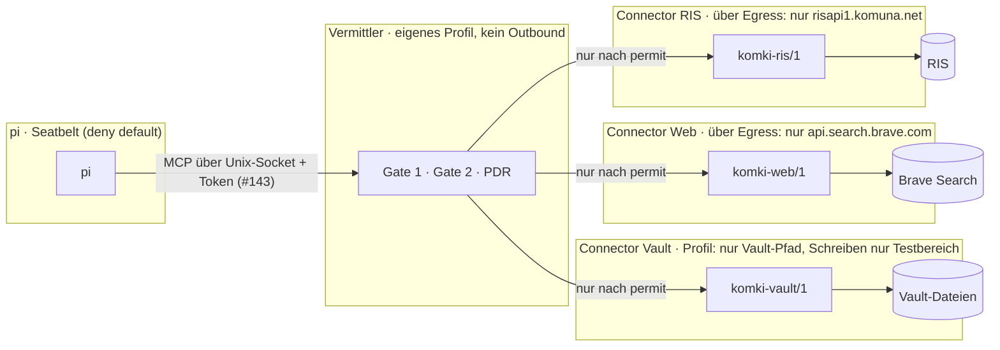
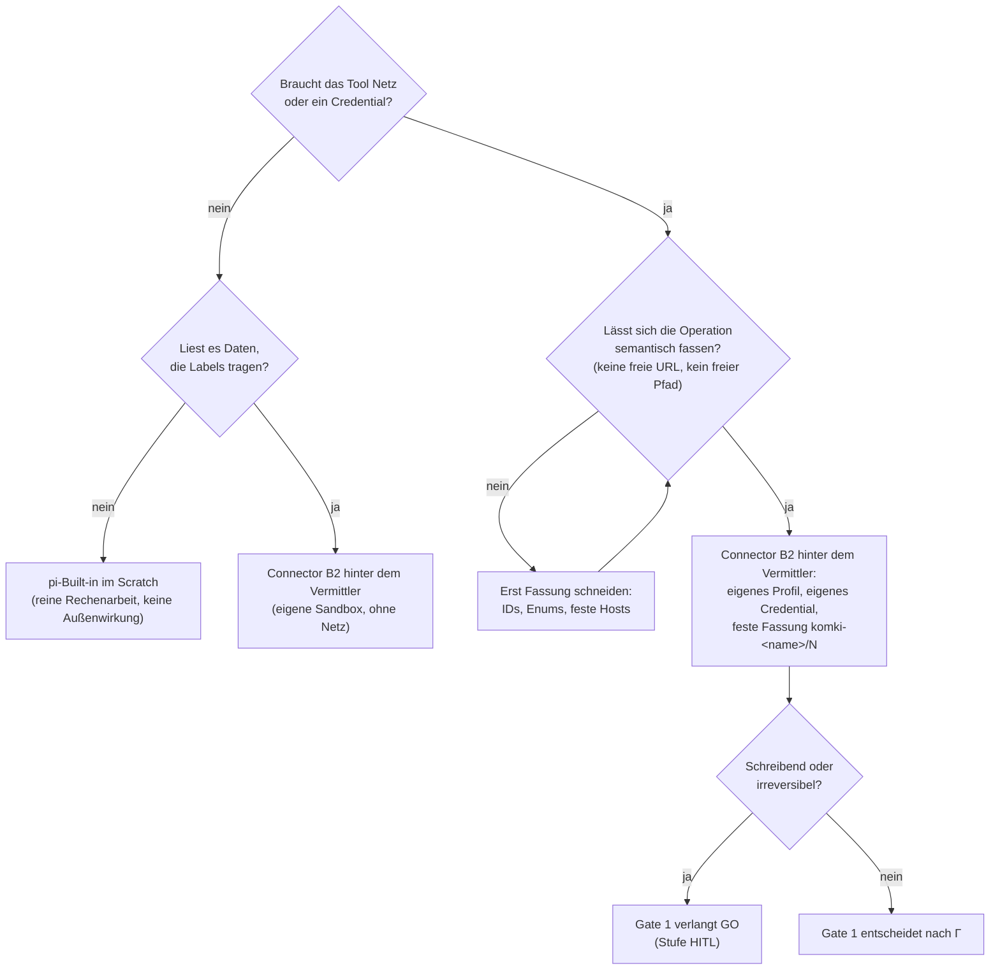

# Entscheidungshandbuch: Tool-Zugang für den gesandboxten pi-Agenten

Stand und Quellenabrufe: 2026-10-20.

| Feld | Wert |
|---|---|
| Art | Entscheidungshandbuch: bündelt Repo-Recherchen, Vault-Notizen und den Web-Stand. Es trifft keinen Beschluss |
| Frage | Wie erreicht pi aus der Seatbelt-Sandbox heraus RIS, Websuche, Vault und die übrigen Tools, und wie werden diese Tools in die Sandbox hineingereicht? |
| Basis | RFC 0003 (R.4.2 bis R.4.4, R.5, R.8, R.11, B.8), [Vermittelte Agent-Netzwerkwege](2026-10-02-vermittelte-agent-netzwerkwege.md), [Agent-Runtime- und Sandbox-Optionen](2026-10-02-agent-runtime-sandbox-optionen.md), Tickets #94, #96, #97, #137 |
| Vault-Quellen | `#sandbox`-Notizen in „All The Notes“: *Agent sandbox design principles*, *omac – Safe tool access for sandboxed agents*, *omac – Security verdict October 2026* (alle 2026-10-19) |

## 0. Feste Prämisse

**komki_policy und der Vermittler (`komki_mediator`) sind immer „im Boot“.** Jeder Tool-Zugang, ob nach
innen oder nach außen, läuft durch Gate 1 und Gate 2 und erzeugt einen PDR. Das ist keine Variante unter
anderen, sondern der Rahmen. Die Varianten V1 bis V6 aus dem Web-Stand werden deshalb in zwei Rollen
gelesen:

- **als Alternative zum Vermittler:** verworfen, weil sie die Prämisse verletzen (Abschnitte 5 und 6
  zeigen, was sie stattdessen leisten würden),
- **als Bauform hinter oder neben dem Vermittler:** Das ist die eigentlich offene Entscheidung
  (Abschnitt 6a): Wie wird ein Connector gebaut, isoliert und mit Credentials versorgt?

## 1. Kurzantwort

**Es gibt einen klaren Favoriten**, und das Repo ist schon auf ihm unterwegs:

> **Der Vermittler bleibt der einzige Ausgang aus der Sandbox. Jedes externe Tool wird ein eigener
> Connector-Prozess mit eigenem, schmalem Seatbelt-Profil, einer festen semantischen Fassung und seinen
> eigenen Credentials. Der Vermittler selbst hat kein Netz nach außen.**

Kurz: Policy-Vermittler plus isolierte Connectoren (Variante V7 unten). Alle anderen Varianten aus dem
Web-Stand lösen nur einen Teil des Problems:

- **Egress-Proxy und Domain-Allowlist** (srt, omac „filtered“): begrenzen das *Ziel*, nicht das *Ereignis*.
- **Sidecar oder Facade** (omac): verstecken den Schlüssel, begrenzen aber nicht die *Autorität* dahinter.
- **MCP-Gateways** (Docker, ToolHive, agentgateway): bringen Containment und Credential-Injection, aber
  keine Labels, keinen Vorbeleg und keine Bindung an den Raumzustand.

Sie liefern Bausteine für V7, aber keinen Ersatz.

Die drei wichtigsten Regeln für jedes neue Tool:

1. **Semantisch statt generisch.** Kein Tool, das eine URL, einen Pfad, einen Befehl oder einen Tenant
   frei entgegennimmt. Ein solches Tool ist ein Request-Dienst mit Credential.
2. **Credentials nur im Connector-Prozess.** Nie in der Sandbox, nie in `mcp.json`, nie im Vermittler.
3. **Beide Richtungen werden geprüft.** Die Anfrage ist eine gebundene Ausgabe (Gate 1), die Antwort ein
   neuer, gelabelter Eingang (Gate 2).

## 2. Ausgangslage im Repo

> **Stand 2026-10-24:** Diese Tabelle beschreibt die Lage *vor* dem Bau. Was umgesetzt ist und wo die Umsetzung
> vom Handbuch abweicht, steht in [Abschnitt 11](#11-abgleich-mit-der-umsetzung-stand-2026-10-24).

| Baustein | Stand | Quelle |
|---|---|---|
| pi unter Seatbelt, deny default | Netz-Auswärts nur zu zwei Loopback-Literals: llama-server und Vermittler | `apps/komki_mediator/README.md` |
| Vermittler (`komki-mediator`) | MCP Streamable HTTP auf `127.0.0.1:49525`, Gate 1 vor dem Vollzug, Gate 2 vor der Antwort, PDR-Journal je Aufruf | ebd., Ticket #102 |
| Aufrufer-Prüfung | Host nur 127.0.0.1 oder localhost, kein Origin, nur `application/json`. Das schließt DNS-Rebinding und Browser-POST aus, ist aber keine Authentisierung | Commit 2cc4dd5 (#133) |
| Fassungs-Pin | Die angebotenen Tools müssen der eingetragenen Fassung entsprechen (D.9) | #94, #102 |
| Vermittler ohne eigene Sandbox | offen | #137 |
| Connectoren RIS, Web, Vault | offen | #94, #96, #97 |

Heute läuft genau ein inhaltliches Tool (`admit_document`) im Vermittler-Prozess selbst. Mit RIS, Web und
Vault entscheidet sich, ob der Vermittler Netz und Credentials bekommt oder ob sie in Connector-Prozesse
ausgelagert werden. #137 lässt diese Architekturfrage ausdrücklich offen. Dieses Handbuch beantwortet sie.

## 3. Bewertungsraster

### 3.1 Fünf Slots (aus *Agent sandbox design principles*)

Jede Variante muss diese fünf Fragen beantworten:

1. **Authority:** Was kann der Agent tun, und was hindert ihn an mehr?
2. **Objects:** Welche Dateien, Sockets, Endpunkte, Identitäten und Daten erreicht er?
3. **Attribution:** Kann das System sagen, welche Session was getan hat?
4. **Duration:** Wann verfällt eine Fähigkeit, und was überlebt einen Absturz?
5. **Payload:** Welcher Code läuft mit einem Credential, und kann der Agent ihn ändern?

### 3.2 Drei Gegner

| Gegner | Was er kann | Was ihn stoppt |
|---|---|---|
| G1 Unfall | Logzeile, Env-Dump, Artefakt | Output-Hygiene, Redaction |
| G2 Prompt-injizierter Agent | Code ausführen, Daten lesen, Anweisungen aus Daten folgen | Capability-Sandbox, keine erreichbaren Credentials, semantische Tools, begrenzter Egress |
| G3 Bösartiger Prozess mit derselben uid | Speicher lesen, Signale senden, Nutzerdateien ändern | nur eigene uid, VM oder Kernelgrenze |

Seatbelt, bubblewrap und gewöhnliche Container reduzieren Capabilities, bieten aber keine
Speicherisolation. **komki zielt auf G1 und G2.** G3 liegt heute außerhalb des Anspruchs und gehört als
Ausschluss in jede Sicherheitsaussage (Prinzip 2: „Write down what is excluded“).

### 3.3 RFC-0003-Pflichten, die jede Variante erfüllen muss

| Pflicht | Bedeutung für den Tool-Zugang |
|---|---|
| R.4.2 | Eine Ausgabe ist das ganze Ereignis: Payload, Ziel, Existenz, Reihenfolge. Auch ein leerer Request ist eine Ausgabe |
| R.4.3 | Connectoren haben eine feste, versionierte Fassung. Suchtext ist Ausgabe, die Antwort ist neuer Eingang. Credentials bleiben beim Connector |
| R.4.4 | Nur ein verbindlicher Vermittler außerhalb der Agentenhoheit erzeugt Außenwirkung |
| R.8 | Der Angreifer bestimmt das gesamte Agentenverhalten. Vollständige Vermittlung muss nachgewiesen werden, auch für Hilfsprozesse |
| R.11 | Vorbeleg vor der Wirkung. Journale sind selbst gebundene Daten |
| B.8 | Vorprüfungen im Harness (pi-Hooks, Extensions) sind unverbindlich |

## 4. Die Entscheidungsachsen

„Wie kommt ein Tool in die Sandbox“ ist nicht eine Frage, sondern sechs fast unabhängige. Die meisten
Produkte im Web beantworten zwei oder drei davon und verkaufen das als Gesamtlösung.

| Achse | Optionen (schwach → stark) |
|---|---|
| **A Ort des Tools** | in der Sandbox · Kindprozess von pi (erbt die Sandbox) · Host-Prozess ohne Sandbox · eigener Prozess mit eigenem Profil · Container oder microVM · eigene uid |
| **B Weg des Agenten zum Tool** | direkter Netzzugang · Egress-Proxy mit Allowlist · MCP stdio · MCP HTTP über Loopback · Unix-Socket mit Peer-Prüfung |
| **C Halter der Credentials** | Env in der Sandbox · Sidecar versteckt den Schlüssel (hider) · Broker injiziert beim Egress (CB4A Model A) · kurzlebige gebundene Tokens (Model B, DPoP) |
| **D Entscheidung pro Aufruf** | keine (Freigabe bei Installation) · Domain-Allowlist · Tool-Allowlist · Regel-Policy (Cedar, OPA, Progent) · Information Flow Control mit Labels (FIDES, komki_policy) |
| **E Behandlung der Antwort** | ungefiltert in den Kontext · Secret-Scanning · Schema- und Größengrenzen · Label und Prüfung vor Aufnahme · Quarantäne (Dual LLM, CaMeL) |
| **F Tool-Oberfläche** | generisch (URL, exec, Pfad) · eingeschränkt generisch · semantisch mit fester Fassung |

Achse F wird am häufigsten übersehen und hat den größten Hebel. Das zeigt der Pfad-Escape im omac-Sidecar
aus der Vault-Notiz: Der Schlüssel war perfekt versteckt, aber `/publish` nahm einen freien `source_dir`
entgegen. Damit konnte der Agent über den Sidecar `~/.ssh/id_rsa` zippen, und die Sandbox war wirkungslos.

## 5. Die Varianten

### V1 Tool als Programm in der Sandbox

Das CLI läuft in pis Sandbox, das Profil öffnet seine Ziel-Hosts, zum Beispiel `ratsinfo` mit Zugriff auf
`risapi1.komuna.net`.

- **Stark bei:** Einfachheit, gut für Werkzeuge ohne Netz und ohne Credential (Compiler, `pdf_ingest` auf
  lokalen Dateien).
- **Schwach bei:** Sobald Netz dazukommt, kann der Agent den erlaubten Host mit beliebigem Payload
  ansprechen (R.4.2) und hält jedes Credential selbst. Kein Vorbeleg, keine Labels.
- **Urteil:** Unter der Prämisse nur für reine Rechenwerkzeuge ohne Netz, ohne Credential und ohne
  gelabelte Eingaben, also das, was pis Built-ins im Scratch ohnehin tun. Sobald ein Tool Daten mit
  Labels liest, gehört es hinter den Vermittler, sonst geht Gate 2 verloren (#104).

### V2 MCP-Server als stdio-Kindprozess von pi

pi startet MCP-Server über `command`/`args` als eigene Prozesse ([pi-Doku `mcp.md`]). Unter Seatbelt
erben Kindprozesse das Profil. Credentials kommen über `${ENV}` oder `!command` in die Konfiguration.

- **Stark bei:** null Infrastruktur, so arbeitet jeder Harness standardmäßig.
- **Schwach bei:** Der Server lebt in der Sandbox, also braucht die Sandbox dessen Netz *und* dessen Token.
  omac beschreibt das wörtlich: „the agent can read this token“.
- **Urteil:** für komki ausgeschlossen, denn das verletzt R.4.3 und R.4.4.

### V3 Egress-Proxy mit Domain-Allowlist

Der Agent spricht HTTP selbst, ein Proxy außerhalb filtert nach Zielhosts. Beispiele: Anthropic
sandbox-runtime (srt) mit `allowedDomains`, omac `network.mode: filtered`, Stripe Smokescreen.

- **Stark bei:** generischer Recherche, Paketinstallation, als *zusätzliche* Netzgrenze.
- **Schwach bei:** Er bewertet nur den Host, nicht Suchtext, Existenz oder Reihenfolge. Ohne TLS-Termination
  ist der Payload unsichtbar. Er ist anfällig für Parser-Bugs am Rand: Die SOCKS5-Null-Byte-Lücke in Claude
  Code (v2.0.24 bis v2.1.89) und CVE-2025-66479 (`allowedDomains: []` griff nicht) sind genau dieser Typ.
- **Urteil:** kein Vermittler im Sinne von R.4.4. Als Netzgrenze *um Connector-Prozesse* aber **nötig**:
  Seatbelt filtert ausgehenden Verkehr nicht nach Host oder IP. Erlaubt sind nur `*` und `localhost`
  (geprüft 2026-10-23, `host must be * or localhost in network address`). Die Host-Allowlist je Connector
  kann deshalb nur ein Proxy erzwingen (Bauform B5, Abschnitt 6a).

### V4 Host-Sidecar oder Facade (Credential Hider)

Das ist das omac-Muster: Der Sidecar auf dem Host hält das Secret aus dem Keychain, der Agent bekommt eine
Loopback-URL und ein Facade-Token, die Freigabe ist per Hash an das Bundle gebunden, das Audit-Log liegt
außerhalb der Sandbox.

- **Stark bei:** Credential-Diebstahl (G2 kann den Schlüssel nicht lesen) und an Inhalte gebundener
  Freigabe (verhindert die MCPoison-Klasse).
- **Schwach bei:** Es ist ein *Confused Deputy*. Der Agent kann jede Route nutzen, die der Sidecar anbietet.
  Freigegeben wird nur einmal bei der Installation, nicht pro Aufruf. Das Facade-Token ist ein Bearer, den
  jeder Prozess in der Sandbox nutzen kann, also keine Attribution. Antworten werden nicht geprüft.
- **Urteil (aus dem Vault-Verdict):** „good practice, not SOTA. The credential is opaque; the authority is
  not.“ Für komki eine Teilmenge von V7, der die Entscheidung pro Aufruf fehlt.

### V5 MCP-Gateway

Ein Gateway bündelt mehrere MCP-Server hinter einem Endpunkt. Beispiele sind Docker MCP Gateway (ein
Container pro Server, Secrets zur Laufzeit nur in den Zielcontainer, Interceptors, `block-secrets`),
ToolHive (Container, Cedar-Policies auf Tool-Annotations), agentgateway und Bifrost (Virtual Keys,
Tool-Allowlists, Logging).

- **Stark bei:** Containment pro Server, Secret-Injection, Tool-Allowlist pro Aufrufer, Logging der
  Aufrufe, Scanning der Antworten.
- **Schwach bei:** Die Policy ist zustandslos und kennt Namen oder Annotations. Sie kennt weder Raumlabel
  noch Empfängerkreis noch Vorbeleg vor der Wirkung. Docker als Pflichtabhängigkeit auf macOS, eine zweite
  Policy-Quelle neben Γ (Prinzip 11: „avoid a second source of truth“) und eine eigene Angriffsfläche.
  Beispiel: ToolHive-Container erreichten über `host.docker.internal` Host-Dienste (CVE-2026-58197).
- **Urteil:** nicht übernehmen, aber die Muster übernehmen: Secret-Scanning in Gate 2, Pinning von
  `tools/list` (bei uns D.9), einen Prozess pro Connector.

### V6 Credential Broker nach CB4A (IETF-Draft, März 2026)

Der Draft trennt den Policy Decision Point (PDP, ohne Credentials) vom Credential Delivery Point (CDP, mintet
nur auf signierte Entscheidungen). Er beschreibt drei Modelle: A Proxy-Injection, B kurzlebige Tokens an den
Agenten, C echte Credentials mit geplanter Sperre. Dazu Stufen der Freigabe: auto, HITL, MFA.

- **Stark bei:** sauberer Trennung von Entscheidung und Credential, Bedrohungsmodell mit Broker-Kompromittierung
  als CRITICAL, Stufen der Freigabe.
- **Schwach bei:** Ausgelegt für Unternehmens-Identität (SPIFFE, DPoP, KMS). Model B, die Vorzugsvariante
  des Drafts, gibt dem Agenten ein Token und widerspricht damit R.4.3.
- **Urteil:** konzeptionell bestätigend. komki_policy ist der PDP, der Connector der CDP nach Model A. Die
  Stufen bilden unser GO-Prinzip ab. Übernehmen sollten wir die *Trennung*: Der Vermittler entscheidet und
  hält keine Credentials, der Connector hält Credentials und entscheidet nichts.

### V7 Policy-Vermittler mit isolierten Connectoren (Favorit)

- **Authority:** nur die Operationen der festen Fassung. Gate 1 entscheidet jedes einzelne Ereignis vor
  der Wirkung.
- **Objects:** pi erreicht genau einen Endpunkt. Jeder Connector erreicht genau seine Ziele.
- **Attribution:** heute über Loopback (schwach, siehe Abschnitt 7.2). Mit Unix-Socket und Peer-PID-Prüfung
  wird sie belastbar.
- **Duration:** Die Fassung ist an die Session gebunden. Eine Fassungsänderung bricht den Pin absichtlich.
- **Payload:** Connector-Code liegt außerhalb der Agentenhoheit, und der Agent liefert nur Parameter einer
  festen Signatur.

Damit sind alle sechs Achsen am starken Ende, außer A (gleiche uid, kein G3-Schutz) und E (Labels statt
Quarantäne).

### V8 Muster im Agenten (orthogonal zu V1 bis V7)

Diese Muster legen fest, *wie* der Agent Tools nutzt, und nicht, wo sie laufen:

| Muster | Kern | Relevanz für komki |
|---|---|---|
| Codemode (Cloudflare, Anthropic, pi 1.0) | Das Modell schreibt ein Skript, das Tools in einer V8- oder QuickJS-Sandbox aufruft | spart Tokens. Jeder Tool-Aufruf läuft weiter über den Vermittler, die Grenze bleibt also gleich. pi warnt selbst, dass Codemode „near harness trust“ läuft |
| Plan-then-execute / Action-Selector | Tool-Auswahl steht fest, bevor untrusted Content gelesen wird | passt zu Remedy Plans und GO. Später als Fassungsmodus denkbar |
| Dual LLM / CaMeL | Ein privilegiertes LLM sieht nie Tool-Ausgaben, ein Interpreter trackt Capabilities pro Wert | stärkster Schutz gegen G2. CaMeL löst 77 % der AgentDojo-Aufgaben mit beweisbarer Sicherheit, ist aber ein eigener Harness |
| FIDES (Microsoft) | Labels für Vertraulichkeit und Integrität wandern automatisch durch Tool-Aufrufe, die Policy greift vor sensiblen Tools | konzeptionell dasselbe wie komki_policy, nur im Planner statt am Rand |
| Lethal Trifecta (Willison) | private Daten + untrusted Content + Kommunikation nach außen = Abfluss | Prüffrage für jede Connector-Kombination in einem Raum |

## 6. Trade-off-Matrix

Skala: ○ leistet es nicht · ◐ teilweise · ● leistet es.

| | V1 in Sandbox | V2 stdio-Kind | V3 Egress-Proxy | V4 Sidecar | V5 MCP-Gateway | V6 CB4A-Broker | **V7 Vermittler + Connectoren** |
|---|---|---|---|---|---|---|---|
| Credential vor G2 geschützt | ○ | ○ | ○ | ● | ● | ● (A) / ◐ (B) | ● |
| Confused Deputy begrenzt | ○ | ○ | ○ | ○ | ◐ Tool-Allowlist | ◐ Policy | ● feste Fassung + Gate 1 |
| Ausgabe als ganzes Ereignis geprüft (R.4.2) | ○ | ○ | ○ nur Host | ○ | ◐ | ◐ | ● |
| Antwort gelabelt vor Aufnahme (R.4.3) | ○ | ○ | ○ | ○ | ◐ Scanning | ○ | ● Gate 2 |
| Vorbeleg vor Wirkung (R.11) | ○ | ○ | ○ | ◐ Netzlog | ◐ Calllog | ◐ Audit | ● PDR |
| Attribution | ○ | ○ | ○ | ○ Bearer | ● OAuth | ● SPIFFE | ◐ → ● mit Unix-Socket |
| Kein zweiter Policy-Ort neben Γ | ● | ● | ○ | ○ | ○ | ○ | ● |
| Betrieb auf einem Mac ohne Docker | ● | ● | ● | ● | ○ | ○ | ● |
| Aufwand | gering | gering | mittel | mittel | mittel (fertig) | hoch | mittel bis hoch (eigene Bauarbeit) |
| Elixir-first | — | — | — | — | ○ Go | ○ | ● |

## 6a. Die eigentliche Entscheidung: Bauform der Connectoren hinter dem Vermittler

Weil Vermittler und komki_policy gesetzt sind, bleibt eine Frage offen: Wo läuft der Code, der das
Credential hält und die Außenwirkung erzeugt? Die Kette ist in allen Bauformen gleich: pi → Vermittler
(Gate 1) → Connector → extern → Connector → Vermittler (Gate 2) → pi.

| Bauform | Beschreibung | Netz und Credentials beim Vermittler? | Schadensradius bei Connector-Bug | Aufwand | Urteil |
|---|---|---|---|---|---|
| **B1 In-Process** | Connector als Elixir-Modul im Vermittler-BEAM, wie heute `admit_document` | ja, der Vermittler braucht die Hosts *aller* Connectoren und alle Keys | alles: Policy, Journal, alle Credentials | gering | verworfen (Architekturentscheidung 2026-10-23): auch Connectoren ohne Netz bekommen eigenen Prozess und eigene Sandbox. `admit_document` wandert mittelfristig aus dem BEAM |
| **B2 Eigener Prozess mit eigenem Seatbelt-Profil** | `komki up` startet den Connector über `sandbox-exec`. Der Vermittler spricht ihn über einen Unix-Socket an (Seatbelt lässt sich nicht verschachteln, siehe 6a.1). Das Credential kommt über stdin aus dem Keychain nur an diesen Prozess | nein, der Vermittler bleibt ohne Outbound | ein Host, ein Credential | mittel: Profilgenerator gibt es schon (#100, #137) | **Favorit**. Lebenszyklus wie llama-server über `komki up/down`, Socket-Rechte `0600` unter `<base>/run` (`0700`), kein Bearer nötig (Host-Annahme) |
| **B3 Host-MCP-Server auf Loopback** | Bestehender MCP-Server (z. B. `@brave/brave-search-mcp-server`, `tools/obsidian_mcp`) läuft eigenständig, der Vermittler ist dessen MCP-Client | nein | der ganze Server-Prozess. Ohne eigenes Profil: volle Nutzerrechte | gering, wenn der Server fertig ist | nur zusammen mit eigenem Seatbelt-Profil, also B2 mit MCP als Protokoll. Ein zusätzlicher Loopback-Port ist für jeden lokalen Prozess erreichbar, und die Fassung muss auf die Tool-Teilmenge geschnitten werden |
| **B4 Container über MCP-Gateway** | Docker MCP Gateway oder ToolHive als Connector-Host hinter dem Vermittler | nein | Container (mit bekannten Ausbrüchen über `host.docker.internal`) | Docker-Pflicht, zweite Policy-Ebene | nicht für jetzt. Sinnvoll erst bei fremden, schwergewichtigen Servern (Playwright-AZ) oder wenn Linux-Betrieb kommt |
| **B5 Egress-Proxy um Connectoren** | Connectoren dürfen nur über einen Proxy mit Host-Allowlist raus | nein | wie B2, plus eine weitere Komponente | mittel | **nötig** (Korrektur 2026-10-23): Seatbelt kann nicht nach Host filtern. Der Connector darf nur `localhost:<sein Proxy-Port>`, der Proxy (`komki-egress`) prüft die Allowlist und schützt vor DNS-Rebinding. Zusätzlich Effektbeleg-Quelle (R.11, [Netzwerkwege §4.4](2026-10-02-vermittelte-agent-netzwerkwege.md)) |

### 6a.1 Architekturentscheidung: jeder Connector seine eigene Sandbox

Beschlossen am 2026-10-23, ohne Ausnahme und auch für Connectoren ohne Netz. Eine einzige Regel ist leichter
zu prüfen als eine Regel mit Ausnahme. Daraus ergeben sich drei Sandboxen-Klassen:

| Prozess | Sandbox | Darf |
|---|---|---|
| pi | eigenes Profil | nur den Kanal zum Vermittler und llama-server |
| Vermittler | eigenes Profil (#137), kein Outbound | Raum lesen, Journal anhängen, Connectoren starten |
| jeder Connector | eigenes Profil | nur seinen Egress-Port (die Hosts prüft `komki-egress`) bzw. seine Pfade, sein Credential und das Binden seines eigenen Unix-Sockets. Kein Kanal zu pi, zu anderen Connectoren oder zu Loopback-TCP |

Drei Regeln machen die Entscheidung belastbar:

1. **Das Profil entsteht aus dem Fassungs-Manifest.** Hosts, Pfade und Credential-Name stehen in der
   Connector-Fassung. Daraus wird das Seatbelt-Profil generiert, und `komki doctor` prüft es byte-stabil
   (Muster wie beim llama-Profil, #100). Damit gibt es keinen zweiten Policy-Ort.
2. **Credentials gehen über stdin an den Connector, nicht über Umgebungsvariablen.** `komki up` liest sie
   aus dem Keychain. Umgebungsvariablen kann jeder Prozess derselben uid mit `ps eww` lesen.
3. **Der Vermittler misstraut dem Connector.** Ein kompromittierter Connector kann behaupten, sein
   Ergebnis sei „public“. Gate 2 vergibt Labels deshalb nach der Import-Regel der Fassung, nicht nach der
   Selbstauskunft des Connectors.

**Randbedingung: Seatbelt lässt sich nicht verschachteln** (geprüft 2026-10-23: `sandbox-exec` innerhalb
von `sandbox-exec` endet mit `sandbox_apply: Operation not permitted`, Exit 71). Ein gesandboxter Vermittler
kann also keine Connectoren mit eigenem Profil starten. Deshalb startet `komki up` (nicht gesandboxt)
jeden Connector selbst, wie heute llama-server und den Vermittler. Der Vermittler erreicht die Connectoren
über Unix-Sockets in einem Verzeichnis mit `0700` und prüft per `LOCAL_PEERPID` gegen das pidfile, dass die
Gegenstelle der richtige Connector ist.

Kosten: Startzeit pro Prozess, und Python-Connectoren (AZ, pdf_ingest) brauchen Lesezugriff auf ihre
Python-Runtime im Profil.

**Die Rollentrennung nach CB4A wird damit konkret:** komki_policy ist der PDP (entscheidet, hält nichts),
der Vermittler setzt durch und protokolliert, der Connector ist der CDP nach Model A (hält das
Credential, entscheidet nichts und handelt nur auf ein permit des Vermittlers). Kein Connector hat einen
Kanal zu pi, der am Vermittler vorbeiführt.

## 7. Begründung des Favoriten und seine Grenzen

### 7.1 Warum V7 klar vorne liegt

1. **Er ist der einzige, der RFC 0003 überhaupt erfüllen kann.** Alle anderen Varianten fehlen mindestens
   bei R.4.2 (Ereignis statt Host) und R.4.3 (gelabelte Antwort). Das ist kein Feinschliff, sondern der
   Zweck von komki.
2. **Der Web-Stand bestätigt seine Struktur.** CB4A trennt Entscheidung und Credential, FIDES und CaMeL
   arbeiten mit Labels und deterministischer Policy vor dem Tool-Aufruf, und die MCP-Spezifikation verbietet
   Token-Passthrough. V7 ist die lokale, auf eine Person zugeschnittene Ausprägung dieser Linie.
3. **Er baut auf Vorhandenem auf.** Gate 1, Gate 2, PDR, Fassungs-Pin und Aufrufer-Prüfung sind geliefert.
   Neu sind nur die Connector-Prozesse samt Profilen, also im Kern #137 plus ein Startmechanismus.
4. **Ein Prozess pro Connector begrenzt den Schaden.** Ein Bug im AZ-Playwright-Pfad erreicht dann den
   AZ-Host und die AZ-Cookies, aber nicht den Vault und nicht den Brave-Key.

### 7.2 Was V7 nicht löst (Ausschlüsse)

- **G3, Prozesse mit derselben uid.** Alle Prozesse laufen als Nutzer `crn`. Ein Prozess außerhalb der
  Sandbox kann Vermittler, Connectoren und Journal manipulieren. Der Ausweg wäre eine eigene uid für
  Vermittler und Connectoren oder eine VM. Heute ist das ausdrücklich nicht im Anspruch.
- **Gegner mit derselben uid sind ausgeschlossen (Annahme der nutzenden Person, 2026-10-23).** Der Host
  gilt als nicht kompromittiert. Saubere Antworten auf G3 wären ein eigener Nutzer für Vermittler und
  Connectoren oder eine VM; macOS hat keine Jails. Beides ist erst nötig, wenn die Annahme fällt.
- **Kanal pi → Vermittler (Befund und Entscheidung 2026-10-23, Ticket #143).** Befund: Der Vermittler lag
  auf `127.0.0.1:49525` ohne Authentisierung. Jeder lokale Client, etwa eine zweite, nicht gesandboxte
  Agent-Session, konnte permit-Inhalte abrufen, und ein fremder Prozess hätte den Port belegen können. Auf
  dem Entwicklungs-Mac war zudem `lo0` ohne root mitschneidbar (Wireshark-`ChmodBPF`, Gruppe `access_bpf`);
  unter der Host-Annahme ist das kein Abnahmekriterium mehr.

  Entscheidung: (1) Der Vermittler lauscht nur noch auf einem Unix-Socket unter `<base>/run/` (`0700`). Es
  gibt keinen Port zum Belegen, und pis Profil erlaubt genau diesen Socket-Pfad. (2) Jede Anfrage braucht
  ein Bearer-Token, das `komki up` bei jedem Start neu erzeugt (Muster wie Jupyter oder VS Code Server). (3)
  Eine Session-ID geht zur Zuordnung in jeden PDR. pis MCP-Client kann keinen Unix-Socket (geprüft: der
  Transport läuft über `fetch`), deshalb startet pi ein kleines stdio-Relay (`komki-relay.js`) in seiner
  Sandbox. Eine Peer-PID-Prüfung (`LOCAL_PEERPID`, getestet: funktioniert) ist unter der Host-Annahme nicht
  nötig.
- **Semantische Leaks über erlaubte Ausgaben.** Ein permit-Suchtext kann Information kodieren. Die
  Engine bewertet Inhalt und Auftreten, aber ein beweisbarer Ausschluss jedes verdeckten Kanals ist nicht
  zu haben.
- **Injection durch Antworten in späteren Schritten.** Gate 2 labelt, aber pi liest das Gelabelte und
  entscheidet danach. Labels für Integrität in Gate 1 („nach untrusted Input keine Ausgabe X“) mildern
  das. Einen Schutz nach Art von CaMeL gäbe es erst mit V8-Mustern.
- **Der Connector wird zum wertvollen Ziel.** Er hält das Credential. Deshalb braucht er ein schmales
  Profil, keine generische Operation und keine Shell.

## 8. Entscheidungsbaum für jedes neue Tool

## 9. Anwendung auf die konkreten Tools

| Tool | Connector-Fassung (Vorschlag) | Credentials | Netz (Allowlist in `komki-egress`) | Ausgabe (Gate 1) | Antwort (Gate 2) | Achtung |
|---|---|---|---|---|---|---|
| RIS (#94) | `komki-ris/1`: `search(text)`, `show(top_id)`, `sessions(range)` | keine (öffentlich) | `risapi1.komuna.net` | Suchtext und IDs sind gebundene Ausgaben | public + Abrufdatum, deterministisch | Die lokale FTS filtert `tops.restricted` nicht (`store.ex:187-202`). Der Connector muss vor Top-k filtern, sonst entsteht ein Existenz-Leak |
| Websuche (#96) | `komki-web/1`: genau `search(query)` | `BRAVE_API_KEY` nur im Connector | `api.search.brave.com` | Query verbatim im PDR, auch leere Requests | public, Integrität *untrusted* | **Kein** `fetch(url)` in derselben Fassung. Seitenabruf ist ein eigener Connector, der höchstens URLs aus vorherigen Suchtreffern akzeptiert |
| Vault (#97) | `komki-vault/1`: `search(text)`, `read(note_id)`, `write_test(note)` | keine | kein Netz, Datei-Read nur Vault-Pfad, Write nur Testbereich | Schreibvorgänge mit GO | Label aus Frontmatter oder Tag, sonst refuse | Kein Vault-Pfad im pi-Profil. Kein `obsidian`-CLI (App-Abhängigkeit, zweiter Prozess mit vollen Rechten). Code aus `tools/obsidian_mcp` wiederverwenden, aber nur als Bibliothek im Connector |
| Allgäuer Zeitung | `komki-az/1`: `search(text)`, `article(id)` | Abo-Cookies nur im Connector | `allgaeuer-zeitung.de` + nachgewiesene Redirect-Hosts | wie RIS | Lizenz-Label (R.2.4), nicht pauschal public | `get_article` nimmt heute eine beliebige URL (`server.py:93-106`) und muss auf IDs eingeengt werden. Der Playwright-Fallback ist eine große TCB und braucht ein eigenes Profil |
| pdf_ingest | B2 ohne Netz (kein Credential) | keine | kein Netz | Dokumentauswahl | Label vom Dokument geerbt | Läuft heute als `admit_document` im Vermittler-BEAM. Nach der Architekturentscheidung (6a.1) wandert es in einen eigenen Prozess |
| Nextcloud (später) | eng geschnitten pro Use Case, kein WebDAV-Generalzugriff | App-Passwort nur im Connector | eigene Instanz | Schreibvorgänge mit GO | Label nach Ordner | Der externe `nextcloud-mcp-server` ist generisch (Files, CalDAV, Talk). Nur hinter einer eigenen Fassung einsetzen |
| Remote-Modell (T3) | eigener Modell-Connector | API-Key nur dort | Anbieter-Host | ganzer Kontext ist Ausgabe | — | siehe [Netzwerkwege §7 T3/T4](2026-10-02-vermittelte-agent-netzwerkwege.md) |

**Lethal-Trifecta-Prüfung pro Raum:** Ein Raum mit Vault (private Daten), Web (untrusted Content) und
Websuche (Kommunikation nach außen) erfüllt das Trifecta. Genau dort muss Gate 1 Suchtexte gegen das
Raumlabel prüfen und nicht nur gegen das Ziel.

## 10. Offene Entscheidungen

1. **Connector-Prozessmodell:** *entschieden* am 2026-10-23, jeder Connector bekommt seine eigene Sandbox
   (Abschnitt 6a.1). Offen ist nur noch die Umsetzung: `komki up` startet Connectoren über `sandbox-exec`
   mit generiertem Profil, der Vermittler erreicht sie über Unix-Sockets, und Credentials
   kommen über stdin aus dem Keychain. Festgehalten in #137.
2. **Transport pi → Vermittler:** *entschieden* am 2026-10-23: Unix-Socket, Bearer-Token und stdio-Relay
   (Abschnitt 7.2, #143). pis MCP-Client kann keinen Unix-Socket.
3. **Codemode in pi 1.x:** *geklärt* am 2026-10-24: in komki-Läufen nicht erreichbar, weil pi mit einer
   `--tools`-Allowlist startet (`komki run`: `write,mcp__komki__*`). Ursprüngliche Frage: Laut Doku ist `codemode` die Standard-Exposure, und auch `direct`-Tools sind aus
   Codemode aufrufbar. Zu prüfen ist, ob Codemode unter `--no-extensions -e builtin:mcp` aktiv ist. Die
   Vermittlungsgrenze ändert es nicht, wohl aber Reihenfolge und Menge der Aufrufe pro Modellschritt (**Test**).
4. **Brave-MCP-Server oder eigener Connector:** #96 sieht den offiziellen `@brave/brave-search-mcp-server`
   host-seitig vor. Unter V7 läuft er als Connector-Prozess mit eigenem Profil, oder er wird durch einen
   kleinen Elixir-Client ersetzt (ein HTTP-Aufruf, weniger TCB). Empfehlung: Elixir-Client, weil die
   Fassung ohnehin nur ein Tool hat.
5. **G3-Anspruch:** Bleibt die Grenze bei derselben uid, oder bekommen Vermittler und Connectoren
   langfristig eine eigene uid?

## 11. Abgleich mit der Umsetzung (Stand 2026-10-24)

Umgesetzt auf Branch `komki-connectors` (PR #167). Verträge: `apps/komki_connector/CONTRACT.md`. Prüfung:
[Labbook](2026-10-23-labbook-komki-connectoren.md), zuletzt Phase 5 mit 11/11 Sicherheitsprüfungen auf einer
nach Schnellstart frisch aufgesetzten Instanz.

**Konsistent mit dem Handbuch:**

| Aussage im Handbuch | Umsetzung |
|---|---|
| Vermittler ist der einzige Ausgang, ohne Netz nach außen (§1) | `mediator.sb`: Outbound nur zu den Connector-Sockets; pi erreicht nur Vermittler und llama (S-07) |
| Jeder Connector eigener Prozess, eigenes Profil, ausnahmslos (§6a.1) | `komki up` startet RIS, Web, Vault und Egress je unter `connector-<id>.sb` bzw. `egress.sb` |
| Profile aus dem Fassungs-Manifest, byte-stabil geprüft (§6a.1, Regel 1) | `KomkiConnector.Manifest` → Profilgenerator; `komki doctor` prüft |
| Credentials über stdin, nie env/argv (§6a.1, Regel 2) | S-11: Key in 0 Prozessen und 0 Dateien |
| Egress-Proxy nötig, weil Seatbelt nicht nach Host filtert (§5 V3, §6a B5) | `komki-egress`, Allowlist je Port, Schutz vor Rebinding und Metadaten (S-08) |
| Semantische Fassungen, keine URL- oder Pfad-Parameter (§1, Regel 1) | geschlossene Schemas; Pfad-Escapes abgewiesen (S-06) |
| Anfrage = gebundene Ausgabe (Gate 1), Antwort = gelabelter Eingang (Gate 2) | emit → Vollzug → admit, zwei PDR, emit-PDR vor der Wirkung (L-105) |
| Lethal-Trifecta-Sperre (§9) | ergibt sich aus der Empfängerprüfung von `emit`; im Raum vertraulich keine Verbindung (S-09, S-10) |
| Kanal: Unix-Socket, Token, Session-ID, Relay (§7.2) | umgesetzt (#143); kein TCP-Listener (S-01, S-02) |
| Host-Annahme statt G3-Schutz (§7.2) | gilt; keine eigene uid, keine Peer-PID-Prüfung |
| Kein `fetch(url)` in der Web-Fassung (§9) | `komki-web/1` hat nur `search` |
| Nicht-öffentliche RIS-TOPs vor Top-k filtern (§9) | Filter vor Begrenzung und Zählung, identische `not-found` (U-1, S-06) |

**Abweichungen und Nachträge:**

| Handbuch | Umsetzung | Einordnung |
|---|---|---|
| §6a.1 Regel 3: Labels nach Import-Regel, nicht nach Selbstauskunft | RIS und Web: fest aus dem Manifest. Vault: Labels stehen in der Notiz, der Connector meldet sie, der Vermittler glaubt sie nur ⊆ `import_labels` | Ein kompromittierter Vault-Connector könnte vertraulich als öffentlich melden. Hingenommen: Er hat nur Lesezugriff auf den Vault und keine Netzroute |
| §9 RIS: `sessions(range)` | nicht gebaut, nur `search` und `show` | Ohne konkreten Bedarf weggelassen (KISS) |
| §9 RIS: Abruf über `risapi1.komuna.net` | nur die öffentlichen Gast-Endpunkte; diese liefern keine TOP-Texte | #148 |
| §9 Web: Query verbatim im PDR | PDR bindet die Anfrage über `intent_hash`/`payload_hash`, nicht im Klartext | Nach R.11.5 gewollt (Journal ohne Payloads); Klartext-Beleg wäre eine eigene Entscheidung |
| §9 Vault: Schreibvorgänge mit GO | `write_test` nur in `komki-test/`, ohne GO | GO-Flow ist #98 |
| §9 Vault: Label aus Frontmatter oder Tag | nur Frontmatter `komki_labels` | Tags bewusst nicht, eindeutiger und prüfbarer |
| §9 pdf_ingest als eigener Prozess (B2) | `admit_document` läuft weiter im Vermittler-BEAM | Übergang laut §6a; #169 |
| §6a.1: Connector ohne Netz und Credential | Vault-Connector ohne Egress-Port; Zertifikate aus `/etc/ssl/cert.pem`, weil `cacerts_get` den Schlüsselbund öffnet | Nachtrag aus L-108 |
| — (neu) | Suchtreffer außerhalb B_W fallen vor Gate 2 still heraus | Nachtrag aus L-109: sonst Existenz-Orakel |
| — (neu) | `mcp.json` wird bei jedem pi-Start neu geschrieben | Nachtrag aus S-07b: sonst Persistenz eines eingeschleusten MCP-Servers |

**Offen aus §10:** nur noch der G3-Anspruch (bewusst ausgeschlossen). Folgetickets aus den Tests: #148, #164,
#165, #166, #168, #169.

## 12. Quellen

Repo und Vault (gelesen 2026-10-20):

- RFC 0003, `docs/rfcs/0003-vertrauliche-ki-arbeitsraeume.md`, Abschnitte R.4.2 bis R.4.4, R.8, R.11, B.8.
- [Vermittelte Agent-Netzwerkwege](2026-10-02-vermittelte-agent-netzwerkwege.md), [Agent-Runtime- und Sandbox-Optionen](2026-10-02-agent-runtime-sandbox-optionen.md).
- `apps/komki_mediator/README.md`; Commit 2cc4dd5; Tickets #94, #96, #97, #104, #137.
- Vault „All The Notes“, `3 - Resources/Tech/`: *Agent sandbox design principles*; *omac - Safe tool access
  for sandboxed agents*; *omac - Security verdict October 2026* (alle mit Tag `sandbox`, angelegt 2026-10-19).

Web (abgerufen 2026-10-20):

- CB4A, IETF-Draft `draft-hartman-credential-broker-4-agents-00` (März 2026): https://www.ietf.org/archive/id/draft-hartman-credential-broker-4-agents-00.html
- agentgateway, Credential Injection Patterns for AI Agents: https://agentgateway.dev/blog/2026-07-27-credential-injection-ai-agent-egress-cb4a/
- CaMeL, Defeating Prompt Injections by Design: https://css.csail.mit.edu/6.858/2026/readings/camel.pdf
- Microsoft FIDES, Securing AI Agents with Information-Flow Control: https://www.microsoft.com/en-us/research/publication/securing-ai-agents-with-information-flow-control/ und https://devblogs.microsoft.com/agent-framework/fides/
- Design Patterns for Securing LLM Agents against Prompt Injections: https://arxiv.org/html/2506.08837v1, Zusammenfassung: https://simonwillison.net/2025/Jun/13/prompt-injection-design-patterns/
- Willison, The lethal trifecta: https://simonwillison.net/2025/Jun/16/the-lethal-trifecta/
- Progent, Programmable Privilege Control for LLM Agents: https://arxiv.org/html/2504.11703v2
- OWASP Top 10 for Agentic Applications (ASI02 Tool Misuse, ASI03 Identity Abuse), Übersicht: https://cycode.com/blog/owasp-top-10-agentic-applications/
- Anthropic sandbox-runtime: https://github.com/anthropic-experimental/sandbox-runtime
- Claude-Code-Sandbox-Lücken (SOCKS5-Null-Byte, CVE-2025-66479): https://www.penligent.ai/hackinglabs/?p=5317
- Docker MCP Gateway: https://hub.docker.com/r/docker/mcp-gateway
- ToolHive + Cedar: https://stacklok.com/blog/enforcing-mcp-tool-annotation-policies-with-cedar/; CVE-2026-58197: https://corgea.com/advisories/vulnerabilities/CVE-2026-58197
- Cloudflare Code Mode: https://blog.cloudflare.com/code-mode-mcp/
- pi MCP-Doku: https://github.com/earendil-works/pi/blob/main/packages/coding-agent/docs/mcp.md; pi 1.0 Codemode (Sekundärquelle): https://redreamality.com/blog/pi-1-0-codemode-mcp-minimal-harness/
- MCP-Spezifikation 2025-11-25, Security Best Practices: https://modelcontextprotocol.io/specification/2025-11-25/basic/security_best_practices

[pi-Doku `mcp.md`]: https://github.com/earendil-works/pi/blob/main/packages/coding-agent/docs/mcp.md
