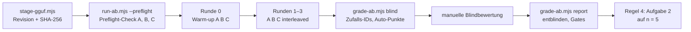

# Labbook: Modell-A/B — Gemma-4-Pin gegen QAT-Variante und Qwen3.8-27B

- **Status:** abgeschlossen, 2026-10-31 (Ticket #285). Pre-Registration committet am 30.10.2026 um 23:54 Uhr (`ba41c62`), erster Lauf am 31.10. um 00:40 Uhr
- **Empfehlung:** Pin behalten, B als Kandidat für einen gezielten Folgetest. Herleitung im Abschnitt [Empfehlung](#empfehlung)
- **Vorgänger:** [Labbook: Realmodell-Smoke-Test](2026-10-30-pi-realmodell-smoke-test.md) (#158, Harness-Basis)
- **Harness:** `apps/komki_cli/experiments/pi_packages/smoke/` (`run-ab.mjs`, `grade-ab.mjs`)

## Ziel und Abgrenzung

Der #158-Smoke-Harness vergleicht drei Modell-Artefakte empirisch: den gepinnten Gemma 4 26B-A4B-it, die QAT-Variante desselben Modells und Qwen3.8-27B. Der Bericht liefert die Grundlage für ein GO der nutzenden Person zum Modell-Pin. Er empfiehlt, entscheiden tut der Mensch. Dieses Ticket pinnt nichts um und ändert keine Instanz.

QAT steht für quantization-aware training: Das Modell wurde während des Trainings auf die 4-Bit-Quantisierung hin optimiert, statt erst danach quantisiert zu werden.

Weitere Begriffe (Einordnung in der [Sprachinventur](../sprachinventur.md), Welle 5): Ein **Arm** ist eine Variante, die gegen die anderen gemessen wird, hier ein Modell-Artefakt samt Server-Konfiguration. Das **Warm-up** ist ein ungemessener Lauf vor den Messläufen, der Caches füllt und Shader kompiliert. **TTFT** (time to first token) ist die Zeit vom Absenden eines Requests bis zum ersten Token der Antwort. Eine **Wiederholungsschleife** (repetition loop) liegt vor, wenn ein Modell dieselbe Zeile immer wieder ausgibt, bis das Ausgabebudget erschöpft ist.

## Pre-Registration

Dieser Abschnitt wurde vor dem ersten Messlauf committet. Checklisten, Gates und Entscheidungsregel stehen gleichlautend als Code in `smoke/grade-ab.mjs` (`MANUAL`, `QUELLEN_SOLL`) und `smoke/criteria.mjs` (K1–K8). Nach den Messläufen ändert sich daran nichts. Wo sich eine Regel als unklar erweist, steht das als Befund im Ergebnisteil, die Wertung bleibt wie registriert.

### Arme

| Arm | Artefakt | Revision | SHA-256 | Sampling (llama-server-Flags) |
|---|---|---|---|---|
| A — Pin | `unsloth/gemma-4-26B-A4B-it-GGUF`, `gemma-4-26B-A4B-it-UD-Q4_K_XL.gguf` | `c099eb48` | `ef728c8e…0636e30c` | `--temp 1.0 --top-p 0.95 --top-k 64` (wie `KomkiCli.Llama`) |
| B — QAT | `unsloth/gemma-4-26B-A4B-it-qat-GGUF`, `gemma-4-26B-A4B-it-qat-UD-Q4_K_XL.gguf` | `7b92b5b2` | `a7c5bc71…0f5891` | wie A |
| C — Qwen | `unsloth/Qwen3.8-27B-GGUF`, `Qwen3.8-27B-UD-Q4_K_XL.gguf` | `4ca72078` | `3f227079…c8b01e` | `--temp 1.0 --top-p 0.95 --top-k 20 --min-p 0.0 --presence-penalty 0.0 --repeat-penalty 1.0` (Thinking-Mode-Empfehlung der Modellkarte) |

Volle Revisionen und Prüfsummen stehen in `smoke/ab-arms.mjs`. Die Sampling-Empfehlungen stammen aus den Modellkarten der jeweiligen Revision (Gemma 4: „temperature=1.0, top_p=0.95, top_k=64“; Qwen3.8-27B: „Thinking Mode: temperature=1.0, top_p=0.95, top_k=20, min_p=0.0, presence_penalty=0.0, repetition_penalty=1.0“), abgerufen am 30.10.2026. Für A und B bleibt `min-p` wie im Produktivstart auf dem llama-server-Default 0,05.

### Messprotokoll

- **Eine Variable:** das GGUF samt Hersteller-Sampling. Gleich für alle Arme: Maschine, llama-server-Binary (SHA-256 im Provenance-Protokoll), Node, pi, Fixtures, Prompts, Logging-Proxy, Serverkontext `-c 131072`, pis `models.json` (Modell-ID `local-model`, `maxTokens` 16 384, Kontextfenster je Aufgabe wie in #158).
- **Staging-Server ohne Seatbelt-Profil:** `smoke/staging-server.mjs` startet llama-server mit den Flags des Produktivstarts, aber auf eigenem Port (A 49611, B 49612, C 49613), mit eigenem API-Key und Log im Laufverzeichnis. Kein Arm läuft über die komki-Instanz.
- **Staging mit Pin-Disziplin:** `smoke/stage-gguf.mjs` lädt von der festen Revision, prüft die vom Server gemeldete Prüfsumme vor dem Download und die Datei danach. `run-ab.mjs` prüft alle GGUFs vor dem Start erneut.
- **Vorab-Check:** derselbe Build muss alle drei GGUFs laden (`run-ab.mjs --preflight`). Scheitert C, wird nicht gemessen, sondern im Ticket ein GO für ein Build-Update eingeholt.
- **Ablauf:** Runde 0 ist das Warm-up (ungemessen), Runden 1–3 sind Messläufe, je Runde A, B, C. Jeder Lauf startet seinen Server frisch und beendet ihn danach. Seed je Runde: 285 000 + Runde, alle Arme einer Runde teilen ihn (`--seed` des Servers).
- **Aufgaben:** 1, 2, 3, 4 und 6 aus #158, Prompts und Fixtures unverändert. Aufgabe 5 (TUI) entfällt. Ein Task-Fehler ist ein Messwert.
- **Timeouts:** Alle Aufgaben-Timeouts sind für alle Arme gleich um den Faktor 6 gestreckt (`--timeout-factor 6`), damit das langsamere dichte Modell nicht vom Timeout zensiert wird.

### Messgrößen je Lauf

| Größe | Quelle | Definition |
|---|---|---|
| Ladezeit | `staging-server.mjs` | Spawn bis `/health` 200 |
| TTFT | Proxy | Zeit vom Request bis zum ersten Delta, Thinking eingeschlossen; dazu die Zeit bis zur ersten sichtbaren Antwort (Text oder Tool-Call) |
| Decode-/Prefill-t/s | llama-Log | Σ eval-Token / Σ eval-Zeit bzw. Σ prompt-Token / Σ prompt-Zeit über alle Requests eines Laufs |
| Token | Proxy, `/tokenize` | Prompt- und Completion-Token (llama-`usage`); davon Thinking-Token, exakt gezählt mit dem Tokenizer des jeweiligen Servers |
| Tool-Calls | Proxy | Schema-Validierung je Call wie in #158 |
| Reparaturbedarf | Proxy, Session | invalide Tool-Calls plus Tool-Results mit `isError` |
| Speicher | `footprint`, `ps` | `phys_footprint` des llama-server nach jeder Aufgabe (zählt ausgelagerte Seiten und Metal-Puffer), RSS als Vergleich |
| finishReasons | Proxy | je Request; `length` zählt als längengeklemmt |
| Compaction | Aufgabe 6 | Anzahl, Summary-Dauer, Präferenz in Summary und nach Resume; der Triggerpunkt verschiebt sich mit dem Tokenizer und wird nicht wegnormalisiert |

Berichtet werden Median und Spanne (Minimum–Maximum) über die drei Messläufe, keine Einzelwerte und keine Signifikanzaussagen.

### Blinde Qualitätsbewertung

`grade-ab.mjs blind` kopiert die Outputs der Aufgaben 1 (Antworttext), 2 (`quellen.json`) und 3 (`neue-fassung.md`) aller neun Messläufe unter Zufalls-IDs, je Aufgabe gemischt. Der Schlüssel liegt getrennt in `blind-key.json` und wird erst von `grade-ab.mjs report` gelesen. Automatische Punkte werden vor der manuellen Bewertung gerechnet, `missingFacts` eingeschlossen. Die manuelle Bewertung arbeitet nur auf den verblindeten Kopien. Jeder Punkt zählt 1.

**Aufgabe 1 — TOP-Zusammenfassung (11 Punkte)**

| ID | Art | Kriterium |
|---|---|---|
| K1–K5, K7, K8 | auto | wie im TOP-Benchmark aus #158 (`criteria.mjs`): Gremium, Datum, Vorhaben, Anliegen, Gesamtkosten, Beschlussvorschlag mit ≥ 2 Komponenten, keine erfundenen Zahlen |
| K6 | auto | streng: die Zahl 80 000 (Eigenanteil) fällt; das Wort „Eigenanteil“ allein reicht nicht |
| M1 | manuell | höchstens fünf Sätze |
| M2 | manuell | keine sachliche Verfälschung: Rollen, Beträge, Auflagen, offene Punkte korrekt zugeordnet |
| M3 | manuell | Deutsch, flüssig, ohne Sprachmischung, ohne Denk- oder Tool-Syntax |

**Aufgabe 2 — Quellen extrahieren (20 Punkte, vollständig automatisch)**

Q0: gültiges JSON-Array, jedes Objekt mit `Quelle`, `Abrufdatum`, `Seite`. Dazu je Soll-Quelle drei Punkte (vorhanden, Abrufdatum richtig, Seite richtig), gewertet am besten passenden Eintrag:

| Soll-Quelle | Abrufdatum | Seite |
|---|---|---|
| VEP 2025–2030, Download `2026-V-118` | 02.10.2026 | 14 |
| VEP 2025–2030 | `null` oder 02.10.2026 | 22 |
| Gutachten Barrierefreiheit, Auftrag 2026/Soz-017 | `null` (11.08.2026 ist das Gutachtendatum, kein Abrufdatum) | 7–9 |
| StVO § 45, gesetze-im-internet.de | 05.10.2026 | `null` |
| Förderrichtlinie Straßenbau | 05.10.2026 | 6 |
| Amtsblatt / Haushaltsplanung 2027 | 09.10.2026 | 31 |

Q9: kein Eintrag nennt ein Abrufdatum oder eine Seite, die nicht im Text steht. Ein Eintrag zu § 23 BauGB wird weder belohnt noch bestraft.

**Aufgabe 3 — Redigieren ohne Faktenänderung (16 Punkte)**

| ID | Art | Kriterium |
|---|---|---|
| S1 | auto | höchstens 80 % der Wortzahl des Entwurfs |
| F0 | manuell, Fakt | nichts hinzuerfunden (keine neue Tatsachenbehauptung, Zahl, Frist oder Bedingung) |
| F1–F10 | manuell, Fakt | Abschnitt Bahnhofplatz–Rathausplatz; Baubeginn 03.02.2027; Bauzeit zwölf Wochen; Hausnummern 4 bis 12; Gehwege 2,5 → 4,0 m; 21 Straßenbäume; Gesamtkosten 240 000 €; Eigenanteil 80 000 € der Stadt; Rest über Förderrichtlinie des Landes vom 19.09.2026; Bitte um Zustimmung zu Maßnahme und Kostenschätzung im Vorgriff auf die Haushaltsplanung 2027 |
| S2 | manuell | klare Sätze, überwiegend aktive Form |
| S3 | manuell | Doppelungen und Tippfehler des Entwurfs beseitigt |
| S4 | manuell | Modalität erhalten: der Rest „kann“ gedeckt werden, nicht als sicher dargestellt |
| S5 | manuell | Textsorte erhalten: deutsche Beschlussvorlage an den Rat mit Beschlussbitte |

Die automatische Vorprüfung (`missingFacts`, neu hinzugekommene Zahlen) wird der Bewertung von F0–F10 angezeigt. Eine Zahl, die nur die Schreibweise wechselt („zwölf“ → „12“), ist keine Faktenänderung. Fehlt die Datei, gelten alle manuellen Punkte als nicht erfüllt.

### Gates

| Gate | Art | Regel |
|---|---|---|
| H1 | hart | 0 Faktenänderungen (F0–F10) in Aufgabe 3, in jedem der drei Messläufe |
| H2 | hart | Reparaturrate ≤ Pin; Reparaturrate = (invalide Tool-Calls + Tool-Results mit `isError`) / alle Tool-Calls, gepoolt über alle Messläufe und Aufgaben |
| Q | Qualität | Median-Punktzahl ≥ Pin in mindestens 2 der 3 Textaufgaben |
| — | Kosten | t/s, TTFT, Wandzeit und Speicher werden berichtet, sind aber kein K.-o. |

### Entscheidungsregel für die Empfehlung

1. Ein Kandidat (B oder C) wird nur zum Re-Pin empfohlen, wenn er H1, H2 und Q besteht und in den Aufgaben 1–4 und 6 nicht häufiger scheitert (Verdikt `fail` oder Timeout) als der Pin.
2. Bestehen beide, entscheidet die Summe der Median-Qualitätspunkte; bei Gleichstand die Wandzeit.
3. Besteht keiner, lautet die Empfehlung: Pin behalten.
4. Liegt eine Entscheidung knapp, also innerhalb eines Punktes oder an einem einzelnen Lauf hängend, wird nur die knappe Kennzahl auf n = 5 erhöht, und das wird so berichtet.

## Ablauf

Begriffe ab hier: **Gesamtdauer** ist die real verstrichene Zeit (wall-clock time), in der Pre-Registration „Wandzeit“. **Prüfergebnis** ist das `verdict` des Harness je Aufgabe (`pass`, `partial`, `fail`), in der Pre-Registration „Verdikt“. **Preflight-Check** ist die Ladeprobe vor der Messung (`run-ab.mjs --preflight`).



| Schritt | Zeit (31.10.2026, MEZ) | Laufverzeichnis unter `$TMPDIR/komki-pi-experiments/ab-285/` |
|---|---|---|
| Pre-Registration committet | 30.10., 23:54 | Commit `ba41c62` (Hauptlauf lief auf genau diesem Stand, Arbeitsbaum sauber) |
| Staging B und C, Preflight-Check A, B, C | 00:03–00:40 | `main/preflight-AB.json`, `main/preflight-C.json` |
| Hauptlauf: Warm-up + 3 Runden × 3 Arme | 00:40–03:33 | `main/` (`schedule.json`, `provenance.json`, `REPORT.md`) |
| Blindbewertung, Entblindung | 03:33–03:37 | `main/blind/`, `main/blind-key.json` |
| Nachmessung Aufgabe 2 (Regel 4), Runden 4–5 | 03:37–04:14 | `n5-task2/` |
| Explorative Nachmessung Aufgabe 6, A und B, Runden 4–7 | 04:15–04:28 | `explore-task6/` |
| Default-Pfad-Kontrolle gegen die komki-Instanz | danach | `default-path/` |

Die Rohdaten (Request-Mitschnitte, Sessions, Server-Logs, Blindkopien) liegen nur in diesen Verzeichnissen und sind nicht Teil des Repos.

## Umgebung und Provenance

| Feld | Wert |
|---|---|
| Hardware | MacBookPro18,4, Apple M1 Max, 64 GB, Netzbetrieb, keine Thermik- oder Leistungswarnung in irgendeinem Lauf (`pmset -g therm`) |
| macOS | 27.2 (26B5101f) |
| llama-server | 0.7.0 (build 11669, commit `620d2225c`), Homebrew, SHA-256 `fd5cb5a7…21ded9d81` → identisch mit dem Pin der komki-Instanz |
| Node, pi | 24.22.1, pi 1.4.0 |
| Server-Flags | `--jinja --offline --no-webui --no-slots -c 131072 --alias local-model --api-key-file …` + Sampling je Arm + `--seed`; 4 Slots, `kv_unified`, 131 072 Kontext je Slot |
| Seeds | Warm-up 285 000, Runden 1–5: 285 001–285 005 (alle Arme einer Runde gleich), explorativ 285 004–285 007 |
| Störgrößen | Die komki-Instanz lief unberührt weiter (idle, ~17 GB footprint, größtenteils ausgelagert), dazu eine VM und Editoren. Swap wuchs im Hauptlauf von 27 auf 38 GB. Die Decode-Raten schwanken trotzdem je Arm um höchstens 2,5 % (siehe unten), die Interleaving-Reihenfolge verteilt den Rest gleich auf alle Arme. |

| Arm | Datei | Größe | SHA-256 (vor dem Lauf gegen den Pin geprüft) |
|---|---|---|---|
| A | `gemma-4-26B-A4B-it-UD-Q4_K_XL.gguf` | 17,0 GB | `ef728c8e0c337fd1067b947af006e38a9ef2419e56feced4fd29b4bf0636e30c` |
| B | `gemma-4-26B-A4B-it-qat-UD-Q4_K_XL.gguf` | 14,2 GB | `a7c5bc715f5ff8e99a3e8901ce7d2b42b402c669bf24f7c5250747633d0f5891` |
| C | `Qwen3.8-27B-UD-Q4_K_XL.gguf` | 17,6 GB | `3f227079003add2511437e5b1e94812e363385225bf6a9b47b0054a72bc8b01e` |

Vorab-Check: Der gepinnte Build lädt alle drei GGUFs (A 8,3 s, B 11,4 s, C 6,6 s). C trägt die Architektur `qwen35` (65 Blöcke inklusive einer MTP-Schicht), die Build 11669 kennt. Ein Build-Update war nicht nötig.

## Ergebnisübersicht

Alle drei Arme bestehen die harten Gates. Die Unterschiede liegen woanders:

- **A, Pin:** solide und schnell, verliert aber in Aufgabe 1 in allen drei Läufen den Eigenanteil. In einem von acht Läufen der Aufgabe 6 schreibt er den Tool-Call als Text, statt ihn auszuführen.
- **B, QAT:** decodiert 42 % schneller, denkt aber doppelt so viel, die Gesamtdauer bleibt deshalb gleich. Qualitativ liegt er auf Pin-Niveau, in Aufgabe 1 einen Punkt darunter. In drei von acht Läufen der Aufgabe 6 gerät er in eine Wiederholungsschleife bis ans Output-Limit.
- **C, Qwen3.8-27B:** liefert die besten Zusammenfassungen (11/11 in jedem Lauf) und braucht keine einzige Reparatur. Er ist aber auf dieser Maschine etwa 9,5-mal langsamer und schreibt in zwei von fünf Läufen ungültiges JSON.

### Gates

| Gate | A (Pin) | B (QAT) | C (Qwen) |
|---|---|---|---|
| H1: 0 Faktenänderungen in Aufgabe 3, jeder Lauf | 0 / 0 / 0 | 0 / 0 / 0 → **bestanden** | 0 / 0 / 0 → **bestanden** |
| H2: Reparaturrate ≤ Pin | 2 von 54 (3,7 %) | 1 von 51 (2,0 %) → **bestanden** | 0 von 60 (0 %) → **bestanden** |
| Q: Median ≥ Pin in ≥ 2 von 3 Textaufgaben | Referenz | Aufgaben 2 und 3 (jeweils Gleichstand) → **bestanden** | Aufgaben 1 und 3 → **bestanden** |
| Regel 1: nicht häufiger `fail`/Timeout als der Pin | 1 (Aufgabe 6) | 0 → erfüllt | 1 im Hauptlauf → erfüllt; mit Nachmessung 2 → nicht erfüllt |

### Qualität (blind, Punkte: Median und Spanne)

| Aufgabe | A (Pin) | B (QAT) | C (Qwen) |
|---|---|---|---|
| 1 — TOP-Zusammenfassung (von 11) | 10 (9–10) | 9 (9–10) | **11 (11–11)** |
| 2 — Quellen (von 20), n = 3 | 20 (20–20) | 20 (18–20) | 18 (0–20) |
| 2 — Quellen (von 20), n = 5 nach Regel 4 | 20 (20–20) | 20 (18–20) | 18 (0–20) |
| 3 — Redigieren (von 16) | 15 (15–15) | 15 (15–15) | 15 (15–15) |
| Summe der Mediane | **45** | 44 | 44 |

Einzelwerte je Lauf: Aufgabe 1 A 10/10/9, B 9/9/10, C 11/11/11; Aufgabe 2 (n = 5) A 20/20/20/20/20, B 20/18/20/20/20, C 20/18/0/0/20; Aufgabe 3 durchgehend 15.

### Leistung (Median und Spanne über 3 Messläufe, Aufgaben 1–4 und 6)

| Messgröße | A (Pin) | B (QAT) | C (Qwen) |
|---|---|---|---|
| Ladezeit | 8,6 s (8,6–8,6) | 7,3 s (7,1–7,3) | 9,6 s (9,3–9,9) |
| Gesamtdauer | 210 s (129–277) | 222 s (211–277) | 1 994 s (1 663–2 565) |
| Decode | 46,0 t/s (45,7–46,2) | **65,3 t/s** (63,8–65,3) | 6,9 t/s (6,9–6,9) |
| Prefill | 402 t/s (398–453) | 439 t/s (437–445) | 85 t/s (84–85) |
| TTFT, Median je Request (Thinking eingeschlossen) | 729 ms (622–788) | 663 ms (614–808) | 2 052 ms (1 739–4 645) |
| erste sichtbare Antwort, Median je Request | 2,4 s (1,6–2,6) | 2,7 s (1,5–2,8) | 16,1 s (13,5–17,4) |
| Prompt-Token | 76 743 (56 858–79 994) | 79 714 (66 198–82 182) | 85 671 (74 312–114 117) |
| Completion-Token | 6 706 (4 905–9 942) | 11 093 (10 278–14 393) | 11 808 (9 631–15 803) |
| davon Thinking-Token | 4 650 (3 346–7 953) | 9 318 (8 432–10 690) | 8 328 (6 766–12 730) |
| `phys_footprint` max | 14,2 GiB (14,2–18,3) | 17,6 GiB (14,2–18,5) | 17,2 GiB (17,2–18,0) |
| Tool-Calls / schema-invalide / Reparaturen | 54 / 1 / 2 | 51 / 0 / 1 | 60 / 0 / 0 |
| finishReasons | tool_calls 54, stop 25 | tool_calls 51, stop 27, length 1 | tool_calls 52, stop 27 |

Die minimale Gesamtdauer von A (129 s) stammt aus dem Lauf, in dem Aufgabe 6 ohne Tool-Call endete. `phys_footprint` zählt die per mmap gelesenen, sauberen Gewichtsseiten nicht vollständig mit. Er taugt als Vergleich zwischen den Armen, nicht als absoluter Speicherbedarf.

### Je Aufgabe (Median und Spanne, 3 Messläufe)

| Aufgabe | Gesamtdauer A | Gesamtdauer B | Gesamtdauer C | Thinking-Token A / B / C | Prüfergebnisse A · B · C |
|---|---|---|---|---|---|
| 1 TOP | 16,2 s (16,1–20,0) | 12,7 s (11,9–15,5) | 76,1 s (62,0–130,1) | 518 / 589 / 143 | partial³ · partial³ · pass³ |
| 2 Quellen | 14,1 s (13,7–82,7) | 61,4 s (60,9–71,8) | 571 s (460–1 262) | 0 (0–3 088) / 3 202 / 3 318 | pass³ · pass³ · pass, pass, fail |
| 3 Redigieren | 36,2 s (30,4–38,4) | 31,9 s (29,0–32,3) | 203 s (145–237) | 1 259 / 1 615 / 999 | pass³ · pass³ · pass³ |
| 4 Todo | 44,9 s (40,9–46,1) | 29,5 s (26,6–29,5) | 349 s (302–499) | 777 / 717 / 995 | pass³ · pass³ · pass³ |
| 6 Compaction | 96,3 s (21,8–98,3) | 78,8 s (75,4–141,6) | 621 s (570–736) | 2 079 / 2 549 / 2 309 | pass, pass, fail · pass³ · pass³ |

## Befunde

### 1. Gemma denkt auch im Produktivbetrieb

Mit `--jinja` gibt der Pin in fast jedem Request `reasoning_content` aus. Im Median sind 4 650 von 6 706 Completion-Token eines Laufs Thinking, also rund 70 %. Der #158-Proxy hat dieses Feld nicht erfasst, deshalb war es dort unsichtbar. Die Gemma-Vorlage wirft das Thinking früherer Turns aus der History. Bei Qwen erhält der Server es standardmäßig (`--reasoning-preserve`, Logzeile beim Start). Das erklärt einen Teil der höheren Prompt-Token von C. pi schickt `reasoning_content` in jedem Fall mit; was davon ins Modell gelangt, entscheidet die Chat-Vorlage.

### 2. B: schneller decodiert, aber nicht schneller fertig

B decodiert 42 % schneller (65,3 gegen 46,0 t/s) und lädt schneller. Die Datei ist 2,8 GB kleiner. B denkt aber doppelt so viel (9 318 gegen 4 650 Thinking-Token), deshalb gleicht sich die Gesamtdauer aus (222 gegen 210 s). Am deutlichsten zeigt sich das in Aufgabe 2: Der Pin denkt dort in zwei von drei Läufen gar nicht und ist nach 14 s fertig, B braucht mit rund 3 200 Thinking-Token 61 s. In den Aufgaben 1, 3, 4 und 6 ist B schneller.

### 3. B: Wiederholungsschleife nach der Compaction

In Aufgabe 6 gibt B nach dem Lesen der Filler-Datei deren Zeile 143- bis 163-mal wieder, bis das Output-Budget erschöpft ist (`finishReason: length`). Das passierte im Warm-up, in Runde 1 und in einem der vier explorativen Läufe, zusammen also **3 von 8**. Beim Pin kam es in 8 Läufen nie vor, bei C in 4 nie. Kein Gate deckt diese Fehlerklasse ab. Die Harness-Prüfung „final-antwort“ verlangt nur einen nicht leeren Text und besteht deshalb.

### 4. A: Tool-Call als Text

In Aufgabe 6, Runde 3, schreibt der Pin `<tool_code> read(path="gross.txt") </tool_code>` als Antworttext, statt das Tool aufzurufen. Die Datei wird nie gelesen, die Compaction löst nicht aus, das Prüfergebnis ist `fail`. Über alle 8 Läufe der Aufgabe 6 passierte das **einmal**, in den übrigen Aufgaben nie. Die Schema-Validierung sieht einen solchen Fall nicht, weil gar kein Tool-Call ankommt. Ein Scan aller Antworttexte nach Tool-Syntax (ohne Compaction-Summaries) findet über alle 26 Läufe genau diesen einen Treffer.

### 5. C: rohe Anführungszeichen machen JSON ungültig

Das Fixture enthält `„Barrierefreiheit Bahnhofstraße"` mit einem ASCII-Zeichen als schließendem Anführungszeichen. Gemma maskiert es beim Schreiben von `quellen.json` als `\"`. Qwen übernimmt es in 2 von 5 Läufen roh, das JSON wird ungültig und bekommt nach Q0 0 von 20 Punkten. Inhaltlich wären beide Fassungen bei etwa 17 von 20 gelandet (VEP-Seiten zusammengelegt, Seiten mit „S.“-Präfix korrekt). Für jeden Weg, auf dem C strukturierte Daten schreibt, braucht es eine Validierung mit Rückmeldung an das Modell.

### 6. C: beste Zusammenfassung und beste Instruktionstreue, aber zu langsam

C nennt in Aufgabe 1 in jedem Lauf den Eigenanteil von 80 000 € (K6), meist auch die Auflagen und offenen Punkte, und verfälscht nichts. Gemma lässt den Eigenanteil unter dem natürlichen Prompt in allen sechs Läufen weg, wie schon in #158. In Aufgabe 6 hält sich nur C durchgehend an die Präferenz („kurze Sätze, Quelle zu jeder Aussage“) und antwortet nach der Compaction auf Deutsch. Gemma (A und B) antwortet nach dem Lesen der Datei in 8 von 14 Läufen auf Englisch (Hauptlauf und explorative Läufe); die drei Wiederholungsschleifen von B sind dabei als deutsch gezählt. Der Preis: 6,9 t/s Decode, 85 t/s Prefill, im Median 16 s bis zur ersten sichtbaren Antwort, die beiden Compaction-Summaries der Aufgabe 6 dauern zusammen 5–8 Minuten (Gemma: 11–48 s). Für interaktive Ratsarbeit auf einem M1 Max ist das nicht tragfähig.

### 7. Alle Arme machen aus „kann gedeckt werden“ eine Gewissheit

Alle neun Fassungen der Aufgabe 3 erhalten jeden Fakt (F0–F10, H1 überall bestanden), aber keine erhält die Modalität: Aus „der Restbetrag … gedeckt werden kann“ wird „deckt“ oder „wird gedeckt“ (S4 in 9 von 9 Läufen verfehlt). Für GO-relevante Texte ist das eine inhaltliche Verschärfung, die der Zahlenabgleich nicht findet. Sie gehört als Prüfpunkt in die redigierenden Skills, zum Beispiel `antrag_generieren`. Dazu wechseln drei Fassungen in die Wir-Form oder machen „die Stadt“ zur Handelnden.

### 8. Gemma: „melden“ wird zu „aufnehmen“

In drei von sechs Gemma-Zusammenfassungen (A einmal, B zweimal) wird aus „die Kostenschätzung zur Haushaltsplanung 2027 melden“ ein „in die Haushaltsplanung aufnehmen“ oder „einfließen lassen“. Das verschiebt den Beschlussinhalt von einer Meldung zu einer Festlegung (M2). Bei C kam das nicht vor.

### 9. Reparaturen heilen sich selbst

Alle drei Reparaturfälle liegen in Aufgabe 4, und das Modell hat jeden im nächsten Call selbst behoben: zweimal `read` auf `.` (Verzeichnis statt Datei, A und B), einmal `todo` ohne `action` (A). pis In-Band-Fehlermeldung reicht. Für `pi-tool-repair` ergibt sich daraus weiterhin kein Bedarf (vgl. #158).

## Abweichungen vom Protokoll

1. **Reparaturzählung korrigiert.** Die erste Auswertung zählte „invalide Calls plus `isError`-Results“ wörtlich. Dabei fiel dasselbe Ereignis doppelt an: Ein invalider Call erzeugt bei pi immer auch ein `isError`-Result, und die Session nach `--continue` (Aufgaben 4, 6) enthält die Results des ersten Laufs ein zweites Mal. `grade-ab.mjs` zählt jetzt distinkte `isError`-Results nach `toolCallId`. Wörtlich gezählt stünden A 9,3 %, B 3,9 %, C 0 %. Gate H2 fällt unter beiden Zählweisen gleich aus.
2. **Darstellungsfehler im generierten Bericht behoben.** In den Qualitätsspannen überschrieb die Maximalpunktzahl das Spannenmaximum. Die Gates rechnen mit dem Median und waren nicht betroffen.
3. **Nachmessung nach Regel 4.** Der Gleichstand B/C (44/44) hing an Cs Aufgabe 2, deren Median an einem einzelnen Lauf lag (0/18/20). Deshalb lief nur Aufgabe 2 zwei Runden länger, für alle Arme interleaved, ohne erneutes Warm-up. Die Mediane blieben unverändert.
4. **Explorative Nachmessung Aufgabe 6** (A und B, je 4 Läufe), **nicht vorab registriert.** Sie fließt in kein Gate ein, nur in die Befunde 3 und 4 und in die Empfehlung.
5. **Dateiname** `2026-10-31-…` statt des im Ticket vermuteten `2026-11-*`: Das Datum ist der Tag der Messung.
6. **Bewertungsregel M2 präzisiert, vor dem Entblinden.** Beim Bewerten zeigte sich die Frage, ob eine fehlende Rollenangabe schon eine Verfälschung ist. Festgelegt und auf alle neun Antworten gleich angewandt: Weglassen ist keine Verfälschung, ein veränderter Beschlussinhalt (melden → aufnehmen) schon.

## Grenzen

- n = 3 (Aufgabe 2: n = 5) bei temp 1.0: Mediane und Spannen beschreiben, sie beweisen nichts. Einzelne Fehlerklassen (Befunde 3–5) liegen bei 1–3 Fällen.
- Die Blindbewertung lag bei derselben Session, die den Harness gebaut hat. Sie arbeitete nur auf den verblindeten Kopien, bevor der Schlüssel gelesen wurde. Der Stil verrät C aber teilweise (Listenform, Quellenvermerke), die Verblindung ist also nicht perfekt. Aufgabe 2 ist vollautomatisch und damit blind per Konstruktion.
- Während der Messung waren die Monitor-Ausgaben der Läufe auf Rundenwechsel gefiltert. Nur die zwei Exit-Codes 1 (Läufe 10 und 12) waren vor dem Verblinden sichtbar. Aus der Harness-Entwicklung kannte die Bewertung je einen ungemessenen Entwicklungs-Output von A (Aufgaben 1–3) und C (Aufgabe 1).
- pis Default-System-Prompt wie in #158, nicht der KomKI-Produktiv-Prompt. Mediator, MCP-Tools und Seatbelt-Profile sind außen vor (Staging-Server ohne Profil).
- Gemma-MTP (speculative decoding, in beiden Gemma-Repos verfügbar) und Qwens Non-Thinking-Modus sind nicht gemessen. Beide könnten das Bild für B bzw. C verschieben.
- `maxTokens` 16 384 und das Fenster von Aufgabe 6 (16 384) gelten für alle Arme gleich. Ein Denkmodell mit größerem Ausgabebudget wurde nicht separat geprüft.

## Default-Pfad (Abnahmekriterium „Pin unverändert“)

Ohne `--gguf` läuft `run-smoke.mjs` wie in #158 gegen die komki-Instanz (Port 49524, `models/gemma-4-26B-A4B-it-UD-Q4_K_XL.gguf`, kein Staging-Server, Timeout-Faktor 1). Prüfergebnisse: Aufgabe 1 partial (Eigenanteil fehlt), 2, 3, 4 und 6 pass, 24 Tool-Calls ohne Fehler. Der TOP-Benchmark aus #158 mit den ausgelagerten Kriterien (`criteria.mjs`) liefert dasselbe Bild wie dort: Variante A K6 fehlt, Variante B vollständig, 160 000 als abgeleitet erkannt. Die komki-Instanz, `pins.ex` und die Instanzdateien sind unverändert.

## Empfehlung

**Formal nach der registrierten Regel:** B und C bestehen H1, H2 und Q sowie Regel 1 im Hauptlauf. Die Qualitätssummen sind gleich (44/44, Pin 45), den Gleichstand entscheidet die Gesamtdauer für B (222 gegen 1 994 s). Rechnet man die Nachmessung zu Regel 1 hinzu, scheitert C dort (2 gegen 1 `fail`) und B bleibt allein übrig. Die Regel zeigt also auf **B**.

**Inhaltlich empfehle ich trotzdem, den Pin vorerst zu behalten.** Begründung:

1. B bringt keinen Qualitätsgewinn. Das Gate Q besteht B nur über zwei Gleichstände, in Aufgabe 1 liegt B einen Punkt unter dem Pin. Den Vorteil im Decode frisst das zusätzliche Thinking, die Gesamtdauer ist gleich.
2. B zeigt eine neue Fehlerklasse, die die Gates nicht erfassen: die Wiederholungsschleife in 3 von 8 Läufen der Aufgabe 6. Der Pin hat dort 1 von 8 Ausfällen (Text-Tool-Call). Bei dieser Stichprobe ist das ein Hinweis, kein Beleg. Für einen Wechsel des Produktivmodells reicht es nicht.
3. C ist inhaltlich der stärkste Arm, aber mit 6,9 t/s und 16 s bis zur ersten Antwort auf einem M1 Max nicht alltagstauglich, dazu kommt das JSON-Problem.

**Vorschlag für Folgetickets (zur Entscheidung):**

- B gezielt nachmessen, bevor über einen Re-Pin entschieden wird: Aufgabe 6 mit n ≥ 10 je Arm und eine Prüfung „keine Zeile ≥ 8-mal wiederholt“ als Gate. Optional MTP-Drafter für A und B, weil beide Repos ihn mitliefern.
- Modalitätsverschärfung (Befund 7) und „melden → aufnehmen“ (Befund 8) als Prüfpunkte in die redigierenden und zusammenfassenden Skills aufnehmen. Das gilt modellunabhängig.
- Thinking des Pins bewusst entscheiden (Befund 1): Abschalten senkt Latenz und Token, muss aber gegen die Qualität gemessen werden.

Die Entscheidung über den Pin trifft die nutzende Person. Dieses Ticket pinnt nichts um.

## Folgemessungen

Die nutzende Person hat am 31.10.2026 entschieden, die drei Vorschläge aus der Empfehlung in diesem Ticket umzusetzen statt in Folgetickets. Die zwei Messvorschläge stehen hier, die Prüfpunkte für die Skills im Abschnitt [Skill-Prüfpunkte](#skill-prüfpunkte).

### Pre-Registration der Folgemessungen

Dieser Abschnitt wurde vor dem ersten Lauf der Folgemessungen committet. Protokoll wie oben: gleicher Build, Staging-Server ohne Seatbelt, Arme interleaved, Warm-up ungemessen, Timeout-Faktor 6, Prompts und Fixtures unverändert. Jede Studie hat eine eigene Seed-Basis, damit kein Lauf den Seed eines früheren wiederholt.

| Studie | Arme | Aufgaben | Läufe | Seed-Basis | Laufverzeichnis |
|---|---|---|---|---|---|
| F1 Schleifen | A, B | 6 | Warm-up + 10 je Arm | 285 100 | `folge-schleifen/` |
| F2 Thinking | A, A0 | 1, 2, 3, 4, 6 | Warm-up + 3 je Arm | 285 200 | `folge-thinking/` |
| F3 MTP | A, AM, B, BM | 1, 2, 3, 4, 6 | Warm-up + 3 je Arm | 285 300 | `folge-mtp/` |

Neue Arme (`smoke/ab-arms.mjs`), jeweils GGUF und Sampling des Basisarms plus genau ein Server-Schalter:

| Arm | Basis | Schalter |
|---|---|---|
| A0 | A | `--chat-template-kwargs '{"enable_thinking":false}'`, der Nicht-Denk-Modus der Gemma-4-Vorlage. Getestet: Ohne den Schalter liefert der Pin auf eine Rechenfrage 481 Zeichen Thinking, mit ihm keines. |
| AM | A | `--spec-type draft-mtp --spec-draft-n-max 4 --model-draft mtp-gemma-4-26B-A4B-it-Q8_0.gguf` aus `unsloth/gemma-4-26B-A4B-it-GGUF@c099eb48`, SHA-256 `6326fb9f…26d93ed1b` |
| BM | B | dasselbe mit dem Drafter aus `unsloth/gemma-4-26B-A4B-it-qat-GGUF@7b92b5b2`, SHA-256 `75f58e20…415f67af` |

MTP (multi-token prediction) ist speculative decoding: Ein kleiner Drafter schlägt bis zu vier Token vor, das Hauptmodell prüft jeden davon. Die Ausgabeverteilung bleibt dabei die des Hauptmodells, nur die Geschwindigkeit ändert sich.

**F1 Schleifen.** Eine Wiederholungsschleife liegt vor, wenn in einer Modellantwort (Compaction-Summaries ausgenommen) eine nicht leere Zeile mindestens 8-mal vorkommt (`LOOP_LINE_REPEATS` in `grade-ab.mjs`). Gate L: Der Anteil der Läufe mit Schleife ist bei B nicht höher als beim Pin. Nebenbei gezählt werden Text-Tool-Calls. Regel: Besteht B das Gate L nicht, bleibt es bei „Pin behalten“. Besteht B es, lege ich den Re-Pin auf B zusammen mit F3 zur Entscheidung vor.

**F2 Thinking.** Blind bewertet mit denselben Checklisten wie im Hauptlauf, Referenz ist A. A0 muss H1, H2 und Q bestehen und darf in den Aufgaben 1–4 und 6 nicht häufiger `fail` oder Timeout haben als A. Dann empfehle ich, das Thinking abzuschalten, und berichte Gesamtdauer und Token-Ersparnis. Andernfalls bleibt es an.

**F3 MTP.** Ohne Textbewertung, weil die Ausgabeverteilung unverändert bleibt; berichtet werden Geschwindigkeit und Prüfergebnisse. MTP lohnt sich für einen Arm, wenn die Gesamtdauer im Median um mindestens 10 % sinkt und kein zusätzliches `fail` auftritt.

## Skill-Prüfpunkte

Befunde 7 und 8 hängen nicht am Modell, also gehören sie in die Skills. Je ein knapper Prüfpunkt, weil lange Checklisten in einem Skill untergehen (#158):

| Skill | Ergänzung |
|---|---|
| `sitzungsvorbereitung` | Beim Beschlussvorschlag Verben und Rollen nicht verschärfen („melden“ ≠ „aufnehmen“, „empfiehlt dem Rat“ ≠ „beschließt“); Gewissheit wie in der Vorlage („kann“, „soll“, „voraussichtlich“ bleiben) |
| `antrag_generieren` | neues Gate vor GO: Gewissheit und Verben wie in der Quelle |
| `bericht_aus_dem_stadtrat` | unter Quellenpflicht: Beschlüsse und Vorlagen nicht verschärfen |

**Gegenprobe (vorab registriert, vor dem Lauf committet).** Pin auf eigenem Staging-Server (Port 49617, Seed 285 400). Prompt „Lies die Datei top-3-anhoerung.md im aktuellen Verzeichnis und bereite TOP 3 als Abschnitt für meine Sitzungsmappe auf.“, der Skill `sitzungsvorbereitung` per `--append-system-prompt`: Arm „alt“ in der Fassung von `origin/main`, Arm „neu“ in der dieses Branches, je 6 Läufe interleaved. Automatisch geprüft:

- **verschärft**, wenn die Antwort beim Haushalt ein Festlegungsverb nutzt (aufnehmen, einfließen, einstellen, einplanen, bereitstellen) oder den Ausschuss beschließen lässt,
- **treu**, wenn „melden“ im Zusammenhang mit der Haushaltsplanung steht.

Erwartung: Arm „neu“ verschärft seltener als Arm „alt“. Die Modalitätsregel prüft diese Gegenprobe nicht, weil das Fixture von TOP 3 kein „kann“ enthält. Das Skript ist flüchtig (Scratchpad) und nicht Teil des Repos; Methode und Ergebnis stehen hier.

Nach dem Merge von #310 (Skill-Evals) brauchen die drei Skills eine aktualisierte `BENCHMARK.md`. Der Runner liegt auf `main` noch nicht vor.

## Reproduktion

```bash
cd apps/komki_cli/experiments/pi_packages
# Staging (Revision, SHA-256: smoke/ab-arms.mjs)
node smoke/stage-gguf.mjs --repo unsloth/gemma-4-26B-A4B-it-qat-GGUF \
  --revision 7b92b5b28818151e8669af2e45e88d6086f490dd \
  --file gemma-4-26B-A4B-it-qat-UD-Q4_K_XL.gguf \
  --sha256 a7c5bc715f5ff8e99a3e8901ce7d2b42b402c669bf24f7c5250747633d0f5891
node smoke/stage-gguf.mjs --repo unsloth/Qwen3.8-27B-GGUF \
  --revision 4ca720788d1e01f1bff70c033e0d0028fd02e502 \
  --file Qwen3.8-27B-UD-Q4_K_XL.gguf \
  --sha256 3f227079003add2511437e5b1e94812e363385225bf6a9b47b0054a72bc8b01e

R=$TMPDIR/komki-pi-experiments/ab-285/main
node smoke/run-ab.mjs --root $R --preflight
node smoke/run-ab.mjs --root $R --runs 3 --timeout-factor 6
node smoke/grade-ab.mjs blind --root $R     # dann blind/grades.json ausfüllen
node smoke/grade-ab.mjs report --root $R

# Regel 4 und explorative Nachmessung
node smoke/run-ab.mjs --root $TMPDIR/komki-pi-experiments/ab-285/n5-task2 --first-round 4 --runs 5 --only 2 --timeout-factor 6
node smoke/run-ab.mjs --root $TMPDIR/komki-pi-experiments/ab-285/explore-task6 --arms A,B --first-round 4 --runs 7 --only 6 --timeout-factor 6
```
