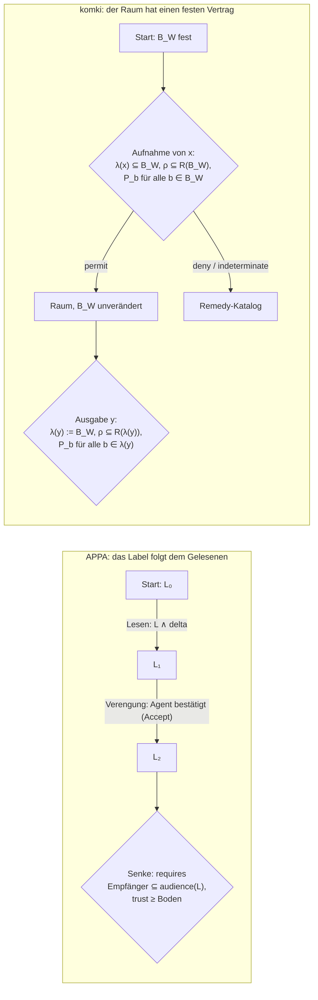
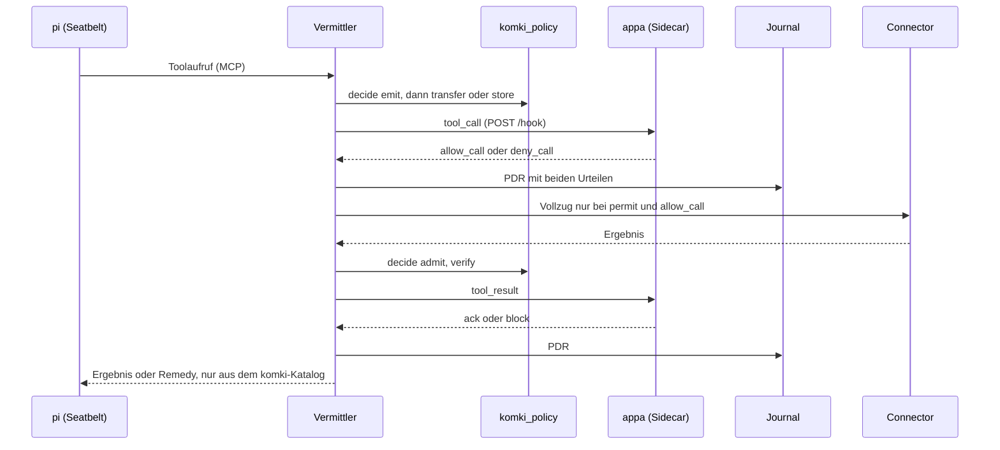

# komki_policy und APPA/OpenAPPA: angleichen, ersetzen oder als Referenzmodell nutzen

Stand: 16.11.2026. Analyse zu Ticket [#596](https://github.com/croesnick/kommunalpolitik_ki/issues/596) (`ai:s-tier`). Das Dokument baut nichts. Es hat eine Entscheidung der nutzenden Person vorbereitet (GO-Vorlage in Abschnitt 7). Das GO kam am 16.11.2026 für alle Punkte; die Entscheidung steht in [ADR 0006](../adr/0006-eigene-inferenz-engine-appa-als-referenzmodell.md). Für APPA schreibt es die Recherche vom 13.10.2026 fort ([Agent policy models](2026-10-13-agent-policy-models-openappa-pace.md)); PACE ist hier kein Thema.

Alle Quellen wurden am 16.11.2026 abgerufen: das Paper in Version 2 (arXiv 2607.24625v2), die OpenAPPA-Dokumentation (openappa.com, vollständig als `llms.txt`), der OpenAPPA-Quellcode auf `main` bei `8151ed1` (15.11.2026, ein CI-Commit nach v0.43.0), die Workshop-Seite auf neurips.cc. Auf komki-Seite sind es [CONTRACT.md](../../apps/komki_policy/CONTRACT.md), [RFC 0003](../rfcs/0003-vertrauliche-ki-arbeitsraeume.md) und der Code auf `origin/main` (`b22b759`). Zitate aus englischen Quellen bleiben englisch. **APPA** meint das Modell aus dem Paper, **OpenAPPA** die Implementierung. Wo beide auseinanderlaufen, ist das vermerkt.

## Kurzfassung

APPA und komki_policy entscheiden dieselbe Frage: Darf diese Information zu diesem Empfänger? Der Kern ist derselbe. Empfängermengen werden geschnitten, Labels werden nur strenger, ein Gate prüft vor dem Aufruf und eines danach, und eine Ausnahme gilt für genau einen gerenderten Call. Formal lässt sich komkis Empfängertest auf APPAs Empfängerdimension (`audience`) abbilden: Aus einer Bindungsmenge `L` wird der Empfängerkreis `R_Γ(L)`, und die Vereinigung zweier Bindungsmengen wird zum Schnitt ihrer Empfängerkreise. Das ist APPAs meet.

Bei dieser Abbildung geht verloren, was komki von APPA unterscheidet. Von den vier Eigenschaften aus dem Ticket kann APPA drei in seiner Algebra nicht ausdrücken und die vierte nur zum Teil:

- **Fester Raumvertrag `B_W`.** APPA führt stattdessen ein Label pro Trajektorie, das beim Lesen sinkt; eine Verengung bestätigt der Agent selbst. Den Empfänger- und Trust-Anteil eines festen Raums kann ein Host nachbilden, Bindungen und ihre Bedingungen nicht.
- **Zweckbedingung `P_b`.** Dafür gibt es im Vertrag keinen Ort, denn `requires` kennt nur `audience`, `trust`, `effects` und `attention`.
- **Beobachter des Verarbeitungswegs `ρ(c)`.** Für ausgehende Aufrufe lassen sie sich als feste Empfänger nachbilden, für den Inferenzweg nicht. Ein unvollständiger Beobachternachweis ist in APPA kein Zustand.
- **Quarantäne.** Es gibt sie nicht. Unbekannte Aufrufe werden abgelehnt oder von einem Annotator eingeordnet, ab Werk von einem Modell.

**Empfehlung: Option D.** komki_policy bleibt die Engine, APPA dient als Referenzmodell. Dazu kommt eine gezielte Angleichung (Option A) an benannten Stellen (Abschnitt 7). Ein Ersatz (B) gäbe Zusagen des RFC auf und widerspräche AGENTS.md §1. Ein Parallelbetrieb (C) brächte einen zweiten Vertrauenskern (TCB, trusted computing base) mit rund 205 000 Zeilen Rust in den `appa-*`-Crates, ein zweites Log und einen zweiten Ausnahmeweg. Übrig bliebe als Gewinn vor allem die Trust-Dimension, und die kann komki als Bindung selbst modellieren, sobald #603 geklärt ist.

**Nebenbefund (Abschnitt 6):** CONTRACT §2.6 sagt, das Modell sei kein Beobachter und könne deshalb keine Aktionsfreigabe ausstellen. Im Seed-Γ ist `pi-agent` aber Element von 𝒪, und die Engine prüft nur die Zugehörigkeit zu 𝒪. Die Grenze hält derzeit allein, weil pi das GO-Verzeichnis nicht schreiben kann.

## 1. Was sich seit dem 13.10.2026 geändert hat

### komki

Die Recherche vom 13.10. beschrieb den Freigabezweig der Engine noch als Stub. Seitdem ist gebaut (CONTRACT.md, Kopfzeile, §§ 2.6–2.8 und 4.5–4.9):

- **Lieferung 2:** `emit`, der Remedy-Katalog nach APPA Theorem 5 („APPA Theorem 5 umgesetzt“, § 2.8) und die Aktionsfreigabe mit Frische-Fenster, Nonce und Call-Hash nach PACE.
- **Lieferungen 3 und 4:** `store` und `transfer`.
- **Lieferung 5:** die Offenlegungsfreigabe (`komki-release/2`) mit Lockerungsbefugnissen, die an der Bindung hängen (§ 4.9).

Der Vermittler hat zwei Gates nach APPA-Vorbild. Gate 1 entscheidet vor dem Vollzug über den exakten, kanonisierten Call, Gate 2 prüft das Ergebnis danach unabhängig nach ([gate.ex](../../apps/komki_mediator/lib/komki_mediator/gate.ex), [connector_gate.ex](../../apps/komki_mediator/lib/komki_mediator/connector_gate.ex)). Jeder Schritt schreibt einen PDR ins Journal. Das Journal ist eine Hash-Kette, auf Wunsch zusätzlich mit `chflags uappnd` geschützt ([journal.ex](../../apps/komki_mediator/lib/komki_mediator/journal.ex), #139). Quarantäne und Erstklassifikation führt der Label-Store; jede Einordnung trägt `decided_by` und `basis` ([label_store.ex](../../apps/komki_cli/lib/komki_cli/label_store.ex), Z. 61: „Erstklassifikation ist ein menschlicher Akt“). Die Engine umfasst 5 437 Zeilen in `lib/` und 4 706 Zeilen Tests und hat weiterhin keine Laufzeitabhängigkeit.

### APPA und OpenAPPA

- **Das Paper** steht seit dem 26.08.2026 unverändert in Version 2. Dass es angenommen wurde, ist jetzt belegt: Die offizielle Workshop-Seite auf neurips.cc führt es unter den angenommenen Beiträgen von „Agents in the Wild“ (11.12.2026, Sydney). Es ist also ein Workshop-Paper und kein Beitrag zur Hauptkonferenz. Die Website schreibt „NeurIPS-accepted paper“, das README genauer „Accepted to the NeurIPS 2026 Workshop on Agents in the Wild“.
- **OpenAPPA** ist von v0.1.0 (18.08.2026) bei v0.43.0 (15.11.2026) angekommen, mit 58 Versions-Tags in 89 Tagen. Hinzugekommen sind unter anderem `forwards`, Attention-Marken, Annotatoren (auch modellgestützte), Context Provider, Recorder, der File-Tracker mit SafeBash, Policy-Revisionen mit Replay und eine Community-Erweiterung für pi (`pi-openappa`).
- **Paper und Code laufen auseinander.** Das Paper beschreibt in §3 partielle Labels `(L_est, U_src)` für nicht annotierte Werkzeuge, die erst ein registrierter Cast auflöst. Der Engine-Code sagt das Gegenteil: "there is no partial or pending label state anywhere in the algebra" (`appa-engine/src/lib.rs`). Nicht annotierte Aufrufe gehen heute an einen Wildcard-Annotator oder werden abgelehnt. Der Bruch kam mit v0.7.0 (02.09.2026): "replace dynamic resolvers, casts, and Unknown with the Annotator boundary" (CHANGELOG). Auch die Empfängerdimension ist im Code symbolisch, als Schnitt von Vereinigungsklauseln über Gruppen, die Mitgliedschaftsdienste auflösen. Im Paper ist sie eine endliche Menge `P(U)`.
- **Die Grenzen** aus der Recherche vom 13.10. stehen weiter in der Doku, nur an anderen Stellen: Abschalten über `APPA_GATE` oder `disableAllHooks`, ungeschützte Hintergrundsitzungen, ein `/hook`-Endpunkt ohne Authentifizierung. Unter `/coding-agents#limits` stehen jetzt die Grenzen von File-Tracker und SafeBash, darunter: "Model-provider requests and assistant messages are not mediated."

## 2. Zwei Modelle mit gemeinsamer Mitte

Beide Engines prüfen vor jedem Schritt, ob eine Information zu einem Empfänger darf. Verschieden ist, woran die Regel hängt.

| | APPA / OpenAPPA | komki |
|---|---|---|
| Träger des Labels | die Trajektorie, also der Verlauf eines Agenten in einer Sitzung | Objekt und Arbeitsraum |
| Verlauf | sinkt mit jedem gelesenen Wert; eine Verengung bestätigt der Agent | ab dem Start fest; eine neue Aufgabe braucht einen neuen Raum |
| Regeln hängen an | Werkzeugen (`delta`, `forwards`, `requires`, `effects`) | Bindungen (Empfängerkreis `R_b`, Bedingung `P_b` je Operation, Lockerungsbefugnis) |
| Ausnahme | Authority mit Mandat (`permits`), über Werkzeug-Tags zugeordnet; Mensch, Regel oder LLM | Aktions- oder Offenlegungsfreigabe; die Lockerungsbefugnis steht in der Bindung |
| Fehlender Beleg | Ablehnung | `indeterminate`, ein eigener Wert neben `deny` |
| Dimensionen | `audience × trust`, dazu Effekte und Attention | Bindungsmenge: Empfängerkreise und Bedingungen |

APPA arbeitet mit einem *floating label*: Das Label wandert mit dem, was gelesen wurde. Für die Unteragenten beruft sich das Paper ausdrücklich darauf: "adapting floating-label subcomputation isolation [31] to LLM transcript management" (§6; [31] ist LIO, Stefan et al. 2011). komki arbeitet mit einem festen Raumvertrag. Label und Obergrenze des Raums fallen zusammen und ändern sich nicht, solange der Raum besteht.



**Die gemeinsame Mitte, formal.** Die Abbildung `h(L) = R_Γ(L) = ⋂_{b∈L} R_b` (RFC R.5.1) führt komkis Bindungsmengen in APPAs Empfängerdimension über und erhält die Verknüpfung: `h(L₁ ∪ L₂) = h(L₁) ∩ h(L₂)`. Mehr Bindungen in komki entsprechen also genau dem meet in APPA. komkis Empfängertest `ρ_Γ(c) ⊆ R_Γ(L)` ist bei festem Trust dieselbe Prüfung wie APPAs `requires.audience.contains` mit `ρ_Γ(c)` als geforderten Empfängern.

**Was `h` vergisst**, ist der Unterschied zwischen den Systemen:

- die Identität der Bindung. Zwei Bindungen mit gleichem Empfängerkreis bleiben in komki verschieden (R.5.1: „Gleich klingende Regeln sind nicht automatisch austauschbar.“). Die Prämisse `label_preservation` (`B_W ⊆ λ(y)`) prüft Identitäten, keine Empfänger.
- die Operationsbedingungen `P_b`
- die Lockerungsbefugnis je Bindung

Umgekehrt hat APPA Dimensionen, für die komki kein Gegenstück hat: Trust `t`, die Effekt-Historie `E` und Verzweigungen in Unteragenten (Abschnitt 3.6).

## 3. Die vier komki-Eigenschaften im APPA-Vertrag

Je Eigenschaft folgen das komki-Vertragszitat, das APPA-Vertragszitat und der Befund. „Nachbildbar“ heißt hier: mit Mitteln von OpenAPPA so konfigurierbar, dass ein Teil der Wirkung entsteht. Die Nachbildung nennt immer, was dabei verloren geht.

### 3.1 Aufnahme gegen `B_W`

**komki verlangt.** CONTRACT § 4.1 (Z. 328): „Das Validierungslabel ist **immer** `workspace.bindings` (B_W). Auch eine öffentliche Datei (λ(x) = ∅) wird gegen **alle** Raumbindungen geprüft (RFC 5.4, D.1).“ RFC R.4.1 (Z. 526): „Ein aktiver Raum vergrößert oder verkleinert seine Bindungsmenge nicht. Eine geänderte Aufgabe benötigt einen neuen Raum.“ RFC R.4.2 (Z. 530): „Alle vom Arbeitsraum veranlassten Ausgaben werden so behandelt, als könnten sie von jedem seiner Eingänge abhängen. Das gilt ab dem Start, auch vor dem ersten tatsächlichen Lesen eines geschützten Dokuments.“

**APPA sagt.** Paper §4: "A call dispatches directly if and only if all policy requirements hold and either cτ(L) = L (no narrowing occurs) or the agent explicitly executes an in-session Accept step acknowledging the label restriction." Anhang B: "Accepting a narrowing is the only route that rests on no registered component, and the only one that spends reach." Die Doku (How it works): "The security label can become more restrictive as the agent works, but it cannot become less restrictive."

**Befund: nicht ausdrückbar.**

1. Wo komki ablehnt (`label_not_included`, λ(x) ⊄ B_W), verengt APPA das Label und bietet dem Agenten an, die Verengung zu bestätigen. Genau dieses Wachsen der Bindungsmenge verbietet R.4.1. Laut Paper ist das Accept der einzige Weg, der keine registrierte Komponente braucht. Im Code ist es ein Routenschritt ohne Vorbehalt (`RecoveryRoute::certainty`, `appa-engine/src/route.rs`, Z. 85–105). Unterbinden kann es nur der Host: Führt er `appa/execute_remedy_plan` nie aus, bleibt jede Verengung eine Ablehnung. Einen eigenen Schalter dafür dokumentiert OpenAPPA nicht.
2. Den Regressionsfall D.1 kann APPA nicht abbilden: Eine öffentliche Datei (λ(x) = ∅) scheitert, weil die Bedingung der Fallbindung falsch ist. In APPA verengt öffentliches Lesen nichts, und eine Bedingung, die an einer Bindung des Raums hängt, gibt es nicht.
3. **Nachbildbar ist ein Teil.** `[policy.deployment] starting_label` (im Code, `appa-policy/src/raw.rs`, in der öffentlichen Doku nicht beschrieben) setzt alle Trajektorien eines Deployments auf ein Startlabel. Das ergibt den konservativen Start aus R.4.2, wenn jeder Raum ein eigenes Deployment bekommt. Den Empfängeranteil der Aufnahmeregel kann man je Lesewerkzeug nachstellen, indem man das Objektlabel als `forwards` angibt und die Empfänger von `R_Γ(B_W)` in `requires.audience.contains` einträgt. Das zweckentfremdet `forwards` (gemeint ist "content the tool sends beyond its arguments"). Die entstehende Lücke ist eine Anforderungslücke, und die räumt ein Accept nicht ab (Anhang B: "acceptance clears a narrowing block rather than a requirement gap"). Zusammen mit einem Host, der kein Accept ausführt (Punkt 1), lassen sich R.4.1 und R.4.2 so für `audience × trust` nachbilden. Es fehlen weiter Bindungsidentität, `P_b` und D.1.
4. Am nächsten kommt einer festen Obergrenze der Rückgabevertrag eines Unteragenten: "The declared return limits constrain what the child may read" (Doku, Subagent Returns). Er gilt aber nur für Unteragenten, und der Agent setzt ihn selbst: "Return declarations are executed autonomously by the agent without requiring human approval."

### 3.2 Zweckbedingung `P_b`

**komki verlangt.** RFC R.5.2: `Erlaubt_Γ(c, L) = Basis_Γ(c) ∧ ρ_Γ(c) ⊆ R_Γ(L) ∧ ⋀_{b∈L} P_b(c)`. RFC R.2.3 (Z. 464): „Der Empfängerkreis begrenzt, wer Informationen sehen darf. Die Operationsbedingungen begrenzen zusätzlich, wie sie verarbeitet werden dürfen.“ RFC R.5.2 (Z. 601): „Eine fehlende Voraussetzung ist nicht wahr.“ CONTRACT § 3 (Z. 316): „Fehlender Fakt im Snapshot → `unknown`, **kein Default**“. Die Bedingungen stehen in der Grammatik `eq`, `member`, `subset`, `at_most`, `all`, `any` über Fakten mit Herkunftsklasse und werden dreiwertig ausgewertet.

**APPA sagt.** Die Doku (Policy configuration) nennt für `requires`: "Preconditions for executing the call: audience, trust, effects, or attention requirements." Weiter: "`contains` is the only supported precondition operator under `requires.audience`." und "Only `contains` and `excludes` are permitted under `requires.effects`." Das Paper (§3) erlaubt registrierte Resolver "for group directories or application-specific log views (e.g., financial spend accumulators), isolating external business logic within the TCB without altering the lattice algebra."

**Befund: in der Algebra nicht ausdrückbar.** Es gibt zwei Nachbildungen, beide mit Verlust.

1. **Zweck als Pseudo-Empfänger.** Jede Bindung nimmt die zulässigen Zwecke als künstliche Empfänger in ihren Kreis auf, etwa `zweck:mandat`, und jede Senke verlangt den Zweck des Raums mit `requires.audience.contains`. So lassen sich Bedingungen der Form „Zweck ∈ Menge“ abbilden. Nicht abbilden lassen sich `at_most` und `subset` über Fakten oder ein Fakt wie `input_in_approved_case_scope`. Vor allem fallen damit die zwei Arten von Grenze zusammen, die R.2.3 trennt. Eine Authority mit `audience_missing` könnte dann einen Zweckverstoß als fehlenden Empfänger durchwinken. komki hält beides auseinander: Bei `store` überbrückt kein GO den Empfängertest (#417), eine falsche Bindungsbedingung bei `emit` dagegen schon, mit einer Aktionsfreigabe für den exakten Call (CONTRACT § 2.8).
2. **Zweck im Annotator.** Ein Annotator mit Context Provider holt die Fakten und gibt eine Sperre zurück. Damit liegt die Prüfung in TCB-Code außerhalb der Algebra. Drei Eigenschaften von komki gehen dabei verloren:
   - Das Label bleibt dem Annotator unbekannt: "Consult requests do not disclose the trajectory's current audience, trust rank, or history." Er weiß also nicht, welche Bindungen `L` trägt, und kann `⋀_{b∈L} P_b` nicht auswerten.
   - Die dreiwertige Semantik hängt vom Code des Annotators ab: "Context provider failures never block execution directly; annotators treat missing or failed context as unknown data."
   - Es gibt keinen Beweisbaum, den ein unabhängiger Prüfer nachrechnen kann (CONTRACT § 5).

### 3.3 Beobachterdomänen `ρ(c)`

**komki verlangt.** RFC R.5.2 (Z. 584): „$\rho_\Gamma(c)$ bezeichnet alle Beobachter, denen der Schritt nach der aufgelösten Umgebung Information zugänglich macht. Dazu gehören die mitverarbeitenden Stellen, nicht nur der adressierte Endpunkt.“ RFC R.3 (Z. 496): „Die Umgebung MUSS alle Stellen erfassen, die Inhalt oder geschützte Metadaten erhalten: auch Diagnose, Hilfsmodelle, Protokollierung, Vorschau, Sicherungen und Sync, soweit vorhanden.“ CONTRACT § 4.3, Prämisse 6 (Z. 352): „`environment_observers_complete` — Fakt. `false`/fehlt → Empfänger nicht beweisbar → `unknown` (unbekannte Empfänger sind fehlende Belege, nicht ∅; RFC 5.1, D.4).“ Bei `store` öffnet nicht einmal ein GO eine unbelegte Beobachterliste (§ 4.7, #432).

**APPA sagt.** Die Doku: `requires.audience.contains` "Verifies that the trajectory audience is authorized to reach every specified reader", mit `$recipient` für Empfänger aus den Argumenten. Unter `/coding-agents#limits`: "Model-provider requests and assistant messages are not mediated." Zu Gruppen: "`within = "internal"` asserts that all members of the group belong to `internal`. OpenAPPA accepts this assertion without verifying individual member IDs". Zur Nachvollziehbarkeit: "OpenAPPA records all membership responses in the audit log alongside the associated decision."

**Befund: für Senken nachbildbar, für den Inferenzweg und für den Vollständigkeitsnachweis nicht.**

1. **Senken:** Mitverarbeitende Stellen einer Senke (Sicherung, Sync, Betreiber) lassen sich als feste Empfänger in `requires.audience.contains` eintragen. Das ergibt eine Regel je Senke, aber keine versionierte Umgebung als eigenen Datensatz (R.3: „Umgebungsbeschreibungen … sind versioniert“).
2. **Inferenzweg:** komki prüft bei der Aufnahme `ρ` der Raumumgebung gegen `R_Γ(B_W)`. Zur Raumumgebung gehört der Weg der Inferenz (im Seed etwa `lokaler-arbeitsraum@1` mit den Beobachtern `nutzende-person` und `pi-agent`). APPA vermittelt Anfragen an den Modellanbieter nicht. Daten gelangen in den Kontext und damit zum Anbieter, ohne dass der Anbieter als Beobachter geprüft wird.
3. **Vollständigkeit:** Für eine unvollständige Beobachterliste kennt APPA keinen Zustand. Eine feste Liste gilt als wahr.
4. **APPA ist hier stärker,** und das zählt für später: APPA löst Mitgliedschaften pro Aufruf über Dienste auf und hält die Antworten im Log fest, damit das Replay sie wiederfindet. komkis Beobachterlisten stehen statisch in Γ.

### 3.4 Quarantäne

**komki verlangt.** RFC R.2.5 (Z. 480–484): „Unklassifiziertes Material hat **kein reguläres Label**.“ – „Die Erstklassifikation darf nicht durch vorherige Übermittlung an eine noch nicht zugelassene externe KI erfolgen.“ – „Ein Agent darf eine Klassifikation vorschlagen. Eine berechtigte Person oder eine freigegebene Importregel entscheidet.“ CONTRACT § 2.2 (Z. 103): „`quarantine` ist kein reguläres Label und kein leeres Label“. Der Remedy-Katalog bietet für `object_quarantine` nur die Aktionsfreigabe mit Geltungsbereich `object` an, die Erstklassifikation (§ 2.8).

**APPA sagt.** Die Doku: "If no wildcard is configured, any call lacking a matching contract is denied immediately." Die eingebauten Annotatoren sind Modelle: "`builtin = "claude-code"`: Runs local Claude Code (`claude -p`)", dazu `llm` und `jev`. Eine Einordnung gilt pro Aufruf: "Annotations are bound strictly to the specific call evaluated." Vor dem Versand an Modellanbieter gilt: "OpenAPPA automatically redacts detected credentials … Redaction is best effort." Der File-Tracker kennt einen Menschenvorbehalt, allerdings beim Zurücksetzen: "Only the person can decide that a file no longer holds what its label says, so no tool call resets a label."

**Befund: als Zustand nicht ausdrückbar.**

1. Nachbildbar ist das Abweisen: Ohne Wildcard-Regel wird jeder Aufruf ohne Vertrag abgelehnt. Das ist Quarantäne als `deny`, ohne abgesonderten Eingang und ohne eine Fortsetzung, die zur Erstklassifikation führt.
2. Ein eigener Annotator über `command` oder `url` könnte einen Menschen fragen. Er ordnet dann aber einen Aufruf ein. Labels je Datei über Sitzungen hinweg hält der File-Tracker, und zurücksetzen kann sie nur die Person (Doku, „Files that keep their labels“). Dort stammt das Label aber aus dem Schreibweg, nicht aus einer Erstklassifikation. Einen Zustand „unklassifiziert“ und ein Ledger der Einordnungen gibt es nicht.
3. Die eingebauten Annotatoren sind Modelle. Ist das Modell nicht zugelassen, verbietet R.2.5 genau diesen Weg für die Erstklassifikation, denn der Aufruf samt Argumenten geht an den Anbieter, die Schwärzung von Zugangsdaten ist "best effort".

### 3.5 Übersicht

| komki-Eigenschaft | in der APPA-Algebra | Nachbildung in OpenAPPA | Was dabei verloren geht |
|---|---|---|---|
| Aufnahme gegen `B_W` | nein | `starting_label` je Deployment; Empfängeranteil über `forwards` und `requires`; ein Host, der kein Accept ausführt | Bindungsidentität, `P_b`, D.1 |
| Zweckbedingung `P_b` | nein | Zweck als Pseudo-Empfänger; Annotator mit Context Provider | Trennung nach R.2.3, Faktenprädikate, `indeterminate`, Beweisbaum |
| Beobachter `ρ(c)` | teilweise | feste Empfänger je Senke | Inferenzweg, Vollständigkeitsnachweis, versionierte Umgebung |
| Quarantäne | nein | Ablehnung ohne Vertrag; Annotator fragt einen Menschen; Labels je Datei im File-Tracker | Zustand „unklassifiziert“, menschliche Erstklassifikation, Ledger der Einordnungen |

### 3.6 Die Gegenrichtung: was APPA hat und komki nicht

| APPA | komki heute | Bedeutung für die Ratsarbeit |
|---|---|---|
| Trust `t` (Integrität: wer den Text schreiben konnte) | keine Dimension | mittel; siehe unten |
| Effekt-Historie (`requires.effects` mit `contains`/`excludes`) | nur der Nonce-Ledger der Freigaben | gering |
| Unteragenten mit geprüftem Rückkanal (`attest-schema`, Theorem 8) | Agentendelegation (R.7) nicht gebaut | später, wenn Delegation kommt |
| Sanitizer werden ausgeführt | Transformationen werden nur aufgezählt (CONTRACT § 2.1) | später |
| Policy-Revisionen, Veröffentlichung per Compare-and-Swap, Replay | Γ wird beim Start des Vermittlers geladen ([cli.ex](../../apps/komki_mediator/lib/komki_mediator/cli.ex), Z. 107), `gamma_hash` steht in jedem PDR | Regel festhalten, siehe Abschnitt 7 |
| Mitgliedschaften pro Aufruf, im Log festgehalten | statische Beobachterlisten in Γ | erst bei Mehrnutzerbetrieb |
| Evaluation mit 6 600 Episoden, Angriffs- und Nutzwertquote | Fixtures, Eigenschaftstests, TCR@k im Test (§ 8.3) | hoch; siehe Abschnitt 7 |
| `appa replay`: erwartete Entscheidungen als Daten, gegen die Policy im Einsatz | Engine-Fixtures; einzelne Entscheidungen auf der Γ-Vorlage in Tests (`templates_test.exs`, `connector_gate_test.exs`); nichts davon läuft gegen den exportierten Γ mit eigenen Bindungen | mittel |

**Trust lässt sich in komki als Bindung schreiben.** Eine Bindung wie `quelle-ungeprueft@1` erhält einen offenen Empfängerkreis und keine `store`-Regel. Ein Raum, der Web-Treffer aufnimmt, muss sie in `B_W` tragen (λ(x) ⊆ B_W), also trägt jede seiner Ausgaben sie (λ(y) ⊇ B_W). Jedes Speichern endet dann in `missing_operation_rule` und braucht eine Aktionsfreigabe für den exakten Call. Das entspricht APPAs `requires = { trust = "trusted" }` mit einer Authority für `trust_below`, nur steht es von Beginn an im Raumvertrag statt erst nach dem Lesen.

Entfernen ließe sich die Bindung nach R.5.7 nur über eine Lockerung mit Befugnis. Die Engine weicht davon heute ab: Bei der Offenlegungsfreigabe verlangt sie eine Befugnis nur für Bindungen, deren Empfängerkreis das Ziel nicht abdeckt (CONTRACT § 4.9, Schritt 6; `calculus.ex`, Z. 68–75). Eine offene Bindung wie diese fiele also ohne Befugnis weg, ebenso eine Lizenzbindung mit offenem Empfängerkreis und Auflage (R.2.4). Das klärt #603; erst danach trägt der Vorschlag.

Für Schreibwege bringt das heute wenig, weil jeder ein GO verlangt. Übergaben laufen dagegen ohne GO: Bindungen mit `transfer: true` im Seed-Γ erlauben Anfragen an RIS und Websuche, und eine eingeschleuste Anweisung aus einem Web-Treffer kann solche Anfragen steuern. Die Frage nach der Integrität (#602) stellt sich also schon jetzt.

## 4. Integrationsskizze: OpenAPPA als Sidecar

Angenommen ist Option C: OpenAPPA läuft neben komki_policy, und eine Ausführung braucht beide Zustimmungen.



### Wer entscheidet

- **komki_policy bleibt Pflicht.** Die vier Eigenschaften aus Abschnitt 3 gibt es nur dort.
- **OpenAPPA entscheidet zusätzlich** über `audience × trust` und Effekte. Die Verknüpfung ist eine Konjunktion: permit nur bei Zustimmung beider, `indeterminate` aus komki geht vor.
- **Remedies kommen nur aus komki.** APPAs Pläne laufen über das eigene Werkzeug `appa/execute_remedy_plan` und den Endpunkt `/mcp`, der die Authorities konsultiert. Das wäre ein zweiter Ausnahmeweg neben dem GO. R.4.4 sagt über den Freigabedienst: „Er liegt außerhalb der Agentenhoheit.“ Ein Ausnahmeweg, den der Agent über ein eigenes Werkzeug anstößt, passt dazu nicht. Authorities und Sanitizer blieben abgeschaltet, und der Vermittler führte keine Remedy-Pläne von OpenAPPA aus. Nur so bleibt auch das Accept aus; einen eigenen Schalter dafür gibt es nicht.

### Wer protokolliert

- **Das komki-Journal bleibt der Auditweg** (R.4.4, R.11): ein getrennter Journal-Writer, eine Hash-Kette, ein PDR je Entscheidung. Das Urteil von OpenAPPA ginge als Beleg in den PDR ein, mit Policy-Revision und dem Hash des Ereignis-Batches.
- **OpenAPPA führt ein eigenes SQLite-Log** je Trajektorienfamilie und exportiert über OpenTelemetry. Zwei Logs mit verschiedener Haltbarkeit erzeugen eine Abgleichpflicht. Für den Export sagt die Doku (Observability) selbst: "Telemetry is not a durable audit log."
- **R.11.5:** „Das Journal darf kein neuer Abfluss sein.“ Recorder erhalten die vollständigen Argumente freigegebener Aufrufe (`"arguments": { "file_path": …, "content": "…" }` im Recorder-Protokoll). Recorder und OpenTelemetry-Export blieben deshalb abgeschaltet.

### Wo die Naht liegt

| Naht | Was wo läuft | Bewertung |
|---|---|---|
| Hook-Endpunkt: `appa` als eigener Prozess, `POST /hook` | Der Vermittler übersetzt seine Gate-Schritte in Hook-Ereignisse. | Machbar. Aber "`/hook` does not authenticate incoming callers": Der Endpunkt muss für pi unerreichbar sein, also im Seatbelt-Profil gesperrt. Die Ereignisse passen nicht 1:1: komki entscheidet je Connector-Aufruf dreimal (emit, transfer oder store, admit), APPA kennt `tool_call` und `tool_result`. Ein Prozess in einer anderen Sprache ist eine Abweichung nach AGENTS.md §1. |
| NIF (Rustler) um `appa-engine` | Der reine Kern läuft in der BEAM-VM. | Nach §1 zulässig, weil nativer Code mit Elixir-Schnittstelle keine Abweichung ist. Der Kern allein reicht aber nicht: Policy-Parser (`appa-policy`) und Log (`appa-eventlog`, SQLite) gehören dazu, Konsultationen und Adapter stecken im Runtime-Crate. Der native Anteil im Vermittler wüchse von null auf rund 58 000 Zeilen (engine, policy, runtime-api), mit dem Log-Crate auf rund 72 000. Ein Absturz im nativen Code beendet die ganze VM und damit den Vermittler. |
| pi-Erweiterung `pi-openappa` | Erweiterung im pi-Prozess, Runtime von der Sitzung gestartet: beides auf der Seite des Agenten | Verworfen. Die Erweiterung übersetzt nur: "The runtime owns every decision: the extension only translates Pi events into hook events and applies the answer." Die Sitzung startet die Runtime aber selbst ("A protected session starts the APPA runtime on its own"), und der Schutz ist abschaltbar ("Protection is opt-in", `/appa off`). Entschieden würde an einer zweiten Stelle vor dem Vermittler. Das Paket ist ein Community-Paket (MIT, 2 Sterne, letzter Push am 01.11.2026) und wird über npm installiert (`pi install npm:pi-openappa`). |
| Elixir-Port der Algebra | in komki_policy | Das ist Option A beziehungsweise D. |

### Was das für den Vermittler als einzige Tür bedeutet

R.4.4 (Z. 548): „Nur dieser kontrollierte Weg darf tatsächliche Außenwirkungen erzeugen.“ OpenAPPA ist als Tür gebaut, nicht als Orakel: "OpenAPPA sits between an agent and its tools". Es führt Remedies über einen eigenen MCP-Endpunkt aus und konsultiert externe Dienste: Annotatoren, Authorities, Mitgliedschafts- und Context-Dienste, Sanitizer, Recorder. Jede Konsultation ist ein ausgehender Fluss mit Aufrufdaten. In komkis Sprache ist jeder dieser Dienste ein neuer Beobachter in `ρ`, den Γ zulassen müsste.

Der Vermittler bleibt nur dann die einzige Tür, wenn OpenAPPA ein reines Orakel ist:

1. Nur der Vermittler erreicht OpenAPPA, pi nicht.
2. OpenAPPA hat keine externen Dienste.
3. OpenAPPA führt keine Remedies aus und konsultiert keine Authorities.
4. Recorder und Telemetrie sind abgeschaltet.
5. Das Urteil geht als Beleg in den PDR, das Journal bleibt der einzige Auditweg.

Unter diesen Bedingungen schrumpft OpenAPPA auf die Faltung von `audience × trust` und die Effekt-Historie. Die Empfängerdimension hat komki schon, und Trust kann es als Bindung schreiben (Abschnitt 3.6, nach #603). Der Sidecar brächte also viel TCB für wenig zusätzliche Entscheidung.

## 5. Risiken

| Risiko | Beleg | Gewicht |
|---|---|---|
| Preview-Status | README: "OpenAPPA is a **preview and an RFC**. … config and wire surfaces may break without shims." | hoch |
| Änderungstempo | 58 Versions-Tags in 89 Tagen; 10 Abschnitte "BREAKING CHANGES" im CHANGELOG, darunter Änderungen der Semantik: v0.7.0 (02.09.2026) "replace dynamic resolvers, casts, and Unknown with the Annotator boundary", v0.33.0 (14.10.2026) "check requirements against what a call forwards", v0.37.0 (20.10.2026) "remove policy snapshots and pinned trajectory families" | hoch |
| Paper ≠ Implementierung | partielle Labels im Paper (§3), keine im Code (`appa-engine/src/lib.rs`); symbolische statt endlicher Empfängermengen | mittel: Unklar ist, welches APPA ein Referenzmodell wäre. |
| Laufende Räume folgen der neuesten Policy | "The next decision in every family, new or already running, is made under the deployment's current revision, its head." komki hält Γ für den Raum fest (R.4.1, Startvertrag: Regelstand). | mittel: ein semantischer Unterschied, den ein Parallelbetrieb überbrücken müsste |
| Elixir-first | AGENTS.md §1: „Eine fertige Bibliothek in einer anderen Sprache … rechtfertigt keine Abweichung. Nativer Code ist keine Abweichung (NIF über Rustler …), hat aber eine Elixir-Schnittstelle.“ | hoch für den Sidecar-Prozess, mittel für den NIF |
| Wartung | rund 205 000 Zeilen in den `.rs`-Dateien der `appa-*`-Crates, Tests eingeschlossen (alle `.rs`-Dateien des Repos: rund 214 000), gegen 5 437 Zeilen Elixir in `komki_policy/lib` ohne Laufzeitabhängigkeit; eine Rust-Toolchain käme in den Bau aus dem Checkout dazu ([release.md](../release.md)) | hoch |
| Ein Anbieter | Spezifikation, Referenzimplementierung und kommerzielle Plattform (Archestra) stammen aus einem Haus; 397 von 1 015 Commits auf `main` von einem Autor. Das Paper rät selbst: "use APPA as one defense-in-depth layer" (§8). | mittel |
| Angriffsfläche | `/hook` ohne Authentifizierung; Recorder erhalten volle Argumente; LLM-Annotatoren senden Aufrufe an Anbieter; `builtin = "approve"` genehmigt automatisch; native Module über `--modules-dir` | hoch, ließe sich aber per Konfiguration abschalten (Abschnitt 4) |
| Evidenz | Die Evaluation stammt vom Hersteller selbst. §8: "finite zero-ASR observations do not prove attacks impossible". Status: Workshop-Paper. | mittel |
| Lizenz | MIT, verträglich mit der MIT-Lizenz des Repos | gering |

## 6. Befund am eigenen Vertrag: Autorität und 𝒪

CONTRACT § 2.6 (Z. 236) zur Aktionsfreigabe: „`authority`: zuständige Stelle; muss Element der Registry-Beobachtermenge 𝒪 sein. Das Modell ist kein Beobachter — der Agent kann also keine Aktionsfreigabe ausstellen; die Durchsetzungsgrenze ist die 𝒪-Mitgliedschaft.“

Der Code sieht anders aus:

- Das Seed-Γ führt `pi-agent` in `observers`, also in 𝒪 ([templates.ex](../../apps/komki_mediator/lib/komki_mediator/templates.ex), Z. 59–68 und 123). Die Fixtures der Lieferung 5 tun dasselbe (CONTRACT § 8).
- Die Engine prüft nur `release.authority in registry.observers` ([derive.ex](../../apps/komki_policy/lib/komki_policy/derive.ex), Z. 470–475). Eine Aktionsfreigabe mit `authority: "pi-agent"` bestünde diese Prüfung.
- Der Label-Store kennt Beobachtertypen und führt `pi-agent` als `processing_domain` (templates.ex, Z. 70–81: „nur eine Person darf klassifizieren; Agent und Empfaenger sind Verarbeitungsdomaenen“). Der Export nach `komki-registry/2` trägt diese Typen nicht mit.

Ausnutzbar ist das heute nicht: Der Vermittler setzt `authority` selbst auf `nutzende-person` (go.ex, Z. 29), und pi kann `<base>/mediator/go/` weder lesen noch schreiben (go.ex, Z. 10). Tragend ist damit die Dateisystemgrenze, nicht die 𝒪-Prüfung, die der Vertrag als Grenze nennt. Das RFC sieht genau diese Lücke vor: Zu A.4 („Kein Autoritätsgewinn“) heißt es, „Die tatsächliche Trennung von Verwaltungs- und Agentenrechten bleibt nachzuweisen.“ Die Engine könnte einen Teil dieses Nachweises selbst führen. Bei Offenlegungsfreigaben steht die Befugnis in der Bindung, und das Seed-Γ vergibt sie nur an `nutzende-person`. Label-Store und Registry prüfen bei einer Lockerungsbefugnis aber ebenfalls nur die Zugehörigkeit zu 𝒪 ([label_store.ex](../../apps/komki_cli/lib/komki_cli/label_store.ex), Z. 567; [registry.ex](../../apps/komki_policy/lib/komki_policy/registry.ex), ab Z. 299). Ein eigener Γ könnte sie also an eine Verarbeitungsdomäne vergeben. #598 schließt beides.

APPA löst die Frage sauberer: Authorities sind eigene registrierte Komponenten mit Mandat, und Korollar 7 stützt sich genau darauf ("model tokens cannot forge a ruling, expand a mandate, or alter a rendered call hash"). Für komki folgt daraus der Vorschlag F1 in Abschnitt 7: eine eigene Menge zuständiger Stellen in Γ, die die Engine prüft. Der Vorschlag ändert den Datenvertrag, also nur durch den Integrator.

## 7. Empfehlung

### Die vier Optionen

| Option | Inhalt | Urteil |
|---|---|---|
| A | komki_policy semantisch an APPA angleichen | ja, an den Stellen F2–F7 unten; nicht bei der Grundsemantik (fester Raum statt floating label) |
| B | durch OpenAPPA ersetzen, komki nur als Umgebungsschicht | nein. Es gingen `B_W`, `P_b`, der Inferenzweg in `ρ`, `indeterminate`, die Quarantäne und die Nichtinterferenz-Zusage des RFC verloren (A.5; APPA lehnt sie ausdrücklich ab: "not general noninterference", §5). Dazu kämen eine Abweichung von AGENTS.md §1 und der Preview-Status. |
| C | beides parallel | jetzt nicht. Abschnitt 4: unter den nötigen Bedingungen bleibt wenig Entscheidung bei viel TCB. Wiedervorlage, wenn eins davon eintritt: OpenAPPA erreicht eine stabile Version mit versioniertem Wire-Vertrag; komki bekommt Schreibwege ohne GO; komki geht in Mehrnutzerbetrieb mit wechselnden Gruppen. |
| D | Engine behalten, APPA nur als Referenzmodell | ja, als Grundentscheidung |

### Was komki_policy „best in class“ macht

APPA ist an drei Stellen weiter als komki: bei der Messung, bei der Trennung der Autoritäten und beim Umgang mit Policy-Revisionen. komki liegt vorn bei der Ausdruckskraft (Abschnitt 3) und beim kleinen Vertrauenskern. Die folgenden Schritte schließen die Lücken, ohne den Vorsprung aufzugeben. Sie sind nach Nutzen je Aufwand geordnet.

| Nr. | Schritt | Anker | Stufe, Ticket |
|---|---|---|---|
| F1 | Zuständige Stellen in Γ getrennt von 𝒪 führen (etwa `authorities` in `komki-registry/3` oder Beobachtertypen im Export); die Engine prüft `release.authority` dagegen. Danach stimmt der Text von § 2.6 wieder. | Abschnitt 6, APPA Korollar 7 | S, #598 |
| F2 | Erwartete Entscheidungen als Daten, analog zu `appa replay`: ein Satz von Fällen (Raum, Objekt, Operation, Umgebung → Entscheidung), der im CI gegen die Vorlage läuft und bei `komki up` gegen den tatsächlich exportierten Γ. Eine Änderung im Label-Store, die eine Entscheidung kippt, fällt dann vor der ersten Sitzung auf. | OpenAPPA Validation | A, #599 |
| F3 | Zusagen aus RFC Anhang A als Eigenschaftstests über erzeugte Eingaben: (a) Wird das Prüflabel um eine Bindung erweitert, bleibt jeder Befund `recipient_not_allowed` und `binding_condition_false` bestehen (A.2; die Aufnahme als Ganzes ist nicht monoton, weil ein größeres `B_W` mehr Objekte zulässt). (b) Jeder `permit`-Baum aus `derive` ist für `verify` gültig, nicht nur für die vier Permit-Fixtures, eine je Zweig (CONTRACT § 8, § 8.4, § 8.5). (c) Eine Freigabe, deren zuständige Stelle eine Verarbeitungsdomäne ist, führt nie zu `permit` (A.4, setzt F1 voraus). StreamData ist schon eingebunden, diese drei Eigenschaften fehlen bisher. Später ist eine maschinell geprüfte Spezifikation des kleinen Kerns denkbar, nach dem Vorbild von cedar-spec. | APPA Anhang A, RFC A.2–A.7 | S, #600 |
| F4 | Angriffskorpus D.4/D.9 als echte Läufe mit pi: Angriffs- und Nutzwertquote, Fehlschläge bleiben im Nenner, TCR@k wie CONTRACT § 8.3, aber live. | APPA §7 | A, #601 |
| F5 | Integrität als RFC-Frage: ungeprüfte Quellen als Bindung (Abschnitt 3.6) oder als eigene Dimension. Zuerst das RFC, dann Code. | APPA Trust `t` | S, #602 |
| F6 | Fester Γ je Raum als ausdrückliche Regel. Kommt einmal ein Neuladen im Betrieb, entscheidet ein Raum, dessen Start-`gamma_hash` nicht mehr der aktuelle ist, nicht weiter; die Regelmigration ist ein expliziter administrativer Übergang (RFC A.1). Von OpenAPPA übernommen ist nur die Prüfung beim Commit ("A decision commits only while the revision that made it is still the head"), nicht die Folge, dass laufende Räume der neuen Revision folgen. | OpenAPPA Revisionen | B, Regel in ADR 0006 |
| F7 | Wenn Agentendelegation (R.7) gebaut wird: Rückkanal mit begrenzter Form wie `attest-schema`, keine Freigabe über die Grenze zwischen Eltern und Kind (Theorem 8). | APPA §6 | später, Regel in ADR 0006 |

Das unabhängige Review dieser Analyse hat außerdem eine Abweichung der Engine vom RFC gefunden: Die Offenlegungsfreigabe entfernt Bindungen mit offenem Empfängerkreis ohne Befugnis (Abschnitt 3.6). Dafür gibt es #603 (`ai:s-tier`).

**Nicht übernehmen:** das Accept durch den Agenten, Authorities als LLM oder Auto-Approver, Modelle als Erstklassifikatoren und die Regel, dass laufende Räume der neuesten Policy folgen.

### GO-Vorlage

Das GO kam am 16.11.2026 für alle Punkte. Nach dem GO hat das unabhängige Review zwei Formulierungen geschärft, die die nutzende Person noch bestätigt:

- Wiedervorlage von Option C: „Schreibwege ohne GO“ statt „Wirkungen ohne GO“. Übergaben laufen schon heute ohne GO (Abschnitt 3.6); mit der alten Fassung wäre die Bedingung bereits erfüllt.
- F6: „Fester Γ je Raum“ statt „je Vermittlerlauf“, mit der Folge, dass ein Raum mit veraltetem Start-`gamma_hash` nicht weiter entscheidet.

```text
GO #596
[x] Grundentscheidung: Option D – komki_policy bleibt die Engine,
    APPA ist Referenzmodell; Angleichung nur an F2–F7.
    Festgehalten in ADR 0006.
[x] Folgeticket F1 (ai:s-tier): zuständige Stellen getrennt von 𝒪, CONTRACT § 2.6 → #598
[x] Folgetickets F2–F5 angelegt → #599, #600, #601, #602 (F6, F7 als Regel im ADR)
[x] Folienkorrektur aus Abschnitt 8 in docs/talks/komki-vortrag/slides.md eingesetzt
[x] Wiedervorlage von Option C unter den drei Bedingungen, festgehalten im ADR
```

## 8. Folienkorrektur

Die Folien liegen in `docs/talks/komki-vortrag/slides.md`: „Kontrolle wandert aus dem Modell“ ab Zeile 1375 (Überschrift Zeile 1379), „Beitrag und Preis“ ab Zeile 1424 (Überschrift Zeile 1431), Stand nach dem Einsetzen. Der Ordner ist nicht versioniert und liegt nur im Hauptcheckout. Nach dem GO vom 16.11.2026 ist der Ersatztext dort eingesetzt; dieser PR enthält die Folien deshalb nicht.

**Folie „Kontrolle wandert aus dem Modell“.** Zwei Zeilen sind überholt. „Theoreme und Evaluation, die komki fehlt“ stimmt nur zur Hälfte: komki hat Beweise im RFC (Anhang A, darunter eine Nichtinterferenz-Zusage, die APPA ausdrücklich nicht gibt), aber keine Evaluation. „Offenlegungsstand hat komki nicht gebaut“ gilt seit Lieferung 5 nicht mehr.

```markdown
| **APPA** | Gate vor und nach jedem Aufruf, legale Wege statt Ablehnung | Vorbild für Gate und Remedy-Katalog; misst, was komki nicht misst |
| **GAAP** | Offenlegungslog über Flüsse | komki führt Offenlegungen einzeln, kein Fluss-Log über Aufgaben |
```

Ergänzung für die Sprechernotiz, nach „ein Teil der Arbeit war redundant“:

```text
Zwei Dinge habe ich danach von APPA übernommen: das Gate vor und nach dem Aufruf und
den Katalog legaler Fortsetzungen. Was APPA nicht ausdrücken kann, ist der Rest: der
Zweck, der feste Raum, der ganze Verarbeitungsweg, die Quarantäne.
```

**Folie „Beitrag und Preis“.** „Offenlegungsstand gegen Kompositionslecks“ verspricht mehr, als komki hält. Der Stand führt verbrauchte Freigaben, und das RFC sagt selbst (R.6.3, Z. 699): „Eine vollständige Liste früherer Freigaben ist noch kein semantischer Datenschutzbeweis.“ Die Analyse zeigt außerdem, dass der Beitrag gegenüber APPA vor allem in den vier Eigenschaften liegt.

```markdown
# Beitrag und Preis

- GO als institutionelle Architektur
- Zweck und Raum als fester Vertrag
- Der ganze Verarbeitungsweg zählt als Empfänger
- Quarantäne mit menschlicher Erstklassifikation
- Öffentliche Ratsinformation als Domäne

::right::

- Jede Ausnahme braucht einen Menschen
- Neue Aufgabe, neuer Raum
- Unbelegte Beobachter blockieren
- Jede neue Datei wartet auf eine Person
- Der Preis ist ein enger Zuschnitt
```

Die Sprechernotiz sagt: „APPA und PACE haben ein Gate. Aber sie beantworten nicht, wer eine Ausnahme freigibt. Manche setzen dafür ein LLM ein.“ Für APPA stimmt das nicht. Ersatz:

```text
Der erste Punkt ist der wichtigste. APPA beantwortet auch, wer eine Ausnahme freigibt: eine
registrierte Prüfstelle mit festem Mandat. Nur hängt das Mandat am Werkzeug, und die
Prüfstelle darf ein Mensch, eine Regel oder ein LLM sein. Ein LLM als Prüfstelle widerspricht
dem GO-Prinzip: Ein Modell kann keine politische Verantwortung tragen. Bei komki steht die
Lockerungsbefugnis in der Bindung der Daten, und sie liegt bei einer Person.
```

und statt „Die Lücken stehen auf der Folie davor: keine Theoreme, keine Benchmarks, kein CaMeL-Schutz, kein implementiertes Offenlegungslog.“:

```text
Die Lücken: keine Messung, wie APPA sie hat, keine Trust-Dimension für unsichere Quellen,
kein CaMeL-Schutz. Die Beweise stehen nur im RFC, begutachtet hat sie niemand.
```

Die Zitatfolie „Partially redundant at component level, confirmed at system level“ und die Aussagefolie „Nicht das Gate ist neu. Neu ist, wer es öffnen darf.“ tragen weiter. Die zweite wird durch Abschnitt 3 gestützt.

## Quellen

Alle abgerufen am 16.11.2026.

- APPA-Paper: Kravchenko et al., *APPA: Recoverable Information-Flow Control for Real-World LLM Agents*, arXiv 2607.24625v2 (26.08.2026), https://arxiv.org/abs/2607.24625. Zitiert: §3 (Labels, Tool-Verträge, partielle Labels), §4 (Dispatch, Theorem 5), §5 (Authorities, Theorem 6, Korollar 7), §6 (Branches, Theorem 8), §8 (Grenzen), Anhang B.
- Workshop: NeurIPS 2026 Workshop „Agents in the Wild“, https://neurips.cc/virtual/2026/loc/sydney/workshop/137500 (Liste der angenommenen Beiträge, APPA enthalten); https://agentwild-workshop.github.io/neurips2026/.
- OpenAPPA-Dokumentation: https://openappa.com/llms.txt (vollständige Doku als Markdown), darin `/how-it-works`, `/contracts`, `/coding-agents` (Abschnitt Limits), `/claude-code`, `/pi`, `/add-to-agent`, `/observability`.
- OpenAPPA-Quellcode: https://github.com/archestra-ai/OpenAPPA, Commit `8151ed1` (15.11.2026, `git describe`: `v0.43.0-1-g8151ed1e`): `README.md`, `CHANGELOG.md`, `LICENSE.md`, `appa-engine/src/lib.rs`, `appa-engine/src/route.rs`, `appa-policy/src/raw.rs`. Zeilenzahlen per `wc -l` über `git ls-files` je Crate.
- pi-openappa: https://github.com/aemonge/pi-openappa (Metadaten über die GitHub-API).
- komki: [CONTRACT.md](../../apps/komki_policy/CONTRACT.md), [RFC 0003](../rfcs/0003-vertrauliche-ki-arbeitsraeume.md), [AGENTS.md](../../AGENTS.md), Code auf `origin/main` `b22b759`.
- Vorgänger: [Agent policy models: OpenAPPA (APPA) and PACE](2026-10-13-agent-policy-models-openappa-pace.md), 13.10.2026.
