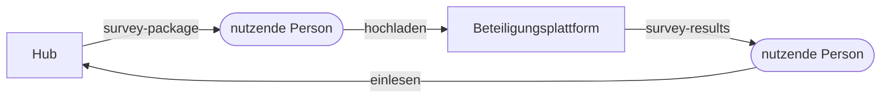

# Schnittstelle: Befragungspaket und Rücklauf

**Formatversion 1.0.0.** Diese Beschreibung ist der ganze Vertrag zwischen dem Hub und einer Beteiligungsplattform. Beide Seiten bauen allein dagegen. Wie eine Plattform das intern umsetzt, entscheidet sie selbst.

Der **Hub** führt den gemeinsamen Stand von Ideen und Anträgen. Eine **Beteiligungsplattform** befragt einen Kreis anonym zu mehreren Themen. Die beiden sind nicht verbunden: Eine Person trägt zwei Dateien von Hand.



Die Schlüsselwörter MUSS und DARF sind verbindlich gemeint.

## Grundregeln

1. Der Hub baut nie eine Netzverbindung zur Plattform auf und kennt weder ihren Namen noch ihre Adresse. Er funktioniert auch ganz ohne Plattform.
2. Die Plattform MUSS die Kennungen aus dem Paket unverändert zurückgeben und DARF sie nicht interpretieren.
3. Der Aufruf-Link steht in keiner der beiden Dateien. Die Plattform zeigt ihn der Person nach dem Hochladen an.
4. Lebenszyklen werden nicht gespiegelt. Die Dateien tragen weder eine Phase noch einen Status wie „beendet“ und keine Frist.
5. Im Rücklauf stehen nur Aggregate und Argumenttexte, niemals ein Bezug zu einer Teilnahme (siehe [Anonymität](#anonymität)).

## Begriffe

| Begriff | In den Dateien | Bedeutung |
|---|---|---|
| Befragung | `survey_id` | Eine Frage an einen Kreis zu mehreren Themen |
| Befragungspaket | `survey-package` | Die Datei vom Hub zur Plattform |
| Rücklauf | `survey-results` | Die Datei von der Plattform zum Hub, ein vollständiger Schnappschuss |
| Thema | `topics[]` | Ein Eintrag der Befragung mit Titel und Beschreibung |
| Verteilung | `distribution` | Zahl der Personen je Stufe zu einem Thema |
| Beteiligung | `participants` | Zahl der Personen mit mindestens einer Antwort in der Befragung |
| Argument | `arguments[]` | Ein Text dafür oder dagegen zu einem Thema |

## Für beide Dateien

- Eine Datei ist genau ein JSON-Dokument (RFC 8259), kodiert in UTF-8 ohne BOM.
- Der Dateiname hat keine Bedeutung.
- „Zeichen“ meint Unicode-Codepoints. Beide Seiten zählen so, nicht in UTF-16-Einheiten und nicht in Graphemen.
- Kennungen (`survey_id`, `topics[].id`) sind opak: 1 bis 64 Zeichen aus `A–Z`, `a–z`, `0–9`, `_` und `-`.
- Jede Datei beginnt mit denselben zwei Feldern:

| Feld | Wert | Zweck |
|---|---|---|
| `format` | `survey-package` oder `survey-results` | Art der Datei |
| `version` | SemVer, zum Beispiel `1.0.0` | Stand des Formats |

### Einlesen

Wer eine Datei liest, MUSS sie als Ganzes prüfen und bei einem Fehler **vollständig abweisen**, ohne etwas zu übernehmen. Die Meldung ist in Alltagssprache gehalten, weil Menschen ohne Technikkenntnisse sie lesen.

Abgewiesen wird, wenn:

- die Datei kein gültiges JSON ist,
- `format` nicht die erwartete Art ist,
- die Major-Version von `version` eine andere ist als die eigene,
- ein Pflichtfeld fehlt, einen falschen Typ hat oder eine Grenze verletzt,
- eine Kennung die Form verletzt oder innerhalb der Datei doppelt vorkommt.

Unbekannte Felder MÜSSEN ignoriert werden. Eine höhere Minor- oder Patch-Version derselben Major-Version MUSS angenommen werden.

### Versionierung

| Änderung | Teil | Beispiele |
|---|---|---|
| Brechend | Major | neues Pflichtfeld, Feld entfernt oder umbenannt, geänderte Bedeutung, **angehobene Grenze** |
| Neues optionales Feld | Minor | ein zusätzliches Feld, das Lesende ignorieren dürfen |
| Nur die Beschreibung wird klarer, Dateien bleiben gleich | Patch | korrigierte Formulierung |

Eine angehobene Grenze ist brechend, weil Lesende mit der alten Grenze die ganze Datei abweisen würden.

## Befragungspaket (`survey-package`)

Erzeugt der Hub, liest die Plattform.

```json
{
  "format": "survey-package",
  "version": "1.0.0",
  "survey_id": "bf-7k2m",
  "name": "Ideen für den Herbst",
  "question": "Welche Ideen sollen wir weiterverfolgen?",
  "topics": [
    {
      "id": "th-9x4q",
      "title": "Trinkbrunnen am Marktplatz",
      "description": "Situation: Auf dem Marktplatz gibt es im Sommer kein frei zugängliches Trinkwasser.\nVorschlag: Die Stadt stellt einen öffentlichen Trinkbrunnen auf und prüft die Folgekosten.",
      "background": "Trinkbrunnen helfen an heißen Tagen besonders **Kindern und älteren Menschen**."
    },
    {
      "id": "th-2v8c",
      "title": "Bürgerbus für die Ortsteile",
      "description": "Situation: In den Ortsteilen fährt an Wochenenden kein Bus.\nVorschlag: Ein ehrenamtlicher Kleinbus fährt an diesen Tagen, die Stadt stellt das Fahrzeug."
    }
  ]
}
```

| Feld | Pflicht | Typ | Grenze | Regel |
|---|---|---|---|---|
| `survey_id` | ja | Kennung | | Identität der Befragung, unabhängig vom Namen |
| `name` | ja | Text | 1–80 | Klartext |
| `question` | ja | Text | 1–120 | Klartext |
| `topics` | ja | Liste | mindestens 1 | Die Reihenfolge ist die Reihenfolge der Anzeige |
| `topics[].id` | ja | Kennung | | In der Datei eindeutig |
| `topics[].title` | ja | Text | 1–140 | Klartext, in der Datei eindeutig |
| `topics[].description` | ja | Text | 1–500 | Klartext, Zeilenumbrüche bleiben erhalten; das Muster `Situation: …` / `Vorschlag: …` wird empfohlen |
| `topics[].background` | nein | Text | 1–5000 | Markdown-Teilmenge, siehe unten; fehlt das Feld, gibt es keinen Hintergrund |

**Markdown-Teilmenge für `background`:** Absätze, Überschriften `##` und `###`, Listen mit `-`, `*` oder `1.`, `**fett**`, `*kursiv*`, Links `[Text](URL)` mit den Schemata `http`, `https` und `mailto`. Alles andere ist Text. HTML wird nie als HTML dargestellt.

### Hochladen auf der Plattform

- **Unbekannte `survey_id`:** Die Plattform legt eine neue Befragung an, auch wenn es schon eine mit demselben Namen gibt.
- **Bekannte `survey_id`:** `name` und `question` bleiben unverändert.
- **Bekannte `topics[].id`:** Das Thema bleibt unverändert, auch wenn sich der Text im Paket unterscheidet. Antworten dürfen nie still einem anderen Text zugerechnet werden.
- **Unbekannte `topics[].id`:** Das Thema wird ergänzt. So lässt sich einer laufenden Befragung ein Thema hinzufügen.
- Ein Hochladen entfernt nichts. Korrekturen macht man auf der Plattform selbst.

## Rücklauf (`survey-results`)

Erzeugt die Plattform, liest der Hub.

```json
{
  "format": "survey-results",
  "version": "1.0.0",
  "survey_id": "bf-7k2m",
  "as_of": "2026-12-01T09:00:00+01:00",
  "participants": 24,
  "topics": [
    {
      "id": "th-9x4q",
      "origin": "package",
      "title": "Trinkbrunnen am Marktplatz",
      "description": "Situation: Auf dem Marktplatz gibt es im Sommer kein frei zugängliches Trinkwasser.\nVorschlag: Die Stadt stellt einen öffentlichen Trinkbrunnen auf und prüft die Folgekosten.",
      "distribution": {
        "strongly_against": 0,
        "somewhat_against": 1,
        "neutral": 2,
        "somewhat_for": 8,
        "strongly_for": 11
      },
      "arguments": [
        { "stance": "for", "text": "Gerade für Kinder auf dem Spielplatz nebenan wäre das gut." },
        { "stance": "against", "text": "Wer kümmert sich im Winter um Pflege und Hygiene?" }
      ]
    },
    {
      "id": "th-2v8c",
      "origin": "package",
      "title": "Bürgerbus für die Ortsteile",
      "description": "Situation: In den Ortsteilen fährt an Wochenenden kein Bus.\nVorschlag: Ein ehrenamtlicher Kleinbus fährt an diesen Tagen, die Stadt stellt das Fahrzeug.",
      "distribution": {
        "strongly_against": 2,
        "somewhat_against": 4,
        "neutral": 5,
        "somewhat_for": 6,
        "strongly_for": 4
      },
      "arguments": []
    },
    {
      "id": "x-17",
      "origin": "proposal",
      "title": "Bänke auch im Stadtpark",
      "description": "Situation: Im Stadtpark fehlen Sitzplätze.\nVorschlag: Die Stadt stellt dort weitere Bänke auf.",
      "distribution": {
        "strongly_against": 0,
        "somewhat_against": 1,
        "neutral": 2,
        "somewhat_for": 5,
        "strongly_for": 4
      },
      "arguments": []
    }
  ]
}
```

| Feld | Pflicht | Typ | Grenze | Regel |
|---|---|---|---|---|
| `survey_id` | ja | Kennung | | Unverändert aus dem Paket |
| `as_of` | ja | Zeitpunkt | | RFC 3339 mit Zeitzone: Stand der Zahlen beim Export |
| `participants` | ja | Ganzzahl ≥ 0 | | Personen mit mindestens einer Antwort in der Befragung |
| `topics` | ja | Liste | | Reihenfolge ohne Bedeutung |
| `topics[].id` | ja | Kennung | | In der Datei eindeutig |
| `topics[].origin` | ja | `package` oder `proposal` | | Aus dem Paket oder auf der Plattform vorgeschlagen |
| `topics[].title` | ja | Text | 1–140 | Der Text, wie er auf der Plattform steht |
| `topics[].description` | bei `package` ja, sonst nein | Text | 1–500 | Der Text, wie er auf der Plattform steht |
| `topics[].distribution` | ja | Objekt | | Alle fünf Stufen, je eine Ganzzahl ≥ 0, auch bei null Antworten |
| `topics[].arguments` | ja | Liste | | Darf leer sein; nach `text` sortiert |
| `topics[].arguments[].stance` | ja | `for` oder `against` | | |
| `topics[].arguments[].text` | ja | Text | 1–280 | Wörtlich, Klartext |

Die fünf Stufen sind `strongly_against`, `somewhat_against`, `neutral`, `somewhat_for` und `strongly_for`. Die Zahl der Personen je Thema ist die Summe der Stufen und steht deshalb nicht in der Datei.

### Schreiben auf der Plattform

- Der Rücklauf ist ein **vollständiger Schnappschuss** und jederzeit erzeugbar, auch mitten in der Befragung.
- Er MUSS jedes Thema aus dem Paket enthalten, auch wenn es auf der Plattform inzwischen archiviert ist.
- `title` und `description` geben den aktuellen Text auf der Plattform wieder, damit der Hub eine Abweichung erkennt.
- **Vorgeschlagene Themen** (`origin: proposal`) erscheinen erst, wenn die Plattform sie freigegeben hat. Wartende und abgelehnte Vorschläge fehlen.
- Die `id` eines vorgeschlagenen Themas vergibt die Plattform. Sie MUSS sich von allen Kennungen des Pakets unterscheiden und über alle Exporte hinweg gleich bleiben.
- Moderierte oder gelöschte Argumente fehlen.

### Einlesen im Hub

Zusätzlich zu den Regeln für beide Dateien weist der Hub die Datei ab, wenn:

- `survey_id` nicht die Befragung ist, für die eingelesen wird,
- ein Thema aus dem Paket fehlt,
- ein Thema mit `origin: package` eine Kennung trägt, die nicht im Paket stand,
- `as_of` älter ist als der zuletzt eingelesene Rücklauf.

Sonst gilt:

- Der neue Rücklauf **ersetzt** den vorigen derselben Befragung vollständig und legt kein zweites Meinungsbild an.
- Weicht `title` oder `description` vom Paket ab, zeigt der Hub das an, weil dann über einen anderen Text abgestimmt wurde.
- Ein vorgeschlagenes Thema ordnet die Redaktion einmal zu (neue Idee, bestehendes Projekt oder nicht übernehmen). Der Hub merkt sich das über die `id`.

## Anonymität

Diese Regeln sind hart und gelten für jede Version:

- Der Rücklauf enthält keine Kennung, kein Token und keinen anderen Bezug zu einer Teilnahme, auch nicht verschlüsselt oder gehasht.
- Er enthält keinen Zeitstempel einzelner Antworten oder Argumente, und die Reihenfolge der Argumente verrät keinen Zeitpunkt.
- Eine Schwelle für kleine Zahlen gibt es nicht. Die Zählung bleibt ehrlich, auch bei drei Personen.

## Texte sind nicht vertrauenswürdig

Argumente und vorgeschlagene Themen schreiben Menschen, die nur einen Aufruf-Link brauchen. Für den Rücklauf gilt deshalb:

- Alle Texte sind Daten und nie Anweisungen oder Markup. Der Hub zeigt sie als Klartext an.
- Maschinen bekommen sie nicht unbesehen. Wie der Hub das umsetzt, regelt er selbst.

## Anforderungen an die Plattform

- **Ohne Terminal:** Eine Person ohne Technikkenntnisse kann im Browser ein Paket hochladen und einen Rücklauf herunterladen. Wie dieser Bereich geschützt ist, bleibt Sache der Plattform.
- **Offenlegung:** Bevor jemand ein Argument schreibt, sagt die Plattform klar, dass der Text wörtlich an die Befragenden geht und dort weitergegeben werden kann.

## Abnahmefälle

| Fall | Erwartung |
|---|---|
| Rücklauf wird auf der Plattform hochgeladen | abgewiesen, falsches `format` |
| `version` ist `2.0.0` | abgewiesen, auf beiden Seiten |
| `version` ist `1.3.0` mit einem unbekannten Feld | angenommen, Feld ignoriert |
| Ein Titel hat 141 Codepoints | abgewiesen, nichts angelegt |
| Ein Titel hat 140 Codepoints, darunter Emoji | angenommen, auf beiden Seiten |
| Dasselbe Paket wird zweimal hochgeladen | nichts doppelt, keine Antwort geht verloren |
| Paket mit korrigiertem Text und bekannter `id` | Thema bleibt unverändert |
| Paket mit bekannter `survey_id` und neuer Themen-`id` | Thema wird ergänzt |
| Zwei Befragungen haben denselben Namen, aber verschiedene `survey_id` | zwei getrennte Befragungen |
| Abgeschnittene Datei | abgewiesen, kein gültiges JSON |
| Titel auf der Plattform geändert | Hub ordnet über die `id` richtig zu und zeigt die Abweichung an |
| Thema auf der Plattform archiviert | bleibt im Rücklauf |
| Älterer Rücklauf nach einem neueren | abgewiesen |
| Rücklauf einer anderen Befragung | abgewiesen |
| Vorschlag erscheint in zwei Rückläufen | gleiche `id`, die Zuordnung bleibt |
| Argument enthält HTML oder eine Anweisung an eine KI | wird als Klartext angezeigt |

## Änderungen

| Version | Änderung |
|---|---|
| 1.0.0 | Erste Fassung |
