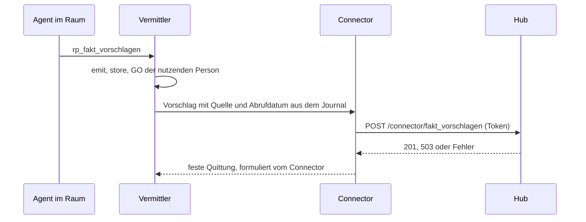

# Schnittstelle: Connector-Socket des Hubs

**Formatversion 1.0.0.** Diese Beschreibung ist der Vertrag zwischen dem Hub und dem ratsprojekte-Connector von komki (`apps/komki_connector_ratsprojekte`). Den Socket stellt #440 bereit, den Schreibweg „Fakt vorschlagen“ baut #277 dagegen. Quelle ist [ADR 0004](../adr/0004-ratsprojekte-als-lokaler-hub.md), Abschnitte „Der Bestand des Hubs trägt genau ein Label“ und „Lokal, ohne Konten“.

Über diesen Socket kommt **Schreibendes von komki** in den Hub, und nur das. Die Oberfläche liegt am Browser-Port und kennt diese Wege nicht. Gelesen wird nicht über den Socket, sondern aus dem [maschinenlesbaren Stand](stand.md).



Die Schlüsselwörter MUSS und DARF sind verbindlich gemeint.

## Grundregeln

1. Die Antwort des Hubs enthält **nichts aus dem Bestand**: keine Kennung, keine Fortnummer, keinen Projektnamen. So lassen sich über Antworten keine Projekte ausprobieren.
2. Die Quittung an den Raum formuliert der Connector, nicht der Hub. Der Hub meldet nur Erfolg oder Misserfolg.
3. Ist der Hub gesperrt, nimmt er nichts an, und gepuffert wird nichts, weder im Hub noch im Connector.
4. Aufrufe des Connectors zählen nicht als Handlung in der Oberfläche. Sie verlängern die Zeit bis zur automatischen Sperre nicht, sonst könnte ein Agent den Hub beliebig lange offen halten.
5. Der Hub vertraut dem Connector nicht blind. Er prüft jede Anfrage selbst gegen dieses Dokument.

## Transport

| Eigenschaft | Wert |
|---|---|
| Socket | `connector.sock` im Verzeichnis des Hubs, also `~/Library/Application Support/ratsprojekte/connector.sock` (mit `RATSPROJEKTE_HOME` dort) |
| Rechte | 0600, Verzeichnis 0700 |
| Protokoll | HTTP/1.1 über den Unix-Socket |
| Anfrage | eine Anfrage je Verbindung, `Connection: close` |
| Rumpf | JSON (RFC 8259), UTF-8, `Content-Type: application/json`, höchstens 64 KiB |
| Antwort | JSON, immer nur das Feld `status` |

In komki zeigt der Eintrag `ratsprojekte_socket` der config auf den Socket.

## Token

| Schritt | Wer | Was |
|---|---|---|
| Erzeugen | komki | `komki secret erzeugen ratsprojekte-hub` erzeugt den Token, versiegelt ihn im Schlüsselbund und gibt nur seinen SHA-256 aus |
| Merken | Hub | `ratsprojekte connector-token` liest den Hash von stdin und legt ihn als `connector-token.sha256` ab (Hex, Kleinbuchstaben) |
| Vorlegen | Connector | `Authorization: Bearer <token>` bei jeder Anfrage; den Klartext bekommt er beim Start über stdin |
| Prüfen | Hub | SHA-256 des vorgelegten Tokens gegen die Datei, Vergleich in konstanter Zeit |

Den Klartext kennt nur komki. Fehlt die Hash-Datei oder ist sie leer, lehnt der Hub jede Anfrage ab. Ein neuer Token, etwa nach `ratsprojekte recover`, ersetzt den alten: `komki secret erzeugen ratsprojekte-hub | ratsprojekte connector-token`.

## Prüfreihenfolge

Der Hub MUSS jede Anfrage in dieser Reihenfolge prüfen und bei der ersten Abweichung antworten:

| Schritt | Abweichung | Antwort |
|---|---|---|
| 1. Token | fehlt, falsch oder keine Hash-Datei | `401 {"status":"abgelehnt"}` |
| 2. Sperre | Hub gesperrt | `503 {"status":"gesperrt"}` |
| 3. Weg | Methode oder Pfad unbekannt | `404 {"status":"unbekannt"}` |
| 4. Rumpf | kein JSON, zu groß oder nicht nach diesem Dokument | `400 {"status":"ungültig"}` |
| 5. Speichern | | `201 {"status":"vorgeschlagen"}` |

Der Token kommt vor der Sperre, damit niemand ohne Token erfährt, ob der Hub offen ist. Eine Antwort `400` nennt bewusst nicht, welches Feld falsch ist. Die Logs des Hubs enthalten weder Rumpf noch Pfad.

## Fakt vorschlagen

`POST /connector/fakt_vorschlagen`

Ein Vorschlag ist genau ein Ereignis mit Teilen. Das GO in komki deckt alle Teile. Im Hub wählt die Redaktion ab, was zum Stand passt.

```json
{
  "titel": "Förderung für Trinkbrunnen",
  "projekt_hinweis": "Trinkbrunnen am Marktplatz",
  "labels": ["ratsprojekte@1"],
  "teile": [
    {
      "aussage": "Der Freistaat fördert Trinkbrunnen im öffentlichen Raum mit bis zu 50 %.",
      "fundstelle": "Nr. 2.3",
      "url": "https://www.example.org/foerderrichtlinie",
      "abgerufen": "2026-11-10"
    }
  ]
}
```

| Feld | Pflicht | Typ | Grenze | Regel |
|---|---|---|---|---|
| `titel` | ja | Text | 1–120 | worum es geht, vom Agenten |
| `projekt_hinweis` | ja | Text oder `null` | bis 120 | nur ein Hinweis; die Redaktion ordnet im Hub zu |
| `labels` | ja | Liste von Bindungen | | das `assigned_label` der Entscheidung im Vermittler; der Hub legt es am Vorschlag ab und entscheidet nichts damit |
| `teile` | ja | Liste | 1–8 | die Teile des Ereignisses |
| `teile[].aussage` | ja | Text | 1–1000 | die Aussage |
| `teile[].fundstelle` | ja | Text oder `null` | bis 200 | Seite, Paragraf oder Nummer in der Quelle |
| `teile[].url` | ja | Text | 1–400 | die Quelle; setzt der Vermittler aus dem Journal, nicht der Agent |
| `teile[].abgerufen` | ja | Datum `JJJJ-MM-TT` | | Abrufdatum; setzt der Vermittler aus dem Journal, nicht der Agent |

Die Form ist geschlossen: Ein unbekanntes Feld, im Ereignis wie im Teil, führt zu `400`. Grenzen zählen Unicode-Codepoints.

**Was der Hub daraus macht:**

- Er entfernt aus jedem Freitextfeld unsichtbare Steuerzeichen, bevor er speichert. Was die Redaktion sieht, ist alles, was gespeichert ist.
- Er legt einen **offenen Vorschlag** an. Jeder Teil trägt den Prüfstatus „nicht verifiziert“, den nur ein Mensch im Hub ändert.
- Er schreibt eine Zeile in den Verlauf, dass ein Vorschlag eingegangen ist. Diese Zeile erscheint nicht im maschinenlesbaren Stand.
- Übernimmt die Redaktion Teile, werden sie zu Fakten des Projekts, das sie wählt (`statement` aus `aussage`, `citation` aus `fundstelle`, `url`, `fetched_on` aus `abgerufen`, `verified` falsch). Abgewählte Teile und abgelehnte Vorschläge werden gelöscht, der Verlauf hält nur fest, dass etwas nicht übernommen wurde.

## Was der Connector daraus macht

Der Connector übersetzt die Antwort des Hubs in eine feste Meldung an den Vermittler. Den Rumpf der Antwort liest er nicht.

| Hub | Meldung an den Raum |
|---|---|
| `201` | `{"status":"vorgeschlagen"}`, dazu die Labels aus der Entscheidung |
| `503` | Fehler `hub-gesperrt`: „Hub ist gesperrt, es wurde nichts gespeichert“ |
| `401` | Fehler `credential-missing` |
| anderer Status | Fehler `upstream-error` |
| keine Antwort in 5 Sekunden, Socket fehlt | Fehler `upstream-timeout` oder `upstream-error` |

## Versionierung

SemVer wie bei der [Befragung](befragung.md#versionierung). Hub und Connector liegen im selben Repo, laufen aber als getrennt installierte Programme. Eine brechende Änderung (Major) bekommt deshalb einen neuen Pfad, etwa `/connector/fakt_vorschlagen_2`. Der Hub nimmt den alten Pfad an, bis der Connector umgestellt ist. Weitere Operationen kommen als eigene Pfade dazu und sind Minor.
