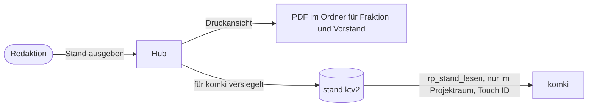

# Schnittstelle: maschinenlesbarer Stand

**Formatversion 1.0.0.** Diese Beschreibung ist der Vertrag zwischen dem Hub, der die Datei schreibt (#438), und komki, das sie liest (`rp_stand_lesen`, #419). Quelle ist [ADR 0004](../adr/0004-ratsprojekte-als-lokaler-hub.md), Abschnitte „Der Stand geht als Druck in einen eigenen Ordner“ und „Der Bestand des Hubs trägt genau ein Label“.

Der **maschinenlesbare Stand** ist die Fassung des [Stands](../../GLOSSARY.md#stand), die komki lesen darf. Er enthält nur die Felder, die dieses Dokument erlaubt. Der Hub sieht dabei keine Anfrage: Er schreibt eine versiegelte Datei, und komki öffnet sie.



Die Schlüsselwörter MUSS und DARF sind verbindlich gemeint.

## Grundregeln

1. Der Hub schreibt die Datei **nur beim Ausgeben eines Stands**, also genau dann, wenn die Redaktion den Stand bewusst an Fraktion und Vorstand weitergibt. komki sieht damit nie mehr und nie Neueres als Fraktion und Vorstand.
2. Was nicht in der [Liste erlaubter Felder](#felder) steht, MUSS fehlen. Kommt im Hub ein Feld dazu, bleibt es unsichtbar, bis es hier steht und die Version steigt.
3. Für komki unsichtbar bleiben, auch als Anzahl:
   - private Einträge (im Hub „Nur ich“),
   - Querverweise auf Vault, Ablage und komki-Raum, auch die Ablage eines Antrags,
   - offene und abgelehnte Vorschläge aus komki, auch die Verlaufszeilen über sie,
   - fremder Text aus Befragungen: Argumente und noch nicht zugeordnete Vorschläge aus einem Rücklauf.
4. Sichtbar ist, was ein Mensch im Hub selbst geschrieben oder gelesen und gespeichert hat, dazu die Zählungen aus Befragungen (Verteilungen).
5. Die Datei trägt genau ein Label, `ratsprojekte@1`. Aufnehmen darf sie nur ein Raum mit dieser Bindung, der Projektraum aus #419.
6. **Die Datei liegt nie im Klartext auf der Platte.** Der Hub versiegelt sie für komki, öffnen kann sie nur komki mit Freigabe per Touch ID. Ist der Hub gesperrt, liegt der Stand damit nirgends lesbar, und Sicherung, Spotlight oder Sync-Werkzeuge sehen nur Chiffretext.

## Datei

| Eigenschaft | Wert |
|---|---|
| Ort | `stand.ktv2` im Verzeichnis des Hubs, also `~/Library/Application Support/ratsprojekte/stand.ktv2` (mit `RATSPROJEKTE_HOME` dort). In komki zeigt der Eintrag `ratsprojekte_stand` der config auf diese Datei. |
| Inhalt | genau ein Siegel im Format `ktv2` von `sealed_envelope` (eine Zeile ASCII), versiegelt für den Schlüssel von komki in der Secure Enclave. Darin steht das JSON-Dokument aus diesem Vertrag, UTF-8 ohne BOM. |
| Größe | höchstens 1 MiB für das Siegel; der Connector weist größere Dateien ab (`too-large`) |
| Art | eine reguläre Datei, kein Symlink; der Connector weist alles andere ab (`forbidden-path`) |
| Rechte | 0600 |
| Schreiben | atomar: erst eine temporäre Datei im selben Verzeichnis, dann umbenennen. Jede Ausgabe ersetzt die vorige Datei vollständig. Klartext entsteht dabei nur im Speicher des Hubs. |
| Fehlt die Datei | Es wurde noch kein Stand ausgegeben; der Connector antwortet `not-found`. |

Freitext enthält keine unsichtbaren Steuerzeichen, weil der Hub sie schon beim Speichern entfernt. Zeilenumbrüche bleiben erhalten.

### Versiegeln

`ktv2` verschlüsselt mit AES-256-GCM unter einem Schlüssel aus ECDH (P-256) mit einem Wegwerf-Schlüssel und HKDF-SHA256. Die einzige Instanz des Formats ist `SealedEnvelope`; weder Hub noch komki bauen oder zerlegen ein Siegel selbst.

| Schritt | Wer | Was |
|---|---|---|
| Empfänger einrichten | nutzende Person | `komki-tresor recipient` gibt Schlüsselreferenz und öffentlichen Schlüssel von komki aus; der Hub übernimmt beides beim Einrichten (Befehl baut #438). Ein Geheimnis ist das nicht. |
| Empfänger aufbewahren | Hub | in seiner verschlüsselten Datenbank, nicht als Datei daneben. So kann ihn kein Prozess austauschen, solange der Hub gesperrt ist, und den nächsten Stand für einen fremden Schlüssel versiegeln lassen. |
| Versiegeln | Hub | beim Ausgeben eines Stands mit `SealedEnvelope.seal/2`; dafür braucht er nur den öffentlichen Schlüssel, keine Freigabe |
| Öffnen | komki | nur über `komki-tresor` mit Freigabe per Touch ID oder Passwort des Macs. Wer in komki öffnet und wie oft gefragt wird, regelt #419. |

Fehlt der Empfänger, gibt der Hub keinen maschinenlesbaren Stand aus und sagt das in der Vorschau. Der gedruckte Stand geht trotzdem. Nach einem neuen Mac oder einem neuen Schlüssel von komki richtet die nutzende Person den Empfänger neu ein. Ältere Siegel lassen sich dann nicht mehr öffnen, der nächste ausgegebene Stand ersetzt sie.

## Beispiel

```json
{
  "format": "ratsprojekte-stand",
  "version": "1.0.0",
  "label": "ratsprojekte@1",
  "issued_at": "2026-11-17T19:42:10+01:00",
  "previous_issued_at": "2026-11-03T20:05:44+01:00",
  "projects": [
    {
      "slug": "trinkbrunnen-marktplatz",
      "title": "Trinkbrunnen am Marktplatz",
      "short": "Ein öffentlicher Trinkbrunnen für heiße Tage.",
      "origin": "Anregung aus der Bürgersprechstunde",
      "phase": "drafting",
      "disposition": null,
      "disposed_on": null,
      "next_step": {
        "text": "Kosten beim Bauhof erfragen",
        "assignee": "Redaktion",
        "due_on": "2026-11-28"
      },
      "value": {
        "proposition": "Kinder und ältere Menschen finden im Sommer frei zugängliches Trinkwasser.",
        "success_metrics": "Der Brunnen läuft von Mai bis September ohne Ausfall."
      },
      "timeline": [
        {
          "kind": "decision",
          "on": "2026-11-12",
          "by": "fraction",
          "text": "Meinungsbildung → Ausarbeitung: Die Fraktion will einen Antrag vorbereiten."
        }
      ],
      "opinions": [
        {
          "on": "2026-10-30",
          "circle": "base",
          "question": "Welche Ideen sollen wir weiterverfolgen?",
          "statement": "Breite Zustimmung, Fragen zu den Folgekosten.",
          "tally": [1, 2, 4, 11, 19]
        }
      ],
      "facts": [
        {
          "statement": "Der Freistaat fördert Trinkbrunnen im öffentlichen Raum mit bis zu 50 %.",
          "citation": "Förderrichtlinie, Nr. 2.3",
          "url": "https://www.example.org/foerderrichtlinie",
          "fetched_on": "2026-11-10",
          "verified": false
        }
      ],
      "variants": [
        {
          "label": "A",
          "title": "Brunnen mit Festwasseranschluss",
          "description": "Anschluss an die bestehende Leitung am Rathaus.",
          "status": "open",
          "reason": null,
          "prerequisites": [
            { "text": "Leitung am Rathaus ist ausreichend dimensioniert", "kind": "knowledge", "met": false }
          ]
        }
      ],
      "motions": [
        {
          "kind": "motion",
          "title": "Trinkbrunnen am Marktplatz",
          "status": "draft",
          "motion_text": "Der Stadtrat beauftragt die Verwaltung, einen öffentlichen Trinkbrunnen am Marktplatz zu planen und die Folgekosten darzustellen.",
          "addressee": "Stadtrat",
          "ris": null,
          "submitted_on": null,
          "outcome": null,
          "report_due_on": null
        }
      ]
    }
  ]
}
```

## Felder

Die Feldnamen folgen dem Schema des Hubs (`Ratsprojekte.Projects`), damit Hub und Datei dieselben Namen tragen. Werte von Aufzählungen sind die Codes; die deutschen Namen stehen in der Tabelle [Codes](#codes). Datumsangaben sind ISO 8601 (`JJJJ-MM-TT`), Zeitpunkte ISO 8601 mit Zeitzone. Ein Feld ohne Wert steht als `null` da, eine leere Liste als `[]`.

### Kopf

| Feld | Typ | Regel |
|---|---|---|
| `format` | Text | immer `ratsprojekte-stand` |
| `version` | SemVer | Stand dieses Formats, siehe [Versionierung](#versionierung) |
| `label` | Text | immer `ratsprojekte@1` |
| `issued_at` | Zeitpunkt | wann die Redaktion diesen Stand ausgegeben hat |
| `previous_issued_at` | Zeitpunkt oder `null` | der vorige ausgegebene Stand; ab ihm zählt „Neu seit“. `null` beim ersten Stand. |
| `projects` | Liste | alle Ratsprojekte des Hubs, aktive und abgelegte, nach Titel sortiert |

### Projekt (`projects[]`)

| Feld | Typ | Regel |
|---|---|---|
| `slug` | Text | der Slug, wie im Vault-Tag `#ratsprojekt/{slug}` |
| `title`, `short`, `origin` | Text oder `null` | Titel, Kurzbeschreibung, Herkunft |
| `phase` | Code | siehe [Codes](#codes) |
| `disposition` | Code oder `null` | die Ablage; `null` heißt aktiv |
| `disposed_on` | Datum oder `null` | seit wann das Projekt abgelegt ist |
| `next_step` | Objekt oder `null` | `text`, `assignee` (wer dran ist, Freitext), `due_on` (Datum oder `null`) |
| `value` | Objekt oder `null` | `proposition` (was sich ändert, für wen), `success_metrics` (woran der Erfolg gemessen wird) |
| `timeline` | Liste | der Verlauf, älteste Einträge zuerst; nur Einträge, die im Stand stehen dürfen, ohne Einträge der Art `cross_reference` und ohne Zeilen über Vorschläge aus komki |
| `opinions` | Liste | Meinungsbilder, nach Datum |
| `facts` | Liste | Fakten, in der Reihenfolge des Eintragens |
| `variants` | Liste | Varianten, nach Kennbuchstabe |
| `motions` | Liste | Anträge, in der Reihenfolge des Anlegens |

### Verlaufseintrag (`timeline[]`)

| Feld | Typ | Regel |
|---|---|---|
| `kind` | Code | Art des Eintrags |
| `on` | Datum | wann es passiert ist |
| `by` | Code oder `null` | wer gesprochen oder entschieden hat |
| `text` | Text | der Eintrag |

### Meinungsbild (`opinions[]`)

| Feld | Typ | Regel |
|---|---|---|
| `on` | Datum | |
| `circle` | Code | wessen Meinung |
| `question` | Text oder `null` | die Frage, falls es eine gab |
| `statement` | Text oder `null` | der Satz, den ein Mensch im Hub geschrieben hat |
| `tally` | Liste aus fünf Zahlen oder `null` | Verteilung von „klar dagegen“ bis „klar dafür“ |

Die Argumente eines Meinungsbilds fehlen immer, auch ihre Anzahl.

### Fakt (`facts[]`)

| Feld | Typ | Regel |
|---|---|---|
| `statement` | Text | die Aussage |
| `citation` | Text oder `null` | die Fundstelle, etwa Seite oder Paragraf |
| `url` | Text oder `null` | die Quelle |
| `fetched_on` | Datum oder `null` | Abrufdatum |
| `verified` | Wahrheitswert | `true` erst, wenn ein Mensch die Fundstelle nachgeschlagen hat |

### Variante (`variants[]`)

| Feld | Typ | Regel |
|---|---|---|
| `label` | Text | Kennbuchstabe, etwa `A` |
| `title`, `description` | Text oder `null` | |
| `status` | Code | offen, gewählt oder verworfen |
| `reason` | Text oder `null` | Grund der Wahl oder Verwerfung |
| `prerequisites` | Liste | je `text`, `kind` (Code), `met` (Wahrheitswert) |

### Antrag (`motions[]`)

| Feld | Typ | Regel |
|---|---|---|
| `kind` | Code | Antrag, Anfrage oder Dringlichkeitsantrag |
| `title` | Text | |
| `status` | Code | |
| `motion_text` | Text oder `null` | der Beschlussvorschlag; der Antragstext selbst liegt nicht im Hub |
| `addressee` | Text oder `null` | Adressat |
| `ris` | Text oder `null` | Kennung im RIS |
| `submitted_on` | Datum oder `null` | eingereicht am |
| `outcome` | Code oder `null` | Ergebnis der Beratung |
| `report_due_on` | Datum oder `null` | bis wann die Verwaltung berichten soll |

Die Ablage des Antragstexts (`document_ref`) ist ein Querverweis und fehlt.

## Codes

| Feld | Code → Name |
|---|---|
| `phase` | `idea` Idee, `opinion_forming` Meinungsbildung, `drafting` Ausarbeitung, `at_council` Im Rat, `implementation` Umsetzung |
| `disposition` | `resting` Ruht, `rejected` Verworfen, `completed` Abgeschlossen |
| `timeline[].kind` | `created` angelegt, `note` Notiz, `opinion` Meinungsbild, `decision` Entscheidung, `next_step` nächster Schritt, `fact` Fakt, `variant` Variante, `value` Nutzen und Erfolg, `motion` Antrag, `survey` Befragung, `return` Rücklauf |
| `timeline[].by` | `fraction` Fraktion, `board` Vorstand, `base` Basis, `external` Externe, `council` Stadtrat, `editor` Redaktion (im Hub „Nur ich“) |
| `opinions[].circle` | `fraction` Fraktion, `board` Vorstand, `base` Basis, `external` Externe |
| `variants[].status` | `open` offen, `chosen` gewählt, `rejected` verworfen |
| `prerequisites[].kind` | `legal` Rechtsgrundlage, `knowledge` Voraussetzung |
| `motions[].kind` | `motion` Antrag, `inquiry` Anfrage, `urgent_motion` Dringlichkeitsantrag |
| `motions[].status` | `draft` Entwurf, `in_fraction` In der Fraktion, `submitted` Eingereicht, `deliberated` Beraten |
| `motions[].outcome` | `adopted` Angenommen, `adopted_amended` Geändert angenommen, `rejected` Abgelehnt, `deferred` Vertagt, `withdrawn` Zurückgezogen |

Einträge der Art `cross_reference` fehlen immer, auch wenn die Redaktion sie im Hub sichtbar gestellt hat: Schon dass es einen Querverweis gibt, etwa auf einen komki-Raum, bleibt für komki unsichtbar.

## Korrekturen

Eine falsche Aussage stellt die Redaktion mit einem Eintrag „Korrektur“ richtig, und der nächste ausgegebene Stand trägt ihn. Bei einer heiklen Korrektur gibt die Redaktion sofort einen neuen Stand aus. Die Datei wird dabei ersetzt. Was komki vorher schon gelesen hat, bleibt im Journal und in den Räumen, die es aufgenommen haben. Wie beim gedruckten Stand wirkt eine Korrektur nur nach vorn.

## Lesen

Wer die Datei liest, MUSS sie zuerst öffnen und ein Siegel, das sich nicht öffnen lässt, als Ganzes abweisen. Danach MUSS er `format` prüfen und eine Datei mit anderer Major-Version abweisen. Unbekannte Felder MÜSSEN ignoriert werden. Klartext entsteht nur im Speicher von komki und geht nur in einen Raum mit `ratsprojekte@1`; geschrieben wird er nirgends.

## Versionierung

Wie bei der [Befragung](befragung.md#versionierung): Ein entferntes oder umbenanntes Feld und eine geänderte Bedeutung sind brechend (Major), ein neues Feld ist Minor, eine klarere Beschreibung bei gleichen Dateien ein Patch. Ein neues Feld kommt aber erst in die Datei, wenn es in diesem Dokument steht (Grundregel 2). Davor steht jedes Mal die Entscheidung, ob komki es sehen darf.
