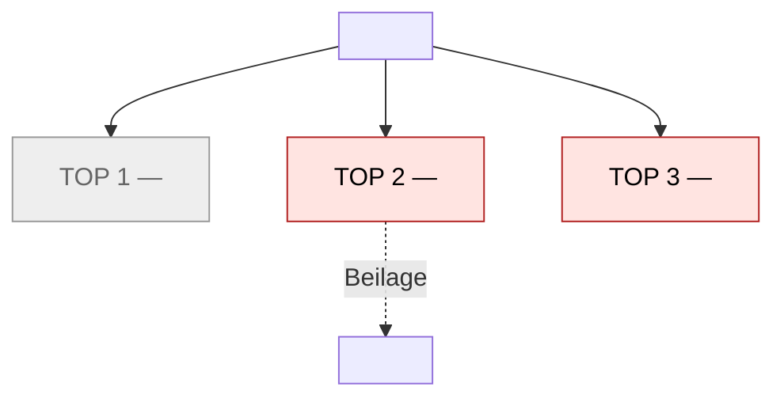
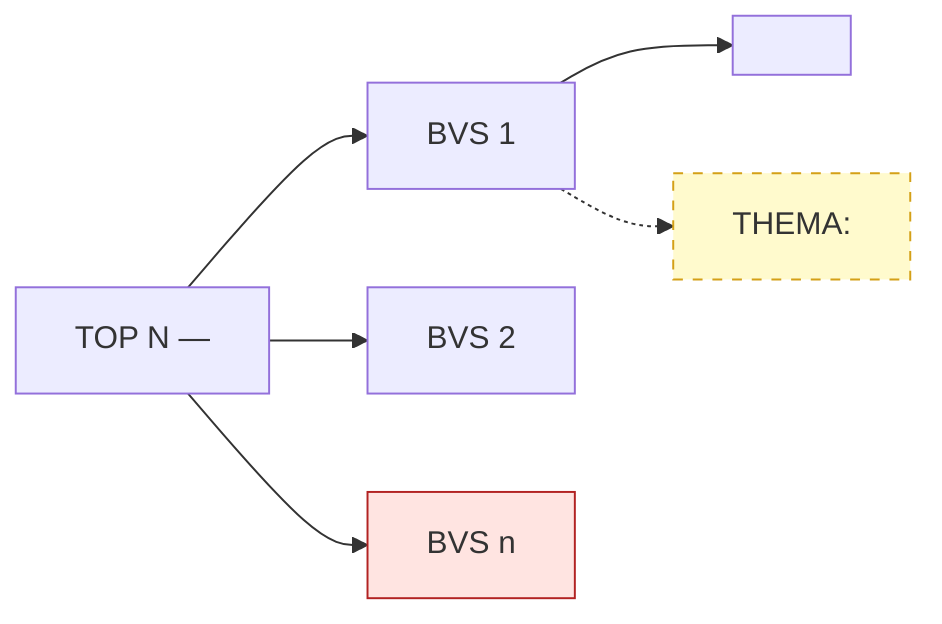
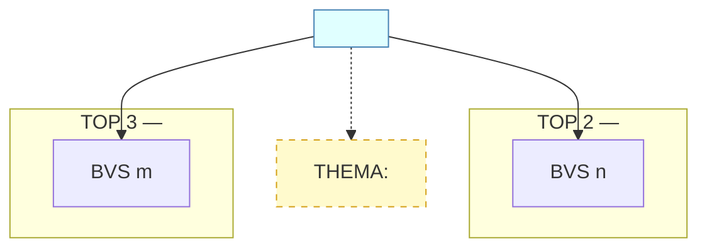

# Sitzungsvorbereitung Skill

## Wann dieser Skill greift

Wenn der Stadtrat vor einer Stadtratssitzung steht und eine strukturierte
Vorbereitung braucht: Was steht auf der Agenda? Welche Vorlagen muss ich
lesen? Welcher TOP hängt an einem Ratsprojekt? Was hat die AZ dazu
geschrieben? Was habe ich selbst schon im Vault notiert?

Das Ergebnis ist eine **Sitzungsmappe** — eine Vault-Notiz pro Sitzung, die
alle Vorbereitungsergebnisse bündelt. Die Mappe ist ein Vorschlag, kein
Entscheid — der Stadtrat entscheidet, was er daraus macht.

> **Definition:** Siehe [`GLOSSARY.md`](../../GLOSSARY.md) —
> "Sitzungsmappe". **Workflow:** WF 1 in
> [`docs/workflows.md`](../../docs/workflows.md).

## Abgrenzung

**Nicht Teil der Sitzungsmappe (und damit nicht Teil dieses Skills):**

- Änderungsanträge, Anträge oder Fraktionspositionen formulieren → Skill
  `antrag_generieren` (nachgelagerter Schritt, nicht Teil dieses Skills).
- Beschlussnachverfolgung für zurückliegende Sitzungen → eigener Workflow
  (WF 4).
- Fraktionsmappe / Fraktionsvorbereitung → nicht priorisiert (WF 5).

Die Sitzungsmappe ist ein **Lese- und Kontextinstrument**, kein
Entscheidungsdokument.

## Konfiguration: Vault-Zugriff

Der Skill schreibt die Sitzungsmappe in den Obsidian-Vault. Wie bei
`vault_suche` kommt der Vault-Name aus einer lokalen, **nicht-getrackten**
Datei:

```
config.local.yml   # im Repo-Root, nicht in Git
```

Format:

```yaml
obsidian:
  vault: "MeinVaultName"   # Name wie in Obsidian angezeigt
```

Fehlt die Datei oder der `vault`-Eintrag, fragt der Skill die nutzende
Person direkt nach dem Vault-Namen und speichert ihn *nicht* automatisch
(GO-Prinzip: die KI schreibt keine Config, der Mensch entscheidet, was
konfiguriert wird). Der Skill merkt sich den Vault-Namen für die restliche
Session.

> **WICHTIG:** Der Vault-Name ist **niemals hartkodiert**. Er kommt immer
> aus `config.local.yml` oder — falls nicht gesetzt — aus der expliziten
> Antwort der nutzenden Person.

## Arbeitsweise

### 1. Konfiguration lesen

- `config.local.yml` im Repo-Root lesen
- `obsidian.vault` übernehmen; falls nicht gesetzt: nachfragen
- Vault-Namen für die Session merken

### 2. RIS-Sync (neue Sitzungen lokal speichern)

Bevor TOPs abgerufen werden, den lokalen RIS-Cache aktualisieren:

```bash
./apps/ratsinfo/ratsinfo sync
```

Damit werden neue Sitzungen, TOPs und Texte aus dem RIS lokal gespeichert.

> **Lücke:** `ratsinfo sessions --remote` wirft aktuell einen
> `FunctionClauseError` (Bug). Daher Sync via `ratsinfo sync` laufen lassen
> und anschließend die lokalen Sitzungen durchsuchen — nicht `--remote`.

### 3. Sitzung finden

Zwei Wege, je nachdem, was der Stadtrat genannt hat:

**a) Datum bekannt** (z.B. "Sitzung am 24.07.2025"):

```bash
./apps/ratsinfo/ratsinfo sessions   # lokale Sitzungen auflisten
```

Die neueste Sitzung mit dem passenden Datum auswählen.

**b) Kein Datum / "nächste Sitzung":**

```bash
./apps/ratsinfo/ratsinfo sessions
```

Die nächste anstehende (oder letzte synchronisierte) Sitzung identifizieren
und kurz bestätigen: "Ich bereite die Sitzung [Datum, Gremium] vor — richtig?".

Sitzungs-ID (`<sitzungs_id>`) für die folgenden Schritte merken.

### 4. TOPs abrufen

```bash
./apps/ratsinfo/ratsinfo show <sitzungs_id>
```

Liefert die TOPs mit Titel, Verfahren/Gegenstand, Status
(beschließend/beratend), Beschlussvorschlägen und referenzierten
Dokumenten (Drucksachen / PDFs).

> **Lücke:** Die RIS-Volltextsuche findet nicht immer alle TOPs (im Testfall
> wurde ein TOP-Stichwort trotz lokalem Cache nicht gefunden). Daher immer
> `ratsinfo show <id>` für die konkrete Sitzung verwenden, nicht nur die
> Suche.

### 5. AZ-Artikel suchen

Für jeden **öffentlichen** TOP die Schlüsselbegriffe extrahieren
(Ortsbezug, Sachthema, beteiligte Akteure) und via `allgaeuer_zeitung_mcp`
suchen:

```
search_articles(query: "Bahnhofstraße Buchloe")
```

Für vielversprechende Treffer den Artikel lesen:

```
get_article(id: <article_id>)
```

Nicht jeder TOP braucht einen AZ-Artikel. Der Skill sucht gezielt bei
Themen mit öffentlichem Bezug (Bauprojekte, Haushalt, Personal,
Verkehr) und lässt kosmetische TOPs (z.B. Protokollnachträge) links liegen.
Overfetching vermeiden — max. 2–3 Artikel pro TOP, nur die relevanten
lesen.

### 6. Vault durchsuchen

Für jedes TOP-Thema den Vault nach Querverweisen durchsuchen (analog
`vault_suche`-Skill, aber ad-hoc ausgeführt):

```bash
obsidian vault="<vault-name>" search query="Bahnhofstraße" limit=10
obsidian vault="<vault-name>" search query="Verkehrskonzept" limit=10
```

Relevante Treffer lesen:

```bash
obsidian vault="<vault-name>" read file="Notiz Titel"
```

Treffer-Deduplizierung: dieselbe Notiz kann bei mehreren Suchen auftauchen
— einmal zusammenführen. Max. 5–7 Notizen pro TOP lesen, Overfetching
vermeiden.

### 7. Cross-Ref Ratsprojekte

Prüfen, ob ein TOP zu einem existierenden Ratsprojekt passt — über die
ratsprojekte-MCP-Tools (read-only):

```
list_projekte()                         # Überblick alle Projekte
search_projekte(query: "Marktplatz")    # gezielt nach Begriff
show_projekt(slug: "<projekt-slug>")    # Vollstand des passenden Projekts
```

> **Lücke:** Es gibt keinen automatischen RIS↔Ratsprojekt-Link. Die
> Zuordnung erfolgt ad-hoc anhand von Titel/Begriffen. Sobald ein Bezug
> erkannt ist, in der Sitzungsmappe als Querverweis (mit Vault-Tag
> `#ratsprojekt/<slug>`) dokumentieren.

### 8. PDFs ingesten (wenn Vorlagen verfügbar)

Wenn `ratsinfo show` PDF-Vorlagen referenziert, diese via `pdf_ingest`
verarbeiten (PDF-Ingestion ist als MCP registriert):

```
pdf_ingest ingest(path: "/pfad/zur/vorlage.pdf")
```

> **Lücke:** `ratsinfo open` ist aktuell ein Stub und kann keine PDFs
> automatisch herunterladen oder öffnen. PDFs müssen ggf. manuell aus dem
> RIS (bzw. dem von `ratsinfo show` angezeigten Link) heruntergeladen und
> der lokale Pfad an `pdf_ingest` übergeben werden. Ist keine PDF
> verfügbar, diesen Schritt überspringen und in der Mappe als "keine
> Vorlage gefunden" kennzeichnen.

### 8b. Graph-Repräsentation als Zwischenschicht (bei umfangreichen Unterlagen)

**Wann dieser Schritt greift (nur dann):**

Der Schritt wird aktiv, wenn **mindestens zwei** der folgenden Kriterien
erfüllt sind (nur „mehr als 10 BVS" allein reicht **nicht** — TOP 2 mit 13
formalen BVS ohne Querschnitt wäre sonst über-modelliert):

- Die Sitzungsvorlage umfasst **mehr als ~50 Seiten** (z.B. eine
  RIS-Sitzungsvorlage mit mehreren Bebauungsplan-Verfahren, Niederschrift
  der Vorwoche, Gutachten), **ODER**
- ein TOP hat **mehr als 10 Beschlussvorschläge** mit substantiellem
  inhaltlichem Bezug (z.B. bei komplexen Bauleitplanverfahren mit
  Stellungnahmen aus Behörden- und Öffentlichkeitsbeteiligung), **ODER**
- **mindestens zwei substantielle TOPs** (≥3 Beschlussvorschläge mit
  inhaltlichem Bezug) haben thematische Überlappung — d.h. dieselben
  Akteure (Behörden, Verwaltung, Interessenvertretungen) oder dieselben
  Querschnittsthemen (Klima, Wasser, Mobilität) tauchen in beiden auf.

Bei kleinen Sitzungen (z.B. 3 TOPs, 20 Seiten, 5 Beschlussvorschläge
insgesamt, keine thematische Überlappung zwischen TOPs) **entfällt dieser
Schritt komplett** — die flache TOP-für-TOP-Erzählung reicht. Keine
Über-Modellierung (AGENTS.md §3: MVP vor Infrastruktur).

**Was dieser Schritt macht:**

Eine **Graph-Repräsentation** der Sitzung als internen Zwischenschritt
bevor die Mappe geschrieben wird. Der Graph ist **kein separates
Artefakt** — er ist eine **Denk-Hilfe** der KI, um Querschnittsthemen,
wiederkehrende Akteure, Klage-Risiken und Cross-TOP-Bezüge zu erkennen,
die in der flachen TOP-für-TOP-Erzählung verdeckt bleiben.

Der Graph wird **in die Sitzungsmappe selbst** eingebettet (als Anhang,
siehe "Graph-Repräsentation in der Mappe" unten) — nicht als separate
Datei gespeichert. Er ist Teil der Mappe, nicht der Skill-Output.

**Warum als Zwischenschritt (nicht als separates Tool):**

Der Graph ersetzt das Lesen der Unterlagen nicht — er ist das Ergebnis
des Lesens. Die KI liest die Unterlagen (Schritt 4+8), baut aus dem
Verständnis heraus eine Graph-Repräsentation auf, und schreibt die Mappe
**basierend auf dieser Repräsentation**. Das zwingt die KI, Querverbindungen
zu denken, statt TOP für TOP abzuhandeln.

**Knoten des Graph (internes Modell der KI):**

```
Sitzung          { datum, gremium, ort, ris_url }
TOP              { nummer, titel, verfahren, status, zeile_von, zeile_bis }
Sachverhalt      { top_ref, zusammenfassung, zeile_von, zeile_bis }
Beschlussvorschlag
                  { slug (stabil, z.B. "bvs-3-11-mustertraeger"),
                   top_ref, text, zeile_von, zeile_bis,
                   traeger, abwaegung_ref }
Stellungnahme    { id, top_ref, typ: behoerde|oeffentlich|verwaltungsintern|anwohner,
                   einreicher, traeger, datum, zeile_von, zeile_bis,
                   briefkopf_raetsel: true|false,
                   urspruengliche_klassifikation: <text>,
                   korrektur: <text> }
Unterlage        { id, top_ref, typ: baugrundgutachten|verkehrsuntersuchung|...,
                   titel, pdf_ref, zeile_von, zeile_bis }
Träger/Einreicher { name, typ: behoerde|person|verband|verwaltung }
Thema            { slug: klima|mobilitaet|wasser|naturschutz|praezedenzfall|... }
Quelle           { typ: ris|pdf|url|vault, ref, abrufdatum, zeile }
```

**Slug-Konvention für Beschlussvorschläge (stabil und eindeutig):**

Format: `bvs-<top-nummer>-<bvs-nummer>-<optional-gegner>` — z.B. `bvs-3-11-mustertraeger`.

- **Ein BVS = ein Slug.** Wenn ein BVS mehrere Unterpunkte hat (z.B. BVS 13
  mit Punkten 1–4), sind das **keine eigenen BVS** — sie bleiben unter
  demselben Slug zusammengefasst. z.B. `bvs-2-13-mustertraeger` deckt
  alle Unterpunkte des betreffenden BVS in TOP 2 ab, nicht
  `bvs-2-13a`, `bvs-2-13b`, etc.
- **Gegner-Suffix optional**, nur wenn der Träger prominent ist (z.B.
  `bvs-3-13-<traeger-kurz>` für eine wiederkehrende Trägerin).
- Bei formalen BVS („Behörden-Ergebnis zur Kenntnis", „Verlesung
  verzichten") ohne spezifischen Träger: `bvs-<top>-<nr>` ohne Suffix.
- Der Satzungsbeschluss am Ende: `bvs-<top>-satzung`.

**Diese Konvention stellt sicher**, dass der Slug in der Mappe, in
Querverweisen und in künftigen Wiederverwendungen stabil bleibt — egal
wie der BVS-intern strukturiert ist.

**Kanten (intern, als Inline-Referenzen):**

```
Sitzung        -[hat_top]->            TOP
TOP            -[hat_sachverhalt]->    Sachverhalt
TOP            -[hat_stellungnahme]->  Stellungnahme
TOP            -[hat_beschluss]->      Beschlussvorschlag
TOP            -[hat_unterlage]->      Unterlage
Stellungnahme  -[eingereicht_von]->    Träger
Stellungnahme  -[betrifft_thema]->    Thema    # Querschnitt!
Beschluss      -[betrifft_thema]->     Thema    # Querschnitt!
Beschluss      -[abgewogen_in]->       Stellungnahme
TOP            -[bezug_zu]->           TOP      # z.B. ein Querschnitts-Akteur in zwei TOPs
```

**Die drei entscheidenden Attribute:**

1. `zeile_von/zeile_bis` auf **jedem** Knoten — löst die Quellenpflicht
   strukturell. Jede Aussage in der Mappe trägt ihre Zeile mit.
2. `stellungnahme.typ` als Enum — zwingt die KI, bei jeder Stellungnahme
   zu klassifizieren: Behörde (§ 4 BauGB) | Öffentlichkeit (§ 3 Abs. 2
   BauGB) | verwaltungsintern | Anwohner. Das schließt
   Fehlklassifikationen (Briefkopf-Rätsel) aus oder macht sie korrigierbar.
3. `stellungnahme.briefkopf_raetsel` — wenn ein Briefkopf von einer
   anderen Behörde stammt als der Einreicher, wird das im Knoten markiert
   (`briefkopf_raetsel: true`) und der ursprüngliche Einreicher (Freitext)
   bleibt sichtbar. Korrekturen sind nachvollziehbar.

**Prozess (intern, in dieser Reihenfolge):**

1. **Knoten extrahieren** aus Schritt 4 (`ratsinfo show`) + Schritt 8
   (PDF-Ingest): Sitzung, TOPs, Beschlussvorschläge, Stellungnahmen,
   Unterlagen. Mit `zeile_von/zeile_bis` versehen.
2. **Akteure identifizieren**: Wer tritt in mehreren TOPs auf? Dieselbe
   Behörde in zwei TOPs? Stadtverwaltung? Höhere Verwaltungsbehörde? Diese
   Akteure werden als Träger-Knoten angelegt und mit mehreren
   Stellungnahme-Kanten verbunden.
3. **Themen identifizieren**: Welche Querschnittsthemen ziehen sich durch
   mehrere TOPs? (Klima, Wasser, Mobilität, Präzedenzfall, § 34/35
   BauGB, etc.) Themen werden als eigene Knoten angelegt, nicht als
   Freitext-Tags.
4. **Cross-TOP-Bezüge erkennen**: Wo argumentieren dieselben Akteure mit
   ähnlichen, aber abweichenden Wortlauten? Wo werden gleiche Forderungen
      in TOP 2 abgelehnt und in TOP 3 auch? Wo werden identische Behörden-
      warnungen (z.B. wiederholte Hinweise derselben Fachbehörde) übergangen?
5. **Klage-Risiken identifizieren**: Wo argumentieren Anwohner mit
   Paragrafen (§ 34/35 BauGB, § 13a BauGB, § 1 Abs. 5 BauGB)? Wo haben
   übergeordnete Behörden (Regierung, Fachbehörden) Bedenken geäußert, die
   von der Stadt übergangen wurden? Diese werden als Risiko-Knoten markiert.
6. **Mappe basierend auf dem Graph schreiben** (Schritt 9) — mit dem
   Graph als interne Referenz, nicht mit flacher TOP-für-TOP-Erzählung.

**Graph-Repräsentation in der Mappe (als Anhang B):**

Die Mappe bekommt einen **Anhang B: Graph-Repräsentation der Sitzung** mit
folgenden Mermaid-Diagrammen (die in Obsidian rendern), plus einer
**Synthese aus der Graph-Sicht**:

**Mermaid-Syntax-Regeln (zwingend — sonst rendert Obsidian nichts):**

- `subgraph` schreiben, **nicht** `subg`. Jedes `subgraph` braucht einen
  Klammernamen in eckigen Klammern: `subgraph TOP2["TOP 2 — Titel"]`.
- Keine Umlaute, Sonderzeichen, Klammern oder Anführungszeichen in Knoten-IDs
  (z.B. nicht `b2_1[IHK<br/>Wettbewerb Stadtz.]` — das `.` am Ende des
  Labels ist OK, aber die ID `b2_1` muss ASCII bleiben).
- Keine `&`-Zeichen in Labels (Mermaid interpretiert das als Entity-Trenner).
  Statt „Behörden & Öffentlichkeit" → „Behoerden und Oeffentlichkeit".
- `<br/>` für Zeilenumbrüche innerhalb von Labels ist erlaubt.
- Pfeile mit Label: `A -->|"Label"| B` (Label in Anführungszeichen).
- Gestrichelte Kanten für Querschnittsthemen: `A -.->|Thema| B`.
- Am Ende jeden Diagramms `classDef` für Farb-Codes:
  - `classDef formal fill:#eee,stroke:#999,color:#666` für formale TOPs
  - `classDef schwer fill:#ffe4e1,stroke:#b22222,color:#000` für Schwerpunkte
  - `classDef thema fill:#fffacd,stroke:#d4a017,stroke-dasharray: 5 5` für Themen
  - `classDef kritisch fill:#ffe4e1,stroke:#b22222` für kritische Punkte
  - `classDef akteur fill:#e0ffff,stroke:#4682b4` für Akteure
  - `classDef satzung fill:#e6e6fa,stroke:#6a5acd` für Satzungsbeschlüsse
- Vor dem Schreiben in den Vault: Mermaid-Code in einer Mermaid-Live-Preview
  (oder in Obsidian selbst) testen. Invalide Syntax rendert still → der
  Anhang B ist wertlos.

1. **Sitzungsüberblick** — ein einfaches Mermaid-Diagramm mit allen TOPs
   und Kennzeichnung der Schwerpunkte vs. formalen TOPs. Nur TOPs mit
   ≥3 Beschlussvorschlägen bekommen ein eigenes Diagramm (Schwelle für
   „substantiell"). Formale TOPs (Protokollgenehmigung, Bekanntgaben)
   werden nur hier erwähnt, nicht in TOP-spezifische Graphen aufgenommen.
2. **TOP-spezifische Graphen** (für jeden substantiellen TOP, s.o.) —
   zeigt Beschlussvorschläge → Akteure → Querschnittsthemen. Kritische
   Punkte rot markieren. Max. 1 Diagramm pro TOP.
3. **Querschnitts-Akteure** (wenn Akteure in mehreren TOPs auftauchen) —
   ein Diagramm, das zeigt, wie dieselben Akteure in mehreren TOPs
   auftauchen und wo sie abweichend antworten. **Das wichtigste
   Diagramm** — es macht Muster sichtbar, keine Einzelfälle.
4. **Synthese aus der Graph-Sicht** — 3–5 Erkenntnisse, die in der flachen
   TOP-Erzählung verdeckt bleiben:
   - Dieselben Akteure lehnen in mehreren TOPs ab — aber mit abgestuften
     Wortlauten. **Das ist ein Muster, kein Einzelfall.**
   - Cluster aus mehreren Stellungnahmen + 1 internem (z.B. ein
     Anliegen-Cluster) — politisch gewichtiger als Einzelpersonen.
   - Klage-Risiken (§ 34/35 BauGB) sind nicht auf eine Stellungnahme
     beschränkt — können gebündelt werden.
   - Präzedenzfall-Argumente ziehen sich durch TOPs — systematische
     Weichenstellung, nicht Einzelfall.
   - Systemische Signale (z.B. mehrfach übergangene Forderungen eines
     städtischen Gremiums) — stärkstes politisches Argument.

**Querschnitts-Anträge (optional, als Q1, Q2, Q3...):**

Wenn die Graph-Sicht **Muster** zeigt, die über einzelne TOPs
hinausgehen (z.B. systematische Nicht-Umsetzung eines beschlossenen
Konzepts, wiederkehrende Warnungen einer Fachbehörde, ein Anliegen-
Cluster), können
in der Mappe **Querschnitts-Anträge** als Q1, Q2, Q3 formuliert werden —
neben den TOP-spezifischen Änderungsanträgen. Diese sind politisch
stärker, weil sie ein Muster sichtbar machen. Der Stadtrat kann sie als
„Anträge zur Struktur" über einzelne TOPs hinaus einbringen.

**Wann der Graph weggelassen wird:**

- Bei kleinen Sitzungen (wenige TOPs, wenige Beschlussvorschläge,
  überschaubare Unterlagen) entfällt Anhang B komplett.
- Der Skill-Output muss proportioniert bleiben — keine Mermaid-Diagramme
  für eine Sitzung mit 3 formalen TOPs.
- Bei mittleren Sitzungen kann der Graph intern im Kopf der KI bleiben,
  ohne in die Mappe geschrieben zu werden — wenn es keine Querschnitts-
  Themen gibt, ist der Graph leer und wird weggelassen.

**Briefkopf-Rätsel-Lektion (strukturiert eingebaut):**

Wenn eine Stellungnahme auf Briefkopf einer anderen Behörde als dem
Einreicher verfasst ist (z.B. Anwohner auf dem Briefkopf einer anderen
Behörde), wird das im Knoten als `briefkopf_raetsel: true` markiert. Die KI soll die ursprüngliche Klassifikation nicht
überschreiben — sie dokumentiert das Rätsel und lässt die nutzende
Person entscheiden (GO-Prinzip). Die ursprüngliche Klassifikation und
die Korrektur bleiben beide sichtbar (Audit-Trail).

**Lehrbeispiel (konstruiert, keine reale Sitzung):**

Eine fiktive Großsitzung mit zwei Bebauungsplan-Verfahren illustriert den
Wert des Graphen:
- je Verfahren 13 beziehungsweise 25 Beschlussvorschläge (jeder einzeln
  abzustimmen)
- dieselben Akteure in beiden TOPs (städtisches Fachgremium,
  Regierungsbehörde, Fachbehörde, Landratsamt)
- mehrfach übergangene Forderungen des städtischen Fachgremiums
- Anliegen-Cluster aus mehreren Anwohner-Stellungnahmen + 1 interner
  Stellungnahme
- § 34/35 BauGB-Klage-Risiko in mehreren Stellungnahmen
- Briefkopf-Rätsel (Einreicher und Briefkopf-Behörde weichen ab)

In der flachen TOP-für-TOP-Erzählung war dies initial untergegangen. Die
Graph-Repräsentation machte das Muster sichtbar und führte zu drei
Querschnitts-Anträgen (ein Konzept systematisch umsetzen, ein
Priorisierungsvorhaben, ein Audit).

**Anti-Pattern: Graph-DB-Verführung**

Der Graph ist **nicht** ein Artefakt, das persistiert, in einer Graph-DB
gespeichert, oder als separates Tool wiederverwendet wird. Er ist eine
**Denk-Hilfe in dieser konkreten Sitzungsvorbereitung** — intern im Kopf
der KI, exportiert als Mermaid in die Mappe. Ein separater Graph-Builder
wäre der `riski`-Fehler in Reinform (AGENTS.md §3: MVP vor
Infrastruktur; §4: problem-first, nicht tool-first). Wenn sich der Graph
in mehreren Sitzungen als wertvoll erweist, kann man immer noch über ein
wiederverwendbares Artefakt nachdenken — aber erst nach dem
Problem-First-Prinzip.

### 9. Sitzungsmappe in den Vault schreiben

Die Mappe wird über die `obsidian`-CLI direkt in den Vault geschrieben.
Ziel-Pfad:

```
1 - Projects/Stadtrat Buchloe/Sitzungsmappen/<YYYY-MM-DD> <Sitzungsname>.md
```

Beispiel: `1 - Projects/Stadtrat Buchloe/Sitzungsmappen/2025-07-24 Stadtratssitzung.md`.

**Ordner sicherstellen** (falls noch nicht vorhanden):

```bash
obsidian vault="<vault-name>" eval code="require('fs').mkdirSync('1 - Projects/Stadtrat Buchloe/Sitzungsmappen', { recursive: true })"
```

**Datei schreiben** — zwei Varianten:

Variante A (Empfehlung, wenn der Inhalt sauber übergeben werden kann):

```bash
obsidian vault="<vault-name>" create path="1 - Projects/Stadtrat Buchloe/Sitzungsmappen/2025-07-24 Stadtratssitzung.md" content="..."
```

Dabei Newlines im Content als `\n` kodieren.

Variante B (für mehrzeilige Inhalte robuster):

```bash
obsidian vault="<vault-name>" eval code="app.vault.create('1 - Projects/Stadtrat Buchloe/Sitzungsmappen/2025-07-24 Stadtratssitzung.md', `<inhalt-mit-backticks>`)"
```

Vor dem Schreiben prüfen, ob die Datei bereits existiert — ggf. überschreiben
(nur nach Bestätigung, siehe GO-Prinzip) oder mit Suffix `_v2` anlegen.

### YAML-Frontmatter: Quoting-Regel

Das Frontmatter enthält externe Strings (AZ-Artikel-Titel, RIS-Titel,
Vault-Notiz-Titel). Diese sind **unkontrolliert** — sie können Zeichen
enthalten, die YAML bricht. Im deutschen Sprachraum sind typografische
Anführungszeichen („...", »...«) der häufigste Fall: ein schließendes
deutsches Anführungszeichen `"` innerhalb eines double-quoted YAML-Strings
wird als String-Ende interpretiert → danach folgt unparserbarer Text → das
gesamte Frontmatter ist kaputt. Obsidian zeigt dann keine Properties mehr
an oder dropped sie still.

**Regel:** Alle YAML-String-Werte mit externem Text **immer in
Single-Quotes** (`'...'`) setzen, nie in Double-Quotes. Innerhalb von
Single-Quotes sind Double-Quotes, deutsche Anführungszeichen und
Sonderzeichen sicher. Der einzige Escape-Fall: ein `'` im Wert wird
durch Verdopplung `''` escaped.

```yaml
# FALSCH — bricht bei deutschen Anführungszeichen im Titel:
titel: "„Völlig konsterniert" – Anwohner zwischen Verzweiflung"

# RICHTIG — Single-Quotes als Wrapper:
titel: '„Völlig konsterniert" – Anwohner zwischen Verzweiflung'

# RICHTIG — einfache Werte ohne Sonderzeichen brauchen keine Quotes:
gremium: Stadtrat
ort: Buchloe
```

Ausnahme: Wenn ein Wert ein `'` (Apostroph) enthält, entweder mit
Double-Quotes wrappen (wenn der Wert sonst keine `"` hat) oder das `'`
verdoppeln: `'It''s a test'`.

### Validierung nach dem Vault-Write

Nach jedem Schreiben der Sitzungsmappe **muss** das Frontmatter
re-validiert werden. Falls das YAML kaputt ist: nicht still weitermachen,
sondern Fehler melden und fixen.

```bash
# Validierung via Python (pyyaml):
uv run --with pyyaml python3 -c "
import yaml, sys
with open('<pfad zur temp-datei>') as f:
    content = f.read()
parts = content.split('---', 2)
if len(parts) < 3:
    print('FEHLER: Kein Frontmatter gefunden'); sys.exit(1)
try:
    data = yaml.safe_load(parts[1])
    if data is None:
        print('FEHLER: Frontmatter ist leer'); sys.exit(1)
    print('OK: ' + str(len(data)) + ' Keys geparst')
except yaml.YAMLError as e:
    print('FEHLER: YAML kaputt: ' + str(e)); sys.exit(1)
"
```

Praxis-Workflow:
1. Mappe in eine Temp-Datei schreiben
2. YAML validieren (obiger Check)
3. Bei OK: Temp-Datei in den Vault übernehmen (`obsidian eval` + `adapter.write`)
4. Bei Fehler: Quoting fixen, wieder von vorne

 Dieser Check eliminiert eine ganze Bug-Klasse. Wenn andere Skills
ebenfalls strukturiertes Frontmatter in den Vault schreiben (z.B.
`ratsprojekt_proposal` bei Vault-Konsolidierung), gilt dort dieselbe Regel
und Validierung.

## Sitzungsmappe-Struktur

Die Mappe ist **Obsidian Flavored Markdown** mit YAML-Frontmatter. Pro TOP
ein Abschnitt; am Ende Querverweise, offene Fragen und nächste Schritte.

### Muss-Kriterien für jeden TOP-Abschnitt

Gemessenes Modellverhalten: Ohne explizite Anforderung fassen Modelle TOPs
unvollständig zusammen — typischerweise fällt der Eigenanteil einer
Kostenschätzung weg. Mit expliziter Checkliste liefert dasselbe Modell
alle Kriterien zuverlässig. Deshalb für **jeden** TOP-Abschnitt
verbindlich:

| Kriterium | Muss |
|---|---|
| Gremium | genannt |
| Sitzungsdatum | genannt |
| Vorhaben | mit Namen genannt (nicht „das Vorhaben") |
| Anliegen | was die Vorlage will; Maßnahmen benennen |
| Gesamtkosten | Zahl aus der Vorlage |
| Finanzierungsstruktur | Eigenanteil und Förderanteil/Rest — der Rat beschließt über den Eigenanteil |
| Beschlussvorschlag | Wortlaut oder alle Komponenten |
| Zahlen | nur aus der Vorlage; abgeleitete Zahlen (z. B. Förderanteil als Differenz) als abgeleitet kennzeichnen |

Fehlt eine Angabe in der Vorlage: **explizit notieren** („Angabe fehlt in
der Vorlage"), nie still weglassen — eine Lücke ist ein Befund für die
Fragen-an-die-Fraktion, kein Kürzungsgrund.

```markdown
---
type: sitzungsmappe
sitzung_id: <RIS-ID>
sitzung_datum: 2025-07-24
gremium: Stadtrat
ort: Buchloe
ris_url: https://ris.komuna.net/vgbuchloe/Meeting.mvc/...
quellen:
  - typ: sitzung
    titel: 'RIS-Sitzung <id> vom 2025-07-24'
    abrufdatum: 2025-07-15
  - typ: presse
    titel: '<artikel-titel>'  # Single-Quotes! Siehe Quoting-Regel
    url: <url>
    abrufdatum: 2025-07-15
  - typ: vault
    titel: '<notiz-titel>'
    pfad: '<vault-pfad>'
---

# Sitzungsmappe: Stadtratssitzung 2025-07-24

**Gremium:** Stadtrat Buchloe
**Datum:** 2025-07-24, 19:00 Uhr
**RIS:** [Sitzung](<ris_url>)
**Erstellt:** 2025-07-15 (Vorschlag, GO für Inhalte beim Stadtrat)

## TOP 1: <Titel>

- **Verfahren / Gegenstand:** <z.B. Beschluss über Bauvorhaben X>
- **Status:** beschließend | beratend
- **Kosten / Finanzierung:** <Gesamtkosten, Eigenanteil, Förderanteil — oder: „keine Angabe in der Vorlage">
- **Beschlussvorschlag:** <Wortlaut oder Zusammenfassung aus RIS>
- **Dokumente:** <Drucksachen-Nummer / PDF-Verweis, falls vorhanden>

### Kontext

**RIS:** <1–2 Sätze, was die Vorlage will — aus `ratsinfo show` oder PDF>

**AZ-Berichterstattung:**
- "<Artikel-Titel>" — AZ, <Datum>
  - URL: <url>
  - Abrufdatum: 2025-07-15
  - Kern: <1–2 Sätze, was der Artikel dazu sagt>

**Vault-Notizen:**
- [[<notiz-titel>]] (persönliche Notiz, erstellt <datum>)
  - Kern: <1–2 Sätze>
- [[<weitere-notiz>]] (persönliche Notiz)

**Ratsprojekt-Bezug:**
- Möglicher Bezug zu [[#ratsprojekt/<slug>]] (ad-hoc, nicht bestätigt)
  - Projektstand siehe `ratsprojekt_stand` — ggf. nachreichen

### Fragen für die Fraktion

- [ ] <Frage 1>
- [ ] <Frage 2>
- [ ] <Was vor der Sitzung klären?>

## TOP 2: …

(wie oben)

…

## Querverweise

### Ratsprojekte (möglicher Bezug)
- `#ratsprojekt/<slug>` — <kurz warum Bezug>
- (kein Bezug erkannt)

### AZ-Artikel
- "<titel>" (<url>, abgerufen 2025-07-15)
- "<titel>" (<url>, abgerufen 2025-07-15)

### Vault-Notizen
- [[<notiz-titel>]] (persönliche Notiz)
- [[<notiz-titel>]] (persönliche Notiz)

### RIS-Sitzung
- Sitzung <id> vom 2025-07-24 — [Link](<ris_url>)

## Offene Fragen / Vorbereitung

- [ ] PDF für TOP X lesen (Vorlage <drucksachen-nr>)
- [ ] Position zu TOP Y klären (Fraktion / Vorstand)
- [ ] Bürgermeister-Anfrage zu TOP Z vorbereiten
- [ ] …

## Nächste Schritte

- [ ] Fraktionssitzung: TOPs mit Bezug durchgehen
- [ ] Bei TOP X: `ratsprojekt_delta` aufrufen, falls neue Infos den Stand
      eines Ratsprojekts ändern
- [ ] Bei Finanzierungs-TOP: `foerdermittel_recherche` anhängen
- [ ] Nach der Sitzung: Beschlüsse nachtragen (WF 4)
```

## Anhang B: Graph-Repräsentation der Sitzung (optional, siehe Schritt 8b)

> [!info] Wozu dieser Anhang
> Die flache TOP-für-TOP-Erzählung der Mappe oben verdeckt, wie dieselben
> Akteure in mehreren TOPs auftauchen und wie Querschnittsthemen über TOPs
> hinweg zusammenhängen. Die folgenden Mermaid-Diagramme machen diese
> Verbindungen sichtbar — sie sind die „Denk-Hilfe" hinter der Mappe.
> **Nur bei umfangreichen Sitzungen einbauen** (siehe Schritt 8b
> Trigger-Kriterien). Bei kleinen Sitzungen weglassen.

### B.1 Sitzungsüberblick



### B.2 TOP-spezifischer Graph (für jeden substantiellen TOP)



### B.3 Querschnitts-Akteure (wenn Akteure in mehreren TOPs)



### B.4 Synthese aus der Graph-Sicht

3–5 Erkenntnisse, die in der flachen TOP-Erzählung verdeckt bleiben. Typische
Muster (nicht alle müssen zutreffen):

1. **Dieselben Akteure lehnen in mehreren TOPs ab** — mit abgestuften Wortlauten.
   Systematisches Muster, kein Einzelfall.
2. **Cluster aus mehreren Stellungnahmen + 1 internem** (z.B. ein
   Anliegen-Cluster aus mehreren Anwohner-Stellungnahmen + 1 interner
   Stellungnahme) — politisch gewichtiger als Einzelpersonen allein.
3. **Klage-Risiken (§ 34/35 BauGB) sind nicht auf eine Stellungnahme
   beschränkt** — können gebündelt werden.
4. **Präzedenzfall-Argumente ziehen sich durch TOPs** — systematische
   Weichenstellung, nicht Einzelfall.
5. **Systemische Signale** (z.B. mehrfach übergangene Forderungen eines
   städtischen Gremiums) — stärkstes politisches Argument: Struktur-Kritik
   statt Einzelfall-Kritik.

### B.5 Querschnitts-Anträge (optional, Q1, Q2, Q3...)

Wenn die Graph-Sicht Muster zeigt, die über einzelne TOPs hinausgehen, können
Querschnitts-Anträge (Q1, Q2, Q3) formuliert werden — neben den TOP-spezifischen
Änderungsanträgen. Politisch stärker, weil sie ein Muster sichtbar machen. Der
Stadtrat kann sie als „Anträge zur Struktur" über einzelne TOPs hinaus
einbringen.

## GO-Prinzip: KI sammelt und strukturiert, Mensch entscheidet

Die Sitzungsmappe ist ein **Vorschlag**. Die KI sammelt (TOPs, AZ, Vault,
PDFs), strukturiert und schlägt Fragen vor. Der Stadtrat entscheidet, was
er daraus macht.

**Schreiben der Mappe im Vault:** Die Mappe ist eine
Vorbereitungsunterlage, kein entscheidender Eingriff in ratsprojekte oder
den RIS-Bestand. Daher ist **kein GO nötig fürs Schreiben der
Vorbereitungsmappe** — die KI darf sie direkt im Vault erstellen.

**Aber — GO erforderlich für:**

- Überschreiben einer bereits existierenden Sitzungsmappe (vorher fragen)
- Änderungsanträge / Positionen (sind nicht Teil der Mappe, siehe Abgrenzung)
- Jede schreibende Aktion in ratsprojekte (`propose_*`, `decide_proposal`)
- Jegliche Weitergabe der Mappe außerhalb des privaten Vaults

## Quellenpflicht

Jede politisch relevante Aussage in der Mappe braucht eine Quelle. Der
Skill kennzeichnet die Quellentypen konsistent (siehe
[`GLOSSARY.md`](../../GLOSSARY.md) "Quelle"):

- **RIS-Quelle:** `sitzung_id` + `sitzung_datum` + RIS-URL. Im Frontmatter
  unter `quellen` und im jeweiligen TOP unter "RIS".
- **AZ-Artikel:** URL + Abrufdatum. Im TOP unter "AZ-Berichterstattung"
  und am Ende unter "AZ-Artikel". Jeder Artikel bekommt das Abrufdatum
  einzeln — nicht pauschal für die ganze Mappe.
- **Vault-Notiz:** Titel + Pfad, gekennzeichnet als
  "persönliche Notiz" (keine amtliche Quelle). Vault-Notizen allein sind
  selten ausreichend als Quelle für politische Aussagen — sie sind
  Hinweise, Erinnerungen, Vorab-Info. Der Skill markiert explizit, wenn
  eine Notiz eine Behauptung ohne Beleg enthält und weist auf die
  generelle Quellenpflicht hin (siehe `AGENTS.md` §6).
- **PDF-Vorlage:** Drucksachen-Nummer / Dateiname + RIS-Bezug. Falls
  ingestet, Hinweis auf `pdf_ingest`-Ergebnis.
- **Ohne bestätigte Quelle:** als "nicht belegt" kennzeichnen, nicht
  verschweigen.

## Komposition mit anderen Skills

Die Sitzungsvorbereitung ist ein orchestrierender Skill — er ruft die
Einzelwerkzeuge und ggf. Folgeskills auf. Komposition findet **nur auf
ausdrücklichen Wunsch** oder bei offensichtlichem Bedarf statt, nicht
automatisch ohne GO.

| Folgeschritt | Skill / Tool | Wann |
|---|---|---|
| Vault-Suche zu einem TOP-Thema | `vault_suche` (oder ad-hoc, wie oben) | Wenn ein TOPthematisch passt und der Skill noch nicht durchgelaufen ist |
| Förderrecherche zu einem Finanzierungs-TOP | `foerdermittel_recherche` | Wenn ein TOP Förderung / Haushalt / Finanzierung betrifft |
| Projektstand zu einem TOP mit Ratsprojekt-Bezug | `ratsprojekt_stand` | Wenn ein TOP ein bekanntes Ratsprojekt betrifft |
| Delta gegen einen Projektstand | `ratsprojekt_delta` | Wenn neue Infos aus dem TOP den Stand eines Ratsprojekts ändern könnten |
| Lebenszyklus-Referenz | [`docs/ratsprojekte-lifecycle.md`](../../docs/ratsprojekte-lifecycle.md) | Bei Status-Übergängen / Gates |
| PDFs verarbeiten | `pdf_ingest` MCP | Bei verfügbaren Vorlagen-PDFs (siehe Schritt 8) |
| AZ-Artikel | `allgaeuer_zeitung_mcp` | Bei jedem TOP mit öffentlichem Bezug (siehe Schritt 5) |
| RIS-Sitzung | `ratsinfo` CLI | Agenda, TOPs, Dokumente (Schritte 2–4) |

Der Skill endet immer mit der fertigen Sitzungsmappe im Vault und
Vorschlägen aus dieser Tabelle — der GO für Folgeschritte liegt bei der
nutzenden Person.

## Known Lücken

| # | Lücke | Auswirkung | Workaround |
|---|---|---|---|
| 1 | `ratsinfo sessions --remote` wirft `FunctionClauseError` (Bug) | Remote-Sitzungsliste nicht abrufbar | `ratsinfo sync` laufen lassen, dann `ratsinfo sessions` lokal |
| 2 | `ratsinfo open` ist Stub | Kein automatischer PDF-Download aus ratsinfo | PDFs ggf. manuell aus dem RIS herunterladen, Pfad an `pdf_ingest` übergeben |
| 3 | Kein automatischer RIS↔Ratsprojekt-Link | TOPs und Projekte sind isoliert | Ad-hoc-Zuordnung über Titel/Begriffe; in der Mappe als Querverweis dokumentieren |
| 4 | RIS-Volltextsuche findet nicht immer alle TOPs (ein konkretes TOP-Stichwort wurde trotz lokalem Cache nicht gefunden) | Cross-Ref kann TOPs verfehlen | Statt Suche immer `ratsinfo show <sitzungs_id>` für die konkrete Sitzung verwenden |
| 5 | YAML-Frontmatter kann durch externe Strings (deutsche Anführungszeichen in AZ-Titeln) brechen | Properties in Obsidian nicht sichtbar / kaputt | Single-Quotes für alle YAML-Strings mit externem Text; YAML nach Vault-Write re-validieren (siehe "Validierung nach dem Vault-Write") |
| 6 | Bei umfangreichen Sitzungsunterlagen (50+ Seiten, 10+ BVS pro TOP) verdeckt die flache TOP-für-TOP-Erzählung Querschnittsthemen, wiederkehrende Akteure, Klage-Risiken und Cross-TOP-Bezüge | Muster werden übersehen (z.B. mehrfach übergangene Forderungen desselben städtischen Gremiums in zwei TOPs); politisch starke Querschnitts-Anträge bleiben ungestellt | **Schritt 8b: Graph-Repräsentation als Zwischenschicht** bei umfangreichen Unterlagen. Mappe bekommt Anhang B mit Mermaid-Diagrammen + Synthese aus der Graph-Sicht + optional Q1/Q2/Q3-Querschnitts-Anträge. Trigger-Kriterien siehe Schritt 8b. Bei kleinen Sitzungen entfällt der Schritt. |
| 7 | Fehlklassifikation von Stellungnahmen (Briefkopf-Rätsel: Anwohner auf Briefkopf einer anderen Behörde als Behördenstellungnahme nach § 4 BauGB fehlklassifiziert) | Politische Fehleinschätzung (Behörden-Ablehnung vs. Anwohner-Stellungnahme); ggf. unnötige Aufklärung in der Sitzung | `stellungnahme.typ` als Enum in Graph (Schritt 8b) zwingt zur Klassifikation; `briefkopf_raetsel: true` + Audit-Trail bei Abweichungen. GO-Prinzip: KI dokumentiert Rätsel, nutzende Person entscheidet. |

Siehe auch [`docs/workflows.md`](../../docs/workflows.md) WF 1 "Lücken"
für die strategische Einordnung.
